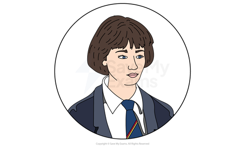
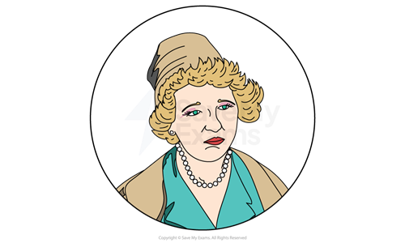
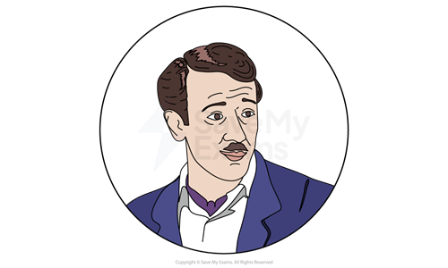
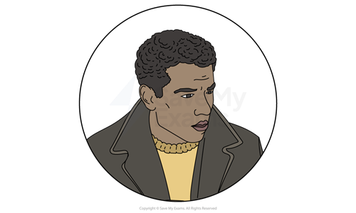

# A Taste of Honey: Characters

## A Taste of Honey: Characters

> **Spec point** — `spcpt_myTpkFtqQFNPVfvN`

## Characters

It is vital that you understand that characters are often used [symbolically](https://www.savemyexams.com/glossary/gcse/english-language/symbolism-definition/) to express ideas. Delaney uses her characters to symbolise various ideas prevalent in her society, and the differences between characters reflect contemporary debates. Therefore it is very useful not only to learn about each character individually but how they compare and contrast to other characters in the play. Below you will find character profiles of:

- **Jo**
- **Helen**
- **Peter Smith**
- **The minor characters of Geof Ingram and The Boy (Jimmie)**

The exam question on A Taste of Honey could ask you to focus on either a theme or a character. Understanding Shelagh Delaney’s choices when devising characters will help you write a convincing analysis and exploration.

It is important to remember that characters represent a group of people or a particular set of attitudes. The way they respond to their environments, the relationships they have, and their speech patterns raise issues and allow writers to explore themes.

Below you will find character profiles of:

**Main characters**

- Jo
- Helen
- Peter Smith

**Other characters**

- The Boy (Jimmie)
- Geof Ingram

## A Taste of Honey: Characters: Jo

> **Spec point** — `spcpt_T8xgYCYRqPNJmh4x`

## Jo

- Through Delaney’s teenage character, Jo, the writer explores ideas about growing up as a girl in 1950s England
- She is desperate for independence and resentful of her mother’s life choices:

  - She is determined to live her life differently to her mother
  - She repeatedly says she will not marry
- Her defiance towards her mother reflects the continual conflict in her home:

  - She tells her mother that she is “ruining [her] life”
  - In response to her mother’s criticisms of her, she stands up for herself by insulting her mother
- Jo is neglected and abandoned:

  - This weakens her physically and emotionally
  - She is underfed and thin even when she is pregnant
  - She says she is “sick” of her mother, and “sick of love”
  - She is uncertain about her future and fearful of becoming a “woman”
- Delaney presents a cycle of poverty through Jo’s character:

  - Her desire for independence is hampered by her mother throughout the play
  - She leaves school early to find a job to “get out” of her mother’s “sight”
  - Although Jo forms a supportive relationship with Geof, her mother’s arrival ruins it, which leaves Jo, once again, without support
- Delaney illustrates how Jo’s experiences with her mother have a profound effect:

  - She often repeats her mother’s words back to her: “You told me not to trust men calling themselves Smith”

> **Exam Hint**
> Examiners suggest that you consider the structure of the play in your analysis. It is always useful to think about how characters are introduced, how they develop, and how the play ends in your answer.
> 
> It is a good idea to explore how a character behaves and speaks throughout the play in order to consider the way themes or ideas are presented. For example, despite Jo’s desire to be away from her mother, she and Helen are together at the start and at the end of the play, which reflects a repeated cycle of conflict.

## A Taste of Honey: Characters: Helen

> **Spec point** — `spcpt_vsN8fgPsNmDRfJrZ`

## Helen

- Delaney’s presentation of Helen, Jo’s mother, as a *working-class* single mother raises questions about society’s expectations of women
- She is presented as lazy and undisciplined with no natural maternal instincts:

  - She is introduced in stage directions as a “semi-whore” who makes a living with “immoral earnings”
  - She drinks too much, neglects the home and her daughter, and seeks financial help from men
- Helen’s changeable attitude to Jo reflects her turbulent life and unstable character:

  - She encourages Jo to pursue art, but insults her drawings
  - She comes to help Jo with her pregnancy, and then leaves
- Helen is about 40 years old, but other characters often imply she looks older than she is:

  - Jo says she looks like a “well-preserved sixty”
  - This presents the physical effects of a *working-class* life
  - It also illustrates sexist attitudes regarding a woman’s appearance
- Jo and Peter’s criticism of her is brushed off with cruel or witty remarks:
- Her response is often *self-deprecating*:

  - “It takes me all my time to look after myself, I know that”
- She is dramatic and self-pitying:

  - “It’s terrible when you’ve got a cold, isn’t it?”

## A Taste of Honey: Characters: Peter Smith

> **Spec point** — `spcpt_yZJtQn7wpTtpkHFc`

## Peter Smith

- Peter Smith is introduced as a “brash car salesman” with a “cigar in mouth”
- His function in the play is to represent *patriarchal* attitudes, materialism, and class privilege in 1950s England:

  - His position in life is secure, and his attitude to women is sexist
  - He indicates his sexual attraction to Helen while criticising her home, age, and *promiscuity*, calling her “fantastic” and, also, a “game old bird”
- Delaney presents him as an unsympathetic *middle-class* man:

  - His insults extend to Jo, whom he calls a “snotty-nosed daughter”, old enough to look after herself, and threatens to kick Helen out if Jo comes to stay
  - He is *homophobic* to Geof, whom he calls a “little fruitcake parcel”
- His relationship with Helen illustrates power imbalances regarding class and gender:

  - He tells Helen that she needs him and is lucky to have him
  - His “wallet” and “big, white house” tempt Helen to marry him
- Delaney [foreshadows](https://www.savemyexams.com/glossary/gcse/english-language/foreshadowing-definition/) the doomed marriage and presents him as a danger:

  - Jo finds pictures of other women in his wallet
  - His arrival at their flat is unexpected:
  
    - Jo comments that he is the reason they had to move
  - When Helen asks him how he found her, he replies: “Did you think you could escape me, dear?”

> **Exam Hint**
> One of the things examiners will be looking for in your response to the question on A Taste of Honey is how Shelagh Delaney uses characters to explore ideas and convey themes.
> 
> To do this well, examiners suggest you analyse “contrasts and parallels in characters”. For example, Geof and Peter contrast each other in order to raise questions about discrimination. While Peter, a heterosexual man, is rude and uncaring, Geof, as a homosexual man, is presented as a strong male role model who protects Jo.

## A Taste of Honey: Characters: Other characters

> **Spec point** — `spcpt_JXf4847p8Q2bRxnf`

## Other characters

### The Boy (Jimmie)

- Jimmie, Jo’s boyfriend, represents themes of racial discrimination
- The script refers to him as “Boy”, although Jo calls him Jimmie once in the play:

  - This implies his innocence and youth
  - It highlights his *marginalisation*
  - He tells Jo that Helen will only see him as a “coloured boy”
- Delaney implies that Jo’s relationship with him is part of a rebellion against society:

  - While she says she does not care about his race, her comments hint at unconscious bias, and this implies she uses him to defy norms
  - She tells Geof he is a “Prince, son of a chieftain”
  - Although he is from Cardiff, Jo says he is from “darkest Africa”
- Delaney presents him as well-intentioned, but unreliable
- His relationship with Jo is affectionate and loving:

  - He is a former nurse
- Jo says she does not expect to see him again when his *national service* takes him away from her and his unborn child

### Geof Ingram

- Geoffrey Ingram, or Geof, is an art student and friend of Jo:

  - He is a good role model to her, and offers her support and advice
  - He cleans her flat, advises her on motherhood, teaches her nursery [rhymes](https://www.savemyexams.com/glossary/gcse/english-language/rhyme/), and is brutally honest with her
- He is a sympathetic character who experiences prejudicial treatment as a result of his homosexuality:

  - He has been evicted from his flat because of his homosexuality
  - He is called derogatory names by Helen and Peter (“pansified little freak” and “fruitcake”)
- Jo’s relationship with Geof is presented as complex to highlight the impact of discrimination:

  - While Jo sees Geof as a source of protection from predatory men, Geof sees marriage as a form of safety
  - He expresses his need for her: “Before I met you I didn't care one way or the other — I didn't care whether I lived or died”
  - However, Jo refuses a more intimate relationship with him: “You're nothing to me. I'm everything to myself”
- Geof’s role in the play is *poignant*: he contributes to the dark ending that leaves them both with uncertain futures:

  - His departure, encouraged by Helen, happens without Jo’s knowledge
  - He tells Helen: “She can't cope with the two of us”, and leaves
  - However, the final scene shows Jo smiling and thinking of him

### Sources

Delaney, Shelagh (2008), *A Taste Of Honey* (Edited by Glenda Leeming and Elaine Aston), Bloomsbury Academic.
