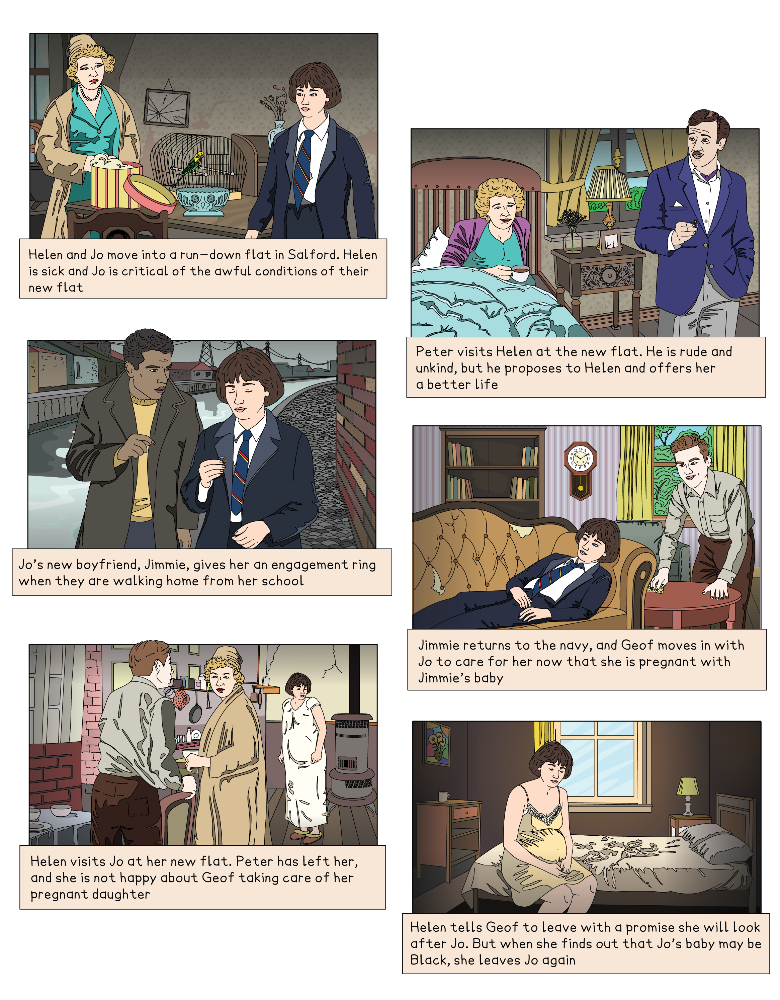

# A Taste of Honey: Plot Summary

## A Taste of Honey: Plot summary

> **Spec point** — `spcpt_yMnMkqJCRWg7shn5`

## Plot Summary

One of the most vital and helpful things you can do in preparation for the exam is to ‘know’ the plot of A Taste of Honey thoroughly. Once you know the text well, you should be comfortable and familiar with key events that you can then link to larger ideas. Having an in-depth knowledge and understanding of the text will help you to gain confidence to find the most relevant references to support your response.

Below you will find:

- **A storyboard of the plot**
- **A general overview of the whole play**
- **Detailed summaries by scene**

To prepare for the question on Shelagh Delaney’s A Taste of Honey, it is best to have a thorough knowledge of the plot. While the exam question does not require you to simply recount the events in the play, it does require you to use your knowledge of the plot to form a structural analysis, which means you should consider how themes and characters develop (or not) through to the play’s end.

Below you will find:

- **a storyboard of the plot**
- **a general overview of the whole play**
- **detailed summaries by scene**

## A Taste of Honey: Plot summary: Plot storyboard

> **Spec point** — `spcpt_zYhtYFX4B2vj4wJv`

## A Taste of Honey: Plot storyboard

*Storyboard of the major events in A Taste of Honey*

## A Taste of Honey: Plot summary: Overview of a taste of honey

> **Spec point** — `spcpt_cfhtn42JGhy6dDCP`

## Overview of A Taste of Honey

Shelagh Delaney’s play, A Taste of Honey, was written in 1958 when she was 18 years old. At the time, its criticism of a discriminatory society was received as controversial. The play is set in an industrial town near Manchester and depicts the struggles of two women (although dialogue often hints at the difficulties of anyone living in the town).

Delaney depicts Helen as a woman trapped in a cycle of unstable relationships, shaped by her pursuit of financial security and male attention. Her neglect of Jo stems from this dependency and her own disillusionment. As a result, Jo and her mother Helen find themselves arguing and mocking each other due to their bitter disappointments about life. Helen’s decision to marry Peter Smith, an untrustworthy car salesman, is doomed. She marries him for money, and he marries her for sex.

Jo is a malnourished and neglected daughter who has to fend for herself, live in poor conditions, move frequently, and face her future without support. Her creative talents are stifled by the instability and poverty of her upbringing. She is often left alone to fend for herself while her mother is with men. She has to travel miles to school and decides to leave education early to get a job so she can begin a life that bears no resemblance to that of her mother’s.  Helen’s poor parenting and failed romances leave her daughter *cynical* and ill-equipped to face life on her own.

The women’s desire for independence and *autonomy* is hindered by romantic relationships with heterosexual men who abandon them and their children. When Jo falls pregnant from a relationship with a sailor in the navy, she is left struggling in a small and rundown flat. It is a much-maligned homosexual friend, Geof, who offers Jo support with her home and pregnancy, and gives her advice on motherhood. However, Helen, whose new marriage breaks down, forces Geof to leave. While she promises to care for Jo, she soon leaves when she finds out the baby may not be white. The play depicts a cycle of poverty and isolation through its portrayal of socially stigmatised characters.

## A Taste of Honey: Plot summary: Scene-by-scene plot summary

> **Spec point** — `spcpt_DkJW4Td25pbwKW9G`

## A Taste of Honey: Scene-by-scene plot summary

### Act 1, Scene 1

- The play’s [exposition](https://www.savemyexams.com/glossary/gcse/english-language/exposition-definition/) portrays a single mother and her teenage daughter moving into a “comfortless flat”
- The flat, in an industrial district in Salford, Lancashire, is “falling apart” and there is “no heating”:

  - Audiences learn they have to move a lot, which leaves Jo feeling insecure
  - Jo criticises Helen’s choices, suggesting she spends too much time with men and is an unstable, reluctant mother
- Helen is sick:

  - She has a cold, but the troubled Jo feels little sympathy
- Their situation is a result of Helen’s history with “fancy men” (her casual affairs):

  - Towards the end of the scene Helen’s past lover, Peter, arrives
  - It is made clear Helen moved to escape him
  - Despite their poor relationship and much to Jo’s disgust, Peter proposes to Helen

### Act 1, Scene 2

- The scene begins with Jo and her boyfriend, a Black sailor, walking together:

  - He has met her after school
- The “Boy” proposes to her and gives her an engagement ring:

  - She accepts, although she puts it around her neck
- They discuss Jo’s mother, and the fact he is going drinking that night before he resumes *national service*
- In the flat, Helen and Jo discuss the relationship and pornography in modern films:

  - Jo asks about her father, who Helen says was a “a bit stupid”
- Peter arrives, and he, Jo and Helen insult each other:

  - Nevertheless, Peter says Helen looks “fantastic”, and they plan a honeymoon
  - Jo is to be left alone while they are away
- Jo’s boyfriend visits and they dance and say goodbye as he must return to the navy

> **Exam Hint**
> It’s useful to remember that examiners reward the use of quotes to back up your argument. This means that the exam does not test your ability to remember strings of quotations, but, rather, wants you to support a clear interpretation of the theme or character in the question.
> 
> Remember, the term “references” is not limited to quotations. You can also refer to key scenes and events. For instance, you could write, “In Delaney’s play, sarcastic comments between Jo and Helen create dark comedy while illustrating how characters build defensive walls to manage personal criticisms”.

### Act 2, Scene 1

- Act 2 begins a few months later
- Jo's pregnancy is now “quite obvious”
- Stage directions state that “fairground music” is playing as Jo and her new friend Geof play with “balloons”
- Geof, an art student, helps Jo prepare for the baby
- Geof cooks and talks to Jo about motherhood
- He has been evicted by his landlady:

  - It is implied this is because he is homosexual
- They discuss Helen who is now living “in a big, white house somewhere”
- Geof attempts a romantic relationship, but Jo declines:

  - She says she feels safer as just friends
- Helen visits, having learnt that Jo is pregnant
- She asks Peter if Jo can move in with them, but he refuses

### Act 2, Scene 2

- The scene begins a few months later
- Geof “dances in with a mop” as he cleans Jo’s flat:

  - The scene is happy and hopeful
- They discuss Jo’s boyfriend, and her father
- When Helen arrives, she reveals Peter has left her for another woman
- She persuades Geof to move out without Jo’s consent
- Helen becomes upset when she finds out Jo’s baby will be Black and leaves to go for a drink
- The play ends with Jo alone, smiling to herself about Geof:

  - She sings a song to her unborn baby, a song Geof taught her

### Sources

Delaney, Shelagh (2008), *A Taste Of Honey* (Edited by Glenda Leeming and Elaine Aston), Bloomsbury Academic.
