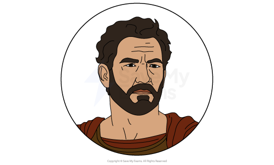
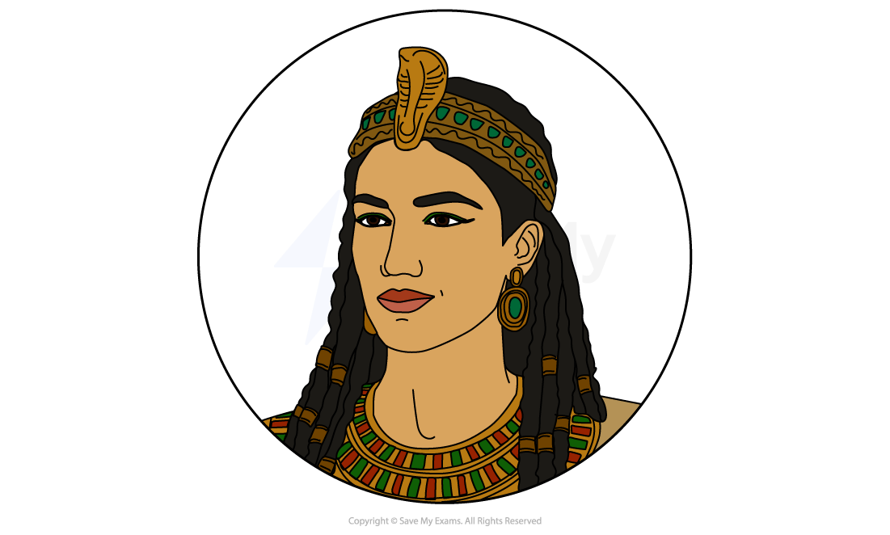
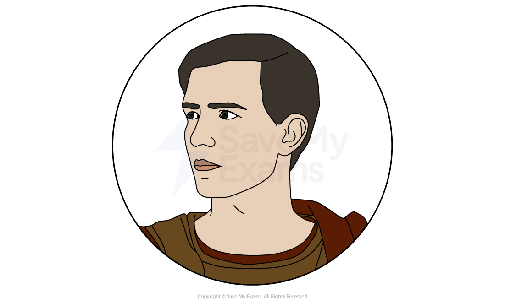
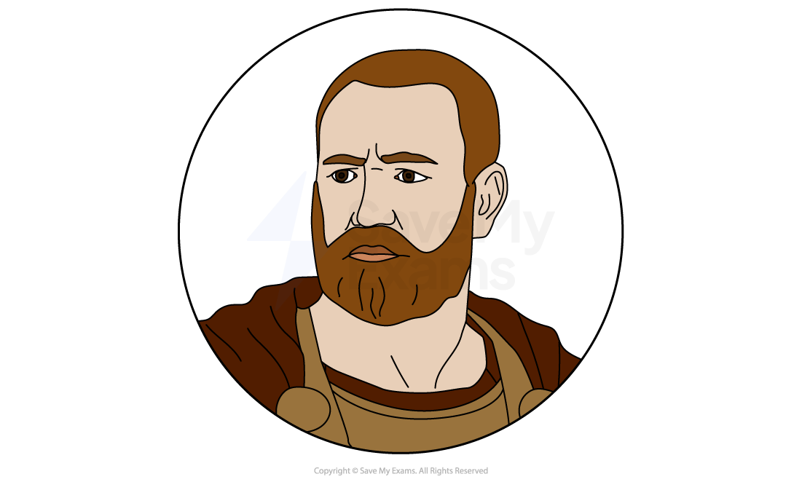
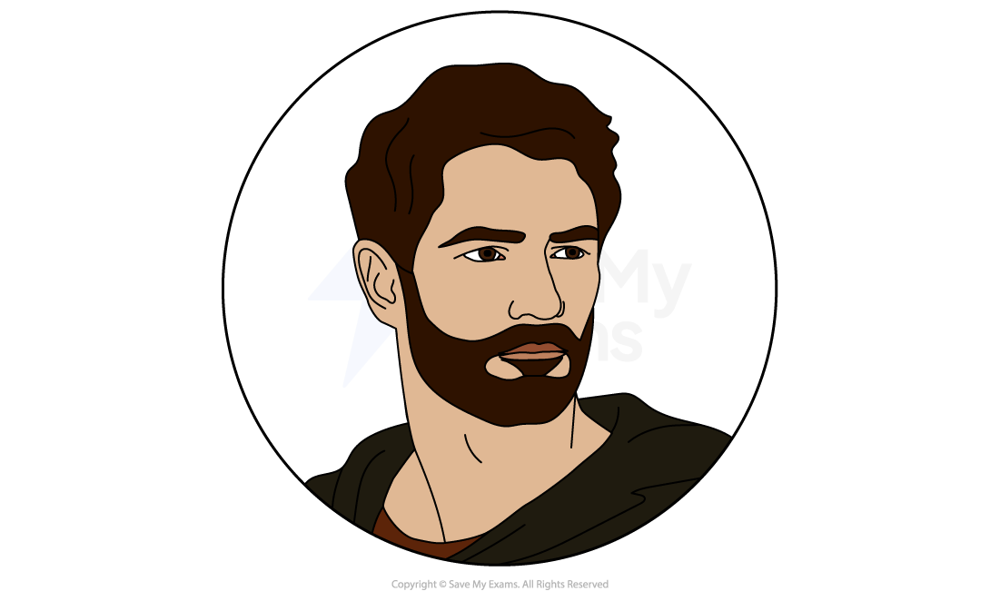
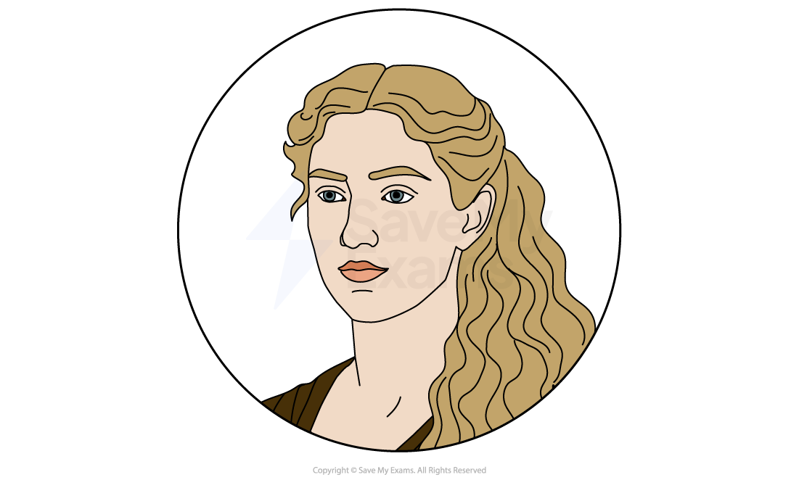
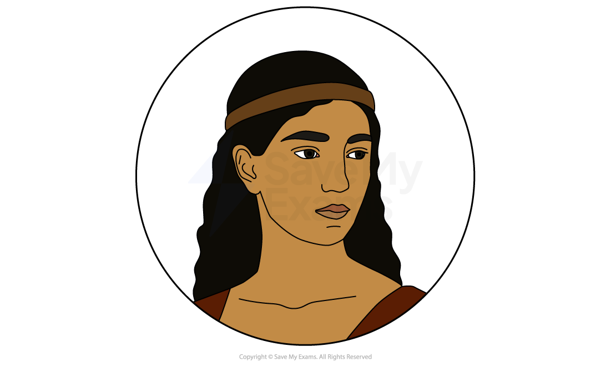

# Antony and Cleopatra: Characters

The exam question on Antony and Cleopatra may ask you to focus on a particular character or theme. Understanding Shakespeare’s choices in shaping these figures, and the worlds in which they inhabit, will help you produce a convincing analysis and interpretation.

It is important to remember, especially with Shakespeare, that characters can be used to represent ideas, a group of people, or attitudes. The way the characters respond to their environments, the pressures placed upon them, and the language they use raises important questions and allows Shakespeare to explore key themes.

Below you will find character profiles of:

### Main characters

- Mark Antony
- Cleopatra
- Octavius Caesar

### Other characters

- Lepidus
- Enobarbus
- Pompey
- Octavia
- Ventidius
- Eros
- The Soothsayer
- Charmian

## Antony and Cleopatra: Characters: Main characters

> **Spec point** — `spcpt_dgsXkTkRzfhZycsC`

## Main characters

### Mark Antony (Antony)

- Mark Antony is one third of the triumvirate who share power in Ancient Rome at the time of the play, alongside Octavius and Lepidus:

  - They are the second triumvirate, having taken power following the assassination of Julius Caesar
- He was first depicted by Shakespeare in Julius Caesar, as the heroic Roman general who fought off the assassins Brutus and Cassius
- He is presented in this play as a man who has left behind the figure he was in Julius Caesar:

  - From the start, he is seen to neglect his duties in Rome, including his wife, Fulvia
- He has fallen heavily in love with Cleopatra and found his happiness and focus much more taken with the life he lives with her in Egypt:

  - He often appears under her control, and is mocked outside of Egypt as her toy, and as more woman than man
  - The pair lead an indulgent life, different to his disciplined time in Rome
- To his men, he still remains the great general he was, and is beloved by them:

  - They serve him with great loyalty to the end
  - As such, when Enobarbus betrays him, it feels as though his final remaining support has been taken away
  - Enobarbus regrets his actions afterwards, such is his love for his general
- He is a complicated man, torn between the freedom of Egypt and the duty of Rome:

  - In this play, we see him as a long way from the phenomenal general he was, and his decision-making is flawed:
  
    - The mistakes he makes in battle, including a lack of preparation and a casual attitude to letting Cleopatra join the naval fleet, are all blamed on his indulgence of Cleopatra and the indulgent lifestyle in Egypt
- His downfall comes as he allows his newfound freedom to affect the battles he is to face:

  - When Cleopatra flees the naval battle in Actium, he turns and follows:
  
    - This shows his priorities
  - However, he is angered by her retreat, and we see a bit of the old, dominant figure he was
  - He loses his next battle with Octavius, but dies because he hears of Cleopatra’s death, and resolves to join her in death and kill himself
- Shakespeare presents him as a man who is lost to his love for Cleopatra, and by following her to suicide, this becomes true:

  - However, this does not take away from the love shown between the pair during the play, and their tragic demise is seen as the ultimate act of loyalty to each other

> **Exam Hint**
> When revising characters, do not think of them as fixed or one-dimensional. Examiners want to see that you understand how characters change across the play and how their decisions shape the plot and key themes in Antony and Cleopatra.
> 
> Try to learn a few key traits for each main character, but also think about their conflicts and contradictions. For example, Antony is both a powerful Roman leader and a passionate lover, and Cleopatra is both a ruler and a romantic partner. Showing these different sides of a character helps you write a more thoughtful and developed response in the exam.

### Cleopatra

- Cleopatra is the Queen of Egypt:

  - Cleopatra is powerful in both position and character, confident in her position as leader of a Greek dynasty that has ruled for centuries
- Cleopatra has fallen for Antony as Antony has fallen for her, but she is seen as the one in control of the relationship:

  - This relationship is the play’s emotional centre
  - Her character appears unchanged in the relationship, in contrast to Antony
- Cleopatra is dramatic and theatrical, strong and powerful, and is comfortable expressing her sexuality:

  - Within all this, she can be quite manipulative, and uses Antony’s love for her to her advantage, calling it into question when she wants to get her way
- Throughout, she is referred to as beautiful. She is also charming and charismatic.
- She does not seem interested in the politics of Rome and the conquests of the Romans:

  - She appears to have no interest in fighting with Rome for the sake of power or expansion, and does not have the same need to prove herself in battle as the ruling men do

- She can be rude and cruel to people like messengers and others of similar reputation
- She appears to signify the freedoms of Egypt:

  - The cynical mockery of her from Rome may have reflected the attitudes of Shakespeare’s audience, dismissive of freer lifestyles
- At times she appears naive to the realities of a situation, especially when she insists on being present at the naval battle, only to flee in the face of the brutality
- She is later brave, and appears noble as she chooses death over the prospect of mockery in Rome as a symbol of Octavius’ conquest:

  - She faces her death with resolve, not wavering even when tempted with promises of respect and honour by Octavius
  - Whilst her love for Antony feels in doubt for much of the play, it is clear by the end that it was true

### Octavius Caesar

- Octavius Caesar is the adoptive son of Julius Caesar and one third of the triumvirate ruling Rome at the start of the play
- He is presented as an [antagonist](https://www.savemyexams.com/glossary/gcse/english-language/antagonist-definition/) but not necessarily evil or wrong, just in opposition to the play’s leads
- As Cleopatra represents the change in Antony and the freer lifestyle, Octavius represents how Antony was in Rome:

  - He is disciplined, strong, powerful, self-restrained and calculating
- Octavius is ambitious, moving on quickly from defeating Pompey to cast Lepidus aside and then go for Antony:

  - This is not malice or a violent nature, but political ambition
  - He sees himself as the single ruling figure that Rome needs to achieve further greatness
  - As such, war is a necessary evil, the means to an end rather than his goal itself
- Octavius profits from Antony’s distraction:

  - It is suggested he is not as competent a general as Antony, and his forces are not overwhelming on land
  - However, he remains focused, whereas Antony no longer takes his military role seriously
- Towards the end, we see further evidence of his character as he approaches Antony and Cleopatra in victory:

  - Whilst he does want to parade Cleopatra in Rome to show off his victory and his power, the respect he has for both in their deaths shows he has a sense of honour
  - It suggests his desire to parade Cleopatra comes from a belief it will solidify his power, not just a desire for mockery
  - He orders the pair be buried together, and plans to attend their funerals, showing his respect for honourable opponents

## Antony and Cleopatra: Characters: Other characters

> **Spec point** — `spcpt_zZTvrrphB4YSJHnh`

## Other characters

### M. Aemilius Lepidus (Lepidus)

- The weakest of the **triumvirate**, his character receives none of the attention of either Antony or Octavius:

  - We learn little about him, and there is never any suggestion that he may come to power
- He allies with Octavius over Antony:

  - This is a mistake, as Octavius disposes of him as quickly as he can once Pompey is beaten
  - He is not even killed, just quietly pushed aside, not appearing again
- His most notable moment is getting very drunk on Pompey’s ship:

  - He is so drunk that he is physically carried away by servants
  - This incident is his final act of the play, and he is banished soon after

### Domitius Enobarbus (Enobarbus)

- Enobarbus is an officer, a loyal follower of Antony’s, and his most trusted ally
- Whilst he is a friend of Antony’s, he grows more and more cynical towards Antony and Cleopatra, their lavish behaviour and relaxed approach to the conflicts coming:

  - He is often an observer of their conversations and activities, and offers asides that the audience hear, and others in the play do not
- He appears to understand that Cleopatra is beautiful and entrancing
- He feels comfortable addressing Antony truthfully, but as his trust in him falters, he chooses to leave his friend and join Octavius:

  - He does this to give himself a chance at survival, prioritising that over his friendship
  - Ironically, it is this that leads to his demise:
  
    - Enobarbus finds that Octavius treats him with little respect, whilst he is shocked and overwhelmed by the kindness of Antony to send his treasures on to him when he leaves
    - Enobarbus is overcome with grief as he regrets his betrayal of his friend
    - He dies alone, effectively of a broken spirit at his despair

### Sextus Pompeius (Pompey)

- Son of Pompey the Great, the popular Roman general who was part of the first **triumvirate**, alongside Julius Caesar:

  - Pompey is the initial threat to the power of the **triumvirate**
- Whilst it appears at one point that the **triumvirate** has made peace with Pompey, that quickly fails and they go to war:

  - He is presented with the opportunity to kill all three of the **triumvirate** when they are aboard his ship making peace, but refuses to do so out of a sense of honour
- Pompey is powerful by sea and presents a credible threat:

  - This threat maintains the alliance of the **triumvirate**
- He is defeated:

  - Once defeated, this signals the beginning of the end for the **triumvirate**, who no longer act as allies with no threat keeping them together

### Octavia

- Octavia is Octavius’ sister
- She marries Antony after the death of his wife Fulvia:

  - She appears unaware that this is a marriage of political convenience, and that Antony has no intention of leaving Cleopatra for her
- Once Antony and Octavius begin to rival each other, her loyalty is torn between her husband and her brother:

  - Once she goes to Rome to be with Octavius, she finds out that Antony has left her behind to be with Cleopatra, so she stays with Octavius
- She is given very little personality or character, and is as much a prop in the play as she is a prop in the lives of Antony and Octavius

### Ventidius

- Ventidius does not have a big role, but [symbolises](https://www.savemyexams.com/glossary/gcse/english-language/symbolism-definition/) the cynical political behaviour of the era:

  - Ventidius is victorious against the Parthian Empire, a notable enemy of Rome
  - He is wary of being seen as too successful and making too much of a name for himself:
  
    - He believes that this could cause envy or fear from others, and he could be killed or imprisoned to ensure he does not rise further

### Eros

- An attendant of Antony
- Loyal to his leader, to the extent that when Antony asks Eros to kill him after Octavius’ victory, Eros instead kills himself

### The Soothsayer

- Predicts ill fate for many of the characters, and is proven correct:

  - Tells Antony that he will lose any contest with Octavius
  - Predicts that Charmian will outlive Cleopatra, which she does, but only by mere moments in the end

### Charmian

- Most notable attendant to Cleopatra, possibly a friend:

  - Devoted enough that she chooses suicide alongside Cleopatra
  - Her last words are direct from Plutarch, the source for much of Shakespeare’s historical writing

#### Sources

Shakespeare, W., Munday, A., Fletcher, J., Middleton, T., Heywood, T., Peele, G., Dekker, T., Wilkins, G., & Chettle, H. (2005). The Oxford Shakespeare: The Complete Works (Second Edition). In Oxford University Press eBooks. [https://doi.org/10.1093/actrade/9780199267170.book.1](https://doi.org/10.1093/actrade/9780199267170.book.1)
