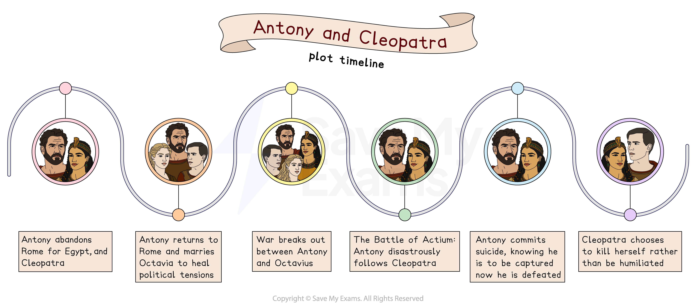

# Antony and Cleopatra: Plot Summary

To prepare for a question on Shakespeare’s Antony and Cleopatra, it is important to have a clear understanding of the play’s plot. Although the exam will not ask you to plainly retell the story, you will need to use your knowledge of what happens to support a structural analysis and evidence your arguments. This means thinking about how characters, ideas, and conflicts develop across the play, and how the shifting power struggles and the lovers’ choices lead to the final tragedy.

## Antony and Cleopatra: Plot storyboard

> **Spec point** — `spcpt_scpC2vHTpRgHJY88`

## Antony and Cleopatra: Plot storyboard

*Antony and Cleopatra plot timeline*

## Antony and Cleopatra: Overview of Antony and Cleopatra

> **Spec point** — `spcpt_6bx75SypKfPx7bBr`

## Overview of Antony and Cleopatra

Shakespeare’s Antony and Cleopatra was first performed in the early 1600s, during a period when England was fascinated by classical history and the politics of empire. It combines elements of  tragedy and history, and follows a loose continuation of the same historical narrative employed in his earlier play, Julius Caesar.

The story follows the turbulent relationship between Cleopatra, Egypt’s charismatic ruler, and Mark Antony, one of the three rulers of Rome, the *Triumvirate*, alongside Octavius Caesar and Lepidus. The tale spans locations across the Mediterranean world, contrasting the rigid discipline of Rome with the luxury and emotional intensity of Egypt.

Though political duties call him back to Rome, Antony remains in Egypt, captivated by Cleopatra. He eventually returns when the ambitious Sextus Pompeius (Pompey) threatens Rome’s stability. Once there, Antony marries Octavia, the sister of fellow leader Octavius Caesar. But after Pompey is defeated, Caesar sidelines Lepidus and then directs his hostility toward Antony. Octavia tries to repair the growing rift between her husband and her brother, but her efforts come to nothing, and Antony goes back to Cleopatra.

Antony decides to confront Caesar in a naval battle and includes Cleopatra’s fleet in his forces. When Cleopatra’s ships unexpectedly retreat, Antony abandons the fight to pursue her, leaving his soldiers behind. A second defeat at sea follows. Furious, he initially blames Cleopatra and intends to kill her, but when he hears (incorrectly) that she has died, he tries to take his own life. Mortally wounded, he is carried to Cleopatra and dies in her arms.

Knowing Caesar plans to parade her as a trophy in Rome, Cleopatra chooses to die on her own terms. She ends her life, joining Antony in death rather than living in captivity. By dying on her own terms, she stays loyal to Antony and avoids being controlled by Rome.

> **Exam Hint**
> Examiners want to see that you understand why events matter, not just what happens. As you move through the key moments of Antony and Cleopatra, think about how each event develops a character or a theme, such as love versus duty, power, loyalty, or identity.
> 
> Try to link each main event to a bigger idea in the play. For example, Antony’s decisions are not just personal choices, they also reflect the wider conflict between Roman values and Egyptian values. This shows the examiner that you understand the plot as part of Shakespeare’s overall message, not just a sequence of events.

## Antony and Cleopatra: Scene-by-scene plot summary

> **Spec point** — `spcpt_nyTDs3KDH543WtRG`

## Antony and Cleopatra: Scene-by-scene plot summary

### Act 1 Scene 1

- The play starts with two Roman soldiers discussing how Antony has gone from strong general to a “strumpet’s fool”:

  - They question whether his love for Cleopatra and their luxurious lifestyle may have made him weak
- Antony and Cleopatra enter:

  - As Antony fawns over the Egyptian queen, a messenger brings news from Rome

- Antony is disinterested, suggesting he is happy to let Rome “melt” and the “empire fall”:

  - The messenger is ignored and dismissed, indicating how Antony is disregarding his duty
- Alone again, the soldiers question Antony’s disrespect of Octavius, thinking the leader does not appear himself

### Act 1 Scene 2

- The scene begins with Enobarbus, a *Soothsayer*, Charmian, Iras, Mardian the *eunuch*, Alexas, and servants
- Charmian, Alexas, and Iras, servants of Cleopatra, speak to the *soothsayer*, eager to learn of their futures:

  - He predicts they will outlive Cleopatra, but does not predict positive fortunes

- Antony enters at this moment, and finally hears the news from Rome
- Antony’s wife, Fulvia, had gone to war with Antony’s brother, Lucius, but then allied with him to fight Octavius
- Octavius defeated both, and the messenger then reveals that Antony has lost part of Asia to Labienus
- Another messenger brings news that Fulvia has died
- Antony tells Enobarbus that he needs to leave, as the business that Fulvia had started in Rome “cannot endure my absence.”
- He tells Enobarbus that the son of Pompey the Great, Sextus Pompeius, is growing in power

### Act 1 Scene 3

- Antony enters, ready to tell Cleopatra he must leave, but she barely lets him speak as she *laments* how she has been betrayed by him:

  - He eventually tells her he must return to Rome
- Cleopatra is taken aback by how calm he seems at the death of his wife, and says she knows now how he will react to her own passing
- She accepts his leaving, saying his “honor calls him hence” and to be “deaf to my unpitied folly,” to which Antony tells her he will remain with her in spirit, and her with him

### Act 1 Scene 4

- In Rome, Octavius Caesar talks with Lepidus about Antony, complaining about his behaviour in Egypt:

  - He calls Antony as manly as Cleopatra, and Cleopatra as womanly as Antony
- Lepidus responds to defend Antony, saying his “evils” do not “darken all his goodness”
- Octavius continues to complain, frustrated that they must deal with political and military problems whilst Antony indulges himself in Egypt
- A messenger enters and brings news that Pompey has grown strong at sea:

  - Pompey appears to be gaining support from people who were once afraid of Octavius
- A second messenger brings news that pirates are also gaining strength at sea
- Octavius and Lepidus agree to meet the next day to discuss what to do about Pompey

### Act 1 Scene 5

- The scene takes us back to Egypt, with Cleopatra, Charmian, Iras, and Mardian
- Cleopatra asks for Charmian to bring her *mandragora* to drink, in the hope she can sleep until Antony returns
- As Cleopatra talks of Antony and other lovers of her past, Alexas enters with a gift and message from Antony
- She talks about how she loves him more than she did Julius Caesar, then chastises Charmian for complimenting Caesar
- She calls for ink and paper, planning to write to Antony every day

### Act 2 Scene 1

- Pompey appears for the first time, discussing the problems in Rome, and how they may come to his advantage:

  - He says Antony is distracted by Egypt, Octavius takes wealth from his people, and Lepidus has no loyalty to either man
- Menas warns that Octavius and Lepidus are in the field and have an army of “mighty strength”
- Pompey dismisses this, claiming he knows that they are in Rome waiting for Antony, but hopes that Antony will stay in Egypt under the control of Cleopatra
- At that moment, Varrius enters to bring news that Antony is on his way to Rome
- Pompey shows surprise that Antony has left, and concern that his army is double that of his allies

### Act 2 Scene 2

- In Rome, Lepidus and Enobarbus speak ahead of a meeting between Octavius and Antony
- Antony enters with Ventidius, and then Octavius with his friends Agrippa and Maecenas
- Octavius is angry about Antony’s time in Egypt, and that Antony’s wife and brother took up war against him in Rome
- Antony defends himself, saying that his brother did not consult him, and that his wife was causing drama to blight his stay in Egypt
- Agrippa comes up with a solution to the disharmony of the alliance: Antony could marry Octavia, Octavius’ sister, bringing them together as brothers:

  - Antony and Octavius agree

- It is also agreed they must take up arms against Pompey before he comes for them

### Act 2 Scene 3

- Antony tells Octavia that his business will sometimes lead him away from her, to which Octavia tells him she will pray for him whilst he is away
- Octavius and Octavia leave, and a *soothsayer* enters:

  - He tells Antony to return to Egypt and, after questioning, tells him that Octavius’ fortunes will fare better than his
- He warns Antony that he should not compete with Octavius, saying, “If thou dost play with him at any game/Thou art sure to lose”
- Antony decides to return to Egypt

### Act 2 Scene 4

- Lepidus, Agrippa and Maecenas prepare to fight Pompey

### Act 2 Scene 5

- In Egypt, Cleopatra spends idle time with her servants, joking that she may go fishing and pretend that each fish she catches is Antony
- A messenger comes from Italy, and reveals that Antony has married Octavia:

  - Cleopatra is furious, and reacts violently

### Act 2 Scene 6

- Octavius, Lepidus and Antony meet with Pompey in an attempt to find a *truce*
- They discuss the offer of compromise that has been sent in letters prior to this meeting:

  - Pompey may retain Sardinia and Sicily, if he rids the sea of pirates and sends wheat in tribute to Rome
- Pompey agrees to their terms, preventing war and dividing up Rome’s territories under their power
- Pompey proposes a celebration on his boat

### Act 2 Scene 7

- On Pompey’s boat, the men are enjoying a grand feast
- Menas tells Pompey he could kill Lepidus, Octavius and Antony now and take power for himself
- Pompey dismisses the idea:

  - He refuses the plan as it is dishonourable, and tells Menas to forget about it

### Act 3 Scene 1

- The scene begins with Ventidius, fresh off a military victory in Parthia, talking with a soldier named Silius, the dead body of Pacorus before them
- Silius suggests they should continue, and pursue the remaining Parthians through to Mesopotamia:

  - Ventidius declines, saying he has done enough for a man of his rank and does not want to catch unwelcome attention

### Act 3 Scene 2

- Agrippa and Enobarbus are in Rome, at the home of Octavius, discussing Octavia:

  - She does not want to leave Rome
- Caesar, Antony, Lepidus, and Octavia enter, with Octavius claiming he is sad to see his sister leave with Antony
- He asks that Antony ensures that his marriage to Octavia brings them closer together

### Act 3 Scene 3

- In Egypt, a messenger speaks to Cleopatra and Charmian
- He reports back that Octavia is shorter than Cleopatra, older, is widowed, has a low voice, lacks elegance, and has a round face
- Cleopatra is pleased, rewarding the messenger with gold

### Act 3 Scene 4

- Antony and Octavia are together at Antony’s house in Athens
- Antony complains about Octavius, annoyed that he has “waged / New wars ‘gainst Pompey”
- He is also upset that Octavius has not spoken of him when addressing the public
- Octavia is torn between her brother and her husband, so Antony sends her back to Rome to make peace
- Antony decides to raise an army in the meantime

### Act 3 Scene 5

- In a different area of Antony’s home, Eros tells Enobarnus that Octavius and Lepidus have fought and defeated Pompey, but Octavius took all of the credit, pushing Lepidus out
- Enobarbus suggests that now, in the wake of this, there is a chasm of power that both Antony and Octavius could fight for

### Act 3 Scene 6

- Octavius complains that Antony has established a kingdom in Egypt, showcasing himself and Cleopatra on golden chairs in public view, and declared Cleopatra queen of Egypt, Cyprus, Lydia and Syria:

  - He is also furious that Antony has declared his sons “the kings of kings” and given them territories
- Antony has publicly accused Octavius of not giving him his share of territories and land after the conquering of Pompey, and is unhappy at the treatment of Lepidus
- Octavius says he will not give Antony his share until he, Octavius, receives part of conquered territories in Armenia
- Octavia arrives and enters:

  - She comes to ask for pardon for Antony
- Octavius responds, telling her that Antony has gone back to Cleopatra
- Octavius claims he has not yet fought with Antony out of respect for her, but is now readying for war in response to his treatment of her

### Act 3 Scene 7

- Enobarbus and Cleopatra argue about her being with them in battle:

  - Enobarbus believes there is no place for her
  - Cleopatra dismisses this idea and says she will be there

- Antony and his commander Canidius enter
- Antony is adamant he will meet Octavius at sea, but is warned against it first by Canidius and then Enobarbus:
- Antony ignores their advice, committing to fighting at sea even as he is advised that he will be outmatched
- A soldier enters and begs that they do not fight at sea
- Antony is stubbornly insistent, almost casually so, and leaves with Cleopatra and Enobarbus

### Act 3 Scene 8

- By contrast, in nearby Actium, Octavius gives very specific orders to his commander Taurus, making sure that his armies do not fight on land before they have fought at sea

### Act 3 Scene 9

- Back with Antony and Enobarbus, Antony commands Enobarbus to send soldiers to a hill to count the ships in Octavius’ navy

### Act 3 Scene 10

- The navies battle at sea
- Enobarbus cries out in despair as Antony flees the battle
- Scarus enters, and describes to Enobarbus the state of the fight, saying it was even until Cleopatra suddenly fled, and Antony chose to follow her:

  - Both are disgusted by Antony’s act

- Canidius enters, saying they have lost, with Antony’s navy following their leader and fleeing:

  - He is going to surrender himself to Octavius
- Enobarbus resolves to continue supporting Antony, even though he thinks it a bad idea

### Act 3 Scene 11

- Now at Cleopatra’s palace, Antony is ashamed of his conduct after fleeing the battle
- He implores his watching attendants to leave him, to take some of his treasure and go “make your peace with Caesar”
- Cleopatra enters and begs that he forgive her for fleeing, claiming she did not expect him to follow:

  - He tells her that she knows he is bound to her, claiming that his heart is tied to her
- Antony decides to offer “humble treaties” and surrender to Octavius:

  - He now understands that his relationship with Cleopatra has weakened him

### Act 3 Scene 12

- An ambassador for Antony arrives at Octavius’ camp:

  - Antony surrenders and pleas to be left to live out his days in either Egypt or Athens as a “private man”
  - Cleopatra, too, begs for mercy, submits “to thy might”
- Octavius refuses Antony, but will allow Cleopatra to live, so long as she either kills Antony or drives him out of Egypt
- After the ambassador leaves, he calls Thidias to him, and tells him to go to Cleopatra and promise her whatever she wants to turn against Antony

### Act 3 Scene 13

- Antony enters with his ambassador, discussing Octavius’ reply:

  - He is angered by it, and sends back his ambassador with a counter: to face off in a duel, just the two of them
- Enobarbus does not believe Octavius will be foolish enough to give away his advantages to meet in a duel
- Thidias arrives and tells Cleopatra that Octavius believes she never loved Antony, just feared him, and forgives her for this:

  - She agrees that she did not give her honour, but that it was conquered
- Cleopatra surrenders to Thidias
- As she kisses Thidias’ hand, Antony re-enters with Enobarbus and is angered:

  - He orders servants to take Thidias away and whip him
- Antony then turns his anger to Cleopatra, shouting at her, claiming she has played with his love
- Antony asks Cleopatra if she would betray him for Octavius, and she says she would rather her and her children die
- This raises Antony’s spirits, convinced by her love, and he decides to meet Octavius on land for battle
- Enobarbus decides to leave Antony’s service

### Act 4 Scene 1

- Octavius ridicules Antony’s challenge to a duel
- Caesar directs his officers to prepare for the final conflict to end Antony

### Act 4 Scene 2

- At Cleopatra’s palace, Enobarbus informs Antony that Octavius will not fight him alone, as he has 20 men to every one of Antony’s
- Antony says he will fight him “by sea and land” and will live or die with honour:

  - Enobarbus says he fight alongside him

### Act 4 Scene 3

- Elsewhere in the palace, a group of soldiers talk, awaiting the battle
- They hear music, which they believe is coming from “under the earth”:

  - They interpret this as a sign that Hercules, the patron deity of Antony, is abandoning him

### Act 4 Scene 4

- The next day, the day of the battle, Eros puts on Antony’s armour
- He kisses Cleopatra goodbye before leaving with Eros and soldiers for
- Charmian and Cleopatra are alone, and Cleopatra wishes that Octavius had agreed to the duel rather than this battle

### Act 4 Scene 5

- At his military camp, Antony is informed by a soldier that Enobarbus has left, and has deserted him for Octavius
- Antony orders his “chests and treasures” left behind to be sent on to him, with a letter that shows his sadness that Antony’s bad fortunes have “corrupted honest men!”

### Act 4 Scene 6

- At Octavius’ camp, Octavius commands Agrippa to begin battle, claiming “universal peace is near”
- He orders that those who deserted Antony be put in the front lines, so that Antony’s men will be forced to face people they know
- Enobarbus *laments* his betrayal of Antony, feeling those who betrayed him have not been treated well by Octavius
- Then his treasure arrives, sent by his former leader:

  - Enobarbus is left regretting his decision even more than he did
- He decides not to fight Antony, but instead find some “ditch wherein to die.”

### Act 4 Scene 7

- Agrippa and the soldiers with him are forced to retreat
- After they exit, in come Antony with Scarus, who is wounded
- Eros enters and tells them that they are victorious

### Act 4 Scene 8

- In Alexandria, Antony celebrates with his soldiers
- Cleopatra enters, and Antony tells her of the victory, and of Scarus’ honour in battle:

  - Cleopatra promises armour made of gold to honour him
- Antony goes on to say that they will march through Alexandria to celebrate

### Act 4 Scene 9

- Back inside Octavius’ camp, Enobarbus repents for deserting Antony:

  - He speaks with much woe, begs for Antony’s forgiveness, then faints and dies

### Act 4 Scene 10

- Antony speaks proudly and powerfully about fighting Octavius’ army:

  - He prepares to fight them at sea once more

### Act 4 Scene 11

- Octavius  too prepares for battle, and looks to meet Antony by sea

### Act 4 Scene 12

- With battle due to commence, Antony and Scarus look out at sea from a high vantage point:

  - Scarus speaks of the swallows that have appeared in Cleopatra’s sails and built nests
  - He says the “*augurs*” are saying they do not know what this omen means, and he feels that they are too scared to speak their “grim” knowledge
- Antony returns, and is angered that Cleopatra has betrayed him again:

  - Octavious has defeated Antony’s fleet, and have joined with him
  - He believes this is Cleopatra’s doing, calling her “this false soul of Egypt”
- Cleopatra enters, wondering why Antony is so mad
- He says that Octavius will imprison her and have her humiliated on public display in the parade celebrating his victory
- She leaves, and Antony says that it would have been better had Cleopatra died, as it would have saved the lives of his men

### Act 4 Scene 13

- At the palace, Cleopatra complains that Antony is mad
- Charmian suggests she go to her already built monumental tomb and lock herself inside:

  - They will tell Antony she is dead
- She agrees, and asks Mardian to tell Antony that she has committed suicide, and the last word she spoke was his name

### Act 4 Scene 14

- Antony continues to blame his defeat on Cleopatra, reasoning he never loved her:

  - Mardian enters and argues against that, saying Cleopatra does love him
  - He then tells Antony that Cleopatra has killed herself, and uttered “Antony! Most noble Antony” as her final words
- Antony *laments* alone, and decides he will end his own life too, to be together in the afterlife
- He calls Eros back, and asks Eros to stab him so he can be with her:

  - Eros makes him turn around, so that he does not have to look him in the face and do it, but after saying farewell to him, Eros instead stabs himself
- Antony then stabs himself, but fails to kill himself outright
- A servant of Cleopatra, Diomedes, then enters and tells Antony that Cleopatra is alive and locked inside her monument
- Antony calls for his guards and asks them to carry him to Cleopatra

### Act 4 Scene 15

- At the tomb, Cleopatra insists to Charmian that she will never leave
- Diomedes enters, and she delivers the news of Antony’s near-death condition
- Antony is carried in by guards, and Cleopatra despairs:

  - Antony is proud that he has done this to himself, rather than being killed by Octavius
- Cleopatra says she will die with him, rather than be taken prisoner, but Antony tells her to “seek your honour, with your safety” with Octavius
- Cleopatra tells them that this is not possible as “they do not go together”
- Antony tells Cleopatra to remember him as “the greatest prince o’ the world”
- Antony dies, and Cleopatra faints, but then regains consciousness
- She orders that he be buried “after the high Roman fashion”

### Act 5 Scene 1

- Octavius sends demands for Antony’s surrender:

  - Dercetas returns, and tells him that Antony is dead, by suicide
- Octavius is saddened by the news, and Agrippa and Maecenas agree with him that he was an honourable man, even as an enemy
- An Egyptian messenger enters: Cleopatra wants to know Octavius’ intentions with her:

  - He says he will show her mercy
- After sending the Egyptian away, he tells one of his men to go to Cleopatra, and to promise her good treatment, so that she does not kill herself
- He wants to show her off in Rome as part of his victory parade
- He asks others to come with him to his tent, to see the letters he sent to Antony that show he was forced and “drawn into this war”

### Act 5 Scene 2

- At the tomb, Cleopatra resolves to die
- Octavius’ messengers arrive, and Cleopatra says she will surrender if Octavius allows her son to take over as ruler of Egypt:

  - Roman soldiers enter secretly and seize her
- Cleopatra draws a dagger to kill herself, but Proculeius disarms her
- After Proculeius leaves, Dolabella confirms Octavius’ intentions to use her as a prisoner to show off his victory
- Octavius enters:

  - He tells her that she will benefit if she surrenders, but threatens that suicide will leave her children at risk of harm

- Cleopatra tells Iras and Charmian that she feels Octavius is trying to stop her achieving a noble death
- Dolabella returns to tell her that the plan is to take her and her children to Syria in three days
- She sends Charmian and Iras to get her crown and best clothes, so that she looks her best to meet Antony in death
- Determined to defeat Octavius’ plans, Cleopatra welcomes a “rural fellow” who delivers a basket of figs containing asps, poisonous snakes that kill
- Dressed in her crown and royal robes, Cleopatra lets a snake bite her:

  - She dies calling out “O Antony!”
- Octavius arrives and acknowledges Cleopatra’s royal determination in choosing death
- He concludes the play by ordering her to be buried by Antony, uniting the “pair so famous”

#### Sources

Stanley Wells and Gary Taylor (eds), 2005, The Oxford Shakespeare: The Complete Works (Second Edition), Oxford University Press
