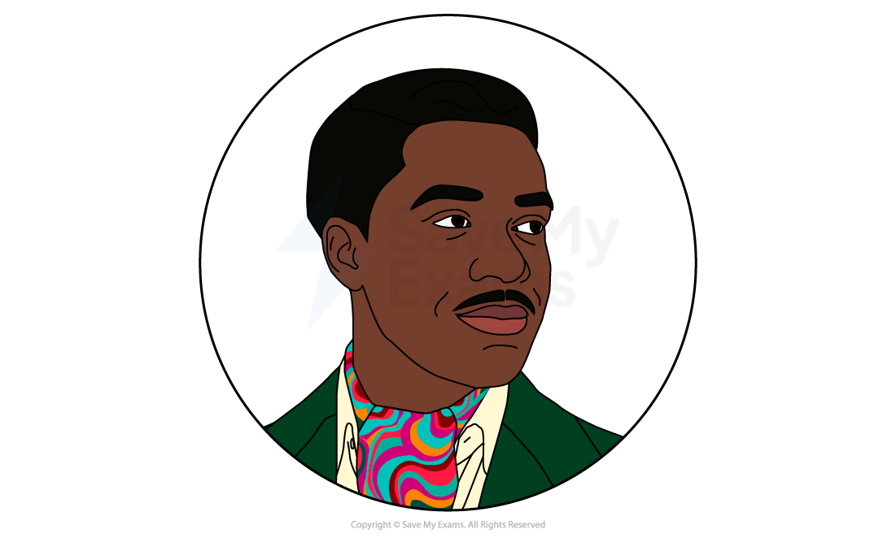
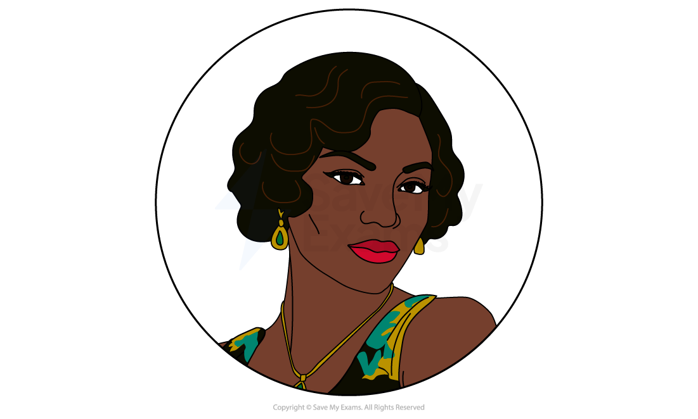
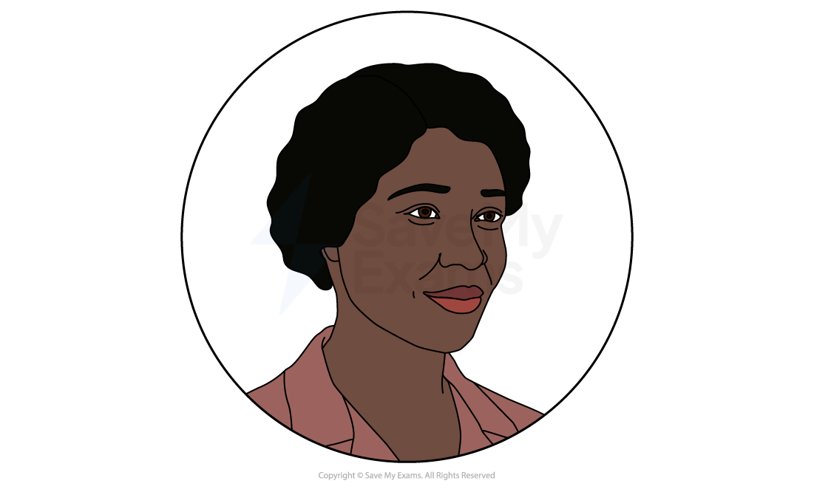
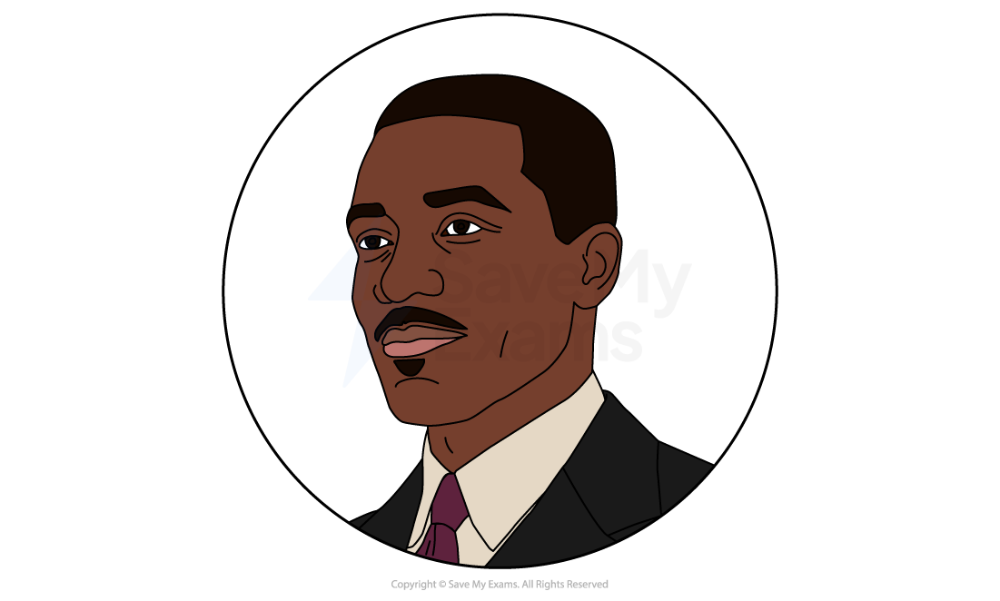
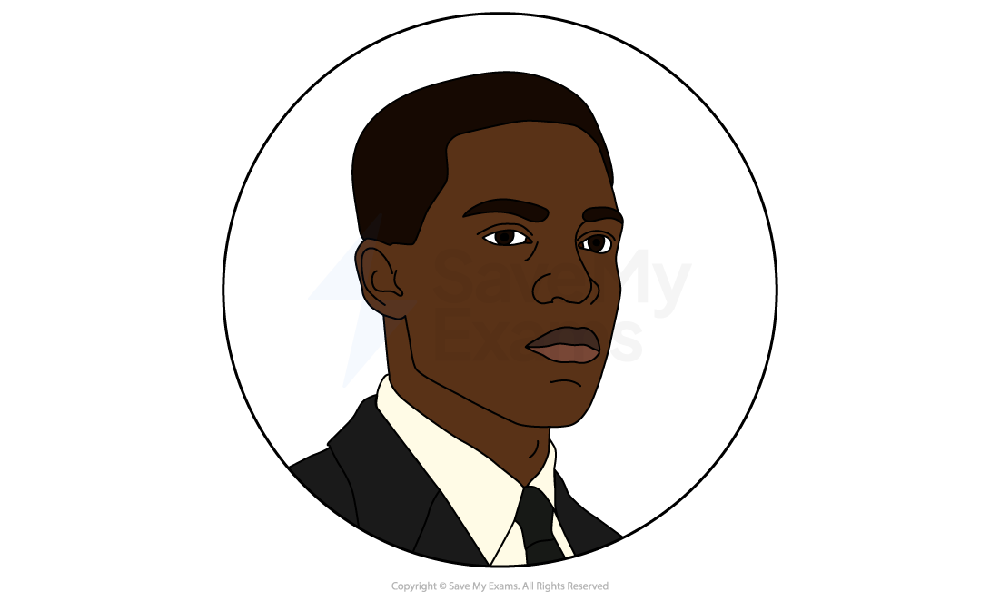

# Blues for an Alabama Sky: Characters

Exam questions on Blues for an Alabama Sky may ask you to focus on a particular theme or character. To answer effectively, it is essential to consider how Cleage develops her characters and constructs the particular world they inhabit, as this shapes both their choices and the play’s impact.

Characters in the play often represent broader ideas, communities, or social attitudes. Observing how they respond to challenges, navigate relationships, and use language reveals their personalities while also allowing Cleage to explore key themes such as identity, ambition, and the political tensions in Harlem during this period.

Below you will find profiles of:

- Guy
- Angel
- Delia
- Sam
- Leland

## Blues for an Alabama Sky: Characters: Guy

> **Spec point** — `spcpt_RNPDDT2qSVJNJd3v`

## Guy

- Guy is an openly gay costume designer
- He is proud, confident, and ambitious, dreaming of working for Josephine Baker in Paris
- He embodies the creative freedom and modernity of Harlem during the Renaissance, expressing his sexuality openly in ways unavailable elsewhere in America
- His glamour and flamboyance contrast with Angel’s reliance on men:

  - He uses his confidence as a form of self-expression rather than a mask
- For the audience, at times, Guy comes across as an idealistic dreamer:

  - His dream of moving to Paris perhaps seems far-fetched when compared to his current lifestyle
  - He seems to be *dissociating* from the difficulty of life by losing himself in thoughts of an escape to France
- Despite external threats, such as violence from conservative forces, he remains true to his identity and creative vision:

  - He is defiant, refusing to be cowed and act differently, even when he is assaulted in an apparent homophobic act
- Guy represents Harlem’s artistic promise:

  - He [symbolises](https://www.savemyexams.com/glossary/gcse/english-language/symbolism-definition/) the persistence of dreams, and the freedom to live authentically, even in a world shaped by economic and moral constraints
- He is also loyal to his friends:

  - Guy is comfortable supporting Angel, both emotionally and financially
  - When he is given the opportunity to move to France, he spends some of the money sent to him to buy a ticket for Angel to go with him
  - After she disappears, he pays the rent on his apartment to the end of the month, so that Angel has somewhere to live if she does come back
  - He quickly offers Delia the chance to take Angel’s place, showing his loyalty to all of his friends

## Blues for an Alabama Sky: Characters: Angel

> **Spec point** — `spcpt_QVJW9y5wWBFcyfsP`

## Angel

- Angel is a singer who has just lost her job as the play starts
- She struggles with navigating very typical things, like love, work, and economic survival
- From the outset, we see that Angel defines herself through the men in her life:

  - She loses her job because she insults her gangster lover and is keenly unaware how unstable that relationship was
  - Later, with Leland, she clings to him for stability, even though the pair are outwardly not a good match
  - He shows her interest, and that is enough for her, because he offers security
- She is glamorous and dramatic, projecting confidence with loud behaviour:

  - This is clearly a front to mask her insecurities and vulnerability
- Attempting to find work a real struggle, and the concerns of being thrown out of the apartment, she loses any independence:

  - Angel dives into a relationship with Leland, due almost entirely to both emotional and financial insecurity
- Her spontaneous and inconsistent personality is on show when she decides to get an abortion and leave Leland:

  - She had only just agreed to marry him and seemed happy to settle down
  - With the chance to leave opened up with Guy, she immediately drops Leland in favour of something more aligned with her wants
- Angel’s journey highlights the tension between personal freedom and dependency:

  - Her choices around love, pregnancy, and survival reveal the fragile identity of a woman of this period

## Blues for an Alabama Sky: Characters: Delia

> **Spec point** — `spcpt_rBQ6mgPVqVF8XC3h`

## Delia

- Delia is a much more grounded personality than Guy or Angel:

  - She is educated, polite, mild-mannered and calm

- Whereas those two are loud and bold, Delia works within the system, quietly:

  - She is an educated woman committed to social activism, particularly women’s rights, and does what she thinks is right
- She works to open a birth-control clinic in Harlem, reflecting a quiet, moral courage and dedication to community wellbeing:

  - She is not confident in herself, and looks for help from Sam when talking to the church to set up the clinic
  - Her identity is rooted in principles, professionalism, and responsibility, contrasting with Angel and Guy’s flamboyance
- When her clinic is attacked, she is shaken but persists:

  - This reflects her ideals of doing the right thing and sticking by your beliefs
  - She shows the resilience and the challenges faced by progressive activists confronting conservative opposition
- Delia represents the quieter, morally driven side of the Harlem Renaissance:

  - Delia embodies those whose work focused on community uplift and long-term societal change rather than glamour or personal ambition
- A further contrast is that she is a virgin, which stands in contrast to the sexual freedom presented in Harlem and by Guy and Angel:

  - She shows that being flamboyant isn’t needed to thrive in Harlem, nor to embrace the progressive ideas of the area

## Blues for an Alabama Sky: Characters: Sam

> **Spec point** — `spcpt_26CPN8tdmwDSb3RK`

## Sam

- Sam is a community-minded doctor:

  - He is dedicated, caring, professional, intelligent and compassionate
- He supports Delia’s clinic and encourages her to pursue the idea:

  - This is both down to believing in what she is doing, and his clear romantic interest in Delia
  - He is also a progressive thinker who champions women’s rights
  - This reflects the progressivism of Harlem at this time
- He is loyal and protective, but calm with it:

  - He supports Angel, and while he is initially reluctant to go through with her abortion, recognises that it is her right to choose
  - He also stands up to Leland, without aggression or contention, as he believes in his own stance
  - However, this also shows that his trust extends to those he doesn’t know well, which could be seen by the audience as naive
  - He is not prepared for Leland to act out violently against him
- His worldview is rooted in science, dignity, and progressive ethics:

  - This is the root of his clash with Leland and his conservative religious views
- Sam represents the ethical and intellectual progress in Harlem:

  - He shows how principled individuals navigate tension between personal and societal pressures
- Even as a more liberal man, he understands that the church is at the core of the community in many ways, and works with them to help Delia set up her clinic
- His death underscores the high stakes of defending *autonomy* and modern values in a time of cultural and social conflict

## Blues for an Alabama Sky: Characters: Leland

> **Spec point** — `spcpt_RhCng8QrC5nrTdfX`

## Leland

- Leland is a conservative Christian man from Alabama, embodying Southern traditionalism and moral absolutism:

  - He represents the migration of those from the South to places like New York, and how their views and values sometimes differed from people living in northern states
- He views behaviour, sexuality, and gender roles strictly through his religious beliefs:

  - He expects others, especially Angel as a woman, to conform to his moral framework
  - He appears to have made no effort to fit in with the lifestyle of Harlem
- Leland is still deep in trauma from losing his wife and child during childbirth:

  - He immediately tells Angel she looks like his ex-wife and seems completely unaware how disconcerting, and uncomplimentary, this is to her
  - Having lost a wife and a child before, he seems to crack when Angel tells him she’s had an abortion and is leaving him
- Leland is drawn to Angel, seeing her as someone he will be able to control and shape rather than a partner with independent agency:

  - His gift of a dress seems kind, but it is also completely not her style, and is likely being used to fit her into his vision of what a woman should be
- His rigid worldview culminates in violence:

  - He kills Sam and destabilises the chosen family of friends, [symbolising](https://www.savemyexams.com/glossary/gcse/english-language/symbolism-definition/) the destructive impact of such strict and controlling belief in his morality
- In Leland, we see the threat that the traditional power of conservative and religious ideology holds to Harlem:

  - His view cannot exist in harmony with the progressive social, artistic, and personal freedoms of Renaissance Harlem
- He acts as an [antagonist](https://www.savemyexams.com/glossary/gcse/english-language/antagonist-definition/) to the group, both in his views and in his desire to control and remove Angel from it
- He is also a broader **symbol** of the resistance to the ideals of Harlem and the Renaissance:

  - He forces others to live within his views
  - It is possible he would support the attack on Delia’s clinic, and gives a face and name to represent that movement within the play

#### Sources

Cleage, P. (1999), *Blues for an Alabama Sky* (Dramatists Play Service Inc.)
