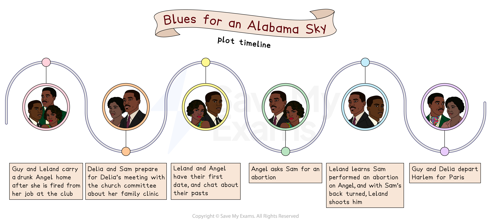

# Blues for an Alabama Sky: Plot Summary

To be best prepared for exam questions on Blues for an Alabama Sky, it is important that you understand the key points within the plot of the play. While you will not be asked to retell the story, it will be easier to give strong answers if you understand when things happen, and which characters are involved, so that you can build answers supported by textual references.

Below you will find:

- A plot storyboard of major events in the text
- An overview of the play
- A plot summary broken down by scenes

## Blues for an Alabama Sky: Plot storyboard

> **Spec point** — `spcpt_cd63X4srt3hJ3346`

## Blues for an Alabama Sky: Plot storyboard

*Blues for an Alabama Sky plot timeline*

## Blues for an Alabama Sky: Overview 

> **Spec point** — `spcpt_7XGCvzwhjsqC49RC`

## Overview of Blues for an Alabama Sky

Blues for an Alabama Sky is a play by American playwright and activist Pearl Cleage. The play is set in Harlem in 1930 during the early years of the Great Depression, and following the Harlem Renaissance. The play centres on a group of close friends — Guy, Angel, Delia and Sam — who are struggling to thrive amid racism, political tension and poverty in Harlem, all while chasing their dreams.

Guy is a costume designer trying to break free from Harlem and start a life in Paris. He lives with Angel, a club singer who loses her job at the start of the play, and who struggles to find her footing as she jumps from man to man, trying to find stability. In the same apartment building lives Delia, a young woman trying to start a family-planning clinic to help Black women access reproductive care. And finally there is Sam, a doctor who is friends with all three, but who finds himself romantically interested in Delia.

Angel falls pregnant to a new man, Leland, who has moved from the South to Harlem, and is trying to find his way in a city that he does not accept. Angel quickly looks to marry him and settle down, preferring security over true love.

However, when Guy’s dream of becoming a fashion designer becomes reality, Angel tries to abandon her plans to settle with Leland. She has an abortion, performed by Sam, and tries to leave Leland. When she reveals that she has aborted their baby, it sends the devout Christian Leland into a rage that ends with him shooting Sam.

## Blues for an Alabama Sky: Scene-by-scene plot summary

> **Spec point** — `spcpt_QMPYBcCSZYcr8kxD`

## Blues for an Alabama Sky: Scene-by-scene plot summary

### Act 1

#### Act 1, Scene 1

*3 a.m., Sunday morning*

- Guy and Leland are helping Angel home through the streets
- Angel is drunk and loud
- When they get her inside, they wake up a neighbour, Delia
- We find out that Guy and Angel are close friends, but Leland was a stranger who saw them needing help
- The audience discovers that Angel has broken up with her partner, Nick, and then lost her job:

  - Her partner was an Italian gangster, and he is now married to someone else
  - He informed Angel just as she was about to go on stage and perform as a singer
  - She berated him on stage in the middle of the show and was then fired
- Guy has a plan to move to Paris, and now Angel wants to come
- Guy also seems interested in Leland as a possible romantic partner
- Guy reveals that he was also fired that night:

  - He was working at the same place, and was fired for standing up for Angel

#### Act 1, Scene 2

*Sunday, late afternoon*

- Guy returns home to find Angel is still asleep on his sofa:

  - He was out collecting her things from Nicky’s place
  - He invites her to stay now she has nowhere else to live
- Angel is hungover and has very little memory of the night before:

  - Guy tells her about Leland helping them get home
  - We find out Leland is from the South
- Delia comes home from church and comes by to see Angel and Guy:

  - She tries to talk to Angel about typewriting and secretarial work, but Angel isn’t interested
- Angel is desperate for aspirin for her hangover
- Their friend, a doctor named Sam, comes by and gives Angel some pills that quickly make her feel better
- They talk about Delia’s plan to set up a family clinic in Harlem
- Delia, Sam and Guy go out for dinner
- Leland pops over to check on Angel and they schedule a date

#### Act 1, Scene 3

*Wednesday, late afternoon*

- Angel comes home to an empty apartment and drinks some of Guy’s liquor
- Guy enters and tells her he saw Nick:

  - Nick apparently feels bad about Angel’s situation
  - He has got her an audition with a friend, but Guy is sceptical about his motivations
  - Angel wants Guy to make her an outfit for her audition, but Guy is too busy
- Guy tells her that their friend Langston has returned to the area and they are going over to his place tonight for a party:

  - They suggest taking Delia
- Guy goes for a nap while Angel goes to ask Delia:

  - Delia is not interested in going
  - Angel claims that Sam has a crush on Delia, which Delia dismisses
  - Angel tells her about the audition and then asks to borrow Delia’s new dress, which she accepts
- Sam arrives to discuss Delia’s idea for a family clinic:

  - He falls asleep during her presentation
  - They discuss how he should go out less, but Sam thinks he needs it to break from the stress of work
- Now awake, Sam supports Delia’s plan:

  - He asks questions that annoy Delia, but she realises he is asking what the church will ask
  - Delia understands she needs to find answers that will convince them

#### Act 1, Scene 4

*Sunday evening*

- It is the night of Angel and Leland’s date
- Angel comes home to change into Delia’s dress for the date:

  - Guy tells her that Delia’s meeting with the church committee has been suddenly moved to tonight
  - She is there with Sam, who went along for support
- Delia and Sam come home:

  - Delia’s plan has been backed, and she will be opening a family clinic in Harlem
  - The church will show it support at sermons, too

- Leland arrives and Sam, Guy and Delia go to the theatre
- Rather than going out for a walk, Angel and Leland stay together in the flat and get to know each other:

  - Leland isn’t as much of a talker as Angel, but reveals his wife died in childbirth
  - He says he was struck by Angel as she looks so similar to his deceased wife
  - He returns a scarf she dropped the night they met, and Angel kisses him to end the scene

#### Act 1, Scene 5

*Friday evening*

- Guy is working on a dress and Delia helps him work on it
- They discuss how Guy used to make dresses for the drag queens in the area
- Delia is anxious about her clinic:

  - The landlord has threatened to withdraw the lease due to some letters of protest
- Delia goes off to sleep, and straight after, Leland arrives looking for Angel:

  - He has a gift for her, but she is still out at her audition
- Guy and Leland chat:

  - Leland is shocked to see Guy has alcohol while New York was under prohibition
  - Leland’s gift for Angel is clothing, as he believes that Angel lost her clothes in a fire, rather than a break-up
- Guy goes to spread the good news he’s received on the cable about his move to Paris
- After he leaves, Angel enters angrily, not even noticing Leland until he calls her name and shocks her
- Angel reads the cable:

  - It reveals that Josephine likes Guy’s work, but cannot promise a job
  - Josephine asks Guy for more dresses, and she’ll be “*almost* certain” that they “*might* be able to at least *think*” of giving him a job
- Angel reveals how her audition went:

  - She says that there was in fact no audition
  - Tony had set it all up for a chance to speak with her
  - They drank together as Tony hit on her and Angel played along, hiding her unhappiness
- Leland is angered by her treatment
- Angel thinks he should leave and not see her again:

  - Leland replies that he loves her
  - He tells her that he knows she isn’t his ex-wife, but he has love to give and wants to protect her
  - Angel is tired, and goes to bed, but tells him to come by again tomorrow
- The scene ends with Angel looking at the dress, which is not stylish, and sighing

### Act 2

#### Act 2, Scene 1

*Two weeks later, early Sunday afternoon*

- Guy returns home, having been attacked by some youths on the street:

  - Angel, wearing the dress Leland gave her (albeit altered), is concerned, but it appears Guy won the fight
- The place is set up for high tea, and Delia, Sam and Leland come over
- They discuss the clinic, the church, and gossip about their friend Isabel

  - Leland is opposed to the clinic and abortion in general
- They talk about love, and Guy begins to tell a story about a party they were at recently:

  - When he mentions men showing interest in other men, Leland is shocked and offended
  - Leland calls homosexuality an “abomination”
  - Guy kicks him out, although Angel argues for him to stay
- Outside, Leland and Sam talk:

  - Leland insists, “the sooner I get Angel out of there, the better it will be for all of us”
- Angel and Guy argue inside:

  - Guy doesn’t think Leland’s right for her, but Angel is happy to settle down for a man who can pay her rent
- Sam comes back in, and Angel rushes out to try catch Leland:

  - Guy, upset by all of this, heads out alone to the Kit Kat Club
- Sam goes over to Delia’s:

  - They talk about love, sex and marriage, and then share a kiss
- Angel and Leland eventually catch each other outside:

  - Angel notices that he has a gun
  - Leland claims to need it in Harlem
  - He reiterates that he is a Christian man and believes homosexuality is wrong

#### Act 2, Scene 2

*Two weeks later*

- Sam is outside the apartment building as Angel comes home

  - She is in the same dress from the start of the play, but it is now more worn and a bit dishevelled
- Angel tells Sam that she’s pregnant, and they also see an eviction notice on their door
- Guy comes home, and he and Angel argue and he leaves again
- Angel is crying when Leland arrives:

  - He talks about falling in love with her, then asks her to marry him
  - Angel reveals to him that she’s pregnant
  - This seems to spark Leland into action, and he wants to go to get married immediately

#### Act 2, Scene 3

*The next day*

- Sam and Delia are at her apartment:

  - Delia is upset, and it appears somebody has started a fire at her clinic
  - Sam offers to rent the ground floor of his parents’ house to her for the clinic to reopen
- Guy comes home and has a letter with him inviting him to Paris, and a first-class ticket
- They decide to go out in Harlem tonight to celebrate:

  - Sam goes away to check in on the hospital, and Delia goes to get changed
- Angel enters, wearing the dress Leland bought her:

  - Guy tells her the news and hands her a ticket to Paris
  - They sail a week on Friday
- Angel tells him she’s pregnant and marrying Leland:

  - She then says she can just tell him she’s had a miscarriage and call off the wedding, so she can go with Guy
  - Guy seems frustrated by her, but leaves the folder with the ticket next to Angel before leaving
- Sam returns, missing Delia and Guy who have already left
- Angel tells Sam about the engagement, and that she doesn’t want to have this baby:

  - She wants to go to Paris
  - Sam is unsure about it, but Angel is adamant
  - She says he had no problem with abortion when she was pregnant with Nicky’s child
  - Sam doesn’t seem to want to do it, but ends up agreeing to see her in the morning

#### Act 2, Scene 4

*The next day*

- Guy is home as Angel walks in slowly and uncomfortably:

  - She tells Guy she’s had the abortion
  - He has to leave to take costumes to the club
- Leland comes round with a rocking chair that he made for Angel:

  - He shows her the small diamond ring he got from his mother
  - Angel then tells him she’s had a miscarriage
- As Leland comes to terms with the news, Angel tells him she is going to take a trip:

  - He thinks they will be going together, but she tells him she is going to Paris with Guy
  - She claims they will get married when she comes back
- Leland thinks she’s leaving because two of his babies have died:

  - Angel gets frustrated and tells him she wants to get away from Harlem and live her life
  - When Leland says they’ll have lots of babies, she snaps that she doesn’t want any
  - She then tells him she wants him to leave her alone
- Leland gets angry and then grabs Angel:

  - She then reveals she had an abortion
  - Leland is angry at her and Sam
  - He says he’d kill her if she didn’t have his ex-wife’s face
- Leland leaves, but bumps into Sam coming to check on Angel:

  - It’s quickly clear that Leland knows
  - As they part, Sam’s back is to Leland, and Leland pulls out a gun and points it at Sam’s back
  - The scene goes dark, but we hear the sound of a gunshot
  - Lit up alone, Angel’s face is clear, and horrified, before the scene ends

#### Act 2, Scene 5

*Two weeks later*

- Delia is reading the newspaper and goes over to Guy, who is packed and ready to leave:

  - Their conversation reveals that Sam died, and the paper calls him a “murdered physician accused of performing illegal abortion on missing Harlem showgirl”
  - Guy has paid the rent until the end of the month, in case Angel returns to get her stuff
- Guy tells the story of moving to Harlem with Angel:

  - Angel had planned to go without him, but Guy met her at the train station and followed
  - He says this to convince Delia, who is heartbroken and looking to leave Harlem, to come with him and take Angel’s place
  - She is unsure, but seems to want to go, and eventually agrees
- Delia goes to get her passport and Guy goes to the corner:

  - With both gone, Angel sneaks in
  - Delia sees her, they share a quiet moment and then say goodbye to each other
- Angel raises a glass of champagne and drinks as the play ends

### Sources

Cleage, P. (1999), *Blues for an Alabama Sky* (Dramatists Play Service Inc.)
