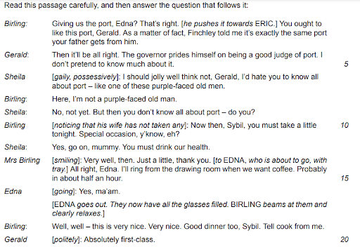
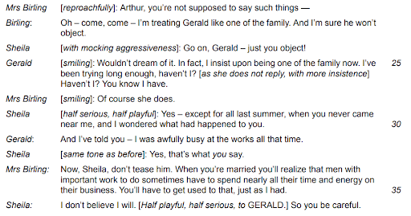
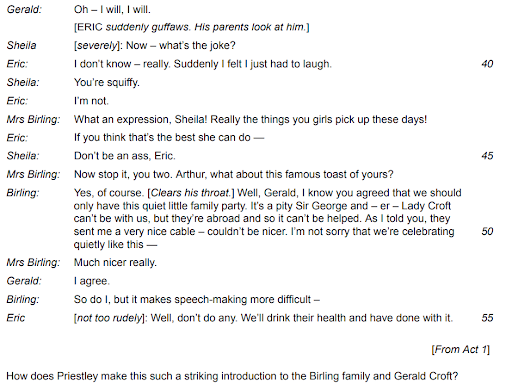
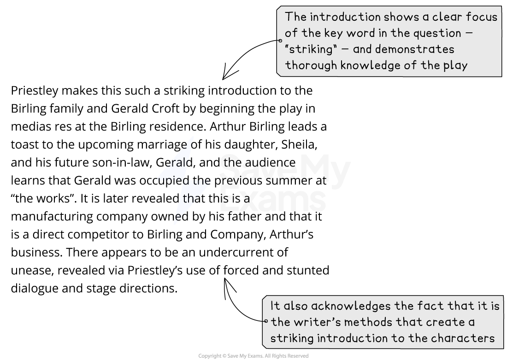
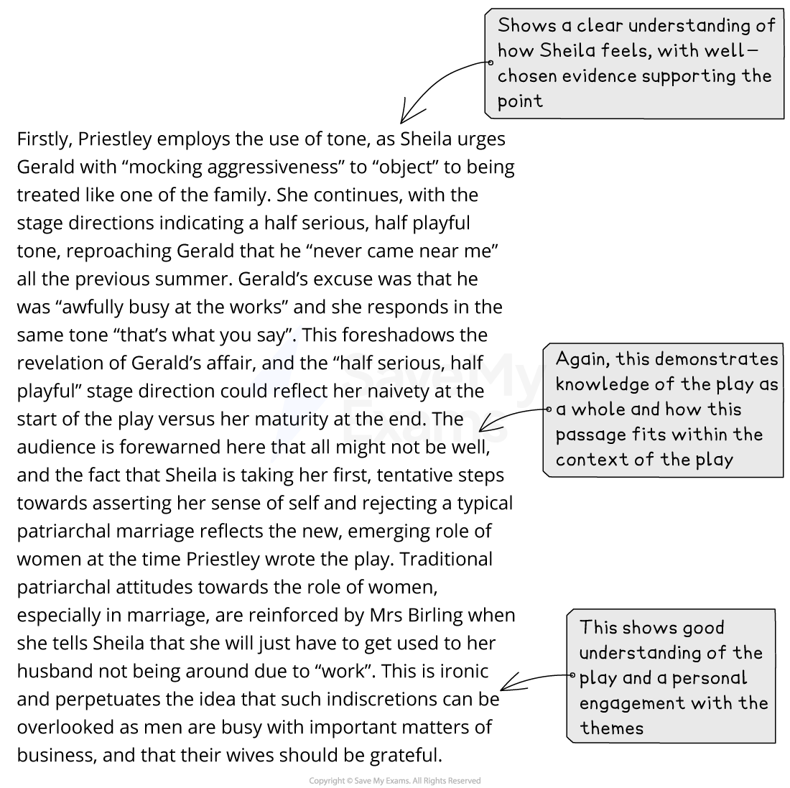
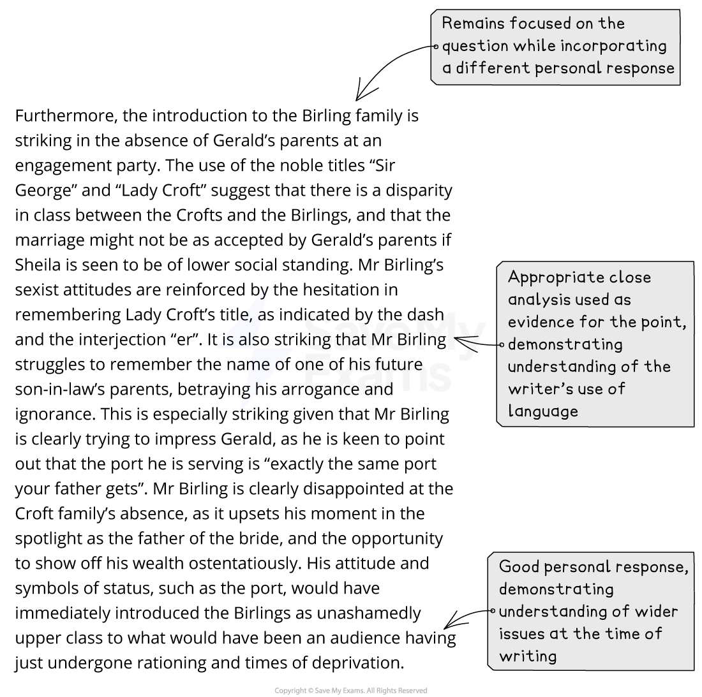
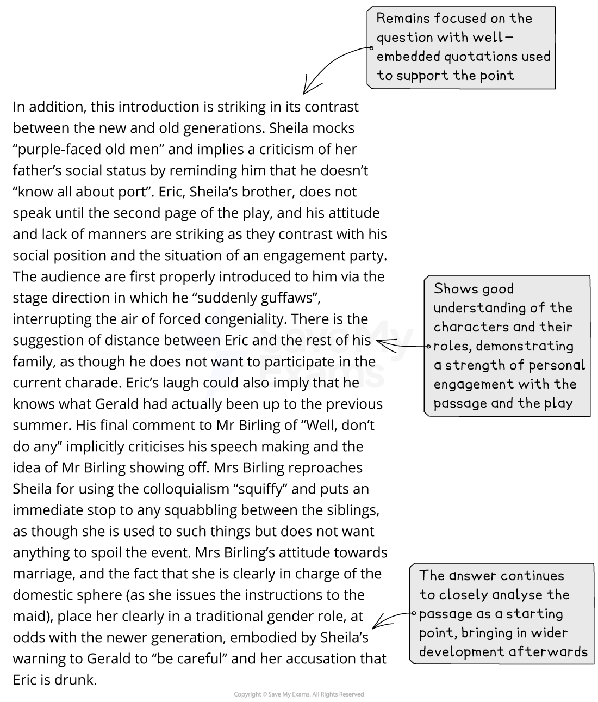
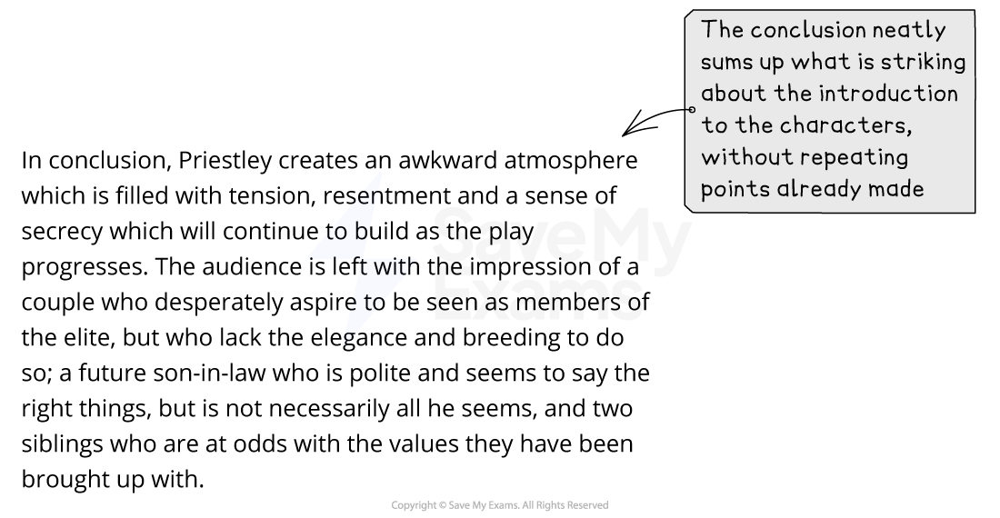

# Question A: Mark Scheme & Model Answer

## Paper 2 Drama: Question A: Mark scheme and model answer

> **Spec point** — `spcpt_tvQkTzVvYvTcPX3Q`

## Question A: Mark Scheme and Model Answer

The best way to improve any essay is to know how you are assessed, and what skills you are being assessed on. This page has been created to give you a sense of what examiners are looking for in a full-mark response. It contains:

- Overview
- Mark scheme
- Example task
- Model answer
- Unannotated model answer

## Paper 2 Drama: Question A: Mark scheme overview

> **Spec point** — `spcpt_WFmRqHrp5ykjqwDF`

## Overview

Question A (the passage-based question) will give you a passage from the drama text printed on the exam paper, and you will be asked to analyse how the writer has achieved particular meanings or ideas. Your response must be supported with direct quotations or close reference to the passage and the rest of the play.

## Paper 2 Drama: Question A: Mark scheme

> **Spec point** — `spcpt_78bHcPWpHXkH5ddW`

## Mark scheme

The mark scheme for any question in Literature in English is quite broad and can seem difficult to understand. This is because there is no “correct answer” for any essay: the exam board does not provide points that need to be included in any essay; instead, examiners use the mark scheme to place an answer into a level.

The questions in Paper 2 are equally weighted, and each question tests all four Assessment Objectives.

In simple terms, to achieve the highest marks (Band 8 = 23–25 marks), this means:

| **AO1** | - Demonstrate your knowledge by incorporating well-selected reference to the text skillfully and with flair in your answers - This means using quotations and indirect references to the play to support your views or arguments |
|---|---|
| **AO2** | - Sustain a critical understanding of the text by showing individuality and insight - This means showing that you understand the main ideas, settings, events, characters and other dramatic features, and that you appreciate the deeper meanings of the play |
| **AO3** | - Respond sensitively and in considerable detail to the way the writer achieves her/his effects - This means that you are able to explore how writers use language, structure and form to convey impressions and ideas |
| **AO4** | - Sustain a personal and evaluative engagement with the task and text - This means that you are able to give a personal response to the question and text, and support your response with references to the text |

> **Exam Hint**
> Although there are four specific Assessment Objectives assessed in this task, it is not the case that a certain number of marks are awarded for any one objective. Instead, the examiners are looking for a well-constructed and coherent essay that seamlessly combines all of the skills covered by the Assessment Objectives.

## Paper 2 Drama: Question A: Example task

> **Spec point** — `spcpt_JPZvnbWGvz5WFqgt`

## Example task

The following task is taken from the CIE IGCSE 2017 Paper 2, and is about An Inspector Calls by JB Priestley. It is typical of the style of a Paper 2 Question A passage-based question:

*An Inspector Calls Act 1 extract*

*An Inspector Calls Act 1 extract*

## Paper 2 Drama: Question A: Model answer

> **Spec point** — `spcpt_BvRwGpc2Wt758k4n`

## Model Answer

Below you will find a full-mark model answer for this task. The commentary labelled in each section of the essay illustrates how and why it would be awarded full marks. Despite the fact it is an answer to the above question on An Inspector Calls, the commentary is relevant to any of the plays in the set text list, because it is modelling how to structure an answer incorporating the relevant Assessment Objectives.

## Paper 2 Drama: Question A: Unannotated model answer

> **Spec point** — `spcpt_4MKrdNdD9N2bKVZp`

## Unannotated model answer

| *Priestley makes this such a striking introduction to the Birling family and Gerald Croft by beginning the play ****in medias res**** at the Birling residence. Arthur Birling leads a toast to the upcoming marriage of his daughter, Sheila, and his future son-in-law, Gerald, and the audience learns that Gerald was occupied the previous summer at “the works”. It is later revealed that this is a manufacturing company owned by his father and that it is a direct competitor to Birling and Company, Arthur’s business. There appears to be an undercurrent of unease, revealed via Priestley’s use of forced and stunted dialogue and stage directions.*  *Firstly, Priestly employs the use of tone, as Sheila urges Gerald with “mocking aggressiveness” to “object” to being treated like one of the family. She continues, with the stage directions indicating a half-serious, half-playful tone, reproaching Gerald that he “never came near me” all the previous summer. Gerald’s excuse was that he was “awfully busy at the works” and she responds in the same tone “that’s what you say”. This foreshadows the revelation of Gerald’s affair, and the “half serious, half playful” stage direction could reflect her naivety at the start of the play versus her maturity at the end. The audience is forewarned here that all might not be well, and the fact that Sheila is taking her first, tentative steps towards asserting her sense of self and rejecting a typical ****patriarchal**** marriage reflects the new, emerging role of women at the time Priestly wrote the play. Traditional patriarchal attitudes towards the role of women, especially in marriage, are reinforced by Mrs Birling when she tells Sheila that she will just have to get used to her husband not being around due to “work”. This is ironic and perpetuates the idea that such**** indiscretions**** can be overlooked as men are busy with important matters of business, and that their wives should be grateful.*  *Furthermore, the introduction to the Birling family is striking in the absence of Gerald’s parents at an engagement party. The use of the noble titles “Sir George” and “Lady Croft” suggest that there is a ****disparity**** in class between the Crofts and the Birlings, and that the marriage might not be as accepted by Gerald’s parents if Sheila is seen to be of lower social standing. Mr Birling’s sexist attitudes are reinforced by the hesitation in remembering Lady Croft’s title, as indicated by the dash and the interjection “er”. It is also striking that Mr Birling struggles to remember the name of one of his future son-in-law’s parents, betraying his arrogance and ignorance. This is especially striking given that Mr Birling is clearly trying to impress Gerald, as he is keen to point out that the port he is serving is “exactly the same port your father gets”. Mr Birling is clearly disappointed at the Croft family’s absence, as it upsets his moment in the spotlight as the father of the bride, and the opportunity to show off his wealth ****ostentatiously****. His attitude and symbols of status, such as the port, would have immediately introduced the Birlings as unashamedly upper class to what would have been an audience having just undergone rationing and times of ****deprivation****.*  *In addition, this introduction is striking in its contrast between the new and old generations. Sheila mocks “purple-faced old men” and implies a criticism of her father’s social status by reminding him that he doesn’t “know all about port”. Eric, Sheila’s brother, does not speak until the second page of the play, and his attitude and lack of manners are striking as they contrast with his social position and the situation of an engagement party. The audience are first properly introduced to him via the stage direction in which he “suddenly ****guffaws****”, interrupting the air of forced ****congeniality****. There is the suggestion of distance between Eric and the rest of his family, as though he does not want to participate in the current ****charade****. Eric’s laugh could also imply that he knows what Gerald had actually been up to the previous summer. His final comment to Mr Birling of “Well, don’t do any” implicitly criticises his speech making and the idea of Mr Birling showing off. Mrs Birling reproaches Sheila for using the ****colloquialism**** “squiffy” and puts an immediate stop to any squabbling between the siblings, as though she is used to such things but does not want anything to spoil the event. Mrs Birling’s attitude towards marriage, and the fact that she is clearly in charge of the domestic sphere (as she issues the instructions to the maid), place her clearly in a traditional gender role, at odds with the newer generation, embodied by Sheila’s warning to Gerald to “be careful” and her accusation that Eric is drunk.*  *In conclusion, Priestley creates an awkward atmosphere that is filled with tension, resentment and a sense of secrecy which will continue to build as the play progresses. The audience is left with the impression of a couple who desperately aspire to be seen as members of the elite, but who lack the elegance and breeding to do so; a future son-in-law who is polite and seems to say the right things, but is not necessarily all he seems, and two siblings who are at odds with the values they have been brought up with.* |
|---|
