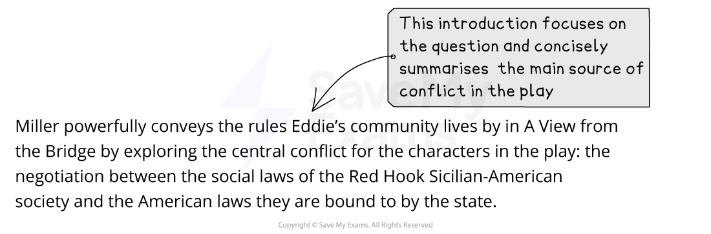
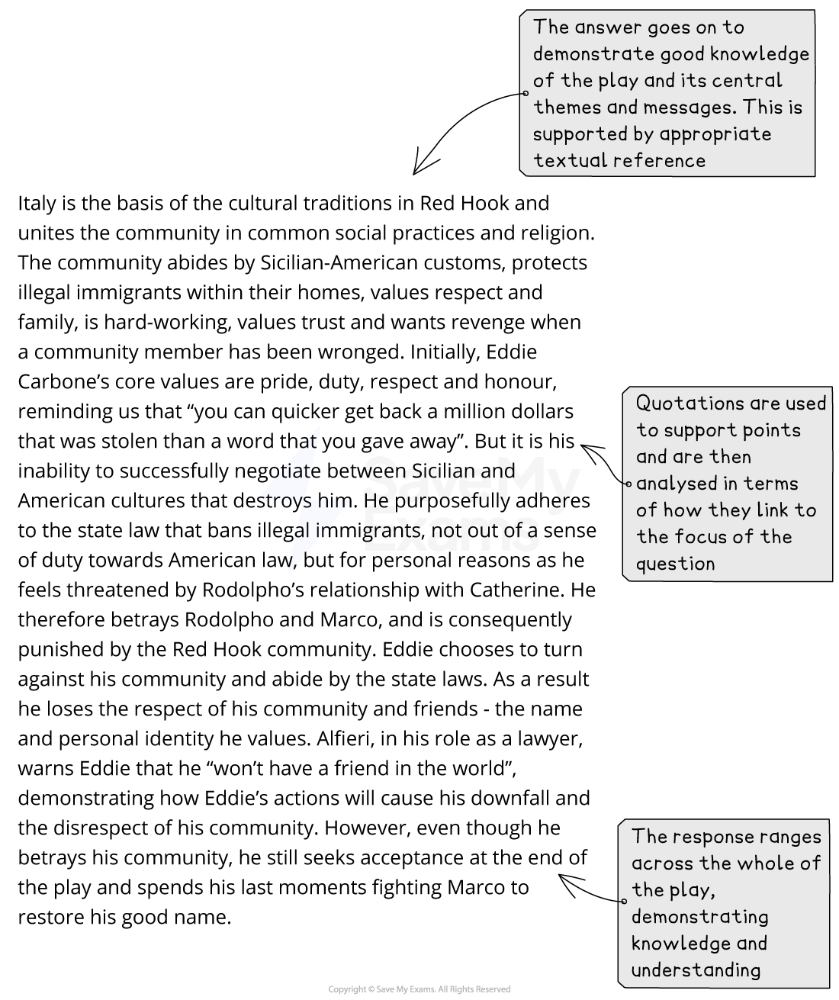
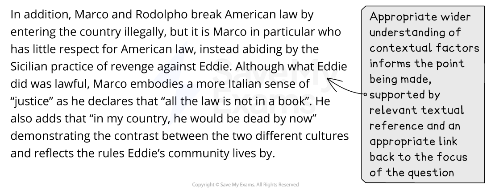
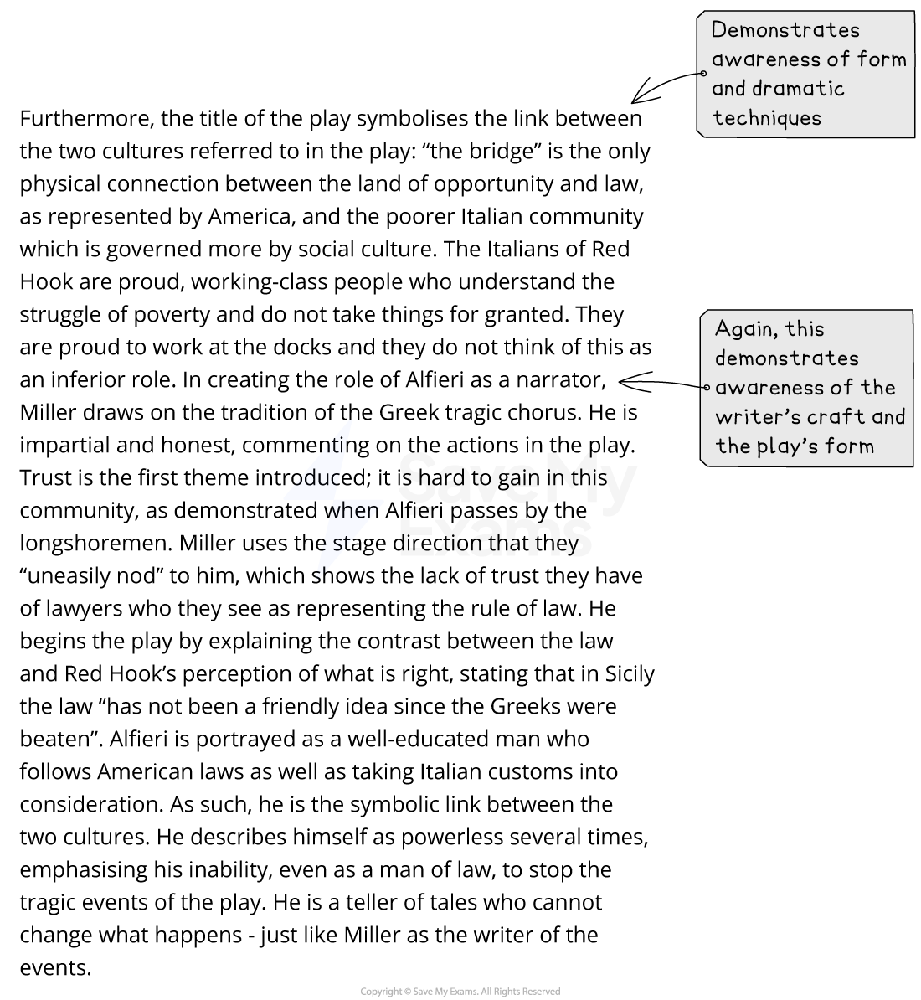
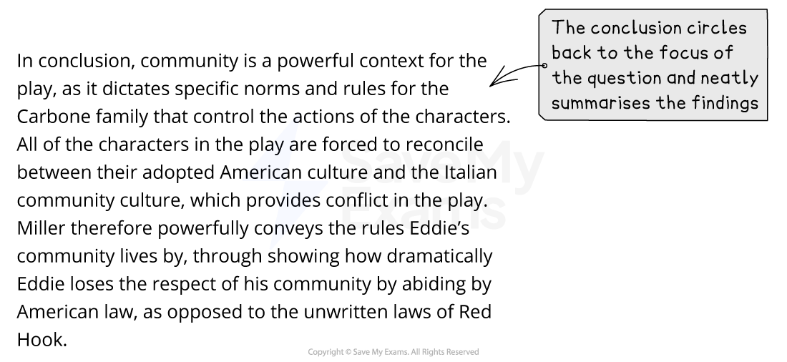

# Question B: Mark Scheme & Model Answer

## Paper 2 Drama: Question B: Mark scheme and model answer

> **Spec point** — `spcpt_wyWcS2rxxyBGkfXj`

## Question B: Mark Scheme and Model Answer

The best way to improve any essay is to know how you are assessed, and what skills you are being assessed on. This page has been created to give you a sense of what examiners are looking for in a full-mark response. It contains:

- Overview
- Mark scheme
- Example task
- Model answer
- Unannotated model answer

## Paper 2 Drama: Question B: Mark scheme overview

> **Spec point** — `spcpt_xJGwkz34jScztQGt`

## Overview

Question B (the essay question) will ask you to explore, or analyse, how the writer of your chosen drama text has achieved meanings or ideas, as relevant to a particular theme. Your response must be supported with direct quotations or close reference to the whole of the play, as appropriate to the focus of the question.

## Paper 2 Drama: Question B: Mark scheme

> **Spec point** — `spcpt_ct2bKzNTRpw7Vx9Z`

## Mark scheme

The mark scheme for any question in Literature in English is quite broad and can seem difficult to understand. This is because there is no “correct answer” for any essay: the exam board does not provide points that need to be included in any essay; instead, examiners use the mark scheme to place an answer into a level.

The questions in Paper 2 are equally weighted, and each question tests all four Assessment Objectives.

In simple terms, to achieve the highest marks (Band 8 = 23–25 marks), this means:

| **AO1** | - Demonstrate your knowledge by incorporating well-selected references to the text skillfully and with flair in your answers - This means using quotations and indirect references to the play to support your views or arguments |
|---|---|
| **AO2** | - Sustain a critical understanding of the text by showing individuality and insight - This means showing that you understand the main ideas, settings, events, characters and other dramatic features, and that you appreciate the deeper meanings of the play |
| **AO3** | - Respond sensitively and in considerable detail to the way the writer achieves her/his effects - This means that you are able to explore how writers use language, structure and form to convey impressions and ideas |
| **AO4** | - Sustain a personal and evaluative engagement with the task and text - This means that you are able to give a personal response to the question and text, and support your response with references to the text |

> **Exam Hint**
> Although there are four specific Assessment Objectives assessed in this task, it is not the case that a certain number of marks are awarded for any one objective. Instead, the examiners are looking for a well-constructed and coherent essay that seamlessly combines all of the skills covered by the Assessment Objectives.

## Paper 2 Drama: Question B: Example task

> **Spec point** — `spcpt_bxPmZ56W3NW5vZFd`

## Example task

The following task is an example of a CIE IGCSE Literature in English question, and it is about the play A View from the Bridge by Arthur Miller. It is typical of the style of a Paper 2 Question B essay question.

***How does Miller powerfully convey to you the rules Eddie’s community lives by?***

## Paper 2 Drama: Question B: Model answer

> **Spec point** — `spcpt_VP5gPGPVfSWKfH2x`

## Model Answer

Below you will find a full-mark model answer for this task. The commentary labelled in each section of the essay illustrates how and why it would be awarded full marks. Despite the fact it is an answer to the above question on A View from the Bridge, the commentary is relevant to any of the plays in the set text list, because it is modelling how to structure an answer incorporating the relevant Assessment Objectives.

## Paper 2 Drama: Question B: Unannotated model answer

> **Spec point** — `spcpt_qmrBpg8gWkkdxVNB`

## Unannotated model answer

| *Miller powerfully conveys the rules Eddie’s community lives by in A View from the Bridge by exploring the central conflict for the characters in the play: the negotiation between the social laws of the Red Hook Sicilian-American society and the American laws they are bound to by the state.*   *Italy is the basis of the cultural traditions in Red Hook and unites the community in common social practices and religion. The community abides by ****Sicilian-American**** customs, protects illegal immigrants within their homes, values respect and family, is hard-working, values trust and wants revenge when a community member has been wronged. Initially, Eddie Carbone’s core values are pride, duty, respect and honour, reminding us that “you can quicker get back a million dollars that was stolen than a word that you gave away”. But it is his inability to successfully negotiate between Sicilian and American cultures that destroys him. He purposefully ****adheres**** to the state law that bans illegal immigrants, not out of a sense of duty towards American law, but for personal reasons as he feels threatened by Rodolpho’s relationship with Catherine. He therefore betrays Rodolpho and Marco, and is consequently punished by the Red Hook community. Eddie chooses to turn against his community and ****abide**** by the state laws. As a result he loses the respect of his community and friends – the name and personal identity he values. Alfieri, in his role as a lawyer, warns Eddie that he “won’t have a friend in the world”, demonstrating how Eddie’s actions will cause his downfall and the disrespect of his community. However, even though he betrays his community, he still seeks acceptance at the end of the play and spends his last moments fighting Marco to restore his good name.*  *In addition, Marco and Rodolpho break American law by entering the country illegally, but it is Marco in particular who has little respect for American law, instead abiding by the Sicilian practice of revenge against Eddie. Although what Eddie did was lawful, Marco ****embodies**** a more Italian sense of “justice” as he declares that “all the law is not in a book”. He also adds that “in my country, he would be dead by now”, demonstrating the contrast between the two different cultures and reflecting the rules Eddie’s community lives by.*  *Furthermore, the title of the play symbolises the link between the two cultures referred to in the play: “the bridge” is the only physical connection between the land of opportunity and law, as represented by America, and the poorer Italian community that is governed more by social culture. The Italians of Red Hook are proud, working-class people who understand the struggle of poverty and do not take things for granted. They are proud to work at the docks and they do not think of this as an inferior role. In creating the role of Alfieri as a narrator, Miller draws on the tradition of the ****Greek tragic chorus****. He is impartial and honest, commenting on the actions in the play. Trust is the first theme introduced; it is hard to gain in this community, as demonstrated when Alfieri passes by the**** longshoremen****. Miller uses the stage direction that they “uneasily nod” to him, which shows the lack of trust they have of lawyers who they see as representing the rule of law. He begins the play by explaining the contrast between the law and Red Hook’s perception of what is right, stating that in Sicily the law “has not been a friendly idea since the Greeks were beaten”. Alfieri is portrayed as a well-educated man who follows American laws as well as taking Italian customs into consideration. As such, he is the symbolic link between the two cultures. He describes himself as powerless several times, emphasising his inability, even as a man of law, to stop the tragic events of the play. He is a teller of tales who cannot change what happens – just like Miller as the writer of the events.*  *In conclusion, community is a powerful context for the play, as it dictates specific norms and rules for the Carbone family that control the actions of the characters. All of the characters in the play are forced to ****reconcile**** between their adopted American culture and the Italian community culture, which provides conflict in the play. Miller therefore powerfully conveys the rules Eddie’s community lives by, through showing how dramatically Eddie loses the respect of his community by abiding by American law, as opposed to the unwritten laws of Red Hook.* |
|---|
