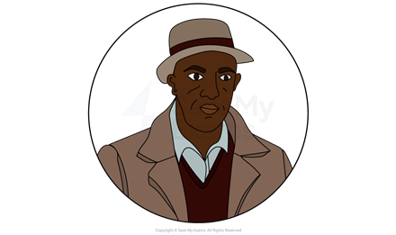
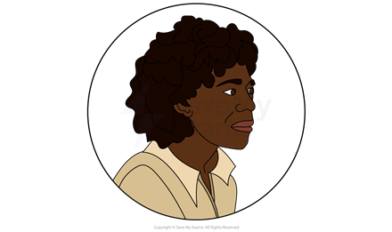
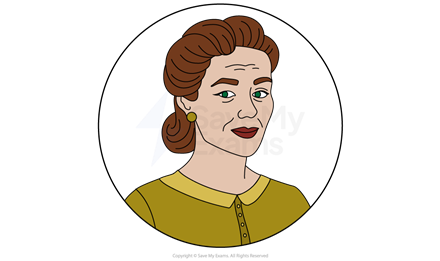
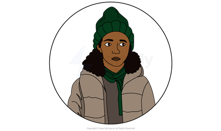

# Princess and the Hustler: Characters

## Princess & The Hustler: Characters

> **Spec point** — `spcpt_rBDJfQzn7wWTNHKB`

## Princess & The Hustler: Characters

A detailed understanding of the characters in Princess & The Hustler and the relationships between them, is essential to understanding key concepts in the play.

Here you will find characters profiles for:

**Main characters:**

- Princess (Phyllis)
- Wendell
- Mavis
- Wendell “Junior”
- Margot

**Other characters:**

- Lorna
- Leon

> **Exam Hint**
> Examiners note that the strongest answers read characters as **contrasts** the writer has arranged, rather than describing them one by one.
> 
> For example, you could write: “Odimba sets Mavis’ caution against Wendell’s confidence, so the reader sees two ways of surviving the same prejudice”. Explaining why a writer puts two ways of surviving side by side is stronger than describing each character.

## Princess and The Hustler: Characters: Princess (Phyllis)

> **Spec point** — `spcpt_WYYq3QGc4kFqh4sq`

## Princess (Phyllis)

*Princess*

- Phyllis “Princess” James is one of the two title characters in the play:

  - She lives with her mother, Mavis, and her seventeen year-old brother, Wendell “Junior”:
  - She is the daughter of Wendell (the “Hustler”) and is half-sister to Lorna
- Although “Princess” is a nickname, the fact that her lines are labelled with this name in the play suggests it is central to her identity
- Princess’ joyous, youthful exuberance is central to the play’s optimistic message about celebrating one’s cultural identity and femininity
- She becomes strongly associated with the “cupboard world’ of ‘pageantry”:

  - This is part of the domestic setting of the play that she transforms, through her imagination, into a place of joy and celebration
- Princess forms close bonds with Wendell and Lorna following their arrival and successfully encourages Mavis to let them stay
- She experiences discrimination in the play which damages her sense of dignity and worth:

  - At school, Princess’ half-sister Lorna, who is mixed race, is invited to a party, while Princess is not (Act 2, Scene 1)
  - After Junior returns home after being harmed in a racially motivated attack, Lorna refuses to hide in safety with Princess, stating that she is “not Black” like Princess but “only half”
- In Act 2, Princess begins to doubt her fantasy of winning the beauty pageant and the “cupboard world” in which that fantasy exists:

  - In Act 2, Scene 1, the ‘cupboard world…seems less alive’ and is ‘somehow subdued’
- At the end of Act 2, the loss of confidence Princess experiences *culminates*** **in her destroying her “cupboard world” and running away from home:

  - Princess declares: “I am Phyllis. I am Phyllis James”, [symbolically](https://www.savemyexams.com/glossary/gcse/english-language/symbolism-definition/) omitting the title of “Princess” and illustrating a loss of her sense  of value (Act 2, Scene 5)
  - She goes to Margot’s flat, where Margot discovers her
- By the end of the play, Princess has returned home (Act 5, Scene 3), and later admits that she took Junior’s bag of money

  - She intended to use the money to take the family to Weston-super-Mare for her beauty pageant
- At the end of the play, Princess recreates the beauty pageant from the opening scene:

  - This is now more fully realised and involves Wendell, who crowns her the winner (Act 3, Scene 6)

## Princess and The Hustler: Characters: Wendell

> **Spec point** — `spcpt_Y2Nrx5YbtNqsqJ4g`

## Wendell

*Wendell*

- Wendell James is father to Phyllis “Princess” and Wendell Junior, whom he had with Mavis years before the play begins, and Lorna, whom he fathered with another woman
- Wendell’s character follows a *redemptive arc*, and he [symbolises](https://www.savemyexams.com/glossary/gcse/english-language/symbolism-definition/) positive change
- Wendell initially embodies the idea of a “hustler” and often articulates ideas equating success with financial gain:

  - He tells Junior that he will become well known in Bristol for making “big money” (Act 1, Scene 6)
  - He tells Mavis that it is only a matter of time before he lands “ar lickle pay packet” (Act 2, Scene 1)
- At the start of the play, he is depicted as irresponsible:

  - He reappears suddenly in Bristol and shows little appreciation of Mavis’ efforts to bring up their children, having left her almost a decade earlier
  - He continually [alludes](https://www.savemyexams.com/glossary/gcse/english-language/allusion-definition/) his previous life as a “hustler”
  - In Act 1, Scene 6, he leaves his two daughters alone at the docks while he gambles at cards
- Wendell previously arrived to England as a Jamaican immigrant as part of the Windrush generation and had previously served in the British army:

  - He has experienced racism and feels underappreciated for his service as a soldier
- While staying with Mavis, it is unclear whether he is actively looking for work:

  - Junior points this out in Act 2, Scene 5 and Margot in Act 1, Scene 7
- As the play develops, Wendell starts to rekindle his relationship with Mavis and she allows him to play a limited role in her family’s life
- In Act 2, tensions between Wendell and Margot increase, as she questions the validity of the bus boycotts
- Throughout the play, Wendell becomes more politically active and plays an increasingly enthusiastic role in protests against the *colour bar*** **in Bristol
- By the end of the play, Wendell has been successful in his political activism and has become reintegrated into the family:

  - He proposes to re-marry Mavis (Act 3, Scene 4); though she doesn’t accept explicitly, she does not refuse:
  
    - Her description of the role she wants him to play in the family (“they [are] the ones that need you to change…”) suggests that she is open-minded to the possibility
  - He is included in Junior’s family photograph, which is symbolic of the family’s unity at the end of the play
  - He dresses up in female clothing and make up for Princess’ pageant, goes into Princess’ “cupboard” room “hand in hand” and “gently places the crown on Princess’s head”
  
    - This perhaps suggests that the has transitioned away from his “hustler” role into a more loving, responsible, family-oriented one

## Princess and The Hustler: Characters: Mavis

> **Spec point** — `spcpt_tgxHSnz4dWBjKRCD`

## Mavis

*Mavis*

- Mavis James is initially presented as the formidable *matriarch* of the James family
- Mavis’ fiercely protective instincts mean that she is sometimes quick to anger:

  - Her stern first lines in the opening scene, reprimanding both Princess and Junior, are a harsh contrast to the gentle dream world of Princess’ imagined beauty pageant (Act 1, Scene 1)
  - She slaps Princess’ face in a moment of high stress, when Princess is slow to leave the room following Wendell’s abrupt return (Act 1, Scene 2)
  - She threatens to harm Wendell with a knife when he doesn’t leave the flat (Act 1, Scene 2)
- Mavis consistently displays strong maternal, caring instincts and prioritises the welfare of her children:

  - At key moments in the play, she provides love and reassurance to Princess, and reminds her that she is “beautiful” and is “free to be anything” (Act 3, Scene 5)
  - She agrees to look after Lorna following Wendell’s unexpected arrival
- Mavis is shocked and upset at Wendell’s sudden reappearance on Christmas Day in Act 1:

  - She initially refuses to let Wendell stay in her home, agreeing only to look after Lorna until Wendell has found somewhere for them to stay
- Mavis softens by the end of Act 1, allowing Princess to persuade her that they should be allowed to stay
- Throughout the play, Mavis becomes more hopeful:

  - She expresses hope that Wendell might become a better man, and “make good” (Act 2, Scene 4)
  - By the end of the play, she is also jubilant about the “win” of the bus boycott, and encourages her family to go out in public to celebrate (Act 3, Scene 5)

## Princess and The Hustler: Characters: Wendell “Junior”

> **Spec point** — `spcpt_ppyVJHPgPgmj2k38`

## Wendell “Junior”

*Wendell "Junior"*

- Wendell “Junior” James is Princess’ seventeen-year-old brother and the son of Mavis and Wendell “the Hustler”
- Junior acts as a bridge between the adult world of his parents and the imaginative, hopeful infant world of his younger sister
- Junior is passionate about photography:

  - His link with cameras and photography is [symbolic](https://www.savemyexams.com/glossary/gcse/english-language/symbol/): he is an observer of his family’s complex dynamic and unlike Princess, is often sceptical of his father’s relationship with them
  - By the end of the play, he seems to have repaired the relationship with his father and includes him in the family photograph taken in the *penultimate* scene (Act 3, Scene 5)
- Junior becomes more politically active throughout the play:

  - He first hears about protests against the *colour bar* from his friend Leon (Act 1, Scene 7)
  - He later marches with students in support of the Bristol Bus Boycott (which he mentions in Act 2, Scene 1)
- His relationship with his father is strained; he is resentful about his father’s unreliability and absence:

  - He argues with his father in Act 1 and questions the motivations for his return (Scenes six and seven)
  - He attempts to pay Wendell to leave the family (Act 2, Scene 5)
- Junior experiences direct racial discrimination during the events of the play:

  - In Act 2, Scene 3, he is the victim of a racially motivated attack while out on a protest march, returning home injured and shaken

## Princess and The Hustler: Characters: Margot

> **Spec point** — `spcpt_WHhPGQDNDr5TJCM9`

## Margot

*Margot*

- Margot is a complex character, who, according to Odimba herself, “clearly loves the family, but she also represents and embodies some of that casual racism that was very much alive at the time”
- As a neighbour and friend, Margot is very caring of Mavis and her children:

  - She claims to Wendell that she “look[s] after” Mavis (Act 1, Scene 7)
  - She plays with Princess and Lorna on a number of occasions and refers to them affectionately as “babbers”
- Margot seems to have an ambivalent relationship with the black community in Bristol:

  - When she first meets Wendell, she sits “very close” to him, “crossing her legs seductively” (Act 1, Scene 5)
  - In a tense exchange with Wendell, she claims to be close enough to Mavis’ family to be able “to walk in parts of the city others can’t”, including “into any church [she] like[s] on Sunday”
  - She is dismissive of the “silly” bus boycott in Bristol, arguing to Wendell that such protests might cause friction with the white community (Act 2, Scene 2)
  - She unwittingly creates friction in Mavis’ family by giving Lorna (who is mixed race) a white doll, and telling Lorna that her hair is as pretty as the doll’s, causing Princess to feel marginalised

- As Margot expresses disapproval of Wendell and the bus boycotts, distance grows between her and Mavis:

  - In Act 2, Scene 4, Margot asks if she is “no longer welcome” in Mavis’ home
  - In the same scene, Margot criticises Wendell and Mavis asks Margot to “stop talking like this”
  - When Margot leaves at the end of that scene, Mavis is uncharacteristically cold towards her and doesn’t look up or speak
- The relationship between Margot and Mavis is repaired towards the end of the play after Margot returns Princess after she has run away from home:

  - Margot shows obvious care for Princess after discovering she has run away and cut her own hair (Act 3, scene two)
  - Mavis is appreciative of Margot’s care for Princess and says she is “welcome…any time” (Act 3, Scene 3)
  - Margot is emotional at having her relationship with Mavis restored and is moved to tears

## Princess and The Hustler: Characters: Other characters

> **Spec point** — `spcpt_N9tm89K7KtNvW36V`

## Other characters

## Lorna

*Lorna*

- Lorna is Wendell’s child from a relationship with a woman she met after leaving Mavis
- Lorna embodies vulnerability, having been displaced physically from her home, as well as from her family:

  - She brings out an *empathetic* response from Mavis, who feels an instinct to protect her
- Lorna is mixed race, which prompts Princess to think about her role in society as a black girl:

  - Lorna is treated differently at school to Princess and is invited to a party that Princess is not invited to

## Leon

*Leon*

- Leon is Junior’s good friend and a guiding moral voice for Junior:

  - He is the first character to mention to Bristol Bus Boycott (Act 1, Scene 6), as his father is involved in organising protest meetings
  - He encourages Junior to be more respectful towards his father (Act 1, Scene 7)
  - He looks after Princess and/or Lorna on more than one occasion when events arise unexpectedly for the James family

#### Sources

Odimba, Chinonyerem. (2019)  *Princess & The Hustler*. Nick Hern Books
