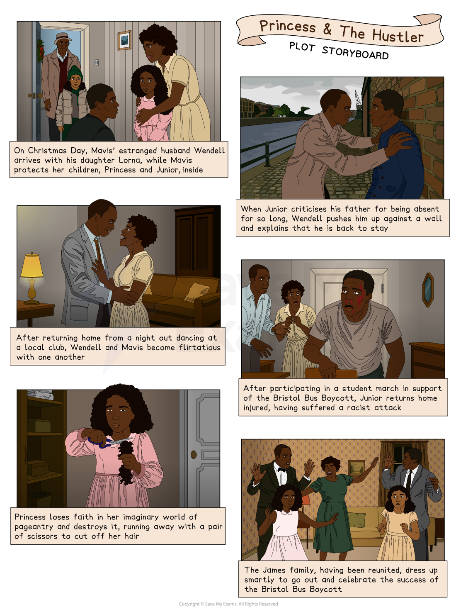

# Princess and the Hustler: Plot Summary

## Princess & The Hustler: Plot Summary

> **Spec point** — `spcpt_MY2TSGV2SGRY9zqR`

## Princess & The Hustler: Plot Summary

An important step in preparing for your exam is to thoroughly understand the plot of Princess & The Hustler. Once you're familiar with the play, you will feel confident connecting key events to broader themes. Having a deep understanding of the text will boost your confidence in finding relevant references to support your responses.

Below you will find:

- **a storyboard of the plot**
- **a general overview of the whole play**
- **detailed summaries by scene**

> **Exam Hint**
> Examiners ask for coverage of the beginning, middle and end, and warn against retelling. Here the useful thing to follow is how the family changes once Wendell returns.
> 
> For example, you could write: “Odimba brings Wendell back into a house that has learned to manage without him, so the play is about adjustment rather than reunion”. Saying what a play is really about, rather than what happens in it, is a point about **structure**.

## Princess and The Hustler: Plot summary: Plot storyboard

> **Spec point** — `spcpt_mYrnx83znw73Vy4D`

## Princess & The Hustler Plot storyboard

*Princess & The Hustler plot storyboard*

## Princess and The Hustler: Plot summary: Overview of Princess and the Hustler

> **Spec point** — `spcpt_wrcPjNrCtdJSk7YF`

## Overview of Princess & The Hustler

Chinonyerem Odimba’s play, Princess & The Hustler, explores the lives of a Jamaican-British family living in Bristol during the 1960s, against the backdrop of the Bristol Bus Boycott — a pivotal moment in the fight against racial discrimination in Britain. The story captures the personal dreams and struggles of its characters, while situating them within the political tensions of the era.

The [protagonist](https://www.savemyexams.com/glossary/gcse/english-literature/protagonist-definition/) of the title is Phyllis “Princess” James, a smart, sensitive and determined child, who dreams of winning the Weston-super-Mare beauty pageant. For Princess, the pageant offers not just a crown but a chance to prove her worth and challenge the prejudice that threatens to limit her future.

At home, her family dynamic is complicated. Her mother, Mavis, works hard to hold things together and is ambivalent about the return of Wendell, Princess’ estranged father, whose presence reopens old wounds and unsettles the household. Wendell’s older son, Wendell “Junior”, fights his own personal battle of resentment towards his father for his absence. Over the course of the play, the characters navigate not only their private conflicts but also the wider social currents of racism and activism sweeping through their community.

In a broader sense, Odimba uses the play to explore the marginalisation of Black communities, the tensions between Black and white populations in 1960s Britain, and the personal resilience needed to face such challenges. Odimba herself describes it as a play “about how racism robs us all of our love and our dreams”. Yet, the tone of the play remains optimistic and celebratory. Princess & The Hustler celebrates the power of self-belief, solidarity, and the pursuit of dreams in the face of systemic injustice.

## Princess and The Hustler: Plot summary: Scene-by-scene plot summary

> **Spec point** — `spcpt_6vj549Kd8D8M73BW`

## Princess & The Hustler: Scene-by-scene plot summary

### Act 1

#### Scene 1

- The play begins with 10-year-old Phyllis “Princess” James in a “cupboard room” in her home:

  - She pretends that she is being crowned the winner of the Weston-super-Mare Beauties of the West Contest — a beauty pageant in a neighbouring town
- Princess’ fantasy is interrupted by the loud, stern voice of her mother, Mavis, who reprimands her, and her brother,  Wendell “Junior”
- Mavis reveals that her work selling curtains hasn’t generated enough money to buy presents
- Junior teases and upsets Princess
- There is a knock at the door

#### Scene 2

- Ten minutes later, the knocking continues
- To Mavis’ surprise, the person at the door is Wendell “The Hustler” James — Mavis’ estranged husband, and father to both Junior and Princess
- Mavis, unsettled, tries to usher her children to go to their rooms

  - Princess is reluctant to leave, and starts asking questions about who the man is and Mavis slaps her across the face
- The children exit, leaving Mavis looking at Wendell

#### Scene 3

- Mavis orders Wendell to leave, and threatens to call the police
- Wendell asks to talk to Mavis, but his attempts to calm her make her even angrier
- Wendell approaches Mavis, and she produces a knife from the kitchen, asking Wendell to leave before she does something she regrets
- Wendell states that he has nowhere else to stay, but is forced out
- Mavis, enraged, threatens to cut Wendell’s throat, and opens the door
- Wendell reveals Lorna, his nine-year-old daughter from another relationship
- Mavis is stunned and hides the knife behind her back

#### Scene 4

- Junior is listening to Mavis and Wendell’s conversation by the door
- Mavis is upset, and doesn’t understand what she has done to provoke a violent response from her mother
- Junior tries to comfort her
- Junior has trouble getting the naive Princess to understand the delicate situation, and still upset, Princess threatens to run away from home
- Lorna is pushed into the room, and Princess bombards her with questions
- Princess starts to show Lorna the dance routine she has prepared for the pageant

#### Scene 5

- Wendell and Lorna are allowed to stay for Christmas lunch
- Princess finds out that Wendell is her (and Junior’s) father
- Junior coldly asks Wendell how long he is going to stay, and is warned by Mavis for being rude
- Princess and Lorna are sent to look at photographs in another room, and Mavis announces that she is willing to allow Lorna to stay for a few days, but not Wendell
- Wendell accuses Mavis of being “cruel”, which angers Mavis, who slaps his face, and berates him
- As he leaves, Margot enters, and doesn’t take Mavis’ hint that they are in the middle of a sensitive discussion
- Wendell leaves to buy some drinks, and once Mavis discloses to Margot who Wendell is, Margot takes the children to her neighbouring home to play some dressing up games

#### Scene 6

- Three days later, at Bristol Docks, Princess and Lorna are sitting waiting for Wendell
- Wendell returns, having won some money in a card game
- Wendell states that he needs to speak to one more man before taking them out for a treat, leaving them alone once again
- Junior and his friend Leon come across the girls before Wendell reappears, and Junior asks Leon to take them home
- Wendell returns and is happy to see Junior, but Junior is angry with his father, and asks him to leave
- Wendell pins his son up against a wall, and explains that he is back to be a good father and husband
- Wendell exits, and a powerless and frustrated Junior slumps to the ground in tears

#### Scene 7

- It is now January, and Margot is with Princess and Lorna when Wendell enters
- The girls are happy to see Wendell, but Margot suggests that he isn’t trying very hard to find work
- Junior enters with Leon and is not happy to see his father
- Margot has to leave to attend a rehearsal, and Leon mentions that he is attending a meeting his dad has organised to protest against the *colour bar*
- Junior wants to attend the meeting, but feels obligated to look after the girls
- Wendell offers to look after the girls, but Junior refuses angrily, stating that he wouldn’t “trust [Wendell] with a dog!”
- Wendell, tells the story of his life while absent from the his first family:

  - The woman with whom he fathered Lorna developed mental health problems
  - That mental deterioration led to Wendell being falsely accused of mistreating her, which in turn led to the local community threatening Wendell's life
- Junior is not pacified, and continues to shout at Wendell, at which point Mavis re-enters
- Princess explains to Mavis that Lorna has been crying at night, and successfully convinces Mavis to let both Wendell and Lorna stay in their home temporarily

#### Act 2

Scene one

- Lorna tells Wendell that Princess is crying because she has not been invited to a party that Lorna has been invited to
- Wendell forbids Lorna from going unless Princess can also attend
- Wendell attempts to flirt with and flatter Mavis, and though she is critical of Wendell at first, she begins to soften and lets him hold her
- Junior walks in on them and Wendell gives Junior a gift: a camera flash he has noticed his son reading about
- Junior states that a group of students will be marching in support of the Bristol Bus Boycott
- Wendell offers his support in the protests — which Junior does not explicitly accept, but does not refuse either

#### Scene 2

- Princess is in her cupboard room, practising her victory speech for the Weston-super-Mare beauty pageant:

  - She hears the front door being opened and hides
- Mavis, Wendell and Margot return home from an enjoyable night out drinking and dancing at a club where people of all races are welcoming
- Mavis goes to bed and tensions rise between Wendell and Margot:

  - Margot is unsympathetic to the black community and the bus boycott, and suggests that they are ungrateful
  - Wendell suggests that Margot is happy to be seen with black people when it suits her socially, but doesn’t care enough about them to support them when it matters
- When Margot leaves, Mavis returns and she and Wendell become flirtatious with each other
- Princess closes the cupboard door

#### Scene 3

- Princess and Lorna tell their parents that they want to see Margot, but Wendell says that he is uncomfortable about them spending any more time with her
- Junior enters: he has been attacked by a group of white youths on the way home from the protest march
- A furious Wendell storms out to look for the people who have harmed his son
- Lorna tells Princess that she won’t get attacked because she isn’t black like Princess: she is “only half”
- Lorna has begun to miss home and her mother
- Mavis hugs Princess tightly

#### Scene 4

- Mavis and Margot meet, seemingly after a gap of some months
- Margot is critical of Wendell and suggests that by involving her in the bus boycott, it has created a negative perception of their family in the community
- Mavis defends Wendell and tells Margot about their previous lives together

  - She expresses a hope that it might be rekindled and that Wendell, like the city of Bristol, can change for the better
- Margot leaves and Mavis doesn’t acknowledge her as she does

#### Scene 5

- Junior is critical of Wendell for not making more of an effort to find work
- Junior gives Wendell a bag of money he has saved and asks him to leave, so that his family are not hurt
- Princess is on the sofa pretending to sleep during this exchange
- Wendell leaves and Princess takes a pair of scissors and destroys her “cupboard world”

### Act 3

#### Scene 1

- Junior and Leon enter the flat to find Mavis extremely worried about Princess:

  - Princess has gone missing
  - Locks of Princess’ hair are in the bin
- Leon watches Lorna while Mavis and Junior go looking for Princess

#### Scene 2

- Margot discovers Princess hiding in her flat:

  - She has cut her own hair, which is now short and uneven
- Princess explains she has run away
- Margot tucks Princess into bed, before leaving to run a “little errand”

#### Scene 3

- Margot returns Princess to Mavis’ home
- Mavis is grateful and tells Margot she is welcome any time, which Margot is very moved by

#### Scene 4

- Wendell appears, having been gone for two days
- Mavis orders Wendell to leave for good
- Junior enters and accuses Wendell of stealing the bag of money he offered, which Wendell vehemently denies
- Princess calls Wendell a “hustler”
- Margot enters, and returns with the bag of money, which she found in her flat
- Princess admits that she took the money when she ran away, planning to use it to pay for the family to go to Weston-super-Mare to attend her beauty pageant
- Wendell, now vindicated, explains that he has been involved with the bus boycott, and is hopeful that it might be effective
- After the children and Margot leave, Wendell proposes to marry Mavis once again
- Mavis does not say yes and argues that Wendell must be a better role model to his children — but does not refuse

#### Scene 5

- Later the same day, Mavis and her family are dressed smartly for a special occasion
- Princess, who is lacking confidence in her appearance, is given a motivational talk by Mavis, who reminds her that she is free to be anything she chooses
- Junior takes a family photograph, which includes Wendell and Lorna
- A radio announcement confirms the lifting of the *colour bar*

#### Scene 6

- Princess is in her swimsuit, ready for her pageant, as in the opening scene of the play
- Wendell appears, wearing make up and women’s clothing
- Wendell enters Princess’ cupboard and is amazed by what he sees
- Princess tells Wendell that he needs to crown her the winner of the pageant
- Once crowned, the “room explodes into a world of pageantry” and “black women of all sizes and nations” surround Princess, who stands in the centre and bows

### Sources

Odimba, Chinonyerem. (2019)  *Princess & The Hustler*. Nick Hern Books
