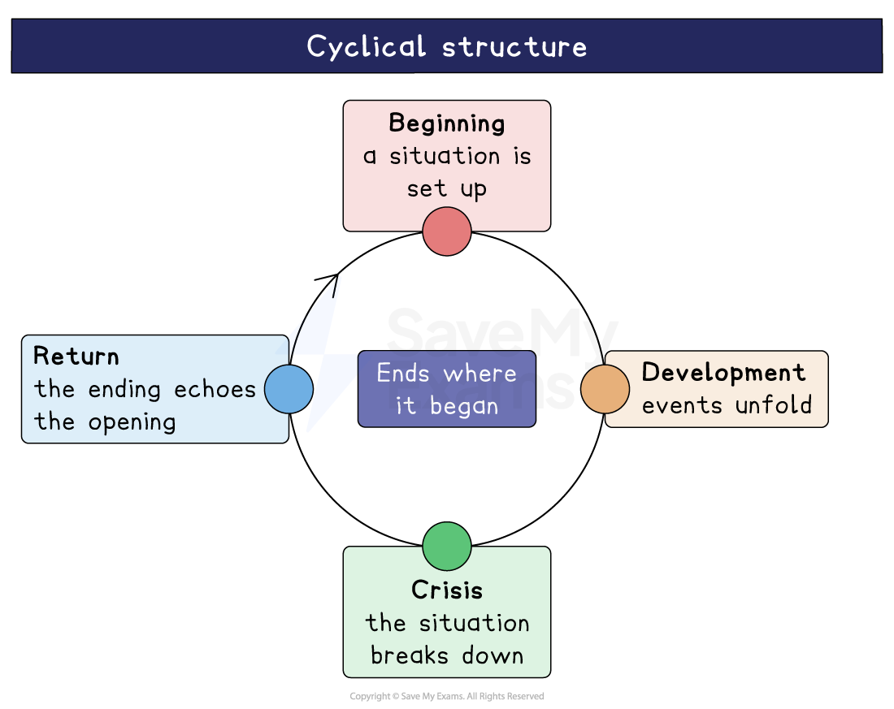

# Princess and the Hustler: Writer's Methods and Techniques

## Princess & The Hustler: Writer’s methods and techniques

> **Spec point** — `spcpt_pn3m9vtSRkvpVKNd`

## Writer’s methods and techniques

Playwrights employ various dramatic devices and techniques to convey meaning, using a range of methods to evoke thoughts and emotions in the audience.

Here we will explore the way that Odimba uses:

- **Structure**
- **Setting**
- **Dramatic features and stagecraft**
- [Motifs](https://www.savemyexams.com/glossary/gcse/english-literature/motif-definition/) **and** [symbolism](https://www.savemyexams.com/glossary/gcse/english-language/symbolism-definition/)

> **Exam Hint**
> Examiners reward attention to the play **as a play**, and warn against naming devices without explaining them. Odimba’s staging of Princess’ imagination is the most rewarding method here.
> 
> For example, you could write: “Odimba lets the audience see the contest as Princess imagines it, so her hope is staged before it is disappointed”. Explaining what staging lets an audience see, before the play takes it away, is real analysis of a play.

## Princess and The Hustler: Writer's methods and techniques: Structure

> **Spec point** — `spcpt_Sy6wTh5KqTSBjpd2`

## Structure

- The play uses a *cyclical structure*, beginning and ending with Princess imagining that she is winning a beauty pageant in Weston-super-Mare:

  - At the start of the play, Princess’ fantasises about winning the pageant in her “cupboard world”:
  
    - This establishes her as a character who has personal hopes and aspirations to be viewed as beautiful
  - By the end of the play, although the setup of the pageant is virtually identical, it has taken on a different *resonance*, with Wendell crowning her the winner of the pageant
  - This pageant at the end follows the *penultimate* scene (Act 3, Scene 5), in which Mavis gives Princes a speech where Princess is encouraged to value herself because Mavis values her as a daughter
  - The final scene therefore develops Princess’ individual celebration of her beauty from the opening, into a broader celebration of black identity, in which the whole family participates

## Princess and The Hustler: Writer's methods and techniques: Setting

> **Spec point** — `spcpt_fVm7PZDKrDwDHGQr`

## Setting

- Most of the play takes place in the domestic setting of Mavis’ family home:

  - The domestic setting centres the action of the play around the family drama created by the complicated relationships between the James family
  - The boycott is shown through the James family’s conversations at home, not the protests themselves:
  
    - This filters the experience of activism directly through the black lives it affects directly
- The domestic setting also creates contrasts with the only other places used in the play:

  - Princess’ imagined “cupboard world”, though technically in the home, is distinct to the more conventional domestic setting, as it is presented in a magical way
  - The cupboard provides Princess with a private escape from the conflicts in her family
  - The only other setting used in the play is the Bristol Docks in Act 1, Scene 6, where Wendell leaves his daughters temporarily as he goes to gamble:
  
    - Wendell Junior arrives and recognises that Wendell has left the girls in a dangerous place
    - The docks root the story in the working class world of Bristol and introduces an element of risk and danger that is adjacent to the lives of the James family

## Princess and The Hustler: Writer's methods and techniques: Dramatic features and stagecraft

> **Spec point** — `spcpt_2bWR5Q59sX4wstMV`

## Dramatic features and stagecraft

It is important to remember that Princess & The Hustler is a play. It was written to be performed on the stage and should be studied with this in mind. Odimba uses the dramatic form in a number of ways to create meaning.

- Odimba’s use of accent** **and *dialect*** **for certain characters foregrounds valuable ideas about their roles in the play:

  - Wendell incorporates *Jamaican Patois* into much of his speech and is therefore presented as an outsider:
  
    - Both his accent and *dialect* mark him out as being set apart from mainstream English society
    - This aligns with his view that he has been marginalised by English society, in spite of his service as a soldier
  - Mavis, too, slips into using *Patois*, particularly when she is angry or upset, which acts as a reminder of the cultural heritage she shares with Wendell
  - Margot uses Bristolian *dialect* phrases (for example, “babbers” for “children”) which clearly indicate her connection to that community
  - Margot’s use of Bristolian patterns of speech suggest she is a product of her context, which aligns with her dismissive attitudes towards the protests and the black community’s efforts to protest
- [Monologues](https://www.savemyexams.com/glossary/gcse/english-literature/monologue-definition/) are used to provide a window into characters’ attitudes and inner lives:

  - Princess’ speeches often see her practising her victory speech for the beauty pageant, illustrating her personal hopes and dreams
  - Wendell makes speeches to Margot and Junior about the racism he has encountered, adding to our understanding of why he might be motivated to become more politically engaged
  - Mavis speaks at length to Margot about her past life with Wendell and her underlying love for him (Act 2, scene four)

## Princess and The Hustler: Writer's methods and techniques: Motifs and symbolism

> **Spec point** — `spcpt_yvcBqRjMMdhKvjSV`

## Motifs and symbolism

A number of [motifs](https://www.savemyexams.com/glossary/gcse/english-literature/motif-definition/) are used to develop key themes across the play as a whole.

- The “cupboard world” of “pageantry” [symbolises](https://www.savemyexams.com/glossary/gcse/english-language/symbolism-definition/) a celebration of black femininity throughout the play:

  - In the final scene, this celebration expands to include “Black women of all sizes and nations”, affirming Princess’ hopes of being seen as beautiful and of value
- Princess’ “crown” goes from “cardboard and tinsel” in the opening scene, to one of “the most wonderful sparkles” by the end:

  - This suggests a shift from her idea of self-worth as being a private dream, to a more tangible** **reality
- Crucially, the “cupboard world” is also nearly destroyed at the end of Act 2 when Princess’ experiences of racism damage her capacity to feel beautiful:

  - However, it is “bigger than it has ever looked” in the final scene after Mavis helps Princess to restore her confidence

- Photography is used as a recurring motif, symbolising** **memory, identity and the preservation of black experiences:

  - Junior indicates his friend Leon’s father has been more of a father figure to him than Wendell and cites the lending of a camera as evidence (Act 1, Scene 7)
  - Wendell tries to play a more active role in his family and gifts Junior a camera flash he saw his son reading about:
  
    - The flash, as an object that emits light, could be viewed as a [symbol](https://www.savemyexams.com/glossary/gcse/english-language/symbol/) of hope
  - At the end of the play, Junior’s family picture includes Wendell and Lorna, which is symbolic of the family’s unity

### Sources

Odimba, Chinonyerem. (2019)  *Princess & The Hustler*. Nick Hern Books
