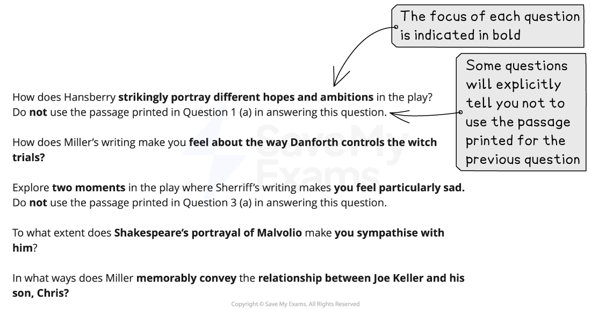

# Question B: What The Question Is Asking

## Paper 3 Drama: Question B: What the question is asking

> **Spec point** — `spcpt_JsJRDFt2GwJQKMGT`

## Paper 3 Question B: What The Question Is Asking

Question B of Paper 3: Drama is the **essay question**. You must ensure you select the correct page of the exam paper that relates to the set text you have studied. The guide below will enable you to approach Question B with confidence. It is divided into:

- Overview
- Breaking down the question
- Top tips

## Paper 3 Drama: Question B: Overview

> **Spec point** — `spcpt_42MKtsg45fhWYXH4`

## Overview

You should answer **one** question in this exam on **one** set text. You can choose to answer either Question A or Question B about the play you have studied. Question B will present you with a question that applies to the **whole** of the play. This Question is worth 25 marks and assesses all four Assessment Objectives. You have 45 minutes to answer this question.

In your response you are expected to:

- Demonstrate your knowledge of the play through reference to detail and the use of accurate, relevant quotations from the text
- Show that you understand the main ideas and explicit meanings in the play, as well as the implied or hidden meanings
- Analyse, in detail, the choices the writer has made in terms of their use of language, structure and form to **convey** impressions and ideas
- Shape your writing in such a way as to communicate your engagement with the play
- Demonstrate your understanding of the play, and the question
- Be sensitive to imagery, sound and language to develop an informed personal response to the play

The suggested timings for Question B the essay question are:

| 10 minutes | - Highlight the key words in the question - Make a brief plan of the structure of your answer - Include which specific references to the play you are going to make that are relevant to the focus of the question |
|---|---|
| 30 minutes | - Follow your plan or annotations - Write your response |
| 5 minutes | - Re-read and check your response |

It is important to read and check your work, rather than to try to write as much as you can in the time allowed. Answers that are shorter, but more focused and *concise*, are often more successful.

## Paper 3 Drama: Question B: Breaking down the question

> **Spec point** — `spcpt_7mRm3xXR5yZnq8kn`

## Breaking down the question

For this question, you will always be asked to write a response that explores how a writer conveys their meanings and messages in their play, focusing on a specific aspect or theme. The most common mistake students make in exams is not thoroughly understanding the question. By paying close attention to the question and understanding it thoroughly, you can enhance your exam performance significantly.

Below are a range of examples of Paper 3 Question B essay questions taken from past CIE IGCSE papers:

## Paper 3 Drama: Question B: Top tips

> **Spec point** — `spcpt_YQ48vH6YjhfFMcvw`

## Top tips

- Highlight the key words in the question:

  - The most successful answers maintain a clear focus on the key words in the question
  - Therefore, pay particular attention to what the question is asking you to do
- Quotations are intended to support your points, but should not be a point in themselves:

  - The strongest answers show a detailed knowledge of the text, by integrating precise and *concise* quotations and indirect textual references to support points
  - You need to be able to analyse and explain the relevance of the quotations you have chosen to your argument or to the question you are answering
- You should structure your response and your use of quotations in chronological order from the play:

  - You should aim to select 6–7 relevant quotations that contain a range of language and/or structure devices that you can comment upon and analyse
  - A high-level response will incorporate these quotations into the explanations of meaning
- Do not just state your ideas:

  - The most convincing responses sustain a critical engagement with the ways in which writers achieve their effects
  - Therefore, it is important that your explanation and analysis is supported with reasons
  - Use words such as “because”, “as” or “since” to offer reasons as to how the writer’s choices of language and structure achieve the particular effects that you mention
  - Make sure you link all of your ideas and reasons to the question
- Embed your quotations into your sentences:

  - Avoid unnecessary phrases such as “This is shown by the quote…” as this is just a waste of words
  - Instead, try: “Shakespeare makes this moment in the play so upsetting because Balthasar reveals that ‘her body sleeps in Capels’ monument’, which leads to the ultimate tragedy in the play”
- Ensure your introduction demonstrates that you have understood the task and that you have a thorough knowledge of the play:

  - You can do this by defining the focus of the question and summarising the main themes of the play
- Do not waste words on general topic sentences that do not make a specific point:

  - For example: “The passage is upsetting because of the language Shakespeare uses.”
  - This does not make any specific point that the examiner could reward with a mark
- Avoid being narrative:

  - You do not get any marks for just re-telling the play
- Make sure every paragraph answers the question:

  - Do not just write down everything you know about the play without any focus on the question
  - Make every sentence count!
- Ensure you include analysis of the use of structure and the form of the play, as well as dramatic techniques:

  - Writing just about the writer’s use of language can limit your marks
- In addition, avoid “feature-spotting”:

  - Listing techniques a writer has used without analysis will not get you marks
- Your conclusion should be relevant and should summarise your personal response to the play and the task:

  - The strongest answers provide evidence of an informed and sensitive personal response to the text, which focuses directly on the key words of the question
  - It should not just repeat points you have already made
- Avoid lengthy discussion of the historical context of the writer and/or the time in which the play was written:

  - Context is not explicitly assessed in this IGCSE
  - Instead, your wider background knowledge should be used to inform your personal response to the play
