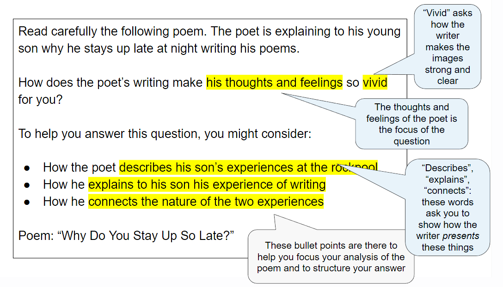

# Question 1 Poetry: What The Question Is Asking

## Paper 4 Unseen: Question 1 Poetry: What the question is asking

> **Spec point** — `spcpt_2rhtfZhmGHSQ4fRc`

## What the Question is Asking

If you are taking the unseen route for your IGCSE Literature in English, then you will do three exams: Paper 1: Poetry and Prose, Paper 3: Drama (open book) and Paper 4: Unseen. In Paper 4, you will answer one question from a choice of two. The guide below will enable you to approach Question 1, the **poetry question**, with confidence. It is divided into:

- Overview
- Breaking down the question
- Top tips

## Paper 4 Unseen: Question 1 Poetry: Overview

> **Spec point** — `spcpt_X9b6rCyxfchc2VKG`

## Overview

Question 1 will give you a poem or an extract from a poem printed on the exam paper. You will then have one question to answer about the poem, which will include bullet points to support you. The question is worth 25 marks and assesses all four assessment objectives. You have 1 hour and 15 minutes to complete this exam. The exam board advises that you spend about 20 minutes carefully reading the question and the poem (this includes time to annotate the poem) before starting your answer.

In your response you are expected to:

- Write a critical commentary on the poem printed on the question paper
- Demonstrate appreciation of the text by developing a personal response
- Use quotations and reference to detail from the poem to support your points
- Show your understanding of characters, relationships, situations and themes
- Respond to the writer’s use of language, form and structure in the poem

The suggested timings for Question 1 are:

| 20 minutes | - Read both questions and decide on the question you are going to answer - Highlight the key words in the question and the three bullet points - Read the poem - Annotate key words and phrases directly relevant to the focus of the question that you will explore in your answer - Make a brief plan of the structure of your answer |
|---|---|
| 50 minutes | - Follow your plan or annotations - Start your response using the wording of the question - Write your response |
| 5 minutes | - Re-read and check your response |

It is important to read and check your work, rather than to try to write as much as you can in the time allowed. Answers that are shorter, but more focused and *concise*, are often more successful.

## Paper 4 Unseen: Question 1 Poetry: Breaking down the question

> **Spec point** — `spcpt_VGhvbbGzvC2KTpgb`

## Breaking down the question

For this question, you will always be asked to write a response that explores how a poet conveys their meanings and message in their poem, focusing on a specific aspect or theme. The most common mistake students make in exams is not thoroughly understanding the question. By paying close attention to the question you can enhance your exam performance significantly.

Below are a range of examples of the poetry question taken from past CIE IGCSE papers:

*Example poetry question*

Read carefully the poem opposite, about a factory that has been closed for some time.

How does the poet’s writing strikingly portray the abandoned factory?

To help you answer this question, you might consider:

- How he portrays the gates and fence that surround the factory
- How he describes the inside of the building
- How he explores the relationship between the factory and the people who once worked there

Poem: “An Abandoned Factory, Detroit”

Read carefully the poem on page 3. The poet recalls a time when she found her husband collapsed in the bathroom.

How does the poet vividly portray this event?

To help you answer this question, you might consider:

- How she portrays the bathroom
- How she portrays her husband’s experience
- How she conveys a feeling of mystery

Poem: “The Fall”

Read carefully the following poem. The poet is explaining to his young son why he stays up late at night writing his poems.

How does the poet’s writing make his thoughts and feelings so vivid for you?

To help you answer this question, you might consider:

- How the poet describes his son’s experiences at the rockpool
- How he explains to his son his experience of writing
- How he connects the nature of the two experiences

Poem: “Why Do You Stay Up So Late?”

## Paper 4 Unseen: Question 1 Poetry: Top tips

> **Spec point** — `spcpt_CkdwVMjmZW5WgmhY`

## Top tips

- Highlight the key words in the question:

  - The most successful answers maintain a clear focus on the key words in the question
  - Therefore, pay particular attention to what the question is asking you to do
  - Then, as you read through the poem, highlight and annotate key words and phrases directly relevant to the focus of the question
- Quotations are intended to support your points, but should not be a point in themselves:

  - The strongest answers show a detailed knowledge of the text by *integrating*** **precise and *concise* quotations and indirect textual references to support points
  - You need to be able to analyse and explain the relevance of the quotations you have chosen to your argument and to the question you are answering
- You should structure your response and your use of quotations in chronological order, and ensure that you respond to every section of the poem:

  - You should aim to select a wide range of relevant quotations, including analysis of the writer’s choice of individual words or phrases that particularly stand out as supporting your argument
  - A high-level response will incorporate these quotations into the explanations of meaning
- Do not ignore the final stanza:

  - This is often where the poet emphasises their message or attitude
- Do not just state your ideas:

  - The most convincing responses sustain a critical engagement with the ways in which writers achieve their effects
  - Therefore, it is important that your explanation and analysis is supported with reasons
  - Use words such as “because”, “as” or “since” to offer reasons as to how the writer’s choices of language and structure achieve the particular effects that you mention
  - Make sure you link all of your ideas and reasons to the question
- Embed your quotations into your sentences:

  - Avoid unnecessary phrases such as “This is shown by the quote…” as this is just a waste of words
  - Instead, try: “Atwood expresses her belief that nature will overcome the suburbs by referring to the ‘future cracks in the plaster’”
- Ensure your introduction demonstrates that you have understood the task and the poem printed on the paper:

  - You can do this by defining the focus of the question and summarising the main themes of the poem
- Do not waste words on general topic sentences that do not make a specific point:

  - For example: “Human activities seem pointless by the way Atwood describes them”:
  
    - This does not make any specific point that the examiner could reward with a mark
- Avoid being narrative:

  - You do not get any marks for just re-telling the poem
- Make sure every paragraph answers the question:

  - Do not just write down everything you think you have discovered about the poem without any focus on the question
  - Make every sentence count!
- Ensure you include analysis of the use of structure and the form of the poem:

  - Writing just about the poet’s use of language can limit your marks
- In addition, avoid “feature-spotting”:

  - Listing techniques a poet has used without analysis will not get you marks
- Your conclusion should be relevant and should summarise your personal response to the poem and the task:

  - The strongest answers provide evidence of an informed and sensitive personal response to the text, which focuses directly on the key words of question
  - It should not just repeat points you have already made
