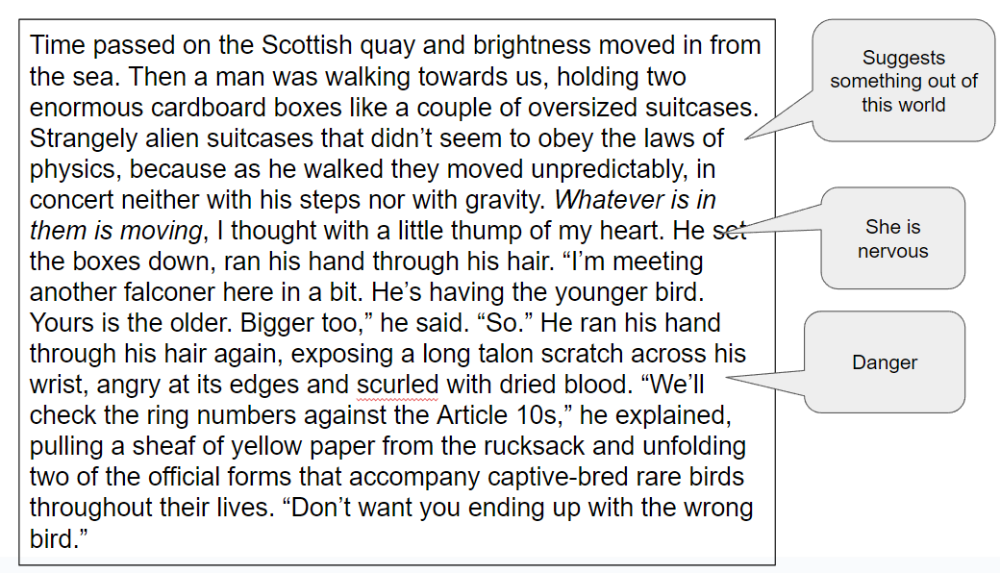
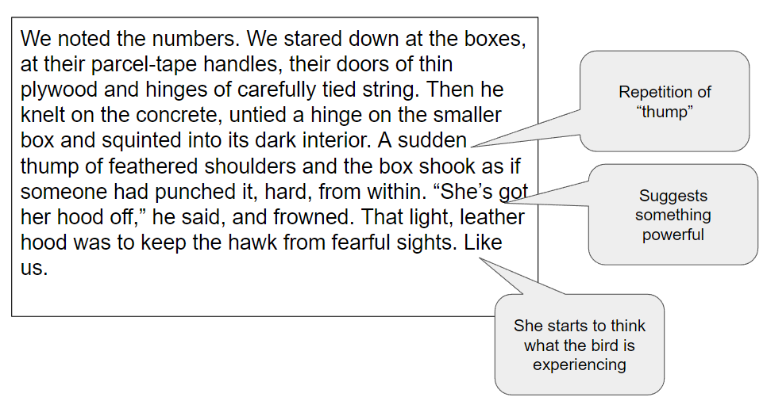
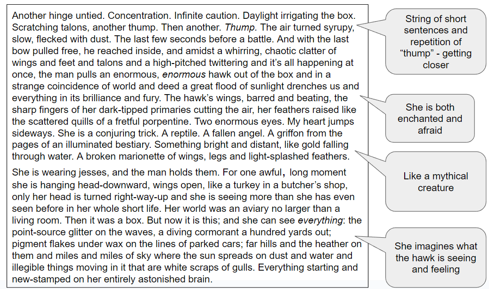
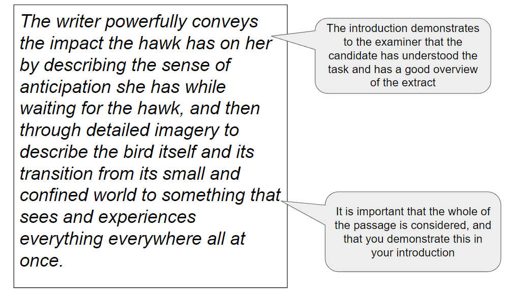
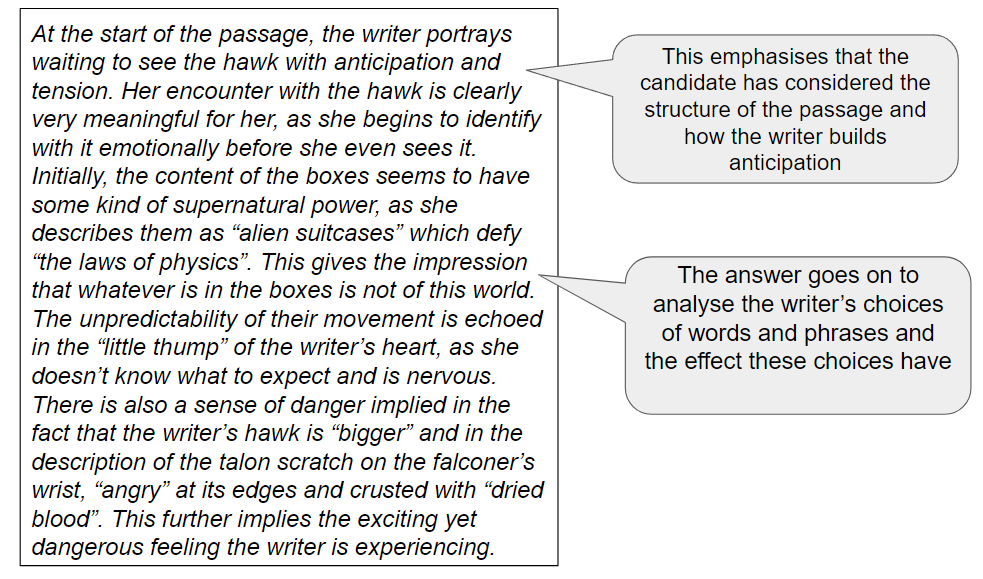
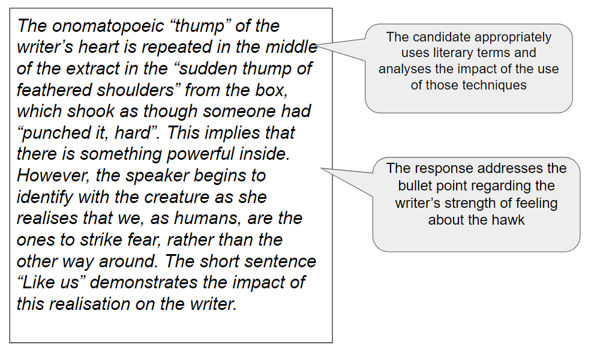
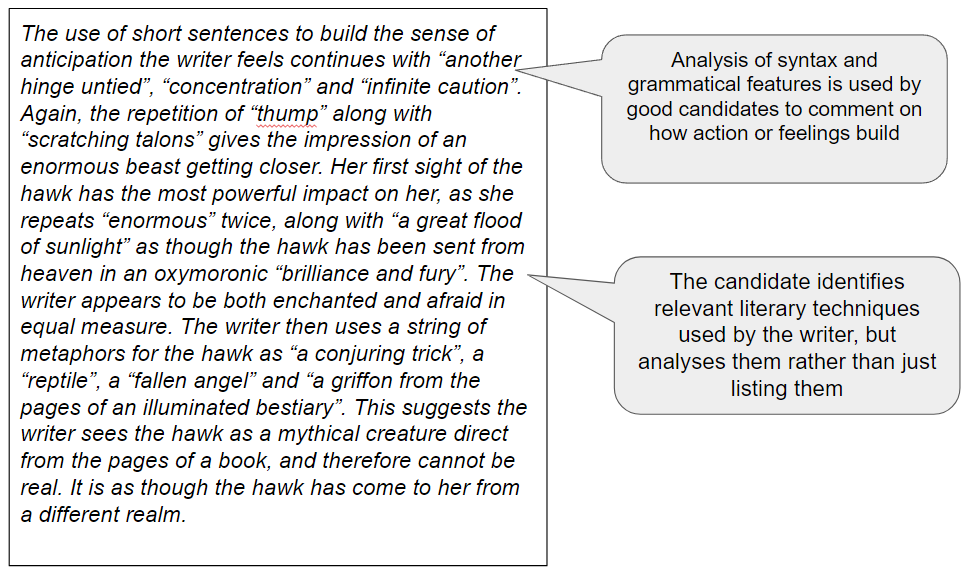
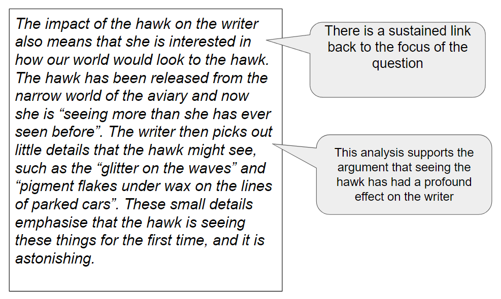
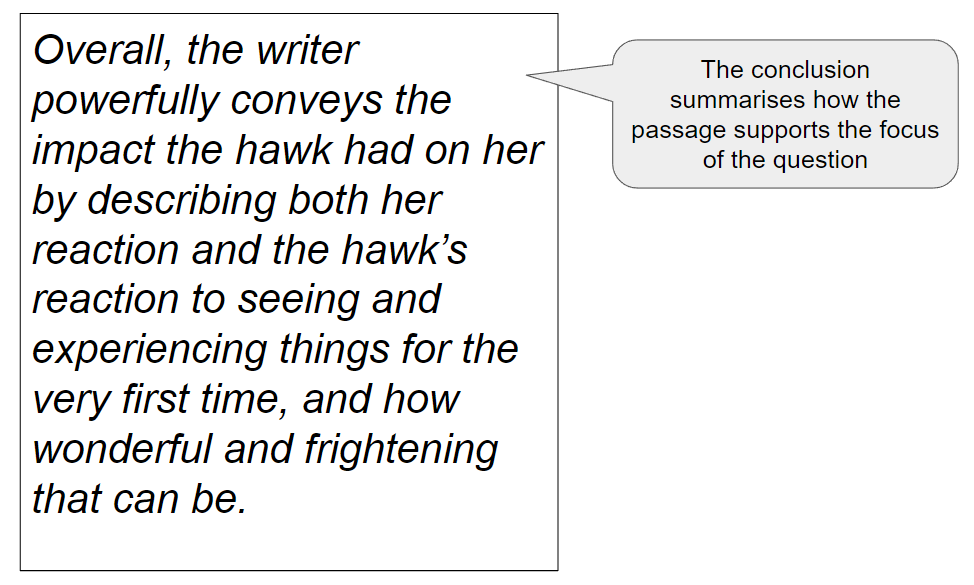

# Question 2 Prose: Mark Scheme & Model Answer

## Paper 4 Unseen: Question 2 Prose: Mark scheme and model answer

> **Spec point** — `spcpt_dvk5Ththb4QD95zG`

## Mark Scheme and Model Answer

The best way to improve any essay is to know how you are assessed, and what skills you are being assessed on. This page has been created to give you a sense of what examiners are looking for in a full-mark response. It contains:

- Overview
- Mark scheme
- Example task
- Model answer
- Unannotated model answer

## Paper 4 Unseen: Question 2 Prose: Mark scheme overview

> **Spec point** — `spcpt_4XsYqXT8gzYd24zv`

## Overview

Question 2 (Prose) will require you to answer a question based on an extract printed on the exam paper. You will be asked to explore, or analyse, how a writer has achieved particular meanings or ideas in the passage. Your response must also be supported with direct quotations or close reference to the text, which should be integrated into your response.

## Paper 4 Unseen: Question 2 Prose: Mark scheme

> **Spec point** — `spcpt_H2DxWGGQ6z9vCHvq`

## Mark scheme

The mark scheme for any question in Literature in English is quite broad and can seem difficult to understand. This is because there is no “correct answer” for any essay: the exam board does not provide points that need to be included in any essay; instead, examiners use the mark scheme to place an answer into a level.

The questions in Paper 4 are equally weighted, and each question tests all four assessment objectives.

In simple terms, to achieve the highest marks (Band 8 = 23–25 marks), this means:

| **AO1** | - Demonstrate your knowledge by incorporating well-selected references to the text skillfully and with flair in your answers - This means using quotations and indirect references to the text to support your views or arguments |
|---|---|
| **AO2** | - Sustain a critical understanding of the text by showing individuality and insight - This means showing that you understand the main ideas, settings, events and characters, and that you appreciate the deeper meanings of the text |
| **AO3** | - Respond sensitively and in considerable detail to the way the writer achieves her/his effects - This means that you are able to explore how writers use language, structure and form to convey impressions and ideas |
| **AO4** | - Sustain a personal and evaluative engagement with the task and text - This means that you are able to give a personal response to the question and text, and support your response with references to the text |

> **Exam Hint**
> Although there are four specific assessment objectives assessed in this task, it is not the case that a certain number of marks are awarded for any one objective. Instead, the examiners are looking for a well-constructed and coherent essay that seamlessly combines all of the skills covered by the assessment objectives.

## Paper 4 Unseen: Question 2 Prose: Example task

> **Spec point** — `spcpt_Mt5RTz9S8PRWf8Sn`

## Example task

The following task is written in the style of a question you might get on your exam paper. It is based on the non-fictional memoir “H is for Hawk” by Helen Macdonald. The annotations indicate the kind of things you should be looking for when reading the unseen prose passage in the exam for the first time.

| Read carefully the extract from a non-fictional memoir. The writer is buying a bird of prey, which she intends to train. Here she sees the hawk for the first time.  In what ways does the writer powerfully convey the impact the hawk has on her?  To help you answer this question, you might consider:  - How the writer portrays waiting to see the hawk - How she describes the hawk and what she imagines it sees - How the writer conveys the strength of her feelings about the hawk |
|---|

## Paper 4 Unseen: Question 2 Prose: Model answer

> **Spec point** — `spcpt_kM47zgNjStFcMT72`

## Model Answer

Below you will find a full-mark model answer for this task. The commentary labelled in each section of the essay illustrates how and why it would be awarded full marks. Despite the fact it is an answer to the above question, the commentary is relevant to any unseen prose essay, because it models how to structure an answer incorporating the relevant assessment objectives.

## Paper 4 Unseen: Question 2 Prose: Unannotated model answer

> **Spec point** — `spcpt_TpGFntrm8htvsbwB`

## Unannotated model answer

| *The writer powerfully conveys the impact the hawk has on her by describing the sense of anticipation she has while waiting for the hawk, and then through detailed imagery to describe the bird itself and its transition from its small and confined world to being something that sees and experiences everything everywhere all at once.*  *At the start of the passage, the writer portrays waiting to see the hawk with anticipation and tension. Her encounter with the hawk is clearly very meaningful for her, as she begins to identify with it emotionally before she even sees it. Initially, the content of the boxes seems to have some kind of supernatural power, as she describes them as “alien suitcases” that defy “the laws of physics”. This gives the impression that whatever is in the boxes is not of this world. The unpredictability of their movement is echoed in the “little thump” of the writer’s heart, as she doesn’t know what to expect and is nervous. There is also a sense of danger implied in the fact that the writer’s hawk is “bigger” and in the description of the talon scratch on the falconer’s wrist, “angry” at its edges and crusted with “dried blood”. This further implies the exciting yet dangerous feeling the writer is experiencing.*  *The onomatopoeic “thump” of the writer’s heart is repeated in the middle of the extract in the “sudden thump of feathered shoulders” from the box, which shook as though someone had “punched it, hard”. This implies that there is something powerful inside. However, the speaker begins to identify with the creature as she realises that we, as humans, are the ones to strike fear, rather than the other way around. The short sentence “Like us” demonstrates the impact of this realisation on the writer.*  *The use of short sentences to build the sense of anticipation the writer feels continues with “another hinge untied”, “concentration” and “infinite caution”. Again, the repetition of “thump” along with “scratching talons” gives the impression of an enormous beast getting closer. Her first sight of the hawk has the most powerful impact on her, as she repeats “enormous” twice, along with “a great flood of sunlight” as though the hawk has been sent from heaven in an oxymoronic “brilliance and fury”. The writer appears to be both enchanted and afraid in equal measure. The writer then uses a string of metaphors for the hawk as “a conjuring trick”, a “reptile”, a “fallen angel” and “a griffon from the pages of an illuminated bestiary”. This suggests the writer sees the hawk as a mythical creature direct from the pages of a book, and that it therefore cannot be real. It is as though the hawk has come to her from a different realm.*  *The impact of the hawk on the writer also means that she is interested in how our world would look to the hawk. The hawk has been released from the narrow world of the aviary and now she is “seeing more than she has ever seen before”. The writer then picks out little details that the hawk might see, such as the “glitter on the waves” and “pigment flakes under wax on the lines of parked cars”. These small details emphasise that the hawk is seeing these things for the first time, and it is astonishing.*  *Overall, the writer powerfully conveys the impact the hawk had on her by describing both her reaction and the hawk’s reaction to seeing and experiencing things for the very first time, and how wonderful and frightening that can be.* |
|---|
