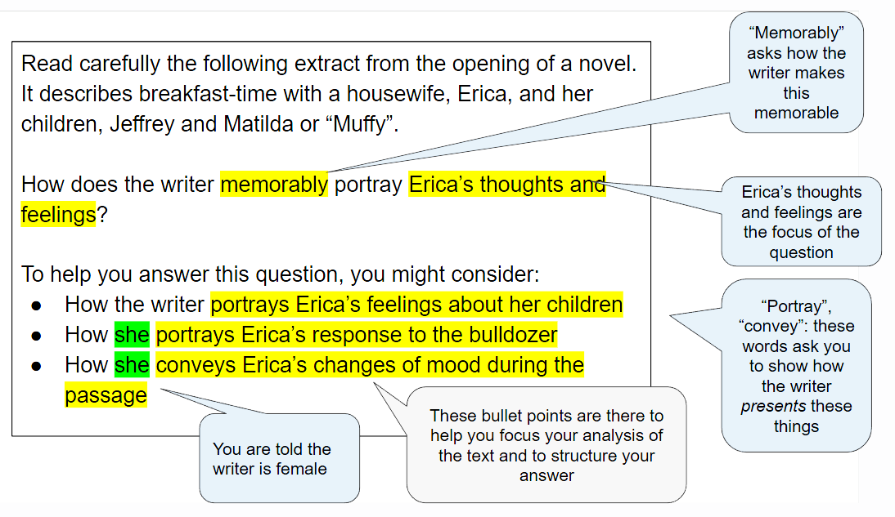
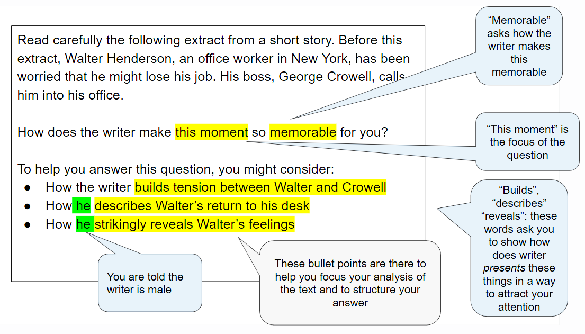
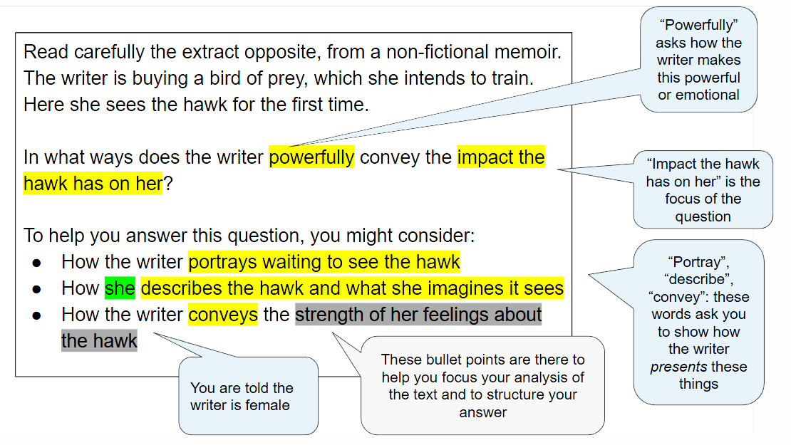

# Question 2 Prose: What The Question Is Asking

## Paper 4 Unseen: Question 2 Prose: What the question is asking

> **Spec point** — `spcpt_rD7Khwkn86svM35p`

## What The Question Is Asking

If you are taking the unseen route for your IGCSE Literature in English, then you will do three exams: Paper 1: Poetry and Prose, Paper 3: Drama (open book) and Paper 4: Unseen. In Paper 4, you will answer one question from a choice of two. The guide below will enable you to approach Question 2, the **prose question**, with confidence. It is divided into:

- Overview
- Breaking down the question
- Top tips

## Paper 4 Unseen: Question 2 Prose: Overview

> **Spec point** — `spcpt_7CBxHNB8VjFM8nZT`

## Overview

Question 2 will give you an extract from a novel, a short story or another type of prose writing printed on the exam paper. You will then have one question to answer about the extract, which will include bullet points to support you. The question is worth 25 marks and assesses all four assessment objectives. You have 1 hour and 15 minutes to complete this exam. The exam board advises that you spend about 20 minutes carefully reading the question and the extract (including time to annotate the extract) before starting your answer.

In your response you are expected to:

- Write a critical commentary on the extract printed on the question paper
- Demonstrate appreciation of the text by developing a personal response
- Use quotations and reference to detail from the extract to support your points
- Show your understanding of characters, relationships, situations and themes
- Respond to the writer’s use of language, form and structure in the extract

The suggested timings for the prose question are:

| 20 minutes | - Read both questions and decide on the question you are going to answer - Highlight the key words in the question and the three bullet points - Read the extract - Annotate key words and phrases directly relevant to the focus of the question that you will explore in your answer - Make a brief plan of the structure of your answer |
|---|---|
| 50 minutes | - Follow your plan or annotations - Start your response using the wording of the question - Write your response |
| 5 minutes | - Re-read and check your response |

It is important to read and check your work, rather than to try to write as much as you can in the time allowed. Answers that are shorter, but more focused and *concise*, are often more successful.

## Paper 4 Unseen: Question 2 Prose: Breaking down the question

> **Spec point** — `spcpt_CMbmKwbh5GSJKYDj`

## Breaking down the question

For this question, you will always be asked to write a response that explores how a writer conveys their meanings and message in their writing, focusing on a specific aspect or theme. The most common mistake students make in exams is not thoroughly understanding the question. By paying close attention to the question you can enhance your exam performance significantly.

Below are a range of examples of the prose question taken from past CIE IGCSE papers. Notice that you are given some contextual information in the questions, including the gender of the author, that will help you.

*Example novel extract question*

*Example short story question*

*Example memoir question*

Read carefully the following extract from the opening of a novel. It describes breakfast-time with a housewife, Erica, and her children, Jeffrey and Matilda or “Muffy”.

How does the writer memorably portray Erica’s thoughts and feelings?

To help you answer this question, you might consider:

- How the writer portrays Erica’s feelings about her children
- How she portrays Erica’s response to the bulldozer
- How she conveys Erica’s changes of mood during the passage

Read carefully the following extract from a short story. Before this extract, Walter Henderson, an office worker in New York, has been worried that he might lose his job. His boss, George Crowell, calls him into his office.

How does the writer make this moment so memorable for you?

To help you answer this question, you might consider:

- How the writer builds tension between Walter and Crowell
- How he describes Walter’s return to his desk
- How he strikingly reveals Walter’s feelings

Read carefully the extract opposite, from a non-fictional memoir. The writer is buying a bird of prey, which she intends to train. Here she sees the hawk for the first time.

In what ways does the writer powerfully convey the impact the hawk has on her?

To help you answer this question, you might consider:

- How the writer portrays waiting to see the hawk
- How she describes the hawk and what she imagines it sees
- How the writer conveys the strength of her feelings about the hawk

## Paper 4 Unseen: Question 2 Prose: Top tips

> **Spec point** — `spcpt_N5jF9R4p87W9tgDn`

## Top tips

- Highlight the key words in the question:

  - The most successful answers maintain a clear focus on the key words in the question
  - There are also some clues given to you in the question, such as the gender of the author and some contextual information
  - Then, as you read through the extract, highlight and annotate key words and phrases directly relevant to the focus of the question
- Quotations are intended to support your points, but should not be a point in themselves:

  - The strongest answers show a detailed knowledge of the text by *integrating*** **precise and *concise* quotations and indirect textual references to support points
  - You need to be able to analyse and explain the relevance of the quotations you have chosen to your argument and to the question you are answering
- You should structure your response and your use of quotations in chronological order, and ensure that you respond to every section of the extract:

  - You should aim to select a wide range of carefully selected and relevant quotations, including analysis of the writer’s choice of individual words or phrases that particularly stand out as supporting your argument
  - A high-level response will incorporate these quotations into the explanations of meaning
- Do not just state your ideas:

  - The most convincing responses sustain a critical engagement with the ways in which writers achieve their effects
  - Therefore, it is important that your explanation and analysis is supported with reasons
  - Use words such as “because”, “as” or “since” to offer reasons as to how the writer’s choices of language and structure achieve the particular effects that you mention
  - Make sure you link all of your ideas and reasons to the question
- Embed your quotations into your sentences:

  - Avoid unnecessary phrases such as “This is shown by the quote…” as this is just a waste of words
  - Instead, try: “The writer creates sympathy for the character by describing her as ‘small and weak’”
- Ensure your introduction demonstrates that you have understood the task and the extract printed on the paper:

  - You can do this by defining the focus of the question and summarising the main themes in the extract
- Do not waste words on general topic sentences that do not make a specific point:

  - For example: “The writer uses adjectives to create sympathy for the character”:
  
    - This does not make any specific point that the examiner could reward with a mark
- Avoid being narrative:

  - You do not get any marks for just re-telling the story
- Make sure every paragraph answers the question:

  - Make every sentence count!
  - Make sure that you can draw a metaphorical line through every paragraph back to the focus of the question
- Ensure you include analysis of the use of structure and the form of the text:

  - This is especially important when considering, for example, a writer’s use of dialogue
- In addition, avoid “feature-spotting”:

  - Listing techniques a writer has used without analysis will not get you marks
- Your conclusion should be relevant and should summarise your personal response to the text and the task:

  - The strongest answers provide evidence of an informed and sensitive personal response to the text, which focuses directly on the key words of the question
  - It should not just repeat points you have already made
