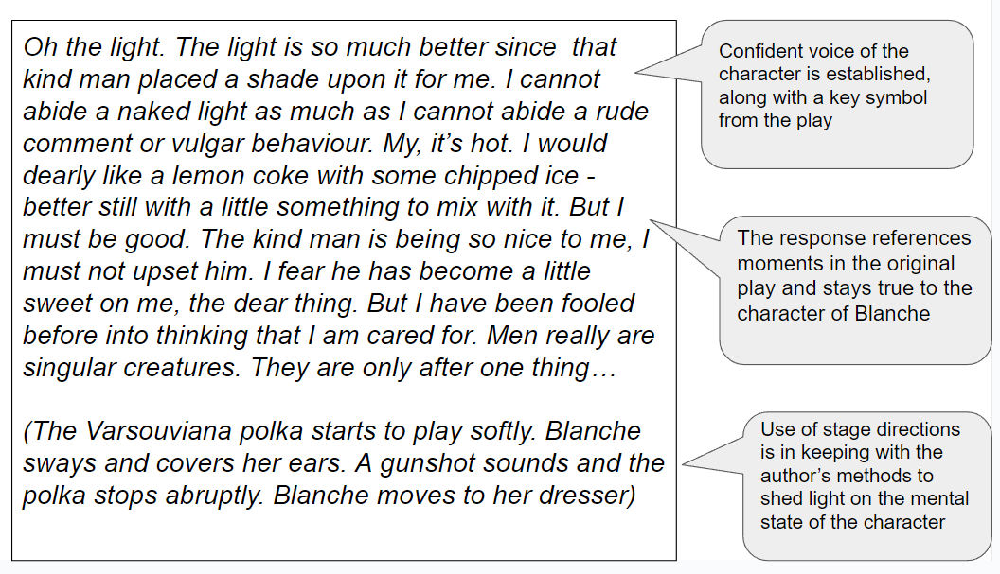
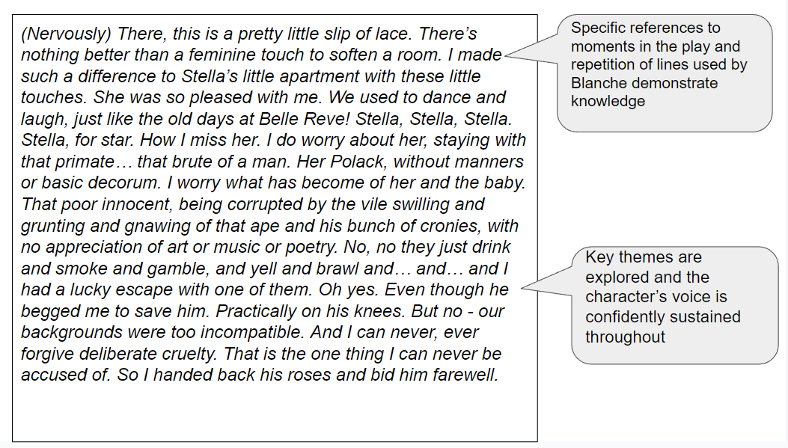

# Mark Scheme & Model Answer

## Coursework: Mark scheme and model answer

> **Spec point** — `spcpt_2nJ6y4QSSMNxs8dK`

## Mark Scheme and Model Answer

The best way to improve any essay is to know how you are assessed, and what skills you are being assessed on. This page has been created to give you a sense of what examiners are looking for in a full-mark response. It contains:

- Overview
- Mark scheme
- Example task
- Model answer and commentary

## Coursework: Mark scheme overview

> **Spec point** — `spcpt_8hVbsSVWdmzPgC2b`

## Overview

Component 5: Coursework requires you to complete two assignments, each one 600–1200 words in length. You will be asked to explore, or analyse, how a writer has achieved particular meanings or ideas, or to write a piece as a character in a text at a specific moment. Your response must also be supported with direct quotations or close reference to the text.

## Coursework: Mark scheme

> **Spec point** — `spcpt_WKY94KKRMxM5pSJS`

## Mark scheme

The mark scheme for any question in Literature in English is quite broad and can seem difficult to understand. This is because there is no “correct answer” for any essay: the exam board does not provide points that need to be included in any essay; instead, examiners use the mark scheme to place an answer into a level.

The two assignments in the coursework portfolio are equally weighted, and each question tests all four assessment objectives.

In simple terms, to achieve the highest marks, this means:

| **AO1** | - Demonstrate your knowledge by incorporating well-selected reference to the text skillfully and with flair in your answers - This means using quotations and indirect references to the text to support your views or arguments |
|---|---|
| **AO2** | - Sustain a critical understanding of the text by showing individuality and insight - This means showing that you understand the main ideas, settings, events and characters, and that you appreciate the deeper meanings of the text |
| **AO3** | - Respond sensitively and in considerable detail to the way the writer achieves her/his effects - This means that you are able to explore how writers use language, structure and form to convey impressions and ideas |
| **AO4** | - Sustain a personal and evaluative engagement with the task and text - This means that you are able to give a personal response to the question and text, and support your response with references to the text |

> **Exam Hint**
> Although there are four specific assessment objectives assessed in each assignment, it is not the case that a certain number of marks are awarded for any one objective. Instead, the examiners are looking for a well-constructed and coherent essay that seamlessly combines all of the skills covered by the assessment objectives.

## Coursework: Example task

> **Spec point** — `spcpt_k3TwnhSRGTDnM8XJ`

## Example task

The following task is an example of one submitted and approved by CIE for a coursework assignment. As we have covered critical responses in the previous revision notes for [*prose*](https://www.savemyexams.com/igcse/english-literature/cie/21/revision-notes/1-poetry-and-prose/how-to-answer-the-poetry-and-prose-questions/section-b-mark-scheme-and-model-answer/), [*poetry*](https://www.savemyexams.com/igcse/english-literature/cie/21/revision-notes/1-poetry-and-prose/how-to-answer-the-poetry-and-prose-questions/section-a-mark-scheme-and-model-answer/) and [*drama*](https://www.savemyexams.com/igcse/english-literature/cie/21/revision-notes/2-drama-closed-book/how-to-answer-the-paper-2-drama-questions/question-a-mark-scheme-and-model-answer/), the following example is of an empathic task and response. The text chosen is A Streetcar Named Desire by Tennessee Williams:

***You are Blanche. It is a few weeks after you were taken to the asylum by the doctor and nurse. You are sitting in your room. Write your thoughts.***

## Coursework: Model answer and commentary

> **Spec point** — `spcpt_yYWyFVfXqpC8H7hy`

## Model answer and commentary

Below you will find an example of the start of a top-mark empathic response for the above question:

