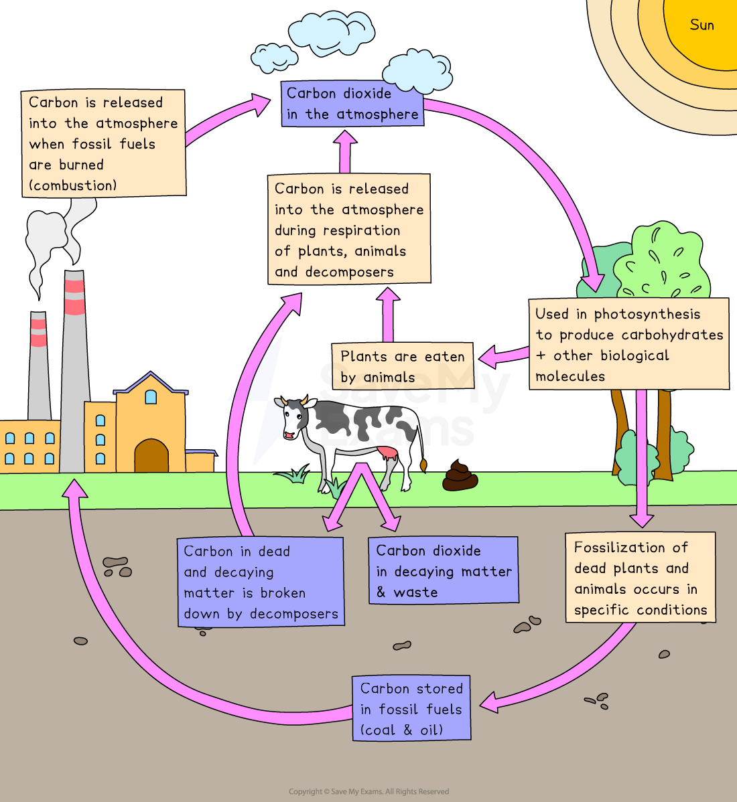

# Carbon Cycle in an Ecosystem

## Carbon cycle in an ecosystem

> **Spec point** — `spcpt_GWpsmFZGZDKmkZQd`

## Carbon cycle in an ecosystem

- The carbon cycle is the continuous movement of carbon between the **atmosphere**, **living organisms**, **oceans**, and the **Earth’s crust**
- Carbon is stored in:

  - the atmosphere as carbon dioxide
  - plants and animals as biomass
  - fossil fuels underground
  - oceans and marine life
  - soils and decaying matter
- The cycle ensures carbon is always **recycled**, which keeps:

  - ecosystems supplied with the carbon plants need
  - the climate stable
  - nutrients flowing between organisms
- Without the carbon cycle, life would quickly run out of the carbon needed to build cells and release energy

### Key processes in the carbon cycle

#### 1. Photosynthesis

- Plants remove carbon dioxide from the air
- They use it to make glucose during photosynthesis
- This locks carbon into plant tissues such as leaves, stems and roots

#### 2. Feeding

- When animals eat plants or other animals, the carbon in their food moves into their bodies
- This passes carbon along food chains and food webs

#### 3. Respiration

- Plants, animals and microorganisms release carbon dioxide back into the atmosphere when they respire
- This happens day and night
- Respiration is a major way carbon returns to the air

#### 4. Decomposition

- When organisms die, decomposers such as fungi and bacteria break them down
- Carbon from dead bodies is released back into:

  - the soil
  - the atmosphere
  - the ocean
- Decomposition keeps nutrients flowing and prevents dead matter from building up

#### 5. Formation of fossil fuels

- Over millions of years, buried dead organisms can turn into:

  - coal
  - oil
  - natural gas
- This traps large amounts of carbon underground

#### 6. Combustion

- Burning fossil fuels or wood releases stored carbon dioxide into the atmosphere
- This speeds up the carbon cycle dramatically and adds extra carbon to the air

*A simplified carbon cycle diagram showing some of the key carbon sources and carbon sinks*

### How human actions affect the carbon cycle

- Humans are changing the carbon cycle faster than nature can cope with
- Key impacts include:

  - Deforestation reduces the amount of carbon removed by photosynthesis
  - Burning fossil fuels releases carbon dioxide more quickly than it is absorbed
  - Agriculture adds carbon through soil disturbance and methane release
  - Climate change increases the amount of carbon released from melting permafrost
- These changes strengthen the **enhanced greenhouse effect** and contribute to global warming

### Why the carbon cycle matters for ecosystems

- The carbon cycle:

  - Provides plants with carbon for photosynthesis
  - Keeps atmospheric carbon dioxide at stable levels
  - Supports food chains and energy transfers
  - Allows decomposers to recycle nutrients
  - Links photosynthesis and respiration into one continuous loop
- Disrupting the carbon cycle can damage ecosystems and reduce biodiversity

> **Exam Hint**
> Always link **photosynthesis**, **feeding**, **respiration** and **decomposition.**
> 
> Use simple arrows to show the cycle when explaining it.
> 
> Mention human impacts such as **combustion** and **deforestation** in higher-mark answers.
> 
> Remember that **carbon never disappears**; it just moves between stores.
> 
> Think of the carbon cycle as the glue that holds the atmosphere and ecosystems together.
