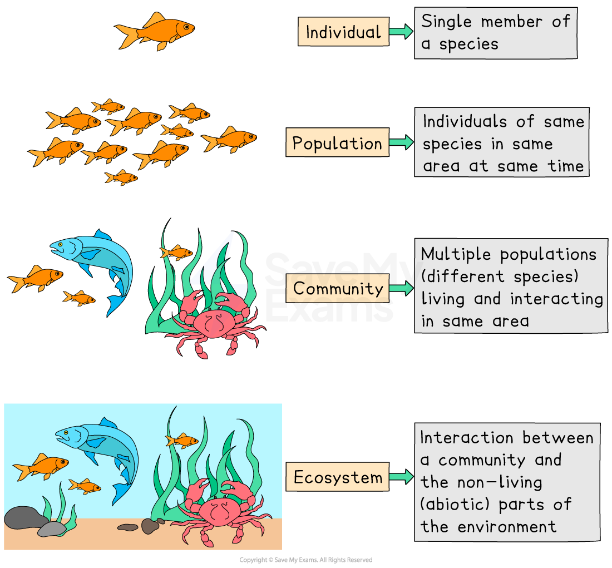

# Ecosystem Components

## What are the components of an ecosystem?

> **Spec point** — `spcpt_d83NC2R5FWxnYgD3`

## What are the components of an ecosystem?

- A ***biotic*** factor is a living thing that has an impact on other populations of living things or on the environment
- ***Abiotic*** factors do the same thing, but they are non-living
- Together, biotic and abiotic factors make up an ecosystem
- We can therefore **define an ecosystem** as:

> **blockquote**
> An area where the living (**biotic**) and non-living (**abiotic**) components interact with each other.

- Ecosystems vary in size and scale

  - A small ecosystem could be a garden pond
  - A large-scale ecosystem could be all tropical rainforests—this is known as a ***biome***

- The **living parts** of an ecosystem are made up of **communities**

  - Communities are the **interacting populations **of **different organisms** in a particular area
  - For example, a woodland community of organisms such as oak trees, ferns, mosses, foxes, rabbits, butterflies, beetles, mushrooms, woodlice, spiders, etc.
- Communities are made up of** populations**

  - Populations are all the **individuals **of the** same species **in the same place
  - For example, a population of puffins on a clifftop`equation` or a population of sunflowers in a garden
- The place where an organism **lives,** which provides **food**, **shelter **and a place to **reproduce**, is called a **habitat**

  - Within its habitat, the species has a particular role in terms of its interactions with other species and its effect on the environment; this is called its **niche**
  - A niche describes:
  
    - The abiotic factors that the species can withstand
    - The resources in the ecosystem that it is able to make use of (e.g. the soil nutrients available to it)
    - Its interactions with other organisms (biotic factors)

*Levels of organisation in an ecosystem*

- Each **individual species** has its **own** **distinct niche** because only one species can occupy a given niche
- If two species try to occupy the same niche, they will **compete** with each other for the same resources

  - One of the species will be more successful and out-compete the other species until only one species is left and the other is either forced to occupy a new, slightly different niche or go extinct from the habitat or ecosystem altogether
- For example, if there were three bird species occupying the **same habitat** (such as a forest), they would occupy **slightly** **different niches** as each species would feed at a different height along the trees

  - This avoids competition between the three species, allowing them to coexist closely with each other in the same habitat

> **Exam Hint**
> Remember that **biotic **factors **need abiotic **factors to survive and that **abiotic **factors can **restrict **the types and quantities of **biotic factors** in an ecosystem.
> 
> This means that changes in one component can have a major effect on other  parts of the ecosystem.

- A **predator **is an organism that hunts, kills and eats *prey* for food

  - Populations of predators and prey are closely linked
  
    - Many predators have niche prey – the food that predators prefer to eat
- An **apex predator** doesn't have any natural predators, so its role is to keep the ecosystem healthy and control the population of prey species

## Abiotic & biotic components of an ecosystem

> **Spec point** — `spcpt_VJk6xVRS6BCPG4PB`

## Abiotic & biotic components of an ecosystem

- Within an ecosystem the different biotic components – plants (flora), animals (fauna), fungi, and microorganisms like bacteria – depend on each other and the abiotic components
- This is known as **interdependence**

### Biotic (living) components

- Biotic components interact with each other through food chains, competition, and mutual support

- **Producers**

  - Plants and algae produce their own food using energy from sunlight
  - The energy that they store serves as food for the consumers and decomposers, either directly or indirectly
  - They form the **first level** in a food chain
- **Consumers **get their energy by feeding on other organisms: plants or animals or both

  - **Primary **consumers are *herbivores*/*omnivores**** ***that feed mostly on producers – plants and plant-derived material
  
    - For example, a grasshopper consumes grass
    - The producers' chemical energy is then transferred to the **primary consumers**
  - **Secondary **consumers are **predators **(*carnivores*/omnivores) that feed on **primary consumers**
  
    - For example, a frog eats the grasshopper
  - **Tertiary **consumers are **predators** that feed on **secondary consumers**
  
    - For example, a snake eats the frog, etc.
  - The **final** **consumer **is called a **top (or apex) predator **and is **not eaten** by anything else **but dies **and is **recycled** by decomposers

- **Decomposers **are organisms that** break down dead organisms **in a **process **called **decomposition **(rotting)** **into simpler substances and play a vital role in the recycling of matter (**nutrient cycling**)

  - For example, bacteria decompose organic matter, releasing nutrients for plant uptake
  - Fungi break down dead plant material, such as fallen leaves and wood, into simpler compounds

### Abiotic (non-living) components

- **Temperature: **Both plants and animals have evolved to thrive at ideal temperatures
- **Water:**

  - Most plants are killed by waterlogging, as they are unable to respire
  - Animals and plants have adapted to tolerate different levels of moisture
- **Oxygen** is required for animal respiration

  - Oxygen dissolves in water for aquatic animals
  - Some animals are **bioindicator species**, as their presence or absence indicates the condition of the habitat
- **Carbon dioxide** is needed for photosynthesis
- Greater concentrations increase plant growth and yields

  - However, CO₂ is an acidic gas and some plants are sensitive to changes in pH levels
- **Salinity: **The amount of salt in the soil/water has an impact on plant growth and animal health

  - High levels kill plants and leave bare, easily eroded soil
  - Wetlands deteriorate, placing species at risk and reducing biodiversity
- **Light: **Photosynthesis requires light, and plant species have adapted to grow best in the light that is available in their environment
- **pH: **Many plants are sensitive to pH levels
