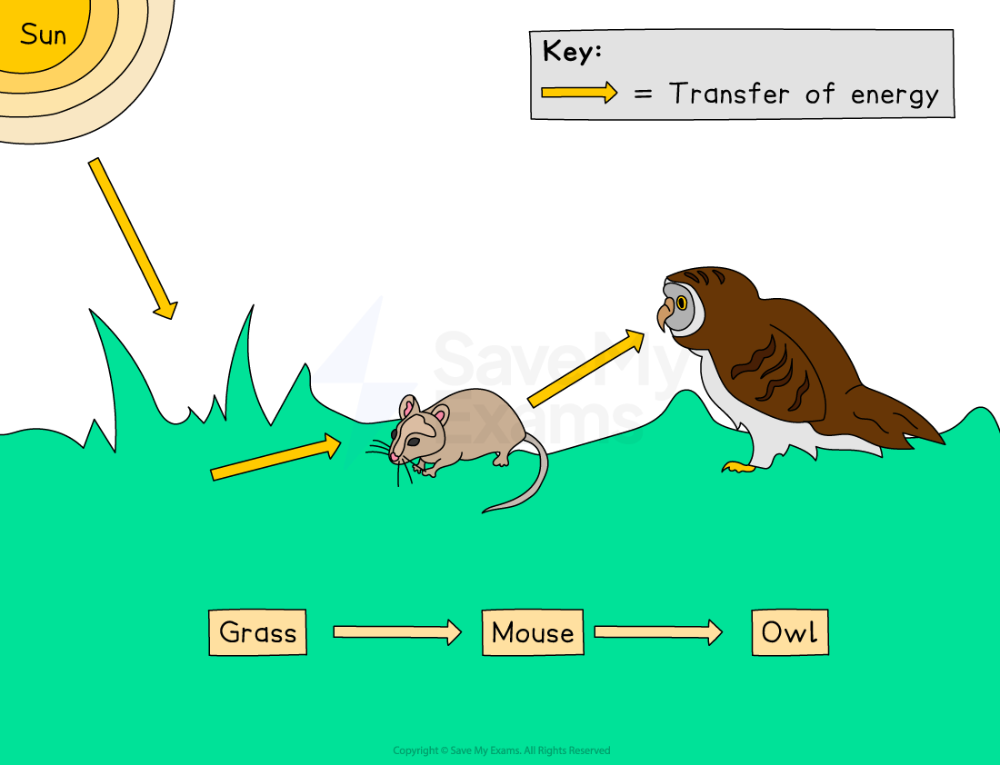
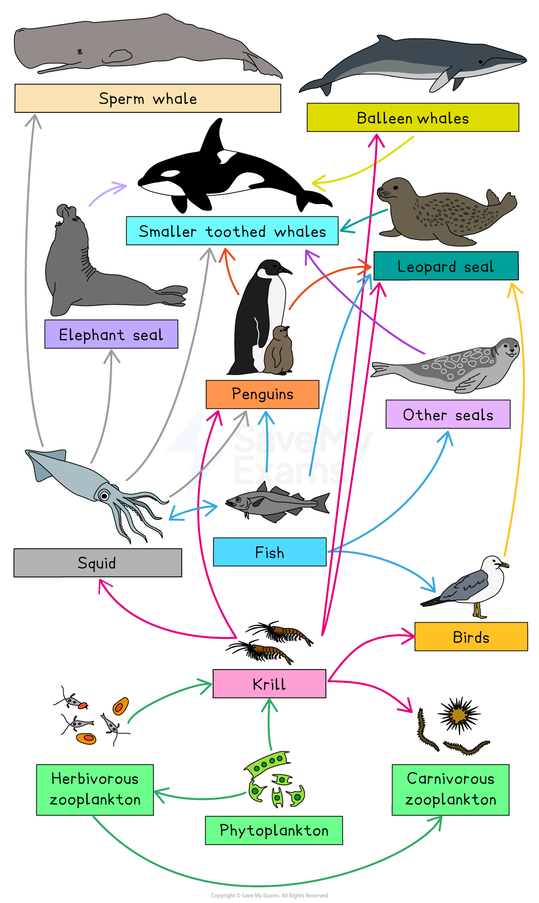
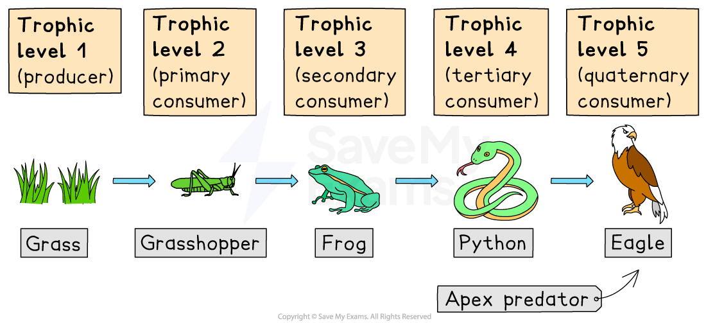
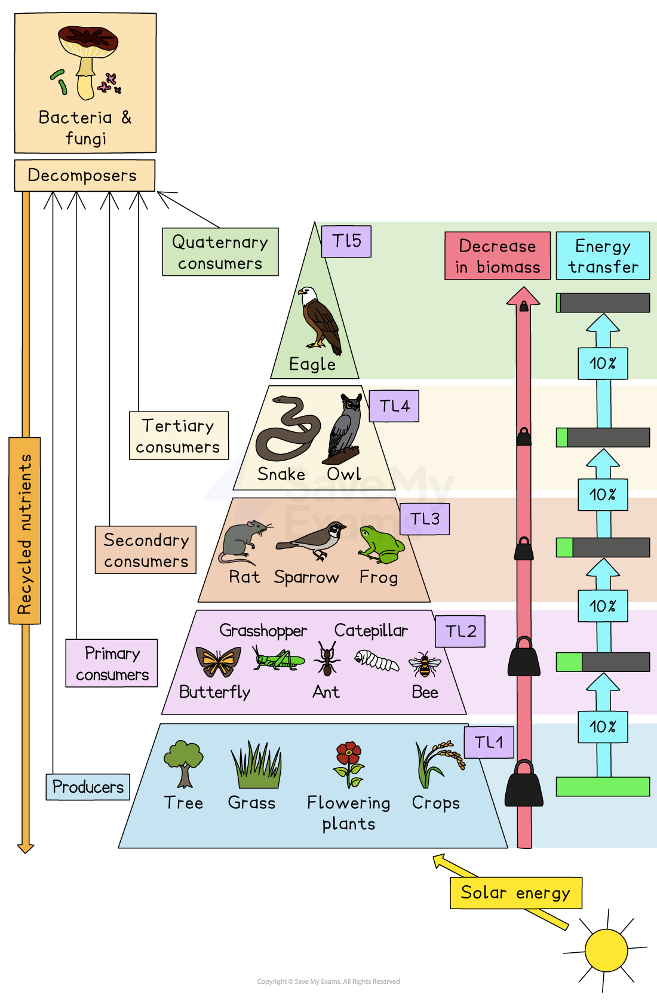
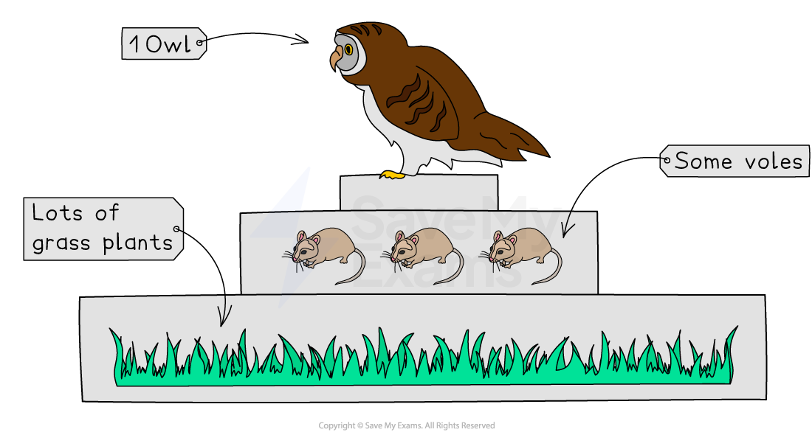
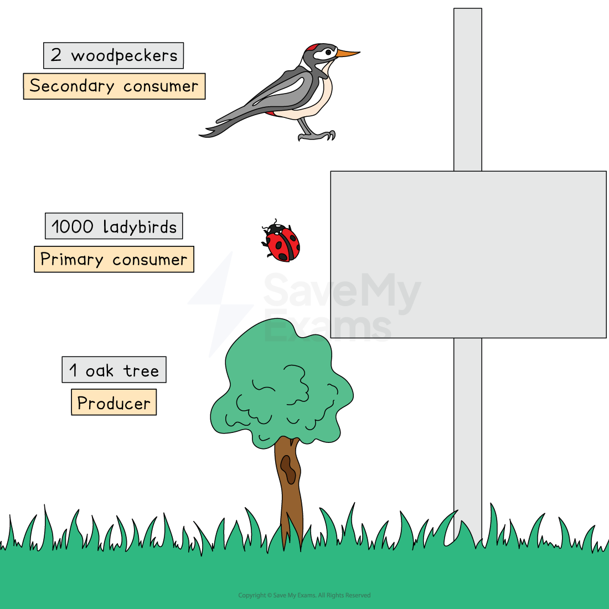
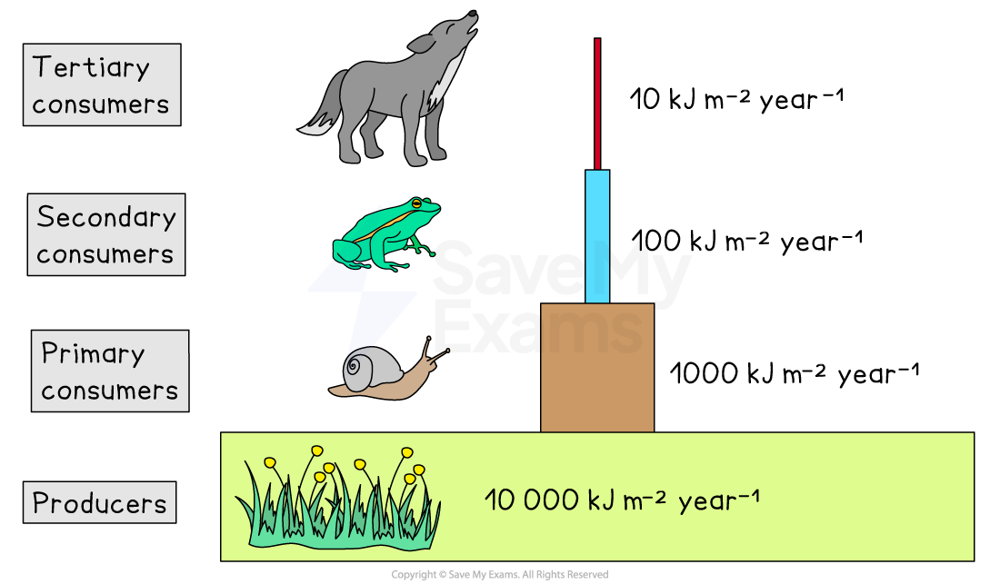

# Energy Flows in an Ecosystem

## Energy flow in an ecosystem

> **Spec point** — `spcpt_6cdVtH8Y6Q9Y8p4q`

## Energy flow in an ecosystem

- All living organisms need **energy** to survive
- This energy originally comes from the **Sun**
- Plants capture sunlight during **photosynthesis** and turn it into chemical energy stored in **glucose**
- Animals get energy by eating plants or other animals
- Energy flow shows **how energy moves**

  - from the Sun → to producers → to consumers → to apex predators
- As energy moves through the ecosystem, **some is always lost**, which is why food chains never have endless levels

### Food chains

A** food chain** is a simple model showing how energy passes from one organism to the next

- Example:

***sun → grass → mouse → owl***

- The grass is the producer
- The mouse is the primary consumer
- The owl is the secondary consumer

Food chains show the direction of **energy transfer**, not who eats the most

*A food chain*

### Food webs

- In reality, many animals eat more than one type of organism, and **food chains** **combine **to make** food webs**
- Food webs show: If one species disappears:

  - All feeding relationships in an ecosystem
  - How energy moves through many species
  - How one change affects the whole ecosystem

  - Prey populations may increase
  - Predator populations may fall
  - The whole food web becomes unbalanced

*Food web showing inter-relation between producers and consumers (prey and predator)*

### Trophic levels

- A trophic level is a **feeding level** in a food chain

  - If multiple organisms occupy the same position in a food chain, they are in the same trophic level
- **Trophic levels**:

  - Producers
  - Primary consumers
  - Secondary consumers
  - Tertiary consumers
  - Apex predators
- Each step up the chain gets **less energy**, so top predators are fewer in number

- **Producers capture solar energy**:

  - Producers (e.g., plants, algae, phytoplankton) convert **solar energy** into **chemical energy** through photosynthesis
  - Example: A grassland ecosystem where grass (producers) captures sunlight to grow
- **Consumers transfer energy**:

  - Primary consumers (herbivores) eat producers
  - Secondary and tertiary consumers eat other consumers, transferring energy upward in the food chain
  - Example: Earthworms decompose organic matter in forests, enriching the soil

*Trophic levels for a simple food chain—the blue arrows show how the chemical energy originally produced by the primary producer (grass) is transferred to other organisms in the community*

### The 10% rule

- The **10% rule** explains how energy decreases as it moves through trophic levels in an ecosystem

  - Roughly **10%** of energy is transferred from one trophic level to the next
  - For example, if a producer captures 1,000 kcal of energy, only 100 kcal is available to primary consumers
- **So much energy is lost because of:**

  - movement
  - respiration
  - digestion
  - heat loss
  - excretion
  - not all parts of an organism are eaten
- Because so much energy is lost:

  - Food chains are usually short
  - Apex predators need large spaces
  - There are more producers than consumers
- Energy pyramids show how total energy **decreases** at each trophic level

  - The base (producers) is widest
  - Each level above is narrower
  - The top has the least energy and the fewest organisms
- This helps explain why apex predators are rare

*Energy pyramid showing trophic levels*

> **Exam Hint**
> Producers always start the chain because they bring in the energy.
> 
> Use the word **'trophic levels'** in exam answers to sound confident.
> 
> Always explain **why** only 10% is passed on.
> 
> Link energy loss to fewer organisms at higher levels.
> 
> Remember that **food webs** are more realistic than simple chains.

## Ecological pyramids

> **Spec point** — `spcpt_N26HPgsKhkFHR92X`

## Ecological pyramids

- Ecological pyramids are diagrams that show **how living things are organised** in an ecosystem
- They help visualise patterns that can be hard to see in food chains
- Pyramids represent different types of information:

  - The **number** of organisms
  - The **amount of energy** available
- All pyramids show that **producers form the widest base**, because they capture sunlight and bring new energy into the system
- As you go up the pyramid, there is **less energy** and usually **fewer organisms**, because energy is lost at every trophic level

### Why ecological pyramids are important

- They show how energy decreases through a food chain
- They help predict how ecosystems change if one level is affected
- They show why top predators are fewer in number
- They reveal the structure and stability of an ecosystem

### Pyramids of numbers

- A pyramid of **numbers** shows how many organisms exist at each level of a food chain
- The **width** of the box indicates the **number of organisms** at that trophic level
- For example, consider the following food chain:

***grass → vole → owl***

- A pyramid of numbers for this food chain would look like the one shown below

  - Often, the number of organisms **decreases** along food chains, as there is a decrease in available energy since some energy is lost to the surrounding environment at each trophic level
  - Therefore, pyramids of numbers usually become **narrower** towards the apex (the top)

*Pyramid of numbers*

- Despite the name, a pyramid of numbers doesn’t always have to be pyramid-shaped
- For example, consider the following food chain:

***oak tree → insects → woodpecker***

- The pyramids of numbers for this food chain will display a different pattern to the first food chain
- When individuals at lower trophic levels are relatively **large**, like the oak tree, the pyramid becomes **inverted **or **distorted**

  - Only a single oak tree is needed to support large numbers of insects (which can then support large numbers of woodpeckers)

*Pyramids of numbers are not always pyramid-shaped (they can be inverted, like the one shown above)*

> **Exam Hint**
> You should know this because examiners may show diagrams that are not perfect triangles.

### Pyramids of energy

- Shows the **energy available** at each trophic level
- Always measured over a period of time, for example, **kJ per m² per year**

  - The length of each box, or bar, represents the quantity of **energy** present
- These pyramids of energy are **always pyramid-shaped**
- Energy always decreases as you go up the trophic levels
- This is the most **accurate** way of showing ecosystem structure
- This supports the **10% rule** of energy transfer

*The energy stored in the biomass of organisms can be represented by a pyramid of productivity*

- **Pyramids **of **energy never invert **because energy is always lost through:

  - respiration
  - movement
  - heat
  - digestion
  - excretion
  - uneaten parts
- No feeding level can ever have **more energy** than the level below it

> **Exam Hint**
> **Interpreting ecological pyramids**
> 
> You must be able to **interpret**, not just describe, pyramid diagrams.
> This means spotting patterns such as:
> 
> - A wide producer base means a healthy source of energy.
> - A narrow producer base suggests the ecosystem might be unstable.
> - A large drop between levels shows big losses of energy.
> - A small top level suggests only a few apex predators can survive.
> 
> Examiners often test your ability to explain what these changes mean for:
> 
> - Stability
> - Biodiversity
> - Carrying capacity
> - Predator–prey relationships

## Respiration in an ecosystem

> **Spec point** — `spcpt_TDdKHx5sbNFnDT7K`

## Respiration in an ecosystem

- Aerobic respiration is a **chemical process** that releases energy from glucose when oxygen is available
- It happens in the cells of **plants**, **animals**, **fungi** and **many bacteria**
- Respiration is not the same as breathing

  - Breathing brings oxygen into the body, but respiration is the chemical reaction that **uses** oxygen to release energy
- All organisms need energy for:

  - movement
  - growth
  - repair
  - keeping warm
  - staying alive
- Without respiration, cells cannot work and organisms cannot survive
- **Respiration links to photosynthesis because:**

  - Photosynthesis **stores** energy
  - Respiration **releases** energy
- **Together**, they form the **core cycle** that supports all life on Earth

### The equation for respiration

***glucose + oxygen → carbon dioxide + water ( + energy)***

> **Exam Hint**
> You only need to learn the **word equation.**
> 
> Respiration **produces **carbon dioxide and water as **waste products** and **releases energy**.

### Where aerobic respiration happens

- Respiration happens inside cells
- You do not need to know the names of cell structures, but you should understand that:

  - Every living cell respires
  - Respiration releases energy that the cell can use
  - Plants respire **all the time**, even at night
  - Plants still need oxygen for respiration
- Respiration is happening **24 hours a day**, even when photosynthesis stops in the dark

### Why organisms need energy

- Organisms use the energy released by aerobic respiration for:

  - Movement such as running, swimming or flying
  - Active transport inside cells
  - Building new cells for growth
  - Repairing damaged tissues
  - Keeping a stable body temperature in mammals and birds
- This explains why animals need large amounts of food and oxygen — they must release lots of energy daily

### Respiration in ecosystems

- Respiration affects ecosystem structure because:

  - It controls how much energy organisms can use from food
  - It reduces energy available to the next trophic level
  - It explains why only about 10% of energy is passed on
  - It helps drive the carbon cycle because it releases carbon dioxide
- Respiration is one of the main reasons food chains are **short**

### How respiration links to the carbon cycle

- Respiration plays a vital role because:

  - Organisms take in carbon as glucose when they feed
  - They release carbon dioxide back into the atmosphere when they respire
  - This carbon dioxide is later used by plants in photosynthesis
- Respiration and photosynthesis form a **continuous loop** that keeps carbon cycling through the ecosystem

### Aerobic respiration vs anaerobic respiration

- You only need to know aerobic respiration for this syllabus, but it helps to understand why oxygen is essential
- **Aerobic respiration:**

  - Uses oxygen
  - Releases large amounts of energy
  - Produces carbon dioxide and water
- **Anaerobic respiration:**

  - Happens without oxygen
  - Releases much less energy
  - Produces harmful waste products
- This explains why organisms prefer aerobic respiration whenever possible

> **Exam Hint**
> Take the time to carefully learn the **word equation**.
> 
> Don’t confuse **breathing** with **respiration.**
> 
> Remember that **all organisms respire**, including plants.
> 
> Link respiration to energy loss and trophic levels for higher marks.
> 
> Mention how respiration connects to the **carbon cycle.**
