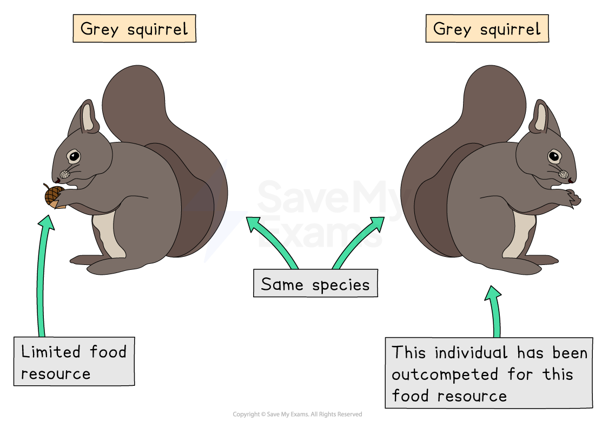
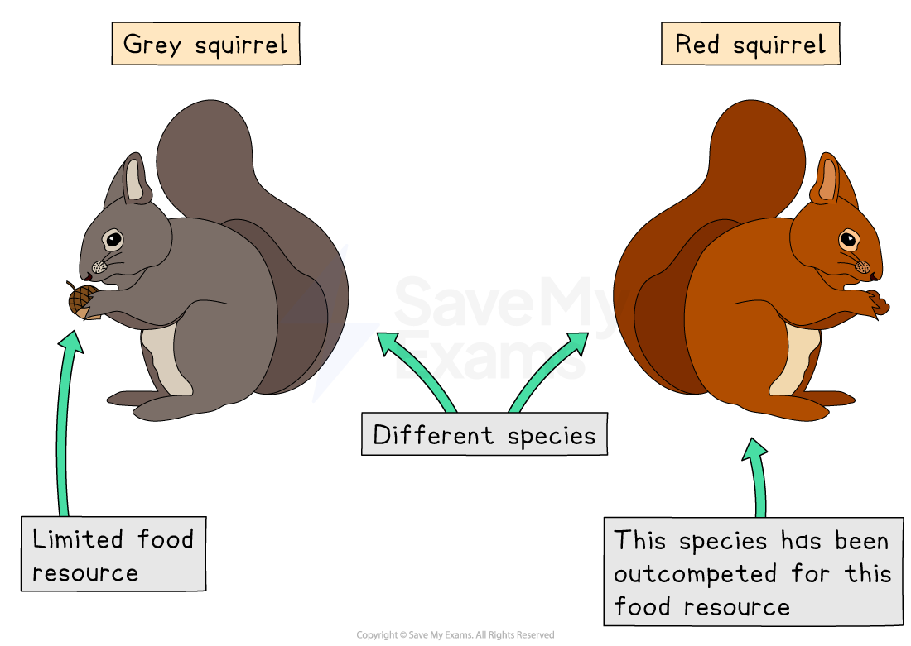
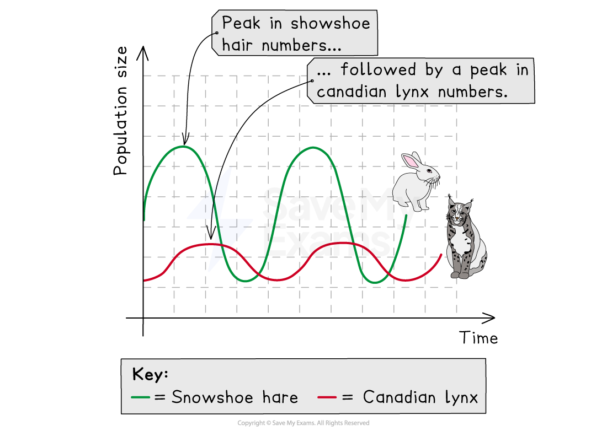

# Interactions in an Ecosystem

## Biotic interactions within an ecosystem

> **Spec point** — `spcpt_vR43PVBCCXbMHxvG`

## Biotic interactions within an ecosystem

- Biotic interactions are **relationships between living organisms** in an ecosystem
- Every organism depends on other living things in some way
These interactions decide:

  - **who survives**
  - **which populations grow or fall**
  - **how energy moves**
  - and **how stable the ecosystem is**
- **Biotic interactions are  important **because they:

  - keep populations under control
  - help plants reproduce
  - shape food chains and food webs
  - maintain biodiversity
  - allow ecosystems to stay balanced over time
- Without these interactions, ecosystems would collapse

### Types of biotic interactions

### Species

- **Native species**

  - Native species are those that naturally inhabit a particular area
  - They fit into food webs and cycles perfectly because they evolved there
- **Invasive species**

  - Invasive species are introduced from elsewhere (often by humans)
  - They spread quickly because they usually have **no predators** in the new environment
  - They outcompete native species for food, water, and space
  - They have the ability to drastically alter the structure of food webs
- **Why it matters:**

  - Invasive species can reduce biodiversity and weaken the ecosystem’s ability to cope with change

### Competition

- Competition is when organisms **fight for the same resources**, such as food, water, mates, and territory
- Competition can be divided into:

  - **Intraspecific** competition
  - **Interspecific** competition
- **Intraspecific competition**

  - This is when the same species compete (e.g. two grey squirrels fighting for food)

*Intraspecific competition between two grey squirrels (same species) for a limited resource*

- **Interspecific competition**

  - This is competition between individuals from **different species **e.g. grey vs red squirrels)

*Interspecific competition between a grey squirrel and a red squirrel (different species) for a limited resource*

- **Why it matters:**

  - Competition controls population sizes and decides which species survive in a habitat

### Predation

- One organism (predator) hunts and eats another (prey)
- **Why it matters:**

  - It ensures that prey populations do not grow excessively large
  - This prevents predators from multiplying excessively
  - Creates **predator–prey cycles** that stabilise ecosystems
  - Predators also remove weak or sick prey, keeping populations healthy

- The graph below shows some of the key patterns of predator-prey cycles:

  - The number of **predators** **increases** as there is **more prey** available
  - The number of **prey** then **decreases** as there are now **more predators**
  - The number of **predators** then **decreases** as there is now** less prey** available
  - The number of **prey **then** increases** as there are now **fewer predators**
  - The cycle now **repeats**

*An example of a graph used to model a predator-prey cycle between the Canadian lynx and the Snowshoe hare*

### Pollination

- Pollination is a special biotic interaction where a pollinator (for example, a bee) carries pollen between flowers
- **Why it matters:**

  - It allows plants to reproduce by producing seeds and fruit
  - Supports food chains (plants are producers)
  - Many major crops depend on insect pollination
  - If pollinators decline, food production drops

> **Exam Hint**
> - Think of biotic interactions as **nature’s way of keeping everything balanced**.
> - Explain **why** an interaction matters — don’t just describe it.
> - Use examples to help show understanding.
> - Remember that ecosystems stay healthy when **no single population becomes too large**.
> - Focus on **cause → effect → consequence**.

## Pollination in an ecosystem

> **Spec point** — `spcpt_QnwWYYZPKYkvwJzn`

## Pollination in an ecosystem

- **What is pollination?**

  - Pollination is a **biotic interaction** that helps flowering plants reproduce
  - It involves the **transfer of pollen** from the **anther **(the male part of a flower) to the **stigma** (the female part)

> **Exam Hint**
> You don't need to memorise flower part names for this syllabus (other than pollen, anther and stigma), but you *do* need to understand the **process** and **why it matters for ecosystems**.

- **Why pollination is important:**

  - It allows **fertilisation **→ seeds → fruit
  - It **supports **food chains because plants are producers
  - It keeps plant **populations healthy and diverse**
  - Many human **food crops depend **on pollinators, especially insects like bees
  - Without pollination, plant reproduction slows down, and **ecosystems can collapse**

### Types of pollination

### 1. Insect pollination

- Insects (such as bees, butterflies, moths, and beetles) move pollen from one flower to another
- **How it happens:**

  - The insect visits a flower for nectar
  - Pollen sticks to its body
  - It flies to another flower
  - The pollen brushes onto the stigma
  - Fertilisation can now take place → seeds develop
- **Why insect pollination matters:**

  - Many plants rely on insect pollination to produce fruit and seeds
  - Insect pollination plays a crucial role in maintaining vast food webs
  - Essential for crops like apples, tomatoes, strawberries, and almonds

### 2. Wind pollination

- Some plants rely on the wind to blow pollen from one flower to another
- Wind-pollinated plants produce **lots of tiny, light pollen grains** so they can travel far
- **Examples include:**

  - Wheat
  - Maize
  - Many grasses
  - Some trees (e.g., birch)
- **Why wind pollination matters:**

  - Important for major cereal crops
  - Large areas, such as grasslands, benefit from wind pollination

### 3. Pollination → fertilisation → seed and fruit formation

- Once pollen reaches the stigma:

  - A **pollen tube** forms
  - Fertilisation takes place inside the flower
  - Seeds develop inside a fruit

> **Exam Hint**
> **You only need a simple idea:**
> Pollination → allows fertilisation → leads to seed and fruit formation.

- **Why pollination is essential for ecosystems**

  - It keeps plant populations stable
  - Plants reproduce more successfully
  - Seeds spread → more habitats form
  - Many animals (including humans) rely on pollinated plants for food
- **If pollinators decline:**

  - Fewer seeds are produced
  - Plant populations shrink
  - Food becomes scarce for herbivores
  - Entire food webs are affected

> **Worked Example**
> **Explain why pollination is an essential biotic interaction for both natural ecosystems and human food production.**
> 
> **[6 marks]**
> 
> **Answer:**
> Pollination is the transfer of pollen from one flower to another, allowing for fertilisation and the production of seeds and fruits. **[1]**
> 
> In natural ecosystems, this action is essential because it helps plant populations grow and spread. **[1]** As producers form the base of food chains, successful pollination supports herbivores and the predators that feed on them.  **[1]**
> 
> Insect pollination is especially important for many flowering plants. If pollinators decline, fewer seeds form, plant numbers fall, and biodiversity decreases. **[1] **Pollination is also vital for human food production because many crops depend on insects, particularly bees.  **[1] **
> 
> Without effective pollination, crop yields fall, which threatens food security and affects economies.  **[1]**
> 
> **Marking guidance**
> 
> - **1 mark**** **for** **defining pollination that shows clear understanding of the process.
> - Up to **4 marks** for explaining its role in ecosystems and food production.
> - **1 mark** for a reasoned conclusion.

> **Exam Hint**
> - Remember: **pollination starts the entire food chain**.
> - Don’t just say 'pollination helps plants reproduce'—explain the **impact on ecosystems**.
> - Mention both **insect** and **wind** pollination if asked about different methods.
> - Use simple chains: **pollination → fertilisation → seeds → new plants → stable ecosystem.**
> - Link pollination to **biodiversity**, **crop yields**, and **food security** for full marks.

## Photosynthesis in an ecosystem

> **Spec point** — `spcpt_XJjPQHknG83VvgRN`

## Photosynthesis in an ecosystem

- Photosynthesis is a chemical process used by **green plants** and **algae** to make **glucose**, a type of sugar that stores energy
- **Plants use:**

  - carbon dioxide from the air
  - water from the soil
  - light energy from the Sun
- **They produce:**

  - glucose for energy and growth
  - oxygen, which is released into the atmosphere

*carbon dioxide + water → glucose + oxygen*

- **Why photosynthesis matters**

  - Forms the **base of every food chain**
  - Provides oxygen for most living things
  - Stores energy from the Sun inside plant tissues
  - Fuels growth, reproduction and survival of nearly all life on Earth
- Without photosynthesis, **ecosystems would collapse** because no new energy would enter the food chain

> **Exam Hint**
> You do **not** need a symbol equation for photosynthesis in the exam.

- **Where photosynthesis happens**

  - Photosynthesis occurs mostly in the leaves, particularly in the palisade layer, because this layer contains
  
    - Many chloroplasts (**chlorophyll **is the green pigment in chloroplasts that absorbs light energy for photosynthesis)
    - Receives lots of sunlight
    - Leaves have a large surface area

> **Exam Hint**
> There is no need to name cell structures, but it's useful to mention that leaves are adapted for absorbing light and gases.

- **What plants do with the glucose they make**

  - Plants must **store or use** the glucose to survive
  - They use it in respiration to release energy
  - Plants convert it into starch for storage
  - They build new cell walls and roots
  - Plants make fruits, seeds and flowers
  - They use it to support growth and repair
- **Why photosynthesis is essential for ecosystems**

  - Plants are producers that make food for herbivores
  - Photosynthesis keeps oxygen levels stable
  - Photosynthesis removes carbon dioxide from the atmosphere
  - It supports entire food webs and nutrient cycles
- **When photosynthesis decreases:**

  - Plant populations fall
  - Food chains weaken
  - Oxygen production drops
  - Ecosystems become less stable

> **Worked Example**
> **Describe how the process of photosynthesis supports life in an ecosystem. **
> 
> **[4 marks]**
> 
> **Answer**
> 
> Photosynthesis supports life in the ecosystem because plants act as producers in food chains.** [1] **The glucose they make is passed on to herbivores and then to higher consumers, moving energy through the ecosystem.** [1] ** Plants also release oxygen as a waste product, which many organisms need for aerobic respiration. ** [1] **Without photosynthesis, there would be no energy entering the food chain and ecosystems would collapse. **[1] **
> 
> **Marking guidance**
> 
> - **1 mark** for describing  how energy enters food chains.
> - **Up to 2 marks** for making clear links between energy and  ecosystems.
> - **1 mark** for showing why photosynthesis is essential overall.
