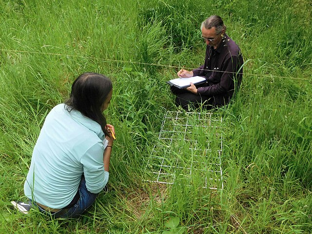

# Population Sampling

## Population sampling techniques

> **Spec point** — `spcpt_W8zJ3fB4nkRgW4JC`

## Population sampling techniques

- **Population sampling** is the process of taking a portion of subjects that is representative of the entire **population**
- Sampling techniques include quadrats, sweep nets, pooters, etc.

### Pitfall traps

- **What they are:**

  - Containers sunk flush with the soil surface to collect small ground-dwelling invertebrates (e.g. beetles, ants, spiders)
- **How they work:**

  - Animals accidentally fall into the trap; a cover may be used to reduce rain entry while still allowing organisms to fall in
- **Used for:**

  - Ground-active species that move unpredictably

### Pooters

- **What they are:**

  - Small hand-held suction devices are used to collect tiny invertebrates safely
- **How they work:**

  - The user sucks gently on the mouthpiece; the organism is pulled through a tube into a container, usually behind a mesh so the user doesn’t inhale it
- **Used for:**

  - Very small, delicate organisms living on vegetation or surface litter

### Sweep nets

- **What they are:**

  - Light nets swept through vegetation to capture flying or plant-dwelling invertebrates
- **How they work:**

  - The net is moved in a figure-of-eight or a consistent sweeping motion across vegetation; collected organisms are transferred to containers for counting
- **Used for:**

  - Butterflies, grasshoppers, leafhoppers and other mobile insects

### Quadrats

- **What they are:**

  - Square frames (open or gridded) placed on the ground to sample plants or slow-moving organisms
- **How they work:**

  - Placed randomly or systematically, all organisms inside are counted or estimated (e.g. % cover for plants)
- **Used for:**

  - Plants, lichens, algae, and sessile or slow fauna like limpets

### Transects

- **What they are:**

  - Straight lines (tape measures or ropes) laid across a habitat to study changes along a gradient
- **How they work:**

  - Quadrats or point sampling are used at regular intervals along the line
- **Used for:**

  - Zonation studies such as sand dunes, rocky shores, woodland edges, and pollution gradients

*Using a transect line and quadrat to investigate population size or distribution. Attributed to Ian Alexander, CC BY-SA 4.0, via Wikimedia Commons*

### Aerial photography and drones

- **What they are:**

  - Drones or aircraft capture high-resolution images
- **How they work:**

  - Images are analysed for animal numbers, vegetation cover, nest counts, habitat structures, or large-scale patterns
- **Used for:**

  - Bird colonies, large mammals, canopy surveys, mapping habitat change

### Automated sampling

- **What it is:**

  - Sensors and recording devices track species without constant human presence
- **Examples:**

  - Camera traps, acoustic recorders for bats, birds, and frogs, automated insect traps, and motion sensors
- **Used for:**

  - Species that are nocturnal, elusive, fast-moving or difficult to observe directly

## Benefits & sampling of population sampling strategies

> **Spec point** — `spcpt_JPyn5rpmy4MTsZBY`

## Benefits & sampling of population sampling strategies

### Pitfall traps

- **Benefits**

  - Excellent for ground-dwelling invertebrates
  - Cheap and easy to deploy in large numbers
  - Provide continuous sampling over time
- **Limitations**

  - Can harm organisms if not checked regularly
  - Miss species that climb or fly
  - Weather conditions (rain, heat) affect capture rates

### Pooters

- **Benefits**

  - Precise: ideal for small and delicate organisms
  - Minimal harm when used correctly
  - Good for comparing microhabitats
- **Limitations**

  - Only captures very small organisms
  - Slow and labour-intensive
  - Dependent on user skill and reaction time

### Sweep nets

- **Benefits**

  - Efficient for mobile vegetation-dwelling insects
  - Covers large areas quickly
  - Useful where species move unpredictably
- **Limitations**

  - Difficult in dense or thorny vegetation
  - Species may escape or be damaged
  - Strong wind and wet conditions reduce effectiveness

### Quadrats

- **Benefits**

  - The best method for estimating plant abundance and distribution
  - Provides quantitative, repeatable data
  - Works well with random or systematic sampling
- **Limitations**

  - Ineffective for fast-moving animals
  - Can miss rare species outside quadrat locations
  - Results vary with quadrat size and placement
  - Estimates of percentage cover can vary between observers, reducing reliability

### Transects

- **Benefits**

  - Ideal for studying environmental gradients and zonation
  - Produces clear patterns and spatial changes
  - Repeatable over time for monitoring
- **Limitations**

  - May miss species between sampling points
  - Time-consuming over long distances
  - Bias if the transect route avoids difficult terrain

### Aerial photography and drones

- **Benefits**

  - Covers large areas rapidly and repeatedly Minimises disturbance to wildlife
  - Useful for counting large or visible species and mapping habitats
- **Limitations**

  - Weak for small or camouflaged species
  - Weather and battery life can limit flights
  - Requires technical skill and can be costly

### Automated sampling

- **Benefits**

  - Operates continuously, even at night or in remote locations
  - Captures elusive or shy species effectively
  - Reduces human disturbance
- **Limitations**

  - Equipment can be expensive
  - Requires careful placement and maintenance.
  - Generates large volumes of data that need processing
  - Automated sensors can generate false triggers (e.g., wind or vegetation movement), increasing data-processing demands
