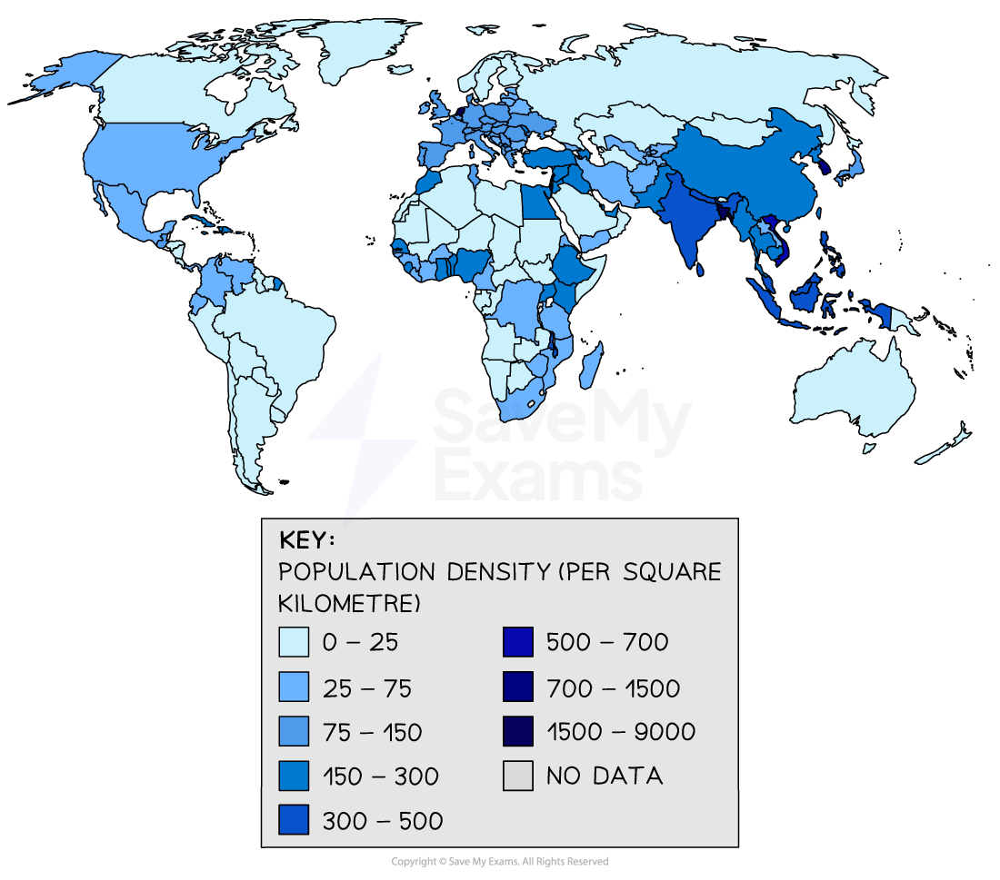

# Population Density & Distribution

## World population distribution

> **Spec point** — `spcpt_FzGdwwhwNcX8shn4`

## World population distribution

- The **spread of people** across a region is referred to as **population distribution**
- It shows how people are distributed (spread) or concentrated in particular areas

  - **East/South/Southeast Asia **and **Europe **are **densely populated** because they are **fertile, temperate, **and** resource-rich **areas with good transport, flat land and reliable water supplies
- **Sparse populations** exist in **extreme climates** (deserts, poles) or **challenging terrains**, because of **physical factors** (poor soil, steep land or limited access to water) and** human elements** (lack of jobs, poor infrastructure, etc.)

  - Examples include the Sahara Desert, Antarctica, the Amazon rainforest and the Himalayas
- Most people live in towns and cities, lowland areas, along rivers, and coasts

  - Approximately 55% of the world now lives in cities but the UN predicts this will reach 68% by 2050 as urbanisation increases
  - Most people live within 1000 km of the sea
  - 90% of the population live on low ground below 500 m above sea level

*Note that the highest population densities are found in the northern hemisphere*

## Population density

> **Spec point** — `spcpt_yCMKNgMZQnrKnyjC`

## Population density

- **Population density** is the number of people living in a given area
- It is usually **measured **in **people per square kilometre (km²)**
- **High population density** means that a lot of people live in a small area

  - Western Europe, Southeast Asia and the Northeast USA have high-density areas of over 200 people/km2
- A** low population density** means that there are only a few people living in a large area

> **Worked Example**
> **Explain one factor that affects population density**
> 
> **[2 marks]**
> 
> **Answer**
> 
> One factor is climate. **[1]** Areas with mild temperatures and regular rainfall attract people because farming and daily life are easier. **[1]**
> 
> **Marking guidance**
> 
> - 1 mark **[1] **for the identification of a factor
> - 1 mark **[1] **for a clear explanation of how it affects population density
> 
> **Alternative content**
> 
> - Alternative content could refer to:
> 
>   - Relief
>   - Water supply
>   - Transport
>   - Employment opportunities
>   - Political stability
> 
> **Common mistakes**
> 
> - Some students fail to explain how the factor affects where people live.
