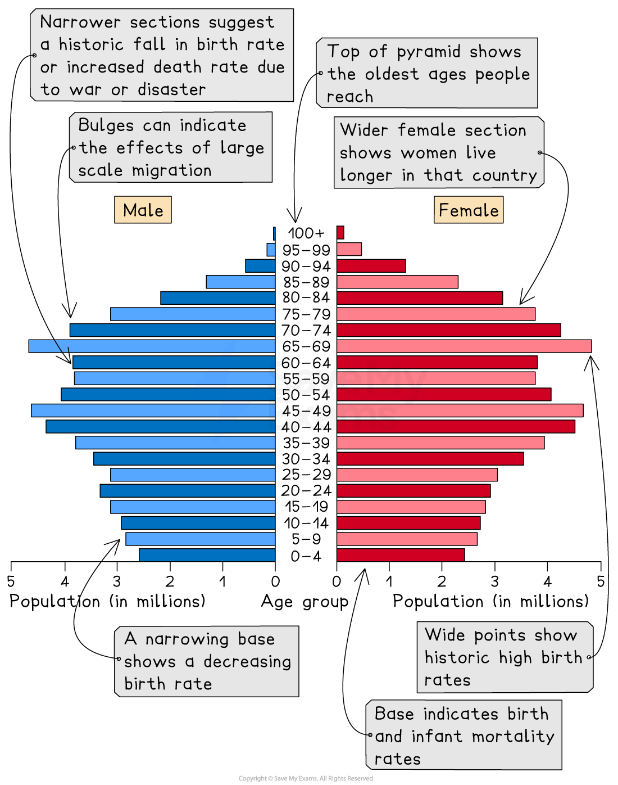
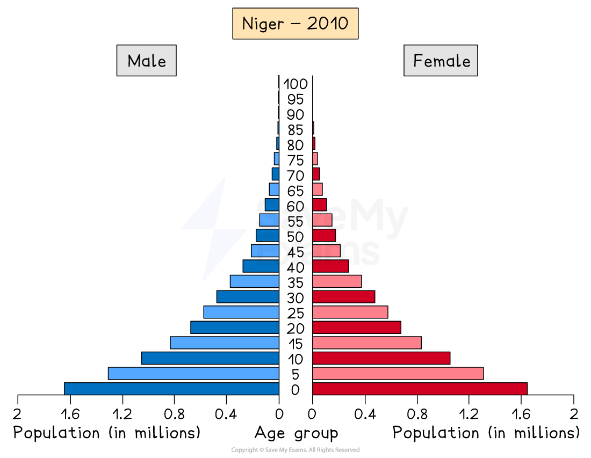
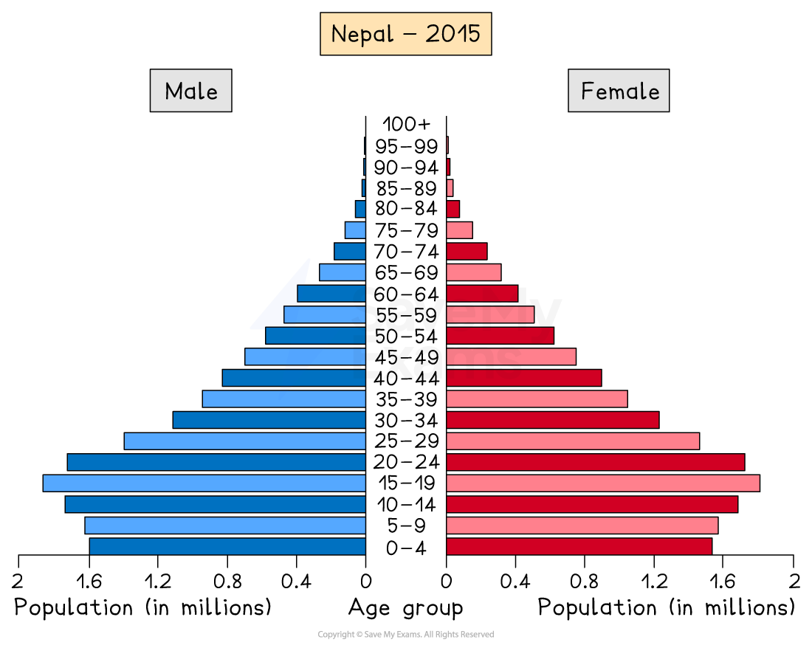
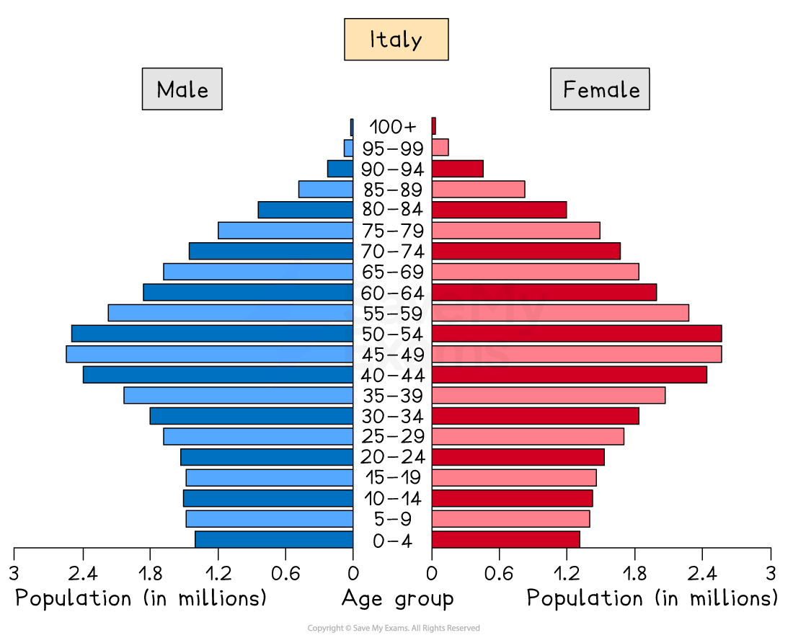

# Population Pyramids

## Population structure 

> **Spec point** — `spcpt_mpq6p5C5y2K9XCxv`

## Population structure

- Population structure describes the composition of a population by **age and sex**
- It shows how many males and females are in different age groups
- Population structure affects the demand for services such as schools, hospitals and pensions
- Governments use population structure data to plan for the future

### Age groups within a population

- **Young dependants** are people aged 0–14 who rely on adults for food, housing and education
- **Working population** includes people aged 15–64 who are economically active and support the economy
- **Elderly dependants** are people aged 65 and over who may require healthcare and pensions
- The **ratio **of the **female** and **male **population
- One of the main tools used to show population structure is a **population pyramid**

## Interpreting population pyramids

> **Spec point** — `spcpt_68hqv5pf2w639nHc`

## Interpreting population pyramids

### What is a population pyramid

- A population pyramid (also known as an **age structure graph**) is used to display the **gender and age structure** of a given population
- **Age groups** are shown on the **vertical axis**, usually in **five-year** bands
- **Males** are shown on the **left **and **females** on the **right**
- The **width **of each bar represents the **size** of the **population** in that **age group**
- As countries develop, the **shape of the population pyramid **changes

*Interpreting a typical population pyramid*

### Types of population pyramid

#### Expansive population pyramids

- Expansive pyramids have a **wide base** and a **narrow top**
- They show **high birth rates** and a **large young population**
- **Death rates** may be **high **and **life expectancy** is often **lowe**r
- Common in many low-income or developing countries
- These countries may face pressure on schools, healthcare and employment in the future

  - Examples include Nepal and Niger

*Expansive population pyramid*

*Expansive population pyramid*

#### Stationary population pyramids

- Stationary pyramids have a more even, rectangular or bell shape
- **Birth** rates and **death rates** are **both low**
- The population grows slowly or remains stable
- Common in more developed countries with good healthcare and education

  - Examples include Italy and the USA

*Stationary population pyramid*

*Stationary population pyramid*

#### Constrictive population pyramids

- Constrictive pyramids have a **narrow base** and **wider middle or upper sections**
- They show **low birth rates** and an **ageing population**
- Life expectancy is high
- These countries may face labour shortages and increased pressure on healthcare and pensions

  - A good example is Japan with its ageing population

*Constrictive population pyramid *

#### Migration population pyramids

- In some countries, **migration** can lead to an imbalance in the population structure
- The UAE has significantly more males than females
- Approximately 29% of the population are males between the ages of 25 and 39, whereas only 10.5% of the population are women between 25 and 39

  - This is the result of the migration of males to the UAE to work in the oil, gas and construction industries

*Population structure showing the impact of male dominated migration*

### Why population pyramids are useful

- They help identify future population growth or decline
- They show the size of the future workforce
- They highlight dependency ratios
- They help governments plan for education, housing and healthcare

> **Worked Example**
> **Define population structure.**
> 
> **[2 marks]**
> 
> **Answer**
> 
> Population structure refers to the age and sex composition of a population **[1]**** **and shows how many males and females are in different age groups. **[1]**
> 
> **Mark allocation**
> 
> - 1 mark **[1] **for reference to age and sex.
> - 1 mark **[1] **for explanation of population composition.
> 
> **Examiner tips**
> 
> Do not confuse population structure with population distribution.
