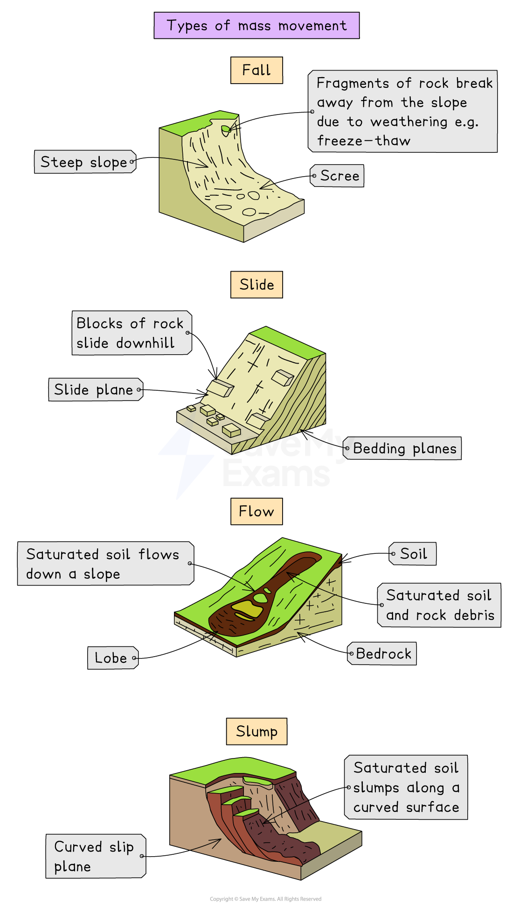

# Causes & Impacts of Soil Erosion

## What are the causes of soil erosion?

> **Spec point** — `spcpt_X5s48ssgwxmBJhGf`

## What are the causes of soil erosion?

- **Soil erosion** refers to the removal of the **top layer of soil** (usually by wind or water)

  - Topsoil contains most of the soil’s **nutrients and organic matter**, so losing it reduces crop growth
- Soil erosion happens when the soil is **unprotected**, **disturbed**, or exposed to **strong forces** like rain, rivers or wind

### Unsustainable agricultural practices

- Some farming methods damage soil health

  - Includes overcultivation, overgrazing and poor irrigation
- **Overcultivation** (growing crops repeatedly on the same land) removes nutrients quickly

  - Soil becomes dry and loose, making it easier for wind or water to carry it away
- **Overgrazing** (too many animals feeding in one area) exposes soil by removing vegetation

  - Roots that hold soil together are lost
  - Exposed soil becomes loose and easier to wash or blow away
- **Mismanaged irrigation** (too much or too little water) weakens soil structure

  - Runoff can wash soil downhill
  - Excessive irrigation can cause soil salinisation (build-up of salts)
  
    - Salty soil becomes dry and crumbly, increasing erosion risk

### Deforestation

- Cutting down **trees and natural vegetation** removes protective cover

  - Leaves and branches normally slow down rainfall, reducing soil loss
- **Tree roots** help bind soil together

  - Without roots, soil becomes loose and more likely to be eroded
- Land cleared for farming or development becomes exposed to wind and rain

### Farming on steep slopes

- Gravity pulls water and soil **downhill**, especially after heavy rain
- Rainwater runs quickly down slopes

  - Fast-moving water removes soil in layers or can create deep gullies
- Machinery use on slopes can make this worse

  - Tractors and equipment disturb soil
  - This creates loose soil that can wash downhill quickly

### Bare soil

- Soil without **plant cover** is easily eroded

  - Plants protect soil from rain impact and help hold it in place
- Bare soil dries out faster

  - No roots to hold soil together
  - Soil becomes dry and light
  - Dry soil breaks into small particles that are easily blown away by wind
- No wind barrier from trees or other plants means wind can lift and transport loose, dry soil particles
- Leaving fields bare between harvesting and the next planting increases erosion risk

### Wind and water erosion

- **Wind erosion**—strong winds blow away dry, loose soil

  - Common in dry climates or during droughts
- **Water erosion**—rain, rivers or runoff remove soil

  - Heavy rain can **splash** soil particles loose or wash them downhill
  - Rivers can cut into banks, removing soil from the edges of fields
  - Storm events (intense rainfall over a short time) greatly increase the rate of soil erosion on exposed land

> **Exam Hint**
> Students often list causes without linking them to **how they remove soil**. Always give a short cause-and-effect explanation, such as 'overgrazing removes vegetation, leaving soil exposed to wind and rain.'
> 
> Use key terms such as 'overgrazing', 'deforestation', 'runoff' and 'topsoil'. These keywords show accurate understanding and will help you gain marks.

## What are the impacts of soil erosion?

> **Spec point** — `spcpt_FvstYbfkYQXBtX6h`

## What are the impacts of soil erosion?

- Soil erosion reduces soil productivity and affects both the **environment** and **human communities**

  - Impacts can be **local**, such as reduced crop yield, or **wide-reaching**, such as desertification or even displacement of communities

### Silting of rivers

- Eroded soil is carried by water into **rivers and lakes**

  - This causes **silt** to build up on the riverbed
- Silt reduces the **depth** of rivers

  - This increases the risk of rivers flooding during heavy rain
- Silting also **reduces water quality**

  - Muddy water blocks sunlight, reducing plant growth in the river
  - Suspended particles clog fish **gills**, making it harder for them to breathe
  - Silt can smother fish eggs and aquatic plants, reducing survival rates

### Desertification

- Loss of soil creates **dry, infertile land** that cannot support crops
- Vegetation dies, leaving the ground exposed
- Over time, the land turns into **desert-like conditions**

  - This is common in areas with drought, overgrazing or deforestation

*Causes of desertification*

### Mass movement: landslides, rockslides and mudslides

- Removing vegetation weakens soil structure on hillsides

  - This is mainly because plant roots normally hold soil in place
- Heavy rain can trigger **landslides or mudslides**

  - Loose soil becomes saturated and slides downhill
- Rockslides occur when exposed rock breaks away

  - These events can destroy homes, roads and farmland

*Types of mass movement*

### Loss of habitats and biodiversity

- Soil erosion destroys **habitats** for plants, insects and animals

  - Many species cannot survive once their habitat is gone
- Loss of vegetation reduces **biodiversity**

  - Fewer plant species mean fewer food sources for wildlife
- Rivers filled with silt may lose aquatic species

  - Ecosystems become less stable

### Reduction in crop yield

- With less topsoil, crops have **fewer nutrients** and poorer growing conditions

  - Roots cannot spread deeply or absorb enough water
- Reduced yields affect **farm income** and food availability
- Farmers may need more **fertiliser**, increasing costs and pollution

### Malnutrition and famine

- Lower crop yields reduce the amount of food available

  - Communities may not have enough to eat
- Malnutrition occurs when people** lack essential nutrients in their diets**
- Severe or long-term soil erosion can contribute to ***famine***

  - Especially in areas already facing **poverty **and **drought**

### Displacement of people

- When land becomes unproductive and crops fail, families may be forced to **move elsewhere**

  - This can lead to *rural-to-urban migration*
- Loss of farmland reduces income

  - People leave to find work or food
- Displacement can cause overcrowding in towns or cities

  - This can put pressure on housing, water and healthcare

> **Exam Hint**
> Remember that environmental impacts (like biodiversity loss or loss of soil nutrients) often have a knock-on effect, leading to **human impacts** (like reduced food supply). Showing this chain of impacts can help you reach the top level in extended responses.
