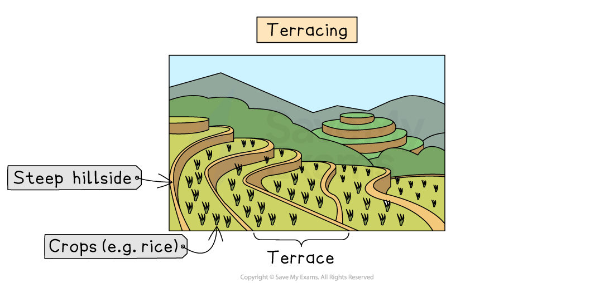
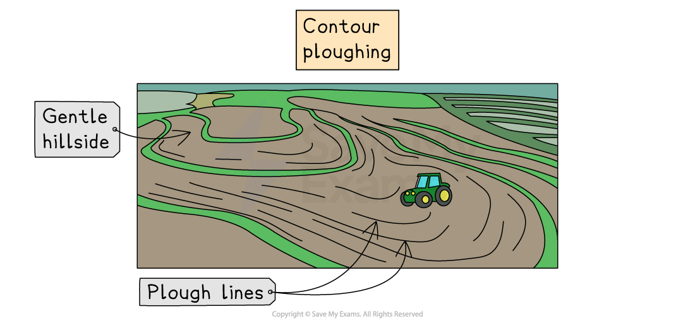
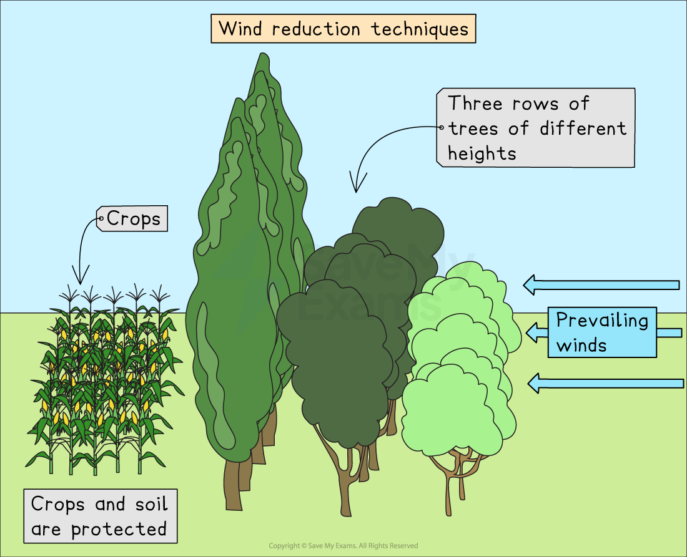

# Soil Erosion Management Strategies

## Strategies to reduce soil erosion

> **Spec point** — `spcpt_7bkR76nzrMyDcKYY`

## Strategies to reduce soil erosion

- Farmers use a range of strategies to reduce and manage soil erosion. These involve:

  - **Slowing down water flow**
  - **Reducing wind speed**
  - **Protecting soil structure**
- These strategies help maintain soil fertility and keep land productive for future farming

### Terracing

- **Terracing** involves cutting the hillside into flat steps
- Each step slows the **movement of water** downhill
- This reduces **surface run-off**, giving water more time to soak into the soil
- Prevents large amounts of soil being washed away on steep slopes

*Terracing helps to conserve soils by slowing the speed of water runoff, which allows water time to infiltrate the soil, minimising soil erosion*

### Contour ploughing

- **Contour ploughing** is ploughing across a slope, following the natural shape of the land
- This creates small ridges that **slow down water**
- Reduces **surface run-off**, which helps prevent soil from being carried downhill
- Increases the amount of water that **soaks into the ground**

*Contour ploughing also helps to conserve soils by slowing the speed of water runoff*

### Bunds

- **Bunds** are small embankments or raised barriers built along field edges
- They help **trap water** and reduce run-off
- They also reduce **wind speed**, offering protection from wind erosion
- They can help collect water for crops, improving soil moisture

### Windbreaks

- **Windbreaks** are rows of trees, shrubs or fences planted to block strong winds
- They reduce **wind speed**, preventing soil from being blown away
- They protect crops from **wind damage**
- They also create sheltered areas that help the soil to retain **moisture**

*Wind reduction techniques help to minimise soil erosion and protect crops from wind damage*

### Maintaining vegetation cover

- Vegetation protects soil by reducing the impact of **raindrops**
- Plant **roots bind the soil**, holding it firmly in place

  - This makes soil less likely to be washed or blown away
- Vegetation slows **surface run-off** and absorbs water, reducing erosion
- Leaving fields covered with plants or crop residues after harvesting prevents soil from being left **bare**

### Addition of organic matter

- Adding organic matter, such as **compost or manure,** improves soil structure

  - This helps stabilise soil, making it less likely to break apart
- Organic matter also:

  - Increases the soil’s ability to **absorb and hold water**
  - Supports soil organisms like earthworms, which improve the soil’s **aeration and drainage**

> **Exam Hint**
> Students often confuse **terracing** with **contour ploughing** because both are used on slopes. Remember: **terracing** involves cutting the hillside into flat, step-like platforms that **physically hold soil in place**, while **contour ploughing** simply means ploughing **across the slope** to slow water flow.
> 
> Similarly, don't confuse bunds and windbreaks. Remember: **bunds** are low barriers on the ground, while **windbreaks** are **tall structures** like trees or fences.
