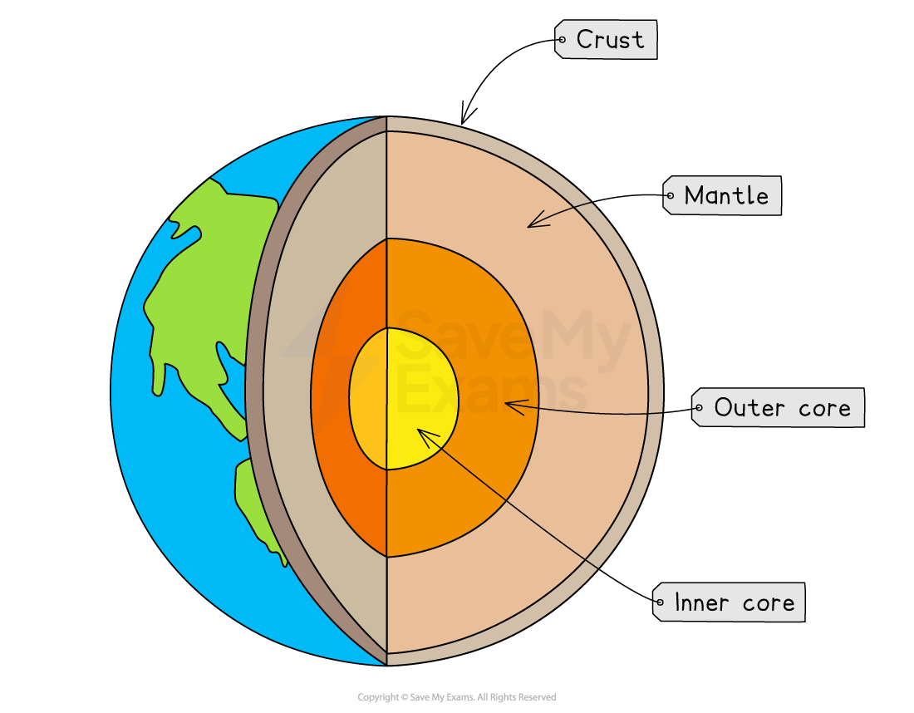
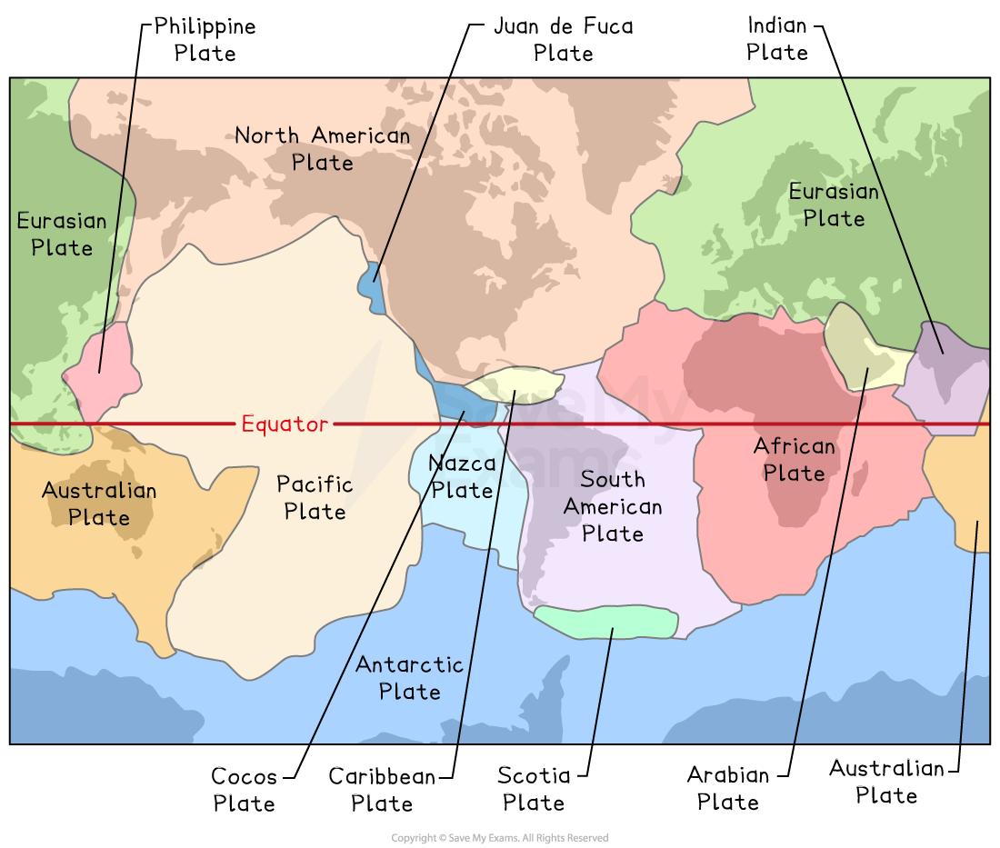
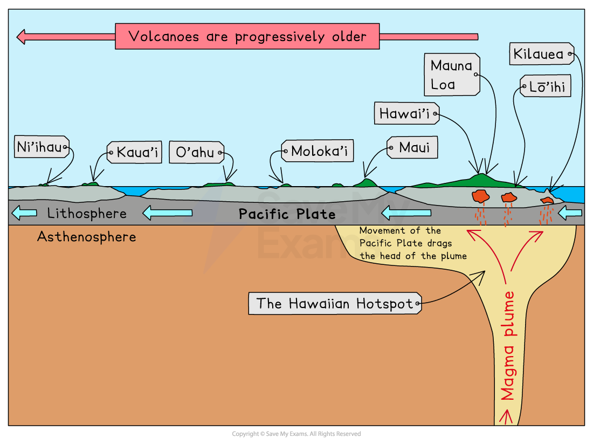

# Earth Structure

## How is the earth structured?

> **Spec point** — `spcpt_5p628b76XVSY4tPT`

## How is the Earth structured?

- Understanding the Earth’s internal structure is essential to understanding **tectonic hazards**
- The planet is made of several layers, each with different compositions, temperatures, and physical states
- The Earth is composed of  three main layers: the crust, mantle and core

### Crust

- The **thin, outermost layer** of the Earth
- Made of solid rock
- Broken into tectonic plates that move slowly across the planet
- The thickness varies and it is made up of two types of crust: **oceanic **and **continental**

  - Oceanic crust is **thin and dense**
  - Continental crust is **thicker and less dense**

### Mantle

- The mantle is the thickest layer, reaching a depth of approximately 2900 km
- Mostly **semi-molten** rock (magma) in the upper mantle and solid in the lower mantle
- Heat from the core drives **convection currents** within the mantle
- These convection currents are the engine of **plate movement**, shaping earthquakes and volcanic activity

### Core

- Divided into:

  - **Outer core**: liquid iron and nickel
  - **Inner core**: solid iron and nickel due to immense pressure
- Temperatures exceed **5000°C**
- Heat from the core powers mantle convection

*Earth's structure*

## Earth’s continents

> **Spec point** — `spcpt_pTNv8nH8mmz6cktN`

## Earth’s continents

- Understanding continents helps visualise plate boundaries, earthquake zones and volcano belts
- The continents include:

  - Africa
  - Antarctica
  - Asia
  - Europe
  - North America
  - Oceania (including Australia and surrounding islands)
  - South America

*Seven continents of the world*

## Distribution of earthquakes & volcanoes

> **Spec point** — `spcpt_fpHww6bpRfGqM6yS`

## Distribution of earthquakes & volcanoes

- Earthquakes and volcanoes do **not** occur randomly
- Their distribution is mainly controlled by the structure and behaviour of tectonic plates
- The surface of the Earth is divided into **tectonic plates** that have **moved** throughout geological time

  - The Earth's **crust** is broken into 15 **major** tectonic plates and several **minor **ones
  - Plates move slowly (mm–cm per year) because of convection currents in the mantle
  - The place where plates meet is called a **plate boundary** or **plate margin**

- Tectonic plates **move apart**, **slide against each other**, or **collide**

*Tectonic plates*

### Earthquakes

- The majority of earthquakes (about 95%) occur close to or at a **plate boundary**
- Plates are constantly moving due to mantle convection
- Where plates interact—colliding, separating or sliding—stress builds up
- This stress is released suddenly as earthquakes

*Map showing global earthquake distribution*

### Volcanoes

- Like earthquakes, most active volcanoes occur at or near plate boundaries
- Many (about 75%) occur around the** 'Ring of Fire'** surrounding the Pacific Ocean

*Global distribution of active volcanoes*

### Patterns to remember:

- **Pacific Ring of Fire**:

  - A tectonically active region surrounding the Pacific Ocean
  - It contains ~75% of the world’s volcanoes and frequent major earthquakes
- **Mid-Atlantic Ridge**:

  - A divergent boundary where new oceanic crust forms, creating volcanic activity and seafloor spreading
- **San Andreas Fault**:

  - A transform boundary in California known for frequent earthquakes

### Hotspots

- Volcanic activity can occur **far from plate boundaries**
- A **hot spot **is an area where **plumes of very hot mantle** rise towards the surface

  - The magma rises to the surface through cracks in the crust
  - Occurs away from the **plate boundaries** (hotspots usually occur away from plate boundaries, in the middle of tectonic plates)
  - As plates move over a hotspot, a **chain of volcanoes** forms, e.g. Hawaii

*Hot spot and island formation*

- Hotspot volcanoes tend to produce **runny, basaltic lava** and create broad shield volcanoes
