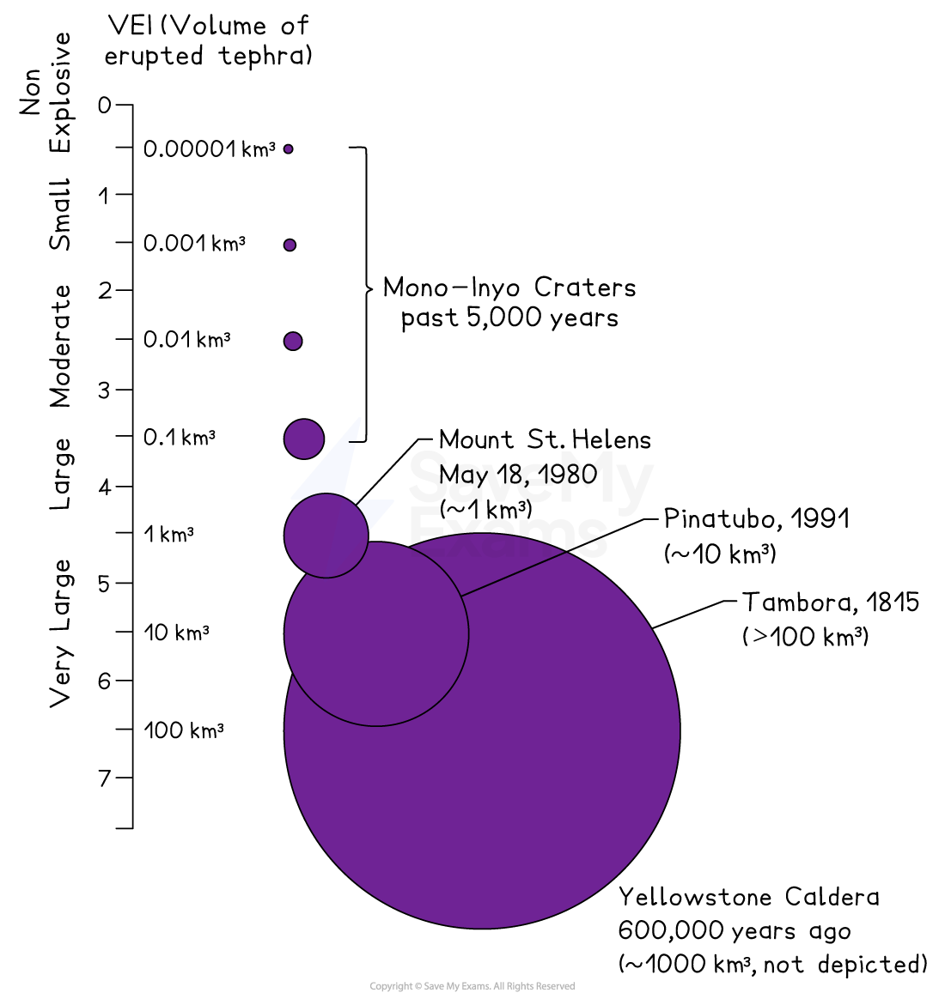

# Features & Impacts of Earthquakes & Volcanoes

## Features of earthquakes

> **Spec point** — `spcpt_xqSRddqsgZNw9gpd`

## Features of earthquakes

- An earthquake is the **sudden, violent shaking** of the ground
- They are the result of pressure building when **tectonic plates** move

### Release of energy

- Stored elastic energy is released as **seismic waves**, causing shaking.

### Focus

- The point **inside the Earth** where the earthquake starts

### Epicentre

- The point **directly above the focus** on the surface
- Usually experiences the strongest shaking

*Features of an earthquake*

### Magnitude (Moment Magnitude Scale)

- Measures the **energy released **(strength/power) of earthquakes
- **Logarithmic**: each whole-number increase is ~32× more energy
- More accurate for large earthquakes than the older Richter scale

*Measuring earthquake magnitude*

- The damage caused by earthquakes is measured on the **Mercalli Scale**

## Features of volcanic eruptions

> **Spec point** — `spcpt_C8fKy85Y77JRYyjP`

## Features of volcanic eruptions

- Volcanic eruptions vary from gentle lava flows to catastrophic explosions
- Key features include:
- **Magma rising to the surface**

  - Magma rises through cracks due to buoyancy and gas pressure
  - When magma reaches the surface, it becomes **lava **and forms new crust and volcanic landforms
- **Ash**

  - Tiny fragments of rock and volcanic glass
  - Can travel globally in the upper atmosphere
  - Heavy ashfall collapses roofs, suffocates vegetation, and disrupts transport
- **Gases (H₂O, CO₂, SO₂)**

  - Water vapour is the most common volcanic gas
  - CO₂ can accumulate in low areas and cause suffocation
  - SO₂ forms volcanic smog and contributes to **acid rain** and atmospheric cooling
- **Acid rain**

  - Forms when SO₂ reacts with water in the atmosphere
  - Damages vegetation, acidifies soils and water bodies, and corrodes stone
- **Volcanic bombs**

  - Large, molten or semi-molten rocks ejected during explosive eruptions
  - Cool as they travel, landing as solid rock — dangerous at close range
- **Pyroclastic flows**

  - Fast-moving clouds of hot gas, ash and rock fragments
  - Can exceed **400°C** and travel at **>100 km/h**
  - Extremely destructive and often fatal
  - Responsible for many historical volcanic disasters (e.g. Mont Pelée 1902)

#### Measuring eruption magnitude

- The magnitude of a volcanic eruption is measured on the **Volcanic Explosivity Index (VEI)**

*The volcanic explosivity index (VEI)*

## Opportunities provided by volcanoes 

> **Spec point** — `spcpt_Ng67RrMMVvJc9bR5`

## Opportunities provided by volcanoes

- Although volcanoes pose serious hazards, they also create **valuable opportunities** that attract people to volcanic regions
- These benefits often outweigh the risks, especially in countries where the land and resources around volcanoes support livelihoods and economic development

### Fertile soils

- Volcanic activity produces ash, lava and rock fragments that eventually break down into **highly fertile soils**
- **Why they are fertile:**

  - Volcanic materials weather into soils rich in **minerals**, especially **potassium, phosphorus, magnesium and iron**
  - These nutrients make soils excellent for crop growth
- **Examples:**

  - The slopes of **Mount Etna (Italy)** are famous for citrus orchards and vineyards
  - **Java (Indonesia)** supports rice farming on volcanic soils that feed millions
- **Why people live there:**

  - Reliable, productive farmland that increases food security and income

### Extraction of minerals

- Volcanoes bring valuable minerals and metals close to the Earth’s surface, making them easier to mine
- **Key volcanic minerals include:**

  - **Copper**
  - **Gold**
  - **Silver**
  - **Lead and zinc**
  - **Sulphur** (from volcanic gases and fumaroles)
- **How they form:**

  - Hot volcanic fluids deposit minerals in cracks and fissures
  - Repeated eruptions concentrate valuable ore bodies
- **Benefits:**

  - Mining creates jobs and export income
  - Supports local industry and national economic growth
- **Examples:**

  - Copper mining in the **Andes** (Chile, Peru)
  - Sulphur mining in **Indonesia** from active volcanic vents

### Building materials

- Volcanoes produce materials that are widely used in construction and industry
- **Common volcanic building materials:**

  - **Basalt**: hard rock used for road building and building blocks
  - **Pumice**: lightweight and porous; used in concrete, abrasives, and horticulture
  - **Scoria**: used for drainage, landscaping, and lightweight construction
- **Why they’re useful:**

  - Durable, abundant, and easy to quarry near volcanic regions
- **Example:**

  - Volcanic stone from **Iceland** and **Hawaii** is used in construction and coastal engineering

### Geothermal power

- Volcanoes provide a reliable and renewable source of **geothermal energy**
- **How it works:**

  1. Heat from magma warms underground water
  2. Hot water becomes steam
  3. Steam is extracted through wells
  4. It drives turbines that generate electricity
- **Benefits:**

  - Clean and sustainable energy source
  - Reduces reliance on fossil fuels
  - Provides heat for homes, greenhouses, and industries
- **Examples:**

  - **Iceland** generates about 25–30% of its electricity from geothermal power
  - **New Zealand** uses geothermal heat for spas, heating and electricity

### Tourism

- Volcanic landscapes are major attractions for domestic and international visitors
- **Tourism activities include:**

  - Hiking volcanic cones (e.g., Mount Fuji, Japan)
  - Visiting hot springs and geysers (e.g., Yellowstone, USA)
  - Viewing lava flows (e.g., Hawai‘i Volcanoes National Park)
  - Exploring volcanic beaches, crater lakes and lava tubes
- **Benefits:**

  - Generates employment (guides, hotels, restaurants)
  - Boosts local and national economies
  - Encourages conservation of volcanic landscapes
- **Why tourism thrives:**

  - Volcanoes offer dramatic scenery and unique natural features
  - Cultural significance adds value (e.g., rituals and traditions around volcanoes)

## Impacts of tectonic events

> **Spec point** — `spcpt_MqRvm6m3H2mqHKqP`

## Impacts of tectonic events

- Tectonic hazards affect societies at every level, such as infrastructure, health, economy, and ecosystems
- Impacts vary depending on:

  - *Magnitude*
  - Distance from the epicentre/volcano
  - *Population density*
  - Building quality
  - Preparedness
- The impacts of earthquakes and volcanic eruptions can be categorised into:

  - **Primary hazards: **these are a direct result of the earthquake or eruption
  - **Secondary hazards: **these occur as a result of the primary effects
- **Damage to buildings and infrastructure**

  - Earthquake shaking collapses homes, bridges, and pipelines
  - Lava and *pyroclastic flows* destroy everything in their path
  - Roads become impassable, slowing rescue and recovery
  - This leads to people being homeless for months and even years after the event
  - The more buildings that are destroyed or damaged, the higher the costs of rebuilding
- **Loss of crops, livestock and habitats**

  - Ash covers farmland; lava buries fields, causing the death of crops
  - Earthquakes can destroy *irrigation *and greenhouses
  - Wildlife habitats burn or become uninhabitable
  - This leads to food shortages and affects farmers' income
- **Evacuation of people and livestock**

  - Volcanic warnings often lead to mass evacuations
  - *Tsunami *threats require rapid coastal evacuation
  - Evacuation disrupts livelihoods and may become long-term
- **Fire**

  - Ruptured gas lines ignite after earthquakes
  - Lava ignites forests and settlements
  - Fires spread quickly when emergency services are limited
- **Tsunamis**

  - Triggered by undersea earthquakes, volcanic eruptions or landslides
  - Flood coastlines, destroy infrastructure and cause high death tolls
- **Landslides**

  - Shaking destabilises slopes
  - Volcanoes produce lahars (mudflows) when ash mixes with water
  - Landslides bury communities and block rivers
- **Contamination of drinking water**

  - Ash and debris pollute reservoirs
  - Broken sewage pipes contaminate supply lines
  - CO₂ emissions from volcanoes may reach groundwater
  
    - Volcanic plume emissions dissolve in the atmospheric water, which infiltrates the surface after precipitation and percolates downwards
    - When magma rises, gases like CO₂ and sulphur are released into fissures, faults, and porous surfaces
    - These gases dissolve in underground water sources, lowering the pH and increasing acidity
- **Water-related disease**

  - Flooding and infrastructure collapse cause outbreaks
  - Examples: cholera, dysentery, gastroenteritis
  - Poor sanitation in evacuation shelters increases risk
- **Financial losses**

  - Rebuilding is expensive
  - Tourism declines after major events
  - Agriculture, business and industry all face disruption
  - It is dangerous for jet planes to fly through ash clouds due to possible engine failure, so flights are cancelled
- **Human health**

  - Injuries from collapsing structures, burns, and inhalation of ash
  - Long-term respiratory issues from ash and toxic gases
  - Mental health effects (trauma, anxiety, displacement)
