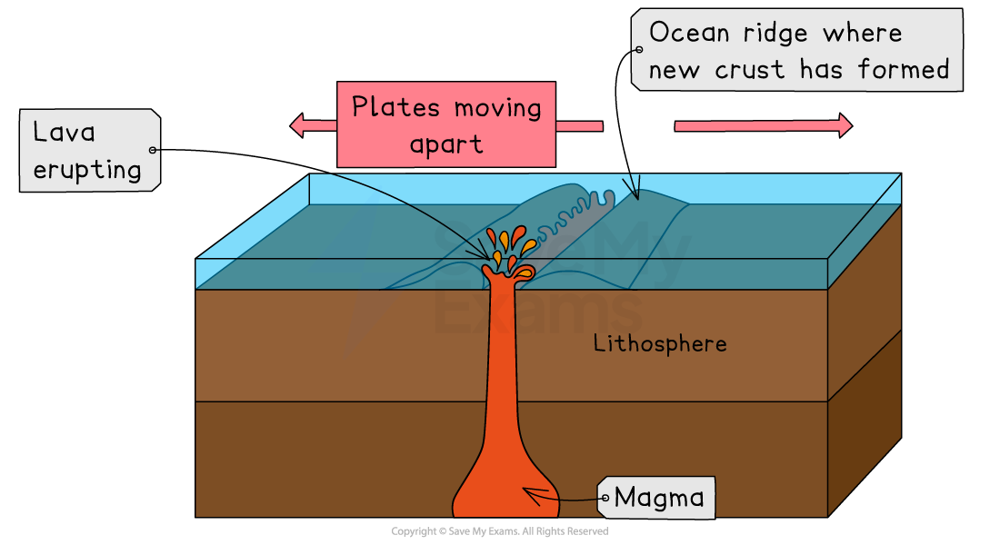
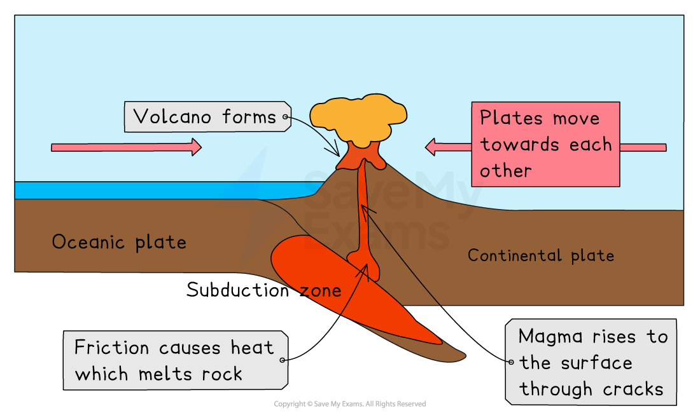
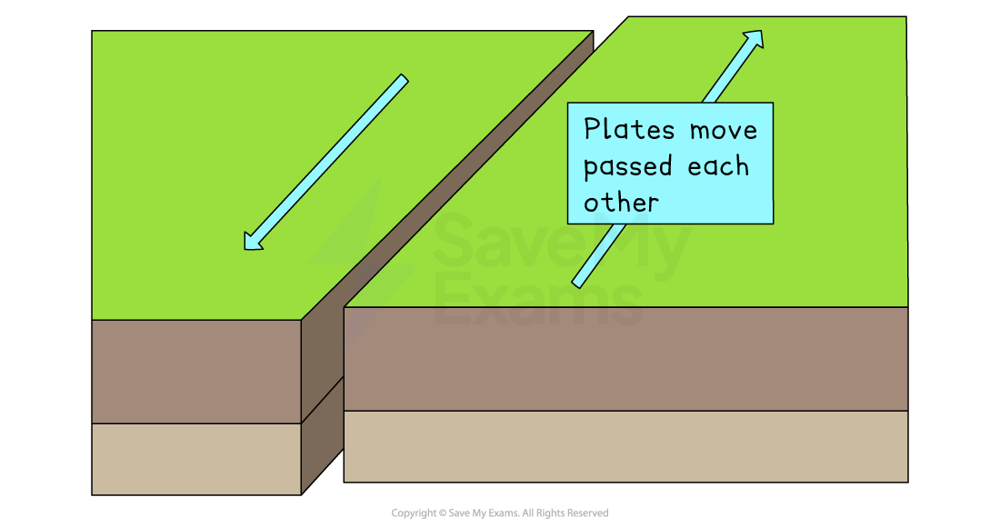

# Formation of Earthquakes & Volcanoes

## Convection currents

> **Spec point** — `spcpt_8ktVVHQmcKsXdn7Z`

## Convection currents

- The heat within the Earth's core **(geothermal energy),** which is estimated to reach up to between 5000 and 6000°C, is generated by radioactive decay
- Heat rises from the Earth's core and creates **convection currents** in the mantle
- The tectonic plates which make up the crust move on top of the semi-molten mantle below
- The current theory of tectonic plate movement is called **slab pull theory** 

*Convection currents and slab pull*

  - This means that plate movement is caused by more than just convection currents
  - The heavier oceanic plates ***subduct***** **and pull the lighter plates along with them

## Plate boundaries

> **Spec point** — `spcpt_2BJBKwvP5bWtDYkd`

## Plate boundaries

- Volcanic eruptions and earthquakes most commonly occur at or near plate boundaries

### Divergent (constructive) boundaries

- Plates **move apart**
- Magma rises to fill the gap, creating **new crust**
- Produces:

  - **Mid-ocean ridges**
  - **Volcanoes** (often gentle lava eruptions)
  - **Shallow earthquakes**
- Example: Mid-Atlantic Ridge (Iceland)

*Constructive (divergent) plate boundary*

### Convergent (destructive) boundaries

- Plates **move towards each other**
- One plate ***subducts*** beneath another
- The subducting plate melts, forming **magma** that rises to create a volcanic arc
- Produces:

  - **Powerful earthquakes**
  - **Explosive volcanoes**
  - **Ocean trenches**
- Example: Andes (Nazca Plate beneath South American Plate)

*Destructive (convergent) plate boundary*

### Conservative (transform) boundaries

- Plates **slide past one another horizontally**
- No crust is created or destroyed
- Friction locks plates together until stress is released as **sudden, violent earthquakes**
- No volcanoes because there is no magma generation
- Example: San Andreas Fault, California

*Conservative (transform) boundary*
