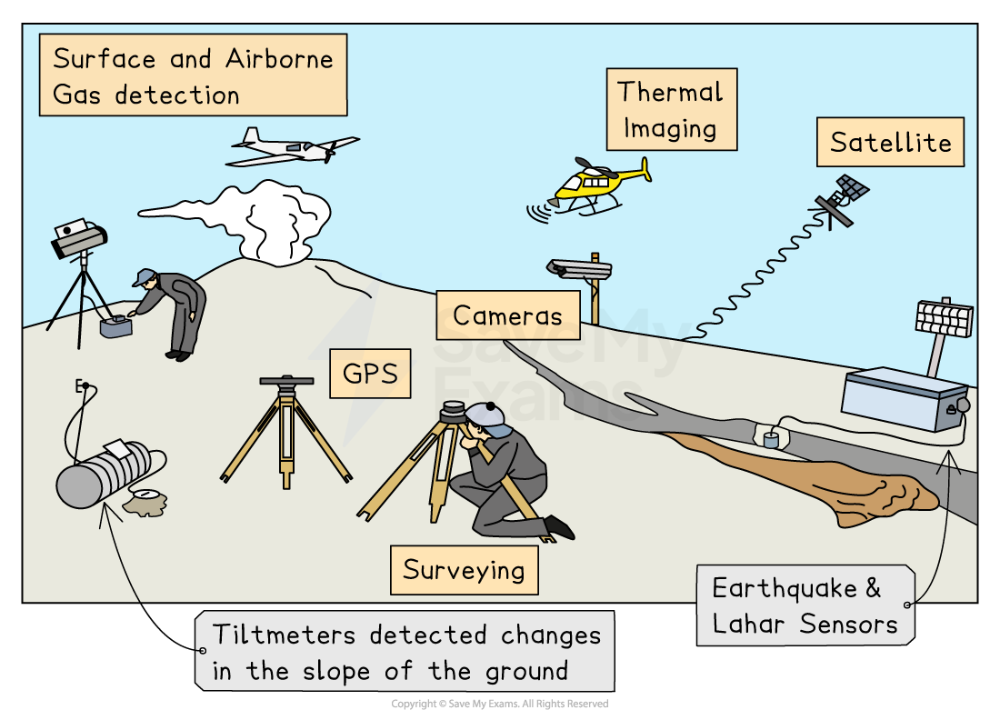
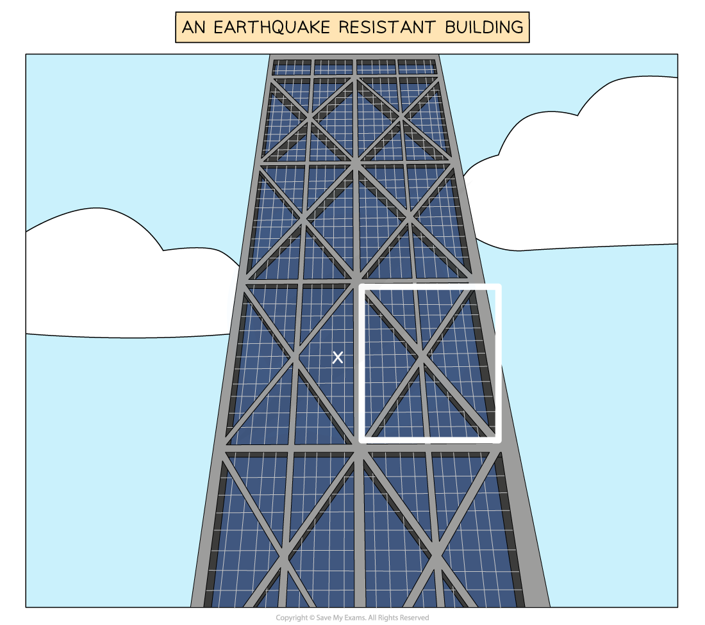

# Strategies for Managing Impacts of Tectonic Events

## Strategies for managing impacts before tectonic event

> **Spec point** — `spcpt_rBJTWjgZYmSwmTxx`

## Strategies for managing impacts of tectonic events

- Tectonic hazards cannot be prevented, but their impacts can be reduced through planning, engineering, monitoring, and effective emergency response
- Management strategies fall into three main phases:

  - **Before the event**: preparation and risk reduction
  - **During the event**: immediate survival and protection
  - **After the event**: recovery and rebuilding

### Monitoring and warning

- Governments and scientists track tectonic activity to provide early warnings
- **Earthquakes:**

  - **Seismometers r**ecord ground movement
  - **Global Positioning Systems (GPS)** detect strain buildup along faults
  - While earthquakes cannot be predicted precisely, warning systems can detect initial** P-waves **and send alerts seconds before shaking arrives
- **Volcanoes:**

  - **Gas emissions** (SO₂, CO₂) monitored using sensors
  - Seismographs detect magma movement
  - **Ground deformation **measured by GPS and tiltmeters
  - Thermal imaging detects rising temperatures
  - Combined monitoring can give days or weeks of warning

*Monitoring volcanic activity*

### Land use zoning

- Planning authorities restrict development in high-risk zones
- **Examples:**

  - No building allowed near volcanic vents, lava flow paths, or lahar channels
  - Avoiding construction on steep slopes in earthquake-prone regions to reduce landslide risk
  - Keeping coastal lowlands free of settlements due to tsunami hazards
- Zoning reduces casualties by preventing high population density in the most dangerous areas

### Structure of buildings

- Engineering creates structures that resist shaking, ash loading, or lava heat
- **Earthquake-resistant design:**

  - Flexible steel frames absorb shaking
  - Base isolation uses rubber bearings to reduce ground movement transfer
  - Lightweight roofs prevent collapse
  - Cross-bracing prevents buildings from twisting or buckling

*Cross bracing is highlighted, this feature makes the building less likely to collapse*

- **Volcanic areas:**

  - Steep roofs prevent ash accumulation
  - Heat-resistant materials reduce fire risks
  - Buildings are elevated to avoid lahars

### Disaster preparation

- Preparation aims to reduce panic and improve survival
- **Plans & drills:**

  - Schools and workplaces practise evacuation and '**drop, cover, hold on**' procedures
  - Communities learn safe routes away from tsunami or lahar zones
- **Emergency supplies:**

  - Water, food, medical kits, masks (for ash), blankets and radios are stored at home
  - Hospitals and emergency centres stock essential equipment
- **Rescue teams:**

  - Specialised teams trained in search and rescue, medical care, and fire management
  - Rapid-response units save lives in the first crucial hours

### Evacuation

- When monitoring indicates imminent danger, people are moved away from hazardous zones
- **Examples:**

  - Evacuating coastal areas after a tsunami warning
  - Moving communities out of pyroclastic flow valleys during volcanic unrest
  - Night evacuations after strong earthquake foreshocks
- Evacuation reduces loss of life, provided communication is fast and clear

### Shelters

- Temporary safe structures provide refuge for displaced people
- **Shelter features:**

  - Food, water, sanitation, and medical care
  - Protection from ash, weather, tsunamis or aftershocks
  - Often located in schools, sports halls or specially built emergency centres
- Shelters reduce immediate suffering and prevent disease outbreaks

### Rebuilding of damaged areas

- Long-term recovery
- **Rebuilding steps:**

  - Repairing infrastructure such as bridges, power grids, and water pipes
  - Reconstructing homes using hazard-resistant designs
  - Restoring farmland contaminated by ash or landslides
- Rebuilding can take years and is often the most expensive stage

### International aid

- Countries often require assistance after major tectonic disasters
- **Forms of aid:**

  - Emergency supplies (food, water, medicine, tents)
  - Rescue specialists, engineers and medical teams
  - Long-term financial support for rebuilding
  - Technical expertise for monitoring and hazard mapping
- Aid is crucial for low-income countries that lack resources

## Benefits & limitations of managing impacts of tectonic events

> **Spec point** — `spcpt_JxnPTPdb5vBRQt3w`

## Benefits & limitations of managing impacts of tectonic events

### Monitoring and warning

- **Benefits:**

  - Provides early warnings for volcanoes and tsunamis
  - Reduces casualties by giving people time to evacuate
- **Limitations:**

  - Earthquakes cannot be predicted accurately
  - Monitoring equipment is expensive
  - Warnings may arrive too late in densely populated areas

### Land use zoning

- **Benefits:**

  - Prevents building in the most dangerous areas
  - Reduces loss of life and property damage
- **Limitations:**

  - Difficult to enforce where land is scarce
  - People may ignore rules or build illegally
  - Existing settlements in hazard zones cannot be easily moved

### Structure of buildings

- **Benefits:**

  - Significantly reduces deaths from collapse
  - Keeps essential buildings (hospitals, emergency centres) operational
- **Limitations:**

  - Very costly—high-income countries adopt these designs far more easily
  - Older buildings remain vulnerable and cannot always be retrofitted
  - Volcanic hazards like pyroclastic flows overwhelm all structures

### Disaster preparation

- **Benefits:**

  - Increases public awareness and quick response
  - Reduces panic and confusion
  - Improves survival rates
- **Limitations:**

  - Requires ongoing funding and training
  - Some communities lack access to education or resources
  - Drills may be ineffective if too infrequent

### Evacuation

- **Benefits:**

  - Early evacuation can save lives
- **Limitations:**

  - This requires excellent communication and transport networks
  - People may refuse to leave livelihoods behind
  - Traffic congestion delays evacuation

### Shelters

- **Benefits:**

  - Protects displaced populations
  - Reduces disease outbreaks after disasters
- **Limitations:**

  - Can become overcrowded
  - May be under-supplied, especially in low-income countries
  - Long-term sheltering affects mental and physical health

### Rebuilding

- **Benefits:**

  - Restores communities and infrastructure
  - It offers a chance to improve building standards
- **Limitations:**

  - Extremely expensive and slow
  - Aftershocks or further eruptions can disrupt the process
  - In low-income settings, the process can take years to complete

### International aid

- **Benefits:**

  - It provides essential support for countries lacking resources
  - Enables rapid rescue and effective recovery
  - It offers both expertise and relief supplies
- **Limitations:**

  - Aid may arrive too late
  - Reliance on aid can slow local recovery
  - Political tensions or corruption can hinder distribution
