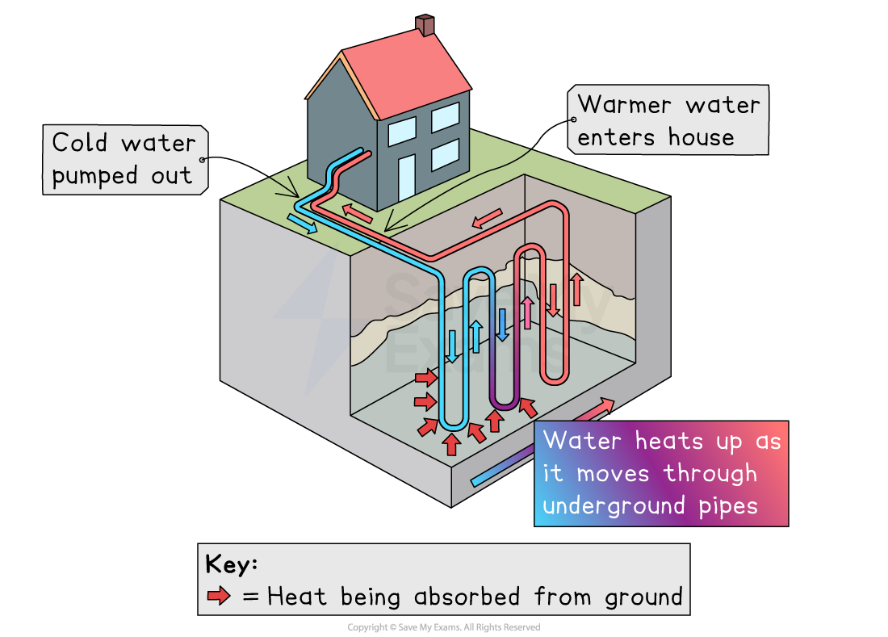
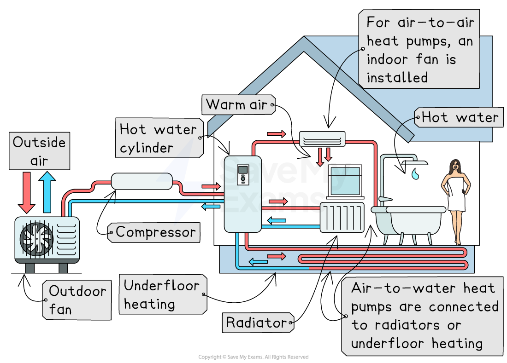

# Development of New Energy Resources

## Hydrogen as an energy source

> **Spec point** — `spcpt_pD3fbKKMKzhRs64j`

## Hydrogen as an energy source

### Why hydrogen can be used as an energy source

- **Hydrogen is a fuel that burns easily**, releasing large amounts of energy
- When hydrogen burns, it produces **water vapour instead of carbon dioxide**, so it can be a low-carbon energy source

### Blue hydrogen fuel

- **Blue hydrogen**—hydrogen fuel made from **natural gas**
- Natural gas is reacted with steam in a process called **steam methane reforming**

  - This produces **hydrogen gas** and **carbon dioxide**
- Carbon dioxide is captured and stored using **carbon capture and storage (CCS)**
- Hydrogen can then be used as a **clean fuel** for vehicles, heating or electricity generation

### Green hydrogen fuel

- **Green hydrogen**—hydrogen fuel made using **renewable energy**
- Electricity from **solar, wind or hydropower** is used for **electrolysis**

  - **Electrolysis** is the splitting of water into hydrogen and oxygen using electricity
- Produces **no carbon emissions** during production
- Hydrogen can be stored and used when needed, helping balance renewable energy supply

## Ground source heat pumps

> **Spec point** — `spcpt_6x3KbxCRhQPkQP9j`

## Ground source heat pumps

### Ground source heat pumps: transfer of heat from the ground for heating

- Pipes are buried **underground**, where the temperature stays fairly constant
- A liquid (water mixed with antifreeze) flows through the pipes

  - The liquid absorbs **heat from the ground**
- The pump transfers this heat into a building’s **heating system**
- Provides low-carbon heating for homes, schools and offices
- Works well in places with enough outdoor space for underground pipes

*How a ground source heat pump works*

> **Exam Hint**
> For heat pumps, always include the phrase **'transfer of heat'**. Examiners look for this because heat pumps **move heat** rather than create it. Missing this wording can lose marks.

## Air source heat pumps

> **Spec point** — `spcpt_Dx9tXbmD2DgRMdGh`

## Air source heat pumps

### Air source heat pumps: transfer of heat from the air for heating

- A fan draws in **outside air**, even on cold days
- A refrigerant fluid absorbs **heat from the air**
- A compressor then compresses the air, increasing its temperature
- The heat is then transferred indoors

  - Can heat **radiators, underfloor heating**, or hot water
- Easier to install than ground source systems because they stay **above ground**
- More effective in mild climates where air temperatures stay higher

*How an air source heat pump works*
