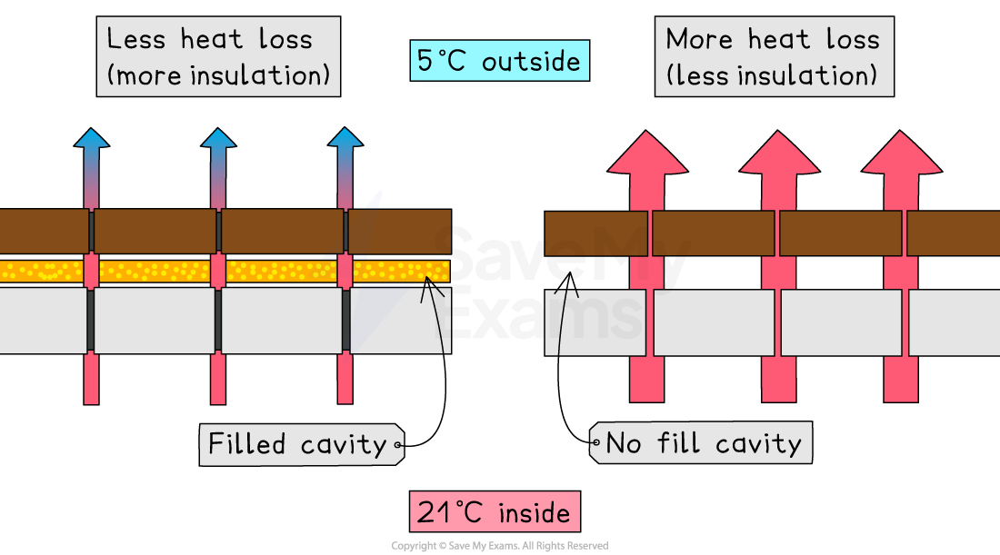
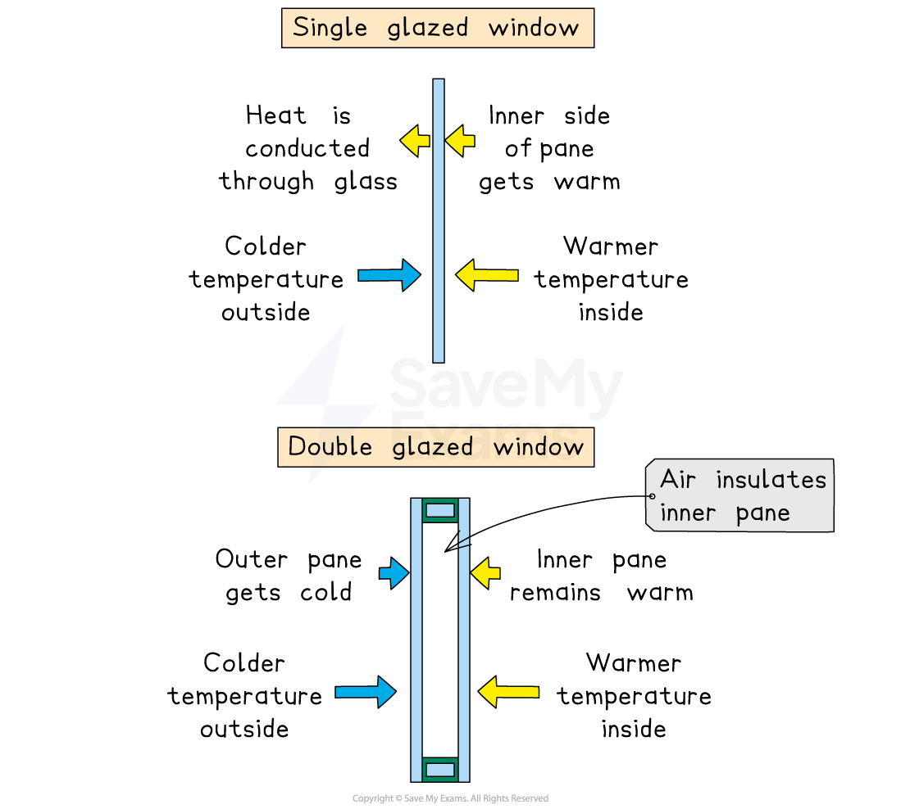

# Strategies for the Management of Energy Resources

## What strategies are used to manage energy resources?

> **Spec point** — `spcpt_r7hVmmBVjPqBq7G7`

## What strategies are used to manage energy resources?

### Reducing consumption

- Using **less electricity and fuel** helps conserve energy resources

  - Turning off lights and appliances when not in use
- Choosing to **walk, cycle or use public transport** reduces fuel demand
- Reducing consumption lowers **energy bills** and **greenhouse gas emissions**

### Insulation

- **Insulating **materials can be added to buildings to reduce heat loss or heat gain
- Insulating walls, roofs and floors keeps **warm air inside in winter**
- Good insulation keeps **hot air out in summer**, reducing cooling needs
- Homes need **less heating and air conditioning**, lowering energy use

#### Cavity wall insulation

- The gaps or cavities between external walls are often filled with insulation

  - This is called cavity wall insulation
  - This is often done by drilling a hole through the external wall to reach the cavity and filling it with a special type of foam which is made from blown mineral fibre filled with gas
  - This lowers the transfer of heat through the walls from the inside to the outside

*Less energy is transferred if the cavity is insulated*

#### Double and triple glazing

- Windows are an area of significant heat loss in houses
- **Double or triple glazing** in windows is an efficient way to reduce heat loss

  - Double-glazed windows consist of two panes of glass with air trapped between them
  - Triple-glazed windows have three panes
  - The trapped air acts as an insulator, preventing heat loss

*Double glazing reduces heat loss through the glass*

### Energy-efficient devices, including vehicles and electrically propelled vehicles

- **Energy-efficient devices** include appliances designed to use less electricity. For example:

  - LED lights use far less electricity than traditional bulbs
  - Energy-efficient fridges and washing machines use less power
- **Vehicles have become much more fuel-efficient**, using less petrol or diesel per kilometre
- **Electrically propelled vehicles** (electric cars, scooters, buses) use **electricity instead of fossil fuels**

  - Produce no exhaust emissions during use
  - Help reduce overall fuel consumption

### Exploiting existing energy resources

- Using **local energy resources** reduces dependence on imports

  - Countries may expand solar, wind or hydropower where conditions are suitable
- Improving existing **power stations** to increase their efficiency
- Upgrading **electricity grids** reduces energy lost during transmission

### Education on energy conservation

- Teaching people why saving energy matters encourages **long-term behaviour change**
- Schools and governments can promote **switching off unused appliances**
- Public campaigns explain how efficient devices and transport choices reduce energy demand

### Transport policies

- Governments can introduce **policies** to reduce fuel use

  - Improving public transport encourages people to drive less
  - Creating **cycle lanes and pedestrian zones** reduces car use
  - Congestion charges can discourage driving in busy city centres
- Encouraging **electric vehicles** through subsidies or increasing availability of charging stations reduces fossil fuel demand

### Battery storage

- **Battery storage systems** store electricity for later use
- Helps balance supply and demand, especially for intermittent renewables like wind and solar
- Stored energy can be used during **power cuts or peak demand**, reducing pressure on the grid
- Large battery systems support the shift towards **cleaner energy sources**

### Development of new energy resources

- Research into **next-generation renewables**, such as improved solar panels or advanced wind turbines
- Developing **hydrogen fuel** as an alternative to fossil fuels
- Exploring **geothermal and tidal energy** in new locations
- Innovation helps reduce dependence on finite resources and increases energy security

> **Exam Hint**
> When describing strategies, always link them to **how they reduce energy use**. For example, insulation works because it “reduces heat loss”, not just because it “saves energy”. Instead of saying “public transport saves energy”, say **why**, such as “more people sharing one vehicle reduces fuel use per person”. Examiners reward clear explanations.
> 
> Many students forget to mention **a behavioural change** in energy management. Adding a point about education or awareness shows you understand that energy conservation isn’t only about new technologies.
