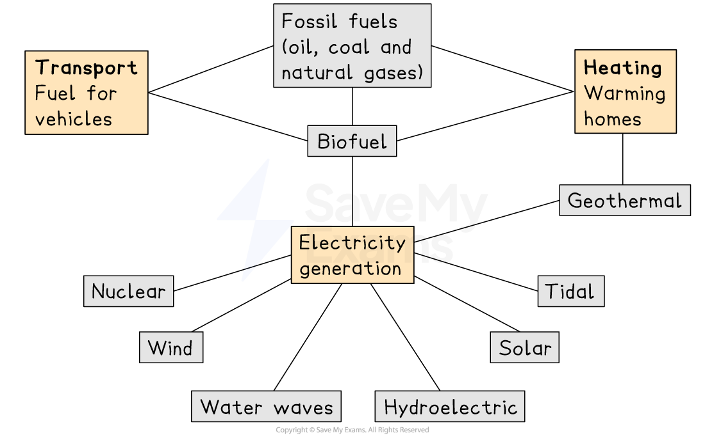
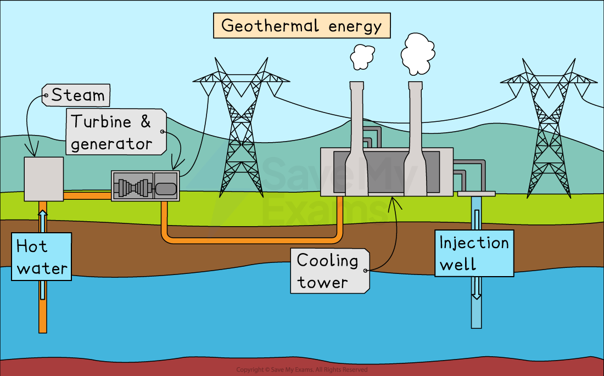
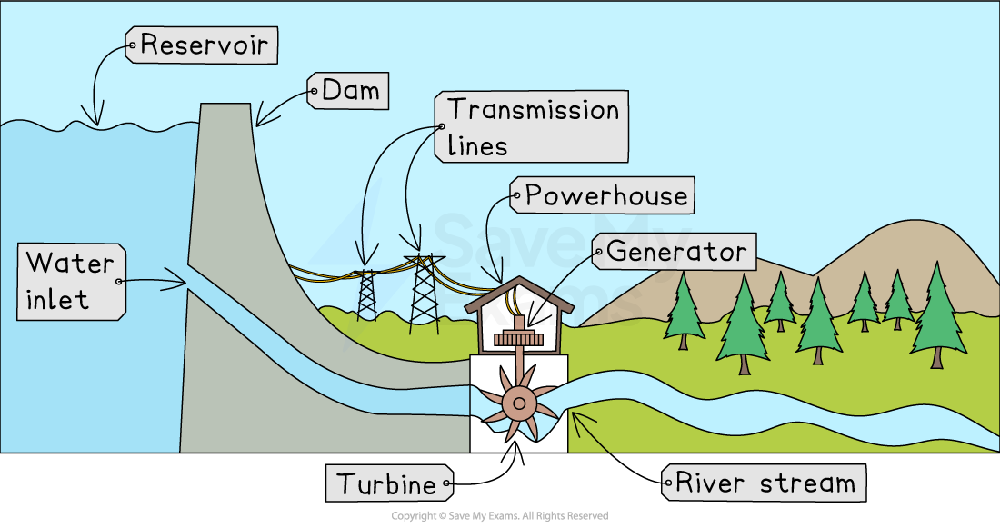
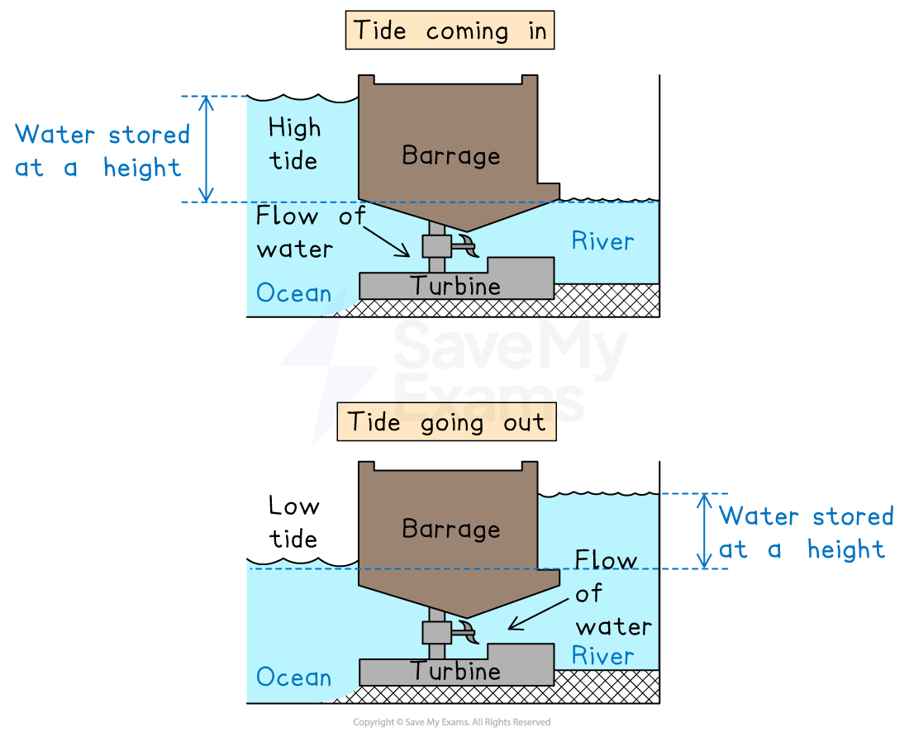
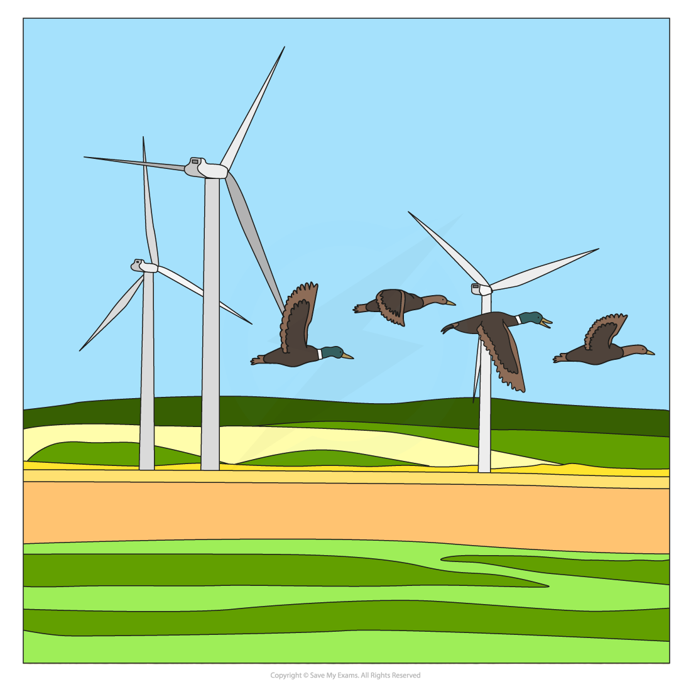
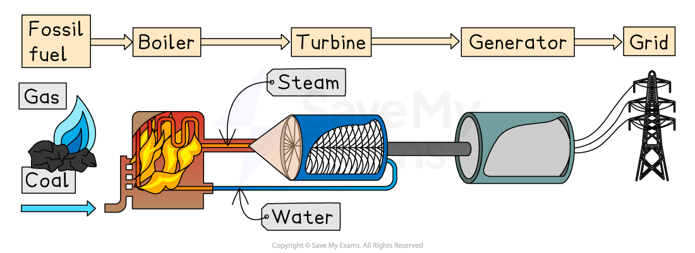
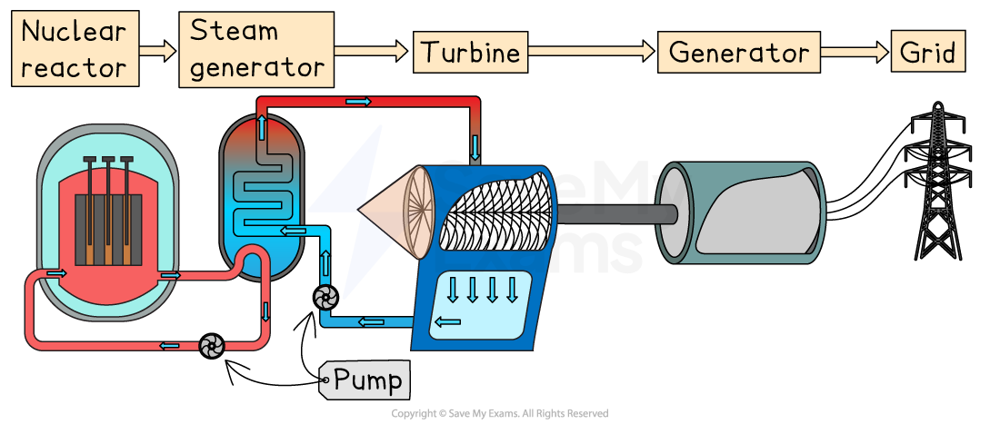

# Energy Resources & Energy Generation

## Renewable & non-renewable energy

> **Spec point** — `spcpt_wgvqqzVTnJ7B8Nc2`

## Renewable & non-renewable energy

### Renewable (non-finite) energy resources

- **Renewable resources**—energy sources that can be replenished naturally in a relatively short time

  - They are **non-finite**, meaning they will not run out on a human timescale
- Examples of renewable energy sources:

  - **Biofuels**—fuels made from living or recently living material, such as crops or waste
  
    - Includes **bioethanol**, **biogas**, **biomass**, and **wood**
  - **Geothermal power**: uses heat from rocks deep underground
  - **Hydroelectric power**: uses moving water from rivers or dams
  - **Tidal power**: uses the rise and fall of sea levels
  - **Wave power**: uses the movement of waves at the ocean surface
  - **Solar power**: uses energy from sunlight
  - **Wind power**: uses moving air to turn turbines

### Non-renewable (finite) energy resources

- **Non-renewable resources**—energy sources that exist in limited amounts and cannot be replaced quickly

  - They are **finite**, meaning once used, they will eventually run out
- Examples of non-renewable energy sources:

  - **Fossil fuels**—coal, oil, and natural gas formed from ancient organisms
  - **Nuclear power**—produced by splitting **uranium** atoms to release heat energy

*Types of energy resources*

## Generation of electricity by renewable energy sources

> **Spec point** — `spcpt_YkVX95Dm6CrW4pmQ`

## Generation of electricity by renewable energy sources

### Biofuels (bioethanol, biomass, biogas, wood)

- **Biomass**—plant or animal material burned as fuel

  - Burned in a **boiler** to heat water
  - Water turns into **steam**, which spins **turbines**
  - Turbines turn **generators** to produce electricity
- **Biogas**—gas (mainly methane) from rotting organic waste

  - Collected and burned in a power station
  - Heat is used to make steam that drives turbines and generators
- **Bioethanol**—alcohol fuel made by fermenting crops such as sugarcane or maize

  - Burned in power stations or engines to provide heat or movement
  - Can be used to turn generators and make electricity
- **Wood**—logs or wood pellets burned as fuel

  - Heat from burning wood boils water
  - Steam turns turbines connected to generators

### Geothermal power

- Cold water is **pumped down** into hot rocks underground
- Rocks heat the water so it turns into **steam**
- Steam rises and **turns turbines** at the surface
- Turbines drive **generators** to produce electricity

*Cold water is heated by the rocks and returned as hot water or steam, which can be used to generate electricity*

### Hydro-electric power

- A **dam** is built across a river to form a **reservoir**
- Water is released from the reservoir and flows through **pipes**
- Fast-moving water **turns turbines** at the base of the dam
- Turbines spin **generators** to produce electricity

*A hydroelectric dam transfers kinetic energy to mechanical energy through moving turbines which turns the generator to produce electricity*

### Tidal power

- A **barrage** is built across an estuary or bay
- As the tide rises and falls, water flows through **turbines**
- Moving water **spins the turbines**
- Turbines turn **generators** to produce electricity

*Tidal barrages can generate electricity from the movement of water, both as the tide comes in and as it goes out again*

### Wave power

- **Floating devices** or **wave machines** are placed on the sea surface
- Waves move the devices up and down
- This motion drives **pistons or turbines** inside the device
- Turbines turn **generators** to produce electricity

### Solar power

- **Solar panels (photovoltaic cells)** are placed on roofs or in solar farms

  - **Photovoltaic (PV) cells**—panels that change light energy directly into electrical energy
  - Sunlight hits the cells and **electrons move**, creating an electric current

*Solar PV panels use energy from sunlight to produce electricity*

- **Solar thermal systems** can also be used

  - Mirrors focus sunlight onto water-filled pipes or a central water tank
  - Water is heated to make steam
  - Steam turns turbines and generators

### Wind power

- **Wind turbines** have large blades mounted on a tall tower
- Wind pushes the blades, making them **spin**
- The blades turn a **shaft** connected to a generator
- The generator produces electricity as the shaft spins
- Wind turbines can be located on-shore (on land) or off-shore (in the sea)

*On-shore wind turbines*

## Generation of electricity by non-renewable energy sources

> **Spec point** — `spcpt_B44FmwRGDMxsbjRW`

## Generation of electricity by non-renewable energy sources

### Fossil fuels (coal, oil, natural gas)

- Fossil fuels are **burned in a furnace** in the power station
- Heat from burning fuel **boils water** in pipes or a boiler
- Water turns into **high-pressure steam**
- Steam is directed onto **turbine blades**, making the turbines spin
- Turbines drive **generators**, which produce electricity
- Steam is cooled back into water and **reused** in a closed loop

*The production of electricity from fossil fuels*

### Nuclear power (uranium)

- **Uranium fuel rods** are placed in a **nuclear reactor**

  - **Nuclear fission** occurs
  - Uranium atoms split, releasing large amounts of heat
- Heat from the reactor core is used to **heat water**
- Water turns into **steam** in a separate loop
- Steam spins **turbines**, which then turn **generators**
- Electricity is carried away by **power lines** to homes and industries

*Nuclear power*

> **Exam Hint**
> When describing how electricity is generated, always follow the chain: **fuel → heat → steam → turbine → generator → electricity** wherever it applies. Examiners love this clear sequence because it shows you understand the whole process, not just one part.
> 
> But remember—**photovoltaic panels change light directly into electricity**, with no turbines or steam involved.
