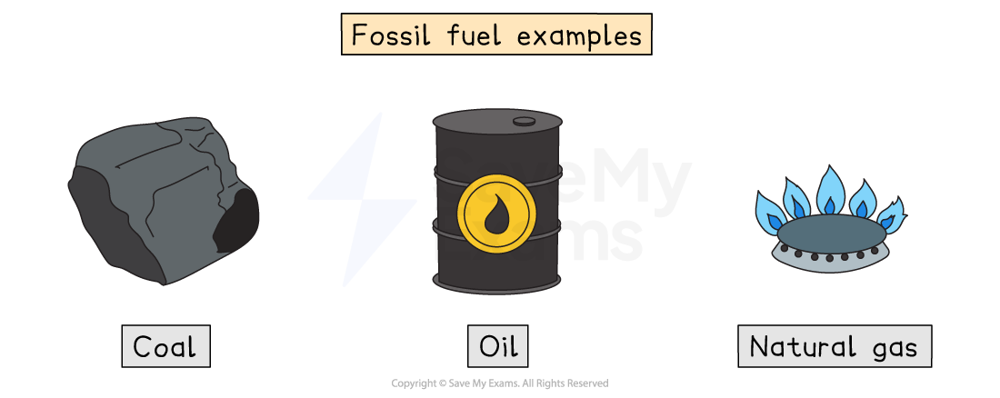
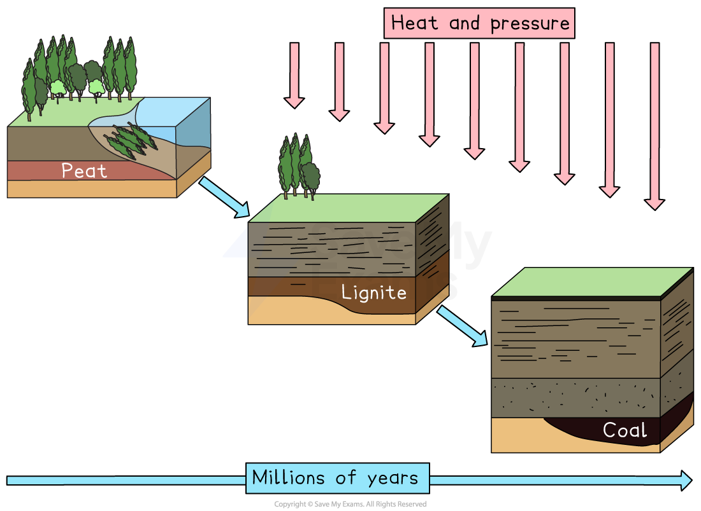
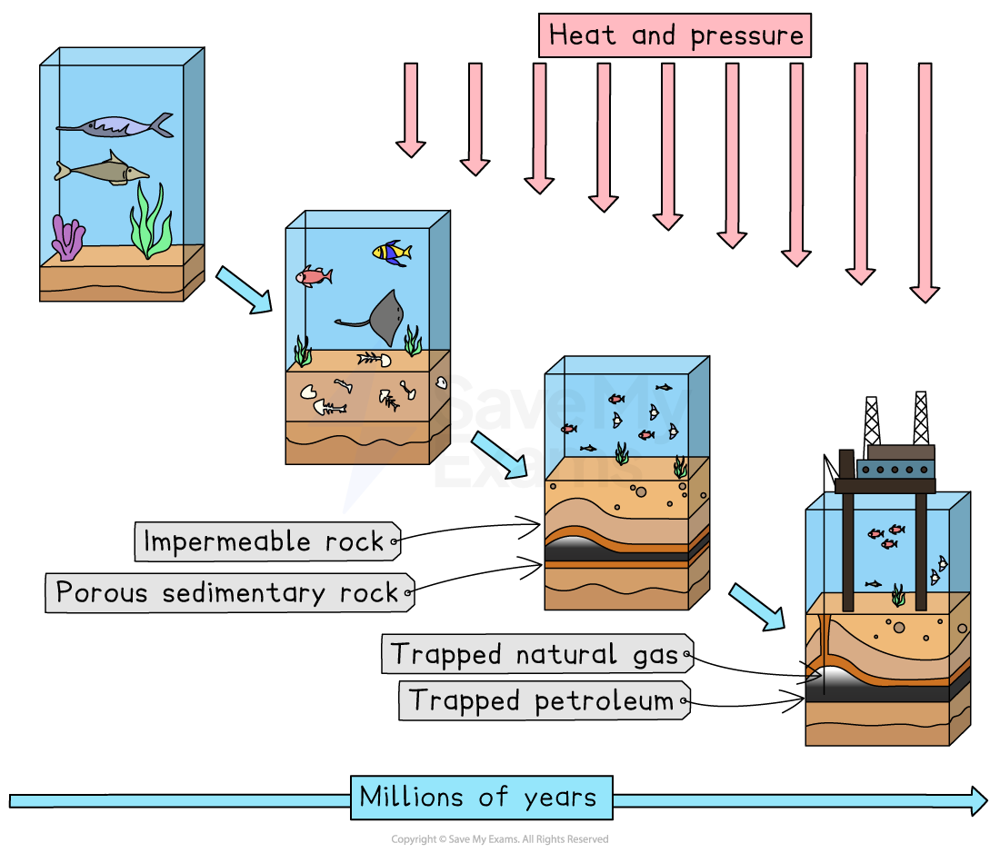

# How are Fossil Fuels Formed?

## Coal formation

> **Spec point** — `spcpt_ZcSG5dQ635dF6gNG`

## Coal formation

- Fossil fuels include:

  - **Coal**
  - **Natural** **gas** (mostly methane), which is used in domestic boilers and cookers
  - **Crude** **oil,** which is refined into petrol, diesel, and other fuels

Fossil fuels are formed from the remains of **plants** and **animals**

- **Chemical energy** stored in fossil fuels originally came from **sunlight**
- Energy from the sun was transferred to chemical energy stores within plants through photosynthesis (plants use energy from sunlight to make food)
- Animals ate the plants and the energy was then transferred to their chemical stores

*Fossil fuels include coal, oil and natural gas*

- **Coal** is a solid fossil fuel formed from the remains of ancient plants

### Stages of coal formation

- **Stage 1: Plant accumulation**—millions of years ago, dense forests grew in **swampy areas**

  - When plants died, they fell into **waterlogged ground**
  - The absence of oxygen slowed their decay
- **Stage 2: Peat formation**—dead plants built up and slowly changed into **peat**

  - **Peat**—a soft, brown, spongy material made of partly decayed plant matter
- **Stage 3: Burial and compression**—layers of **sediment** built up over the peat

  - The weight of these layers **compressed** the peat and forced out water and gases
- **Stage 4: Heat and pressure**—as heat and pressure increased, peat gradually turned into different types of coal

  - First into **lignite**—a soft, brown coal with low carbon content and lots of moisture
  - Then into **bituminous coal**—harder, darker, and containing more carbon, producing more energy when burned
  - Finally, into **anthracite**—the hardest and purest form, with the highest carbon content and energy value
- The whole process took **millions of years** underground
- Coal is mainly made of **carbon** and is burned to produce **energy** in power stations

*The formation of coal*

## Petroleum (oil) and natural gas (methane) formation

> **Spec point** — `spcpt_cxS6qkgDn2jWZcCs`

## Petroleum (oil) and natural gas (methane) formation

- **Petroleum (crude oil)**—a liquid fossil fuel formed from the remains of **marine organisms**
- **Natural gas**—a gaseous fossil fuel made mainly of **methane**

### Stages of petroleum and natural gas formation

- **Stage 1: Organic matter**—tiny plants and animals (plankton) lived in ancient seas

  - When they died, their remains settled on the **sea floor**
- **Stage 2: Burial**—layers of **mud and sand** covered the remains

  - Lack of oxygen slowed decay, so the organic matter was preserved
- **Stage 3: Heat and pressure**—as sediments built up, **temperature and pressure increased**

  - Over millions of years, this changed the remains into **oil and natural gas**
- **Stage 4: Migration and trapping**—oil and gas moved through **porous rocks** until trapped under **impermeable rock layers**

  - These **traps** form **oil and gas reservoirs**
- Natural gas is often formed **alongside oil** from the same marine deposits

*The formation of petroleum and natural gas*

> **Exam Hint**
> Be careful—many students think all fossil fuel forms come from the same source material and are formed in the same way. Remember: **coal** forms on **land from plants**, while **oil and gas** form **under the sea from plankton**.
