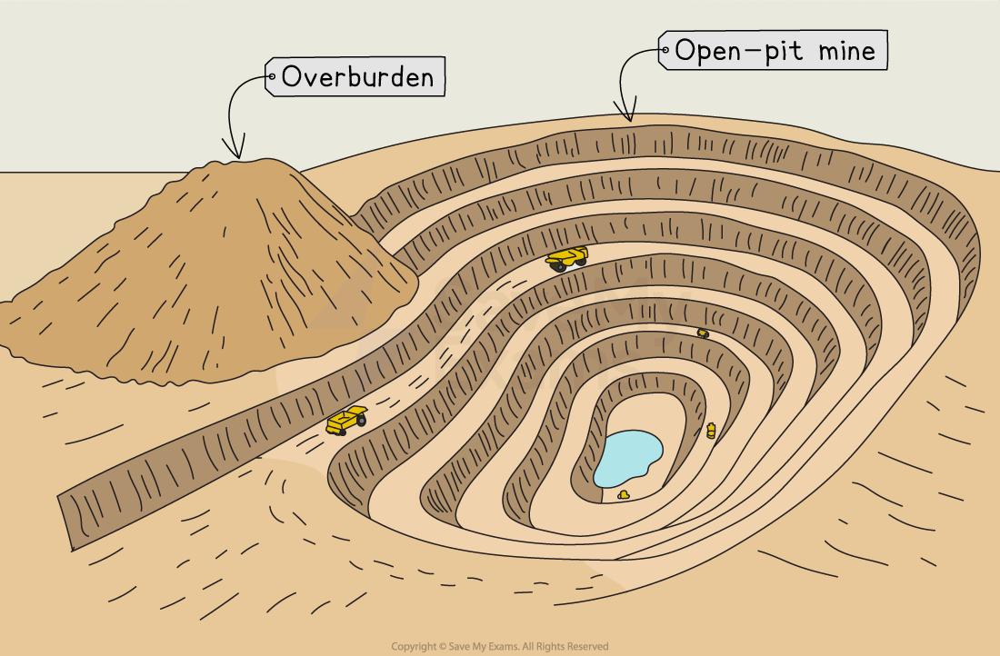
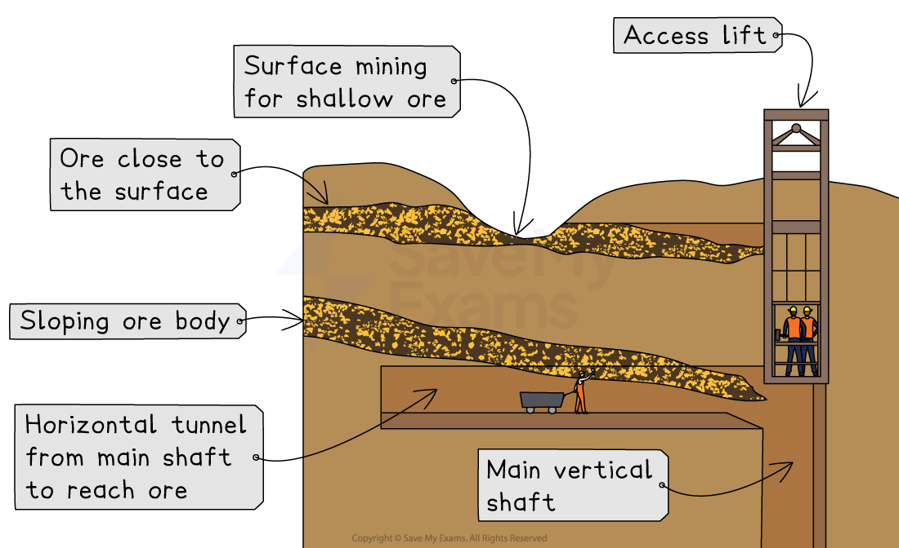
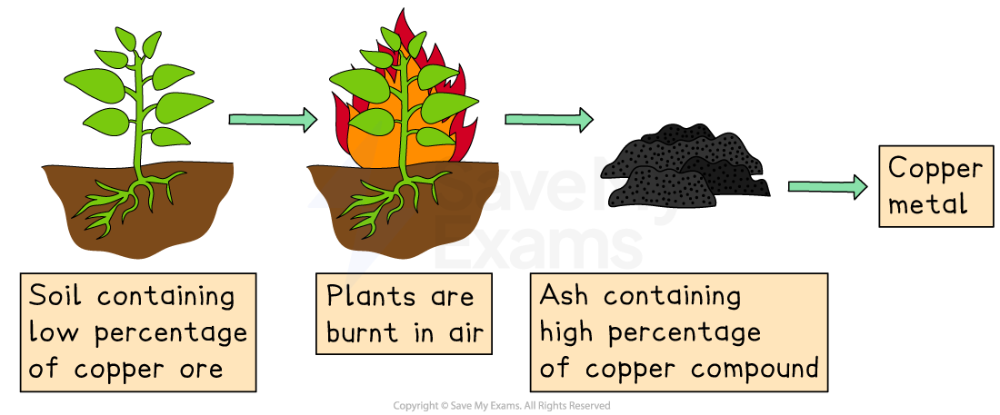

# How are Rocks, Ores & Minerals Extracted from Mines?

## What is an ore?

> **Spec point** — `spcpt_6CNBTrrz7vk7Fx2H`

## What is an ore?

- **Ore** is a type of rock that contains **minerals and metals**

  - The metal or mineral can be **extracted** and **used** for human purposes
- **Metallic ores** provide us with metals and alloys that we need to make everyday products like laptops, smartphones, cars, and batteries
- Examples of metallic ores include:

  - Iron ore for iron
  - Bauxite for aluminium
  - Copper ore for copper
- There are three main methods for extracting rocks, ores, and minerals from **mines**:

  - Surface extraction
  - Subsurface extraction
  - Biological extraction

## Surface extraction

> **Spec point** — `spcpt_SD8Hvnf59XQKh447`

## Surface extraction

- **Surface extraction** is when rocks, ores, and minerals are removed from **close to the Earth’s surface**

  - It is also known as **open mining**
- Common methods include:

  - **Opencast mining**:
  
    - Also known as open-pit or open-cut mining
    - Large sections of worthless rock and soil (known as the ***overburden***) are removed to reach the valuable material beneath
- Surface extraction is often **cheaper and safer** than underground mining

  - However, it can cause **large-scale damage to the landscape and habitats**

*Open pit mine*

## Subsurface extraction

> **Spec point** — `spcpt_fNDMwKJCTSxSqXSj`

## Subsurface extraction

- **Subsurface extraction** is when rocks, ores, and minerals are taken from **deep below the Earth’s surface**
- It is used when the mineral deposits are **too deep** for surface mining
- Common methods include:

  - **Deep mining**—tunnels are dug to reach the deposit, and workers remove the rock from below
  - **Shaft mining**—vertical shafts are dug down to access the mineral layers, with lifts or hoists to bring materials to the surface
- Subsurface extraction is **expensive and dangerous**

  - Risks include **cave-ins**, **gas leaks**, and **poor air quality**
  - It also requires **ventilation**, **drainage systems**, and **strong supports** to make it safe

*Subsurface extraction*

> **Exam Hint**
> Make sure you link each method to the **depth** of the resource—surface mining for shallow deposits, subsurface for deeper ones.

## Biological extraction

> **Spec point** — `spcpt_3S57wHy6J3CbhDz4`

## Biological extraction

- **Biological extraction** uses living organisms to extract metals from ores

  - This process is more environmentally friendly and less energy-intensive than traditional mining
- Two main methods are:

  - **Phytomining**—plants absorb metal ions from the soil through their roots
  
    - The plants are harvested and burned
    - The ash contains concentrated metal compounds that can be processed to obtain the metal

* Copper in soil can be extracted by phytoextraction*

- **Bioleaching**—bacteria feed on the minerals in the ore and produce a solution containing the metal ions

  - The solution is collected and processed to extract the metal

- Biological extraction is a **slow process** but it **reduces pollution** and can use **low-grade ores** that would otherwise be wasted
