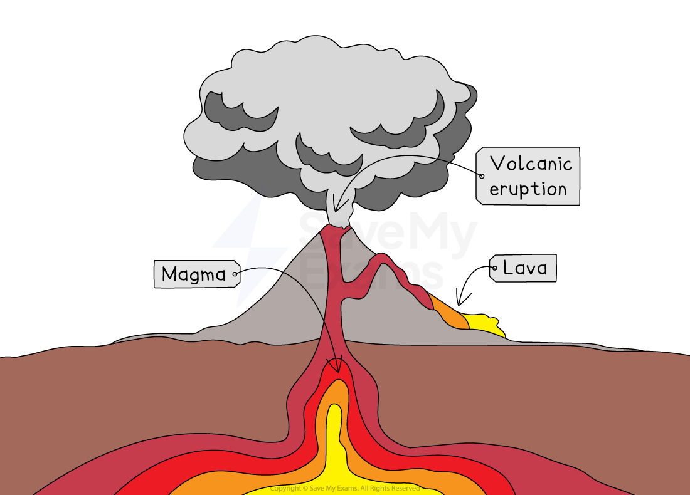
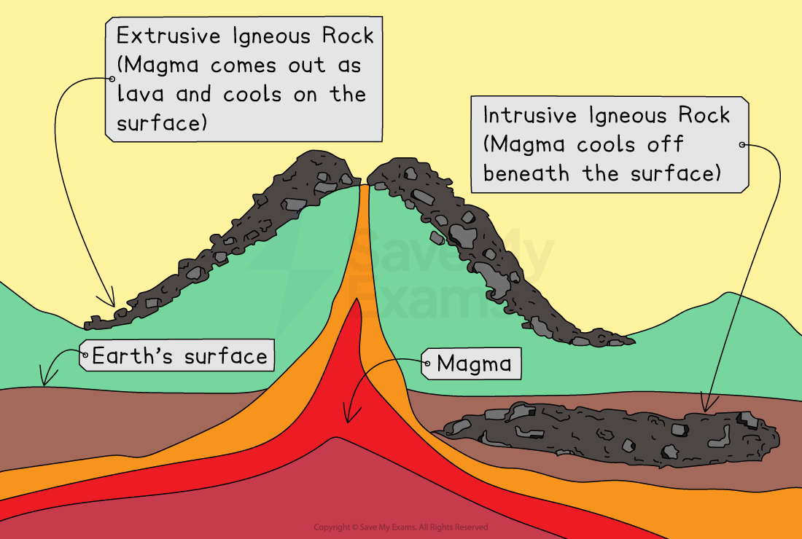
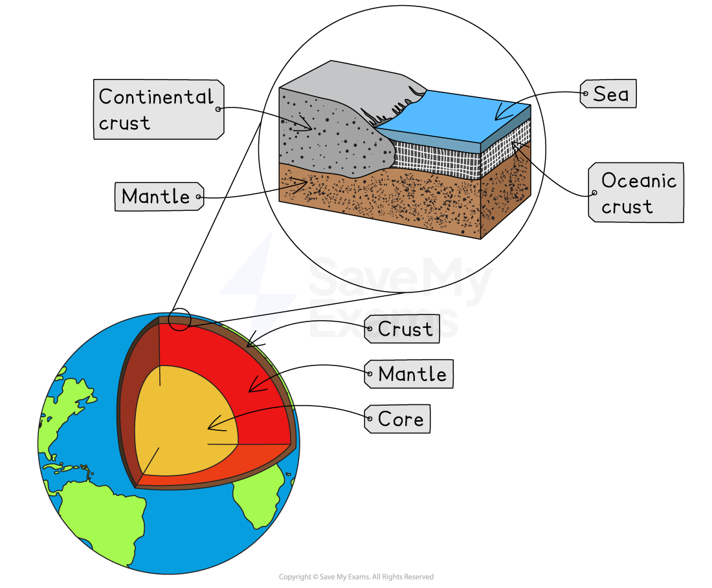
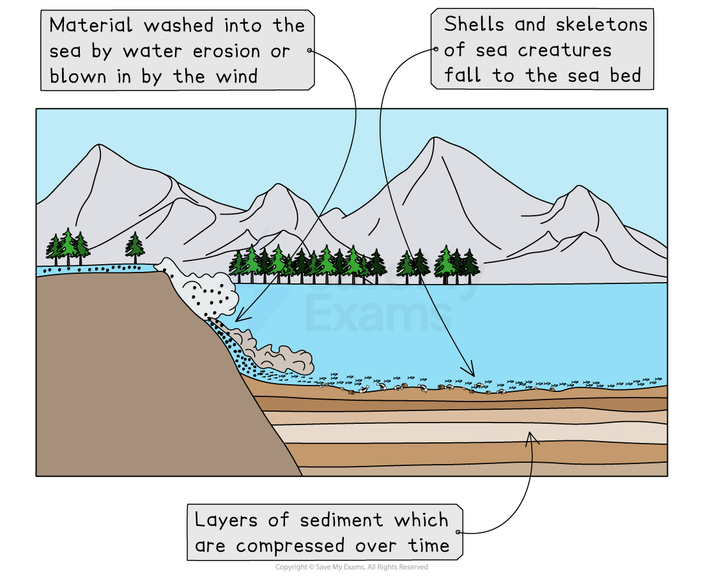

# How are Rocks Formed?

## Formation of igneous rocks: granite & basalt

> **Spec point** — `spcpt_pVT4zyP7Pk92Rgnf`

## Formation of igneous rocks: granite & basalt

### What are igneous rocks?

- **Igneous rocks** form when **molten rock (magma or lava)** cools and solidifies

  - **Magma**: molten rock **beneath the Earth’s surface**
  - **Lava**: molten rock **that reaches the surface** through volcanic eruptions
- Magma is found in the ***mantle***

*The difference between magma and lava*

### Types of igneous rocks

- **Intrusive (plutonic)** igneous rocks

  - Form **below the surface** when **magma **cools **slowly**
  - Crystals have **time to grow**, so they are **large** and **visible**
  - Example: **Granite**
- **Extrusive (volcanic)** igneous rocks

  - Form **on the surface** when **lava **cools **quickly**
  - Crystals are **small** because there isn’t enough time for them to grow
  - Example: **Basalt**
- Igneous rocks are **hard **and **more resistant to erosion**

*Types of igneous rock*

### Formation of granite (intrusive)

- Magma **rises** and **gets trapped** below the Earth’s crust
- It **cools slowly** over thousands of years
- **Large crystals** of minerals (e.g. quartz) form
- Granite is:

  - **Coarse-grained** (large crystals)
  - **Hard and durable**
  - Commonly found in **continental crust**

### Formation of basalt (extrusive)

- Lava **erupts** from a **volcano** or **fissure** onto the Earth’s surface
- It **cools rapidly** in contact with air or water
- **Small crystals** or **no visible crystals** form
- Basalt is:

  - **Fine-grained** (small crystals)
  - **Dark in colour**
  - Found mainly in **oceanic crust**

*Structure of the Earth*

## Formation of sedimentary rocks: limestone, sandstone & shale

> **Spec point** — `spcpt_2rPcVJnzcWPH3YBR`

## Formation of sedimentary rocks: limestone, sandstone & shale

### What are sedimentary rocks?

- **Sedimentary rocks** form from **sediments** (small rock particles, minerals, or organic remains) that are:

  - **Eroded**, **transported**, **deposited**, and then
  - **Compressed and cemented** over time
- They usually form in **layers (strata)** at the **Earth’s surface** or in **water bodies**

### Main processes forming sedimentary rocks

- **Weathering**—breakdown of existing rocks into smaller particles
- **Erosion and transportation**—movement of these particles by **wind, water, or ice**
- **Deposition**—settling of materials in **lakes, seas, or riverbeds**
- **Compaction**—pressure from layers above squeezes sediments together
- **Cementation**—particles bind together, forming solid rock

### Formation of limestone

- Formed mainly from **calcium carbonate**
- Originates from:

  - **Shells** and **skeletons** of marine organisms
- Over time:

  - Sediments build up on the seabed
  - Layers are **compressed and cemented** to form limestone
- Limestone is:

  - **White, grey, or yellow** in colour
  - Can contain **fossils**

### Formation of sandstone

- Formed from **sand-sized mineral grains** (mainly quartz)
- **Deposited** by **rivers, wind, or waves** in deserts, beaches, or riverbeds
- Layers of sand are **buried**, then **compacted** and **cemented** together

### Formation of shale

- Formed from **clay and silt particles** that settle in **calm water** (like lakes or deep seas)
- Layers of mud build up and are **compacted** under pressure
- Shale is:

  - Often **dark grey** due to organic material

*Formation of sedimentary rock*

## Formation of metamorphic rocks: marble & slate

> **Spec point** — `spcpt_DKrV2zJX7g35XcMZ`

## Formation of metamorphic rocks: marble & slate

### What are metamorphic rocks?

- **Metamorphic rocks** form when **existing rocks** (igneous or sedimentary) are **changed by heat and/or pressure** inside the Earth
- The process is called **metamorphism**

  - **Metamorphism**: the alteration of rocks due to **heat**, **pressure**, or **chemical processes**, without melting

### Formation of marble

- **Limestone** is the **parent rock**
- When exposed to **high temperature and pressure**, the **calcium carbonate crystals** in limestone **recrystallise**
- This forms **marble**, a **hard**, **crystalline**, and **non-layered** rock
- Marble is:

  - Usually **white** (can have coloured streaks from impurities)
  - Used in **building and sculpture**

### Formation of slate

- **Shale** is the **parent rock**
- Under **moderate heat and pressure**, the **minerals align**, creating thin layers
- This forms **slate**, a **fine-grained**, **layered** metamorphic rock
- Slate is

  - **Hard**, **dense**, and **splits easily** into thin sheets
  - Commonly used for **roofing tiles** and **flooring**

> **Exam Hint**
> Students often think that all rocks with crystals are igneous, but that’s not true. Metamorphic rocks like marble can also have crystals—the difference is that these crystals form under heat and pressure, not from cooling magma or lava.
