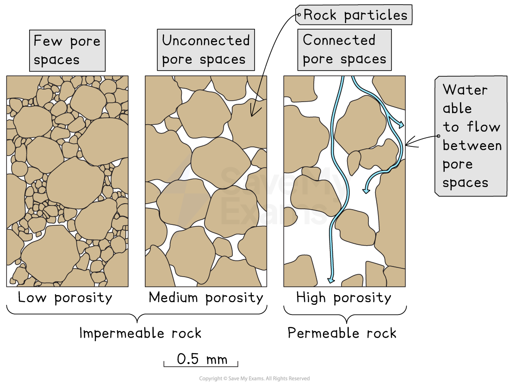

# Rock Permeability

## What is rock & soil permeability?

> **Spec point** — `spcpt_cdkKMwdx8F3cQX5w`

## What is rock & soil permeability?

- **Permeability** is the ability of water to pass through the pore spaces of rock and soil

  - **Pore spaces** are the tiny gaps or holes between rock or soil particles that allow water and air to move through
- Rocks and soils with many connected pore spaces allow water to flow through easily

  - They are described as **permeable**
- Rocks and soils with few or no connected pore spaces do not let water pass through easily

  - They are described as **impermeable**
- The size and connection of the pores determine how quickly water can move through the material

*Rock permeability*

> **Exam Hint**
> Students sometimes mix up **'porous' and 'permeable'.** 'Porous' means the rock has spaces; 'permeable' means water can actually flow through. If the pores aren’t connected, the rock might be porous but still **impermeable**.

## Permeable rocks

> **Spec point** — `spcpt_kcqXBKYxdzrGzRcC`

## Permeable rocks

- **Permeable rocks** allow water to pass through them because they contain many connected pores or cracks
- Most **sedimentary rocks** are permeable because they form from layers of particles that leave spaces between grains
- Examples of permeable rocks include:

  - **Limestone** has small cracks and spaces that let water flow through
  - **Sandstone** is made of sand-sized grains with spaces between them that allow water to move easily
- Permeable rocks often store **groundwater**

  - This forms **aquifers**, which are underground layers of rock that hold water

## Impermeable rocks

> **Spec point** — `spcpt_Df7bmzk8j9sFgZH8`

## Impermeable rocks

- **Impermeable rocks** do not allow water to pass through easily because their pores are very small or not connected
- **Igneous** and **metamorphic** rocks are usually impermeable

  - This is because they have a dense, compact structure with few spaces
- Some **sedimentary rocks**, such as **shale**, are also impermeable

  - This is because the fine clay particles are packed tightly together
- Water cannot soak into impermeable rocks

  - This means that water often flows over their surface or collects above them to form **springs** or **surface water**

> **Exam Hint**
> When classifying rock types, avoid vague answers like 'igneous rocks are hard.' Instead, state **why** they’re impermeable—because the crystals fit tightly together and there are no spaces for water to pass through.
