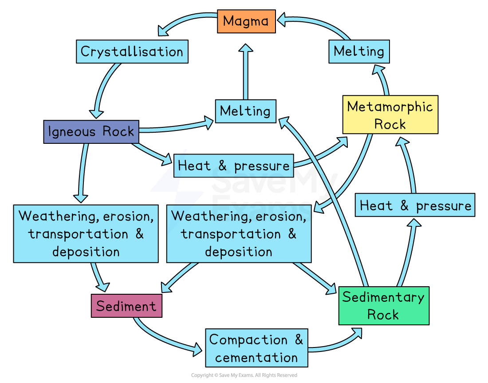
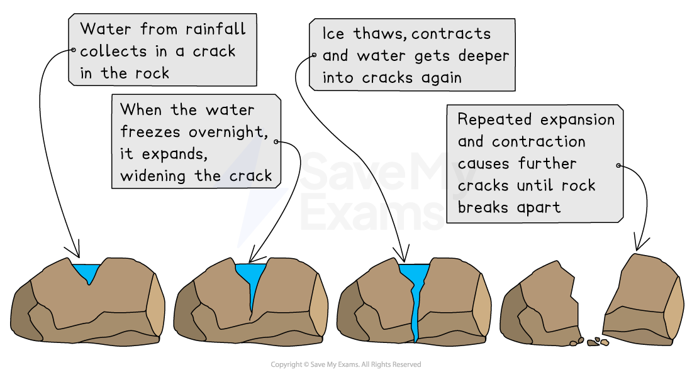
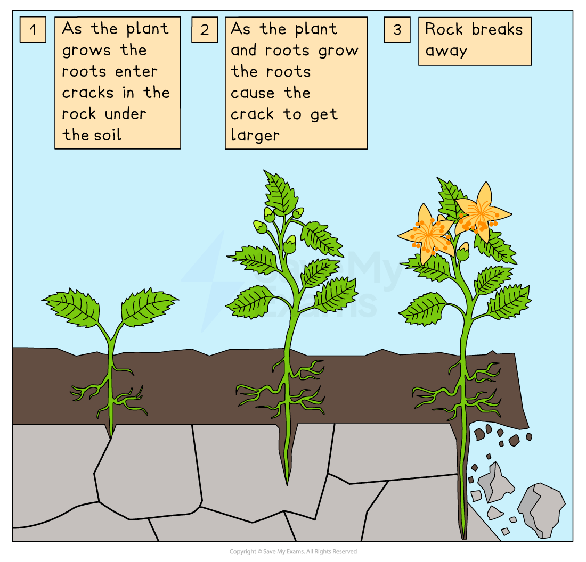
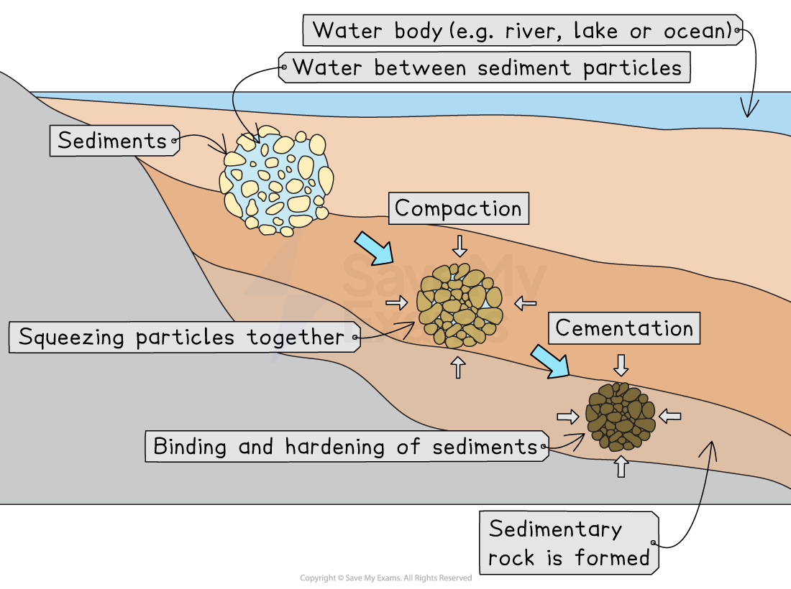

# The Rock Cycle

## Weathering & erosion

> **Spec point** — `spcpt_YRsjyFf3KW3wc2XH`

## Weathering & erosion

- **The rock cycle** is a continuous process that shows how rocks change from one type to another over time

*The rock cycle*

- **Weathering** is the breakdown of rocks *in-situ*, at or near the Earth’s surface, into smaller pieces

  - Caused by **physical**, **chemical**, and **biological** processes
  - **Physical weathering**: caused by temperature changes, freeze-thaw action, and wind or water movement, breaking rock apart
  - **Chemical weathering**: caused by chemical reactions, such as acid rain dissolving minerals in rocks
  - **Biological weathering**: caused by plant roots or animals breaking down rock
- **Erosion** is the removal of weathered rock particles from their original location

  - Carried out by **wind**, **rivers**, **glaciers**, or **waves**
  - Over time, erosion wears away landforms and creates new ones, like valleys and cliffs

*The process of freeze-thaw weathering*

*The process of biological weathering*

## Transportation

> **Spec point** — `spcpt_GDJQKFN5PgqWP74d`

## Transportation

- **Transportation** is the movement of eroded material from one place to another

  - Carried out by **wind**, **rivers**, **glaciers**, or **waves**
  - The material moved is called **sediment**—small pieces of rock and mineral
  - Larger, heavier particles are carried only short distances, while smaller, lighter ones travel further
  - When the moving water, wind, or ice loses energy, the material it is carrying is **dropped**

## Deposition

> **Spec point** — `spcpt_4tjT34TQ92hZMdgn`

## Deposition

- **Deposition** is the process of sediment being dropped or laid down after transport

  - It happens when the moving force loses energy and can no longer carry the material
  - Deposition is the first stage in the formation of sedimentary layers
  - Once sediment has been deposited, **sedimentation** begins as the layers build up over time
  - Deposition also creates features such as **river deltas**, **sand dunes**, and **beaches**

## Sedimentation

> **Spec point** — `spcpt_m3jZfKTJmXTzvBmj`

## Sedimentation

- **Sedimentation** is the process by which transported materials settle out of moving water, ice, or wind

  - Starts **after deposition**, when sediments settle and begin to collect on top of each other
  - Sediments build up in layers at the bottom of rivers, lakes, and oceans
  - Larger, heavier sediments settle first, while lighter ones stay suspended longer
  - The weight of new layers adds pressure to the layers below, preparing them for compaction
  - Over long periods, these layers form **sedimentary deposits** that can later become rock

> **Exam Hint**
> Many students confuse **deposition** and **sedimentation**. Think of deposition as the moment the sediment drops out of moving water or wind, and sedimentation as what happens **after—when** those sediments build up in layers.

## Compaction

> **Spec point** — `spcpt_FNGxsYxKpkCx9hbQ`

## Compaction

- **Compaction** is when pressure from the layers of sediment above squeezes the lower layers together

  - Water and air are pushed out from between the grains
  - The sediment becomes denser and starts to form solid rock

## Cementation

> **Spec point** — `spcpt_23dmnPHDjCJ8KQXN`

## Cementation

- **Cementation** happens when minerals crystallise and glue compacted particles together

  - Minerals such as **silica** or **calcium carbonate** fill the spaces between grains of rock
  - This binds the sediments to form **sedimentary rock**

*Compaction and cementation*

## Crystallisation

> **Spec point** — `spcpt_vycszgnMpW3W4qYN`

## Crystallisation

- **Crystallisation** is the process by which molten rock cools and forms crystals

  - When **magma** or **lava** cools, minerals form solid crystals that make up **igneous rocks**
  - Slow cooling underground produces **large crystals**, as seen in **granite**
  - Rapid cooling on the surface produces **small crystals**, as seen in **basalt**
