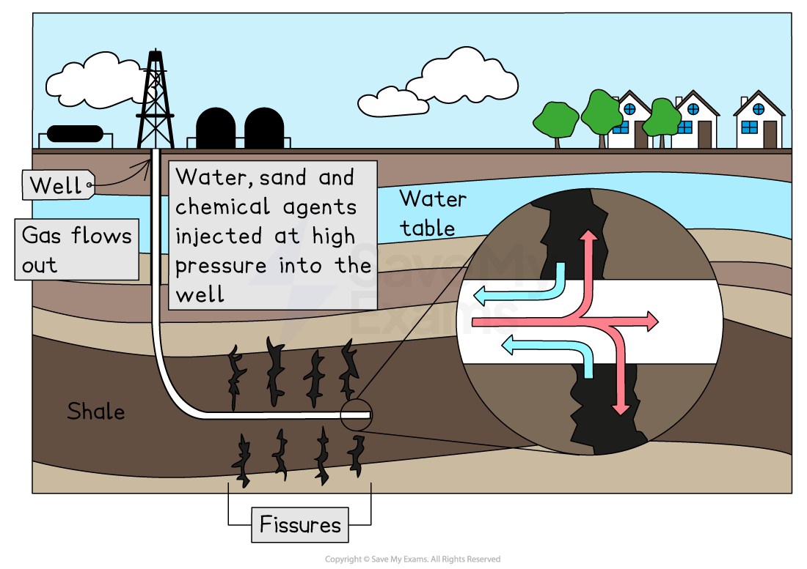

# Definition of Fracking

## What is fracking?

> **Spec point** — `spcpt_vQrF7nRF8Jn347rG`

## What is fracking?

- **Hydraulic fracturing,** usually known as '**fracking**', is a method used to extract **natural gas or petroleum** from deep **shale rock layers**

  - It involves pumping water, sand and chemicals at high pressure to **fracture the rock**
- The high-pressure fluid creates **small cracks** in the shale
- These cracks allow **gas or oil** trapped inside the rock to flow out
- The fuel is collected through a **well** drilled into the shale layer

*Hydrologic fracturing or fracking*
