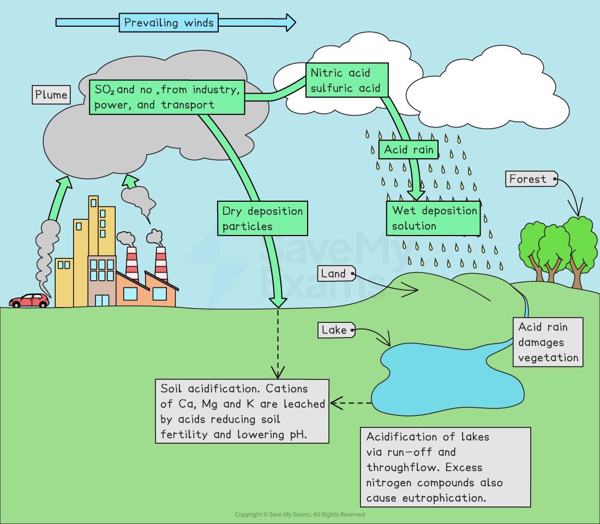
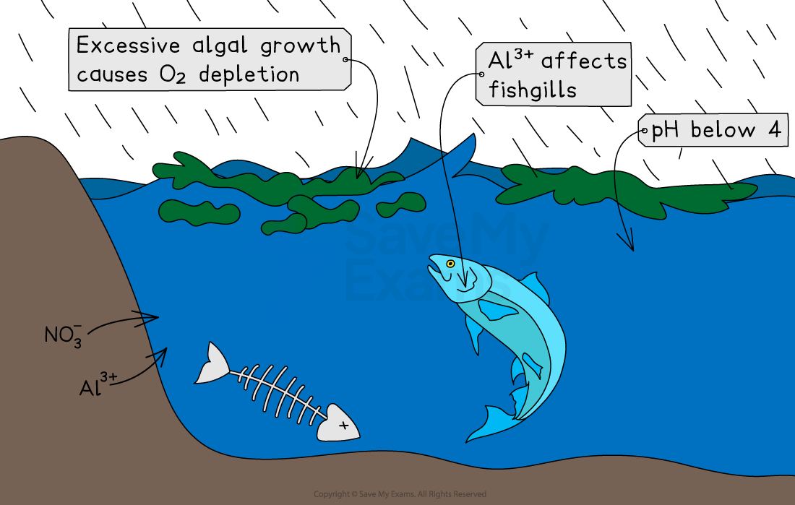
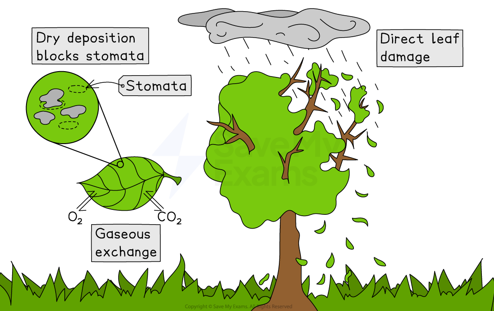
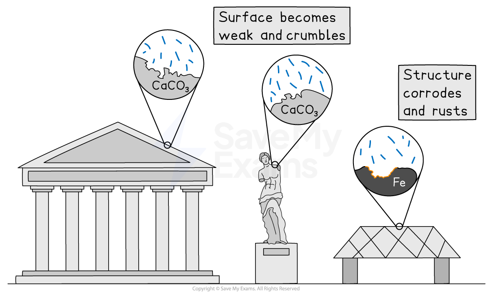

# Causes & Impacts of Acid Rain

## How does acid rain form?

> **Spec point** — `spcpt_C8VgkrRPWCdGPwn4`

## How does acid rain form?

- Acid rain is precipitation or atmospheric deposits with a pH value below 5
- It occurs when **sulphur dioxide** and **nitrogen oxides **are released into the atmosphere through human activities such as car emissions and burning coal
- It can also come from **natural sources,** such as volcanic eruptions
- The equation for this process is:

*sulphur dioxide + water + oxygen → sulphuric acid*

- Most acid rain is caused by fossil fuel combustion in factories and power stations, and motor vehicles, releasing **sulphur dioxide (SO₂)** and **nitrogen oxides (NOₓ) into the atmosphere**

  - **Power stations **that burn coal and oil are major contributors to SO₂ emissions, while NOₓ emissions mostly come from **vehicle exhausts**
  - **Sulphur dioxide** is released when fossil fuels containing sulphur compounds are burned
  - **Oxides of nitrogen** are produced when nitrogen from the atmosphere reacts with oxygen at the high temperatures of vehicle engines and industrial furnaces
  - These acidic gases settle directly onto surfaces (buildings, vegetation, soil) **without rain**
  - This is known as **dry deposition**
- When **NOₓ and SO₂ **react with water vapour and oxygen in the atmosphere, they form weak solutions of **nitric acid** (HNO₃) and **sulphuric acid** (H₂SO₄)
- Sulphuric acid and nitric acid can dissolve in **rainwater** or **snowflakes**, forming **acid rain **
- Acid rain can be moved by winds for hundreds of kilometres before it falls to the ground, so it can occur at some distance from the source; this is known as **wet deposition**

*Acid rain formation*

## Impacts of acid rain

> **Spec point** — `spcpt_XzsWkvj5G697NzvX`

## Impacts of acid rain

- Acid rain is **not restricted** to the immediate area of emission
- Acid rain is more likely to affect locations **downwind **of big industrial regions because winds can carry particles for long distances, causing **transboundary pollution** to occur in other countries
- Acid rain affects both the living and the non-living

### Water

- Acidic rain **directly affects**  bodies of water,  **aquatic food webs,** and a**quatic organisms **such as fish, amphibians, and invertebrates
- When acid rain falls on bodies of water, **pH levels fall** and cannot support life, causing **water acidification**
- Food web destruction starts at the lowest level of the food chain, where tiny microorganisms that are food  die
- As food sources dwindle, more and larger fish die
- This **cascades through food webs, **which further **reduces water quality**

*The impact of acid deposition on waterways*

- Acid rain can **leach copper, aluminium**, and **other heavy metals** **out **of the **soil **and **into runoff **and **drinking water**

### Soil and plants

- Acid rain **decreases **the **pH of the soil,** causing its **acidity **to **increase**, which decreases the level of important nutrients found in the soil

  - This makes it harder for plants to absorb nutrients and grow
- Acid rain negatively impacts  forests and trees as sulphur dioxide **interferes **with the **process** of **photosynthesis**

  - When acid rain **directly **falls on **leaves**, it  damages the protective waxy coating of leaves, interrupting water and gas exchange, which eventually kills the plant
- Acid rain also damages foliage, causing *defoliation* and reduces nutrient absorption

  - Acid rain is especially** harmful **to** coniferous forests **such as **pine and spruce** due to their** shallow root systems **and** thin bark**
- Removing a whole tree can be equivalent to the effect of 60 years of acid rain

*The impact of acid rain on plant life*

### Buildings

- Acid rain can react with metals and stone (such as limestone), damaging buildings and statues
- Limestone and marble both contain calcium carbonate (CaCO₃)
- The calcium carbonate reacts with sulphuric acid or nitric acid, causing stonework to corrode and weaken

*The impact of acid deposition can be seen on buildings, statues and metal structures*

> **Case Study**
> **Acidification in Sweden**
> 
> - It is mostly winds from other countries and international shipping that bring most of the acidifying pollutants that land in Sweden
> - There isn't much limestone in Swedish soils, so they can easily become acidic
> - Sweden has more than 18,000 lakes, and 4,000 of them are badly damaged by acidification
> - About 9,000 lakes in Sweden, mostly in the south and centre of the country, are also losing a lot of fish population
> - Sweden has up to 1.7 mg/l of aluminium in its water, which is higher than the safe limit of 0.2 mg/l
> - High levels of mercury in fish have caused health problems when eaten
