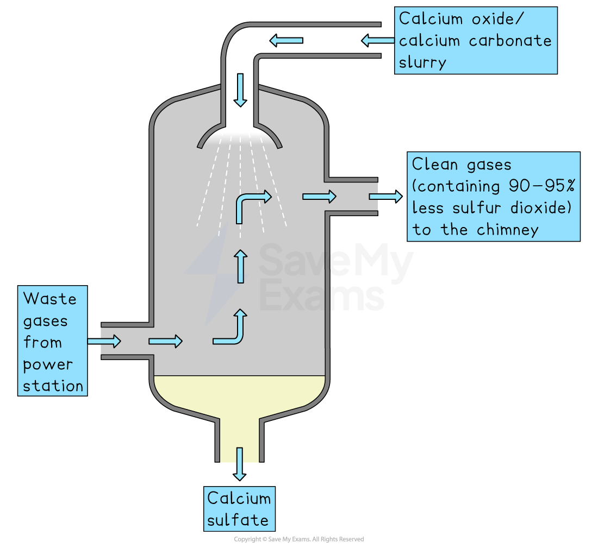
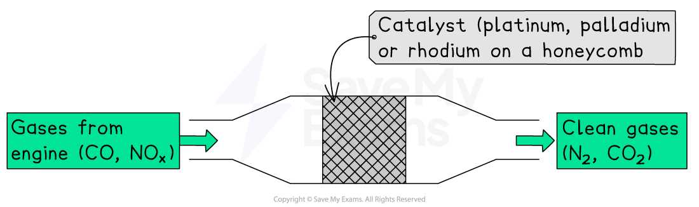
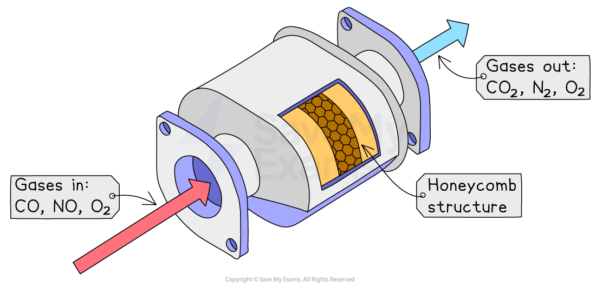

# Strategies to Manage Impacts of Acid Rain

## Strategies to manage impacts of acid rain

> **Spec point** — `spcpt_frFgtymFnjSH825W`

## Strategies to manage impacts of acid rain

### Flue gas desulphurisation (FGD)

- FGD is important because SO₂ emissions are a health and environmental hazard
- FGD systems can remove up to 95% of SO₂ from flue gases
- FGD is the main way to reduce sulphur dioxide emissions from coal-fired power stations

  - Emissions are passed into a scrubbing chamber where
  
    - They are sprayed with a wet slurry of calcium oxide and calcium carbonate
    - The calcium compounds react with sulphur dioxide to produce calcium sulphate
    - The cleaned gas is then emitted from the chimney

#### Flue gas desulphurisation

*The scrubber sprays a lime slurry over the waste gases to remove 90-95% of the sulphur dioxide*

- Scrubbers remove building exhaust gases and particles
- **Wet scrubbers**

  - Wet scrubbers use limestone to neutralize sulphur dioxide before it leaves exhaust stacks
  - These pipes pass gases through a water-sprayed chamber
  - Particulates and dissolved gases are then filtered from the liquid
  - After cleaning (scrubbing), the exhaust is emitted
  - There is a sludge collection system that traps polluted water for later disposal
- **Dry scrubbers**

  - Exhaust gases are neutralised or converted by dry chemical scrubbers
  - The converted materials are recovered from the gas stream, with the cleaned gases being emitted
  - Calcium oxide is a common dry scrubber additive which reacts with SO₂ to form calcium sulphite

### Catalytic converter

- Catalytic converters are devices fitted to petrol and diesel vehicles and sometimes on** kerosene heaters **and **stoves** to **reduce harmful emissions**
- They contain a series of **transition precious metal catalysts**, such as platinum and rhodium
- The metal catalysts are in a **honeycomb** within the converter to increase the surface area available for reaction
- The system is attached to the exhaust system and converts toxic gases like CO, NOₓ, and hydrocarbons into less toxic compounds like CO₂, O₂, N₂, and water

*Catalytic converters are designed to reduce the polluting gases produced in car exhausts*

### Transport policies

- Transport policies can help mitigate the effects of acid rain by using fewer fossil fuels
- In many countries, it is **compulsory** for vehicles to have catalytic converters
- By providing larger subsidies, governments can promote the use of public transport
- Walking, cycling, and *carpooling *reduce emissions
- Increasing the number of electric vehicles (EV) on the road can also help

## Benefits & limitations of strategies to manage impacts of acid rain

> **Spec point** — `spcpt_SSv5T4j2pMC2d4Sj`

## Benefits & limitations of strategies to manage impacts of acid rain

### Flue gas desulphurisation

- They **help lower harmful gases released into the air**
- They can reduce SO₂ emissions by up to 90%
- However, the flue gas exiting the absorber is highly corrosive because it's saturated with water and still contains SO₂ that can damage equipment
- Using corrosion-resistant materials or reheating the gasses above dew point minimises corrosion but adds to the costs

### Catalytic converters

- Motor vehicles generate more air pollution than any other single human activity

  - **Catalytic converters **may improve air quality; however, they are expensive to replace and can increase fuel consumption, as extra fuel is needed to keep the converter hot enough to work
  - Also catalytic converters are a target for thieves who remove them for the **precious metals **

### Transport policies

- **Carpooling** leads to a reduction in the number of cars in city centres and is also a more economical way to travel

  - Leeds city council operates a policy to encourage car sharing by the use of high-occupancy vehicle lanes, available for cars carrying two or more passengers, hence encouraging people to share cars to enable them to get to work quicker
  - However, carpooling offers limited flexibility and can cause additional wear and tear on vehicles, leading** **to increased maintenance costs
- **Using public transport**

  - The introduction of bus lanes and improved transport information services has made public transport more attractive and sped up journey times
  - However, in some countries, the cost, availability and reliability of public transport means people will continue to use their cars
- **Cycling** can often be the quickest way to make short journeys

  - But cycle tracks in towns and cities need improvement and expansion
- **Walking**

  - The introduction of pedestrianisation in city centres has increased the number of walkers
  - As with cycling, walking is also a healthy way to travel as it increases physical fitness with no emissions
- **Promoting efficient motoring**

  - Maintaining slower speeds, fuel is conserved, and less carbon dioxide is emitted
  - However, many people will and do ignore speed restrictions
- **Electric vehicles (EVs)**

  - An EV’s electric motor is highly efficient compared to an internal combustion engine
  - EVs produce no tailpipe emissions but still contribute to emissions when the raw materials are mined, refined and manufactured
  - EVs may also source energy from a grid that uses fossil fuels
  - EVs are fitted with lithium-ion batteries that use a lot of energy and raw materials
- **Traffic management schemes**

  - Traffic management schemes reduce the amount of traffic in city centres
  
    - Paris has experimented with a scheme that allows cars with an even number plate to enter the city on one day and those with odd number plates on the next
