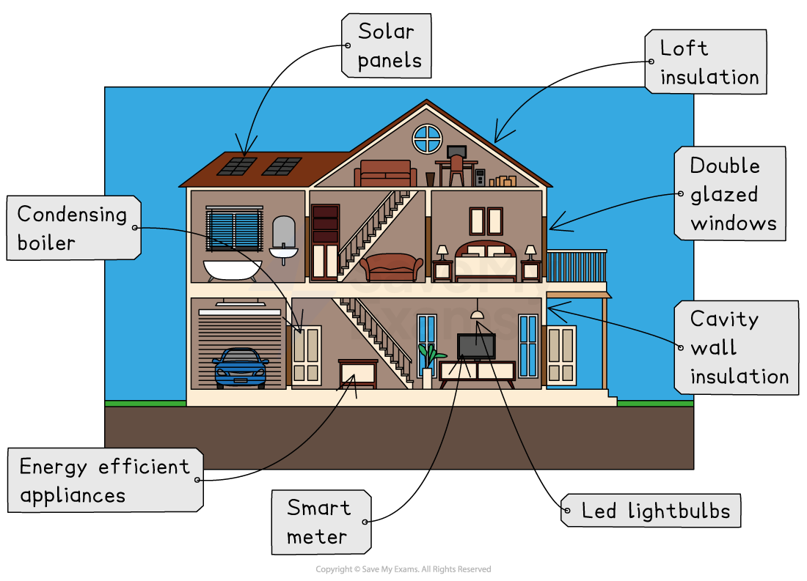

# Strategies to Reduce Carbon Footprints

## National & international strategies to reduce carbon footprints

> **Spec point** — `spcpt_cptrDRcZzMxvkzMR`

## National & international strategies to reduce carbon footprints

- A carbon footprint is **the total amount of greenhouse gases (GHGs) emitted by a person, organisation, **or** product**

  - It is usually **measured **in** tonnes of carbon dioxide equivalent (CO****2**** e)**
- To manage the effects of climate change, the population's carbon footprint needs to be reduced by cutting down on the amount of greenhouse gases being released into the atmosphere
- This can be done at the** international, national, **and** individual levels** and may be **short-term **or **long-term solutions**
- Responses involve mitigation and adaptation

  - **Mitigation **focuses on tackling the root cause of climate change by reducing greenhouse gas emissions to prevent future warming
  - **Adaptation **involves adjusting to the current and future effects of climate change to reduce harm
  
    - This includes things like building sea walls or developing drought-resistant crops

### International agreements

- In 1988, the **Intergovernmental Panel on Climate Change (IPCC)** was set up to assess the '**risks of human-induced climate change**'

  - This was followed by several international agreements

#### Earth Summit, Rio 1992

- In May 1992, the **United Nations Framework Convention on Climate Change (UNFCCC)** was established
- It was then signed by **166 countries** at the Earth Summit in Rio or at the UN headquarters
- The Earth Summit also set out:

  - **Twenty-seven principles** aimed at guiding countries towards more environmentally sustainable development
  - Aims to stabilise greenhouse gas levels
  - Principles for the management, conservation and sustainable development of all forests

#### Kyoto Protocol 1997

- Delegates from 150 countries agreed to **reduce greenhouse gas emissions**
- It stated that industrialised countries would **reduce emissions** to below the levels in 1990
- Developing countries, including China and India, were exempt from the agreement
- The USA did not sign up for the treaty
- Canada withdrew in 2011, stating that without China and the USA, the treaty would not work
- The Kyoto Protocol was the first legally binding international treaty to set emissions targets

#### Marrakech Agreement, 2007

- It was agreed that funding would be provided to less developed countries to support them in adapting to the effects of climate change

#### Paris Agreement 2015

- Global agreement to** limit global warming to 2°C** (preferably 1.5°C) above pre-industrial levels
- The agreement also includes** reducing CO₂ emissions by at least 60% **by 2050
- Signed by 196 countries, including the USA and China (the USA withdrew in 2020 and rejoined in 2021)
- Introduced** Nationally Determined Contributions (NDCs)**

  - These are climate action plans submitted by each country outlining their commitments
  - Currently, these are not sufficient to meet the 2°C target (projections show 2.6-2.7°C warming by 2100)

#### Conference of the Parties (COP)

- The United Nations (UN) holds an annual (every year) meeting to discuss climate change.
- COP29 was held in Baku, Azerbaijan
- All nations agreed to:

  - Continue to take action to further reduce greenhouse gas emissions
  - Triple financial aid to developing countries

### Research and climate modelling

- *Climate modelling* can recreate past climates, which helps scientists to predict future temperature changes
- Researchers can test their ideas and scenarios and see the climate effects
- However, extreme weather events are hard to predict, and climate models are not always accurate.

### Reducing emissions

- Using less fossil fuels and more nuclear and renewable energy will **lower greenhouse gases** and slow the rate at which average temperatures change around the world
- Some countries will keep using fossil fuels because they already have the resources and reserves to generate energy cheaply
- Many countries do not have the funding or infrastructure for renewable and nuclear energy

  - Nuclear power is more expensive and produces radioactive waste

### Carbon sequestration

- Sequestration, storage and capture is the process of taking carbon dioxide from power plants and putting it in underground storage sites using pipelines
- This could cut CO₂ emissions from energy and manufacturing sites by 20%
- However, it is expensive to equip power plants with the right technology and not every country will be able to store enough CO₂.
- It's possible for leaks to pollute groundwater, which could harm people and animals in the area
- There have been reports of small earthquakes after carbon dioxide is pumped into the ground

### Transport policies

- Transport policies can include:

  - An extensive public transport system
  - Use of electric hybrid cars
  - Use of biofuels
  - Increasing road tax
  - Car-sharing schemes
- In 2023, 15% of the world's greenhouse gas emissions came from the transportation sector
- It is not easy to find new ways to reduce shipping and aviation emissions
- It takes time and money to change people's habits, and the changes involved can be more expensive and people may not want these changes

### Carbon tax

- Imposing a carbon tax on carbon-emitting goods may reduce demand, but governments are resistant due to concerns about impacting the poor and businesses
- Additionally, the tax only targets carbon dioxide emissions, not other emissions like methane

### Energy conservation

- Energy conservation includes education and advertising campaigns to promote energy efficiency. While campaigns raise awareness of the consequences of actions, some individuals may not be ready to make changes due to cost concerns.

### Use of AI

- AI can measure iceberg changes 10,000 times faster than humans, as well as deforestation rates and forest carbon storage
- AI technology can aid communities in adapting to climate change by predicting weather patterns and implementing renewable energy, waste management, and reforestation
- AI is helping industries to decarbonise operations and reduce emissions
- AI technology has an environmental impact due to its carbon footprint and the materials used in its production

### Reforestation, agroforestry and afforestation

- *Reforestation*, *agroforestry* and *afforestation* reduce **carbon dioxide emissions** and **mitigate deforestation**
- CO₂ is removed from the atmosphere through photosynthesis and stored within trees and soil, which prevents further emissions from deforestation
- Afforestation and reforestation also:

  - Reduce flooding
  - Cool local temperatures
  - Improve biodiversity

### Lowering birth rates

- A smaller population directly reduces the total demand for resources and energy, which in turn lowers overall greenhouse gas emissions

  - Achieving this is challenging

### Adjustments in agriculture

- **Methane emissions** can be reduced by farming fewer animals
- A major source of greenhouse gases is **nitrogen-based fertilisers**

  - There is evidence that they emit more carbon than global aviation and shipping combined
- Methods like reduced ploughing and cover crop planting. improves soil quality and reduces CO₂ emissions
- Without financial incentives, farmers may not adopt strategies that reduce production and are costly to implement

## Individual actions to reduce carbon footprints

> **Spec point** — `spcpt_J88sj4RkrxDNfdtN`

## Individual actions to reduce carbon footprints

- There are many actions that individuals can take to reduce energy use and conserve resources or use energy more efficiently, including:

  - Reduce car use by using public transport, walking or cycling
  - Insulating walls and roof spaces
  - Buy ***energy-efficient*** (AAA-rated) appliances such as washing machines
  - Don't leave electrical items on standby
  - Install double or triple-glazing
  - Install heat exchange
  - Turn the thermostat down and wear more layers
  - Install solar panels

*Individual methods of reducing energy use - energy-efficient home*

### Sustainable lifestyle choices

- Opting for a plant-based diet and purchasing seasonal, locally produced food can reduce greenhouse gas emissions
- Most individuals are unaware of their environmental impact and only act if changes are easily accessible and affordable
