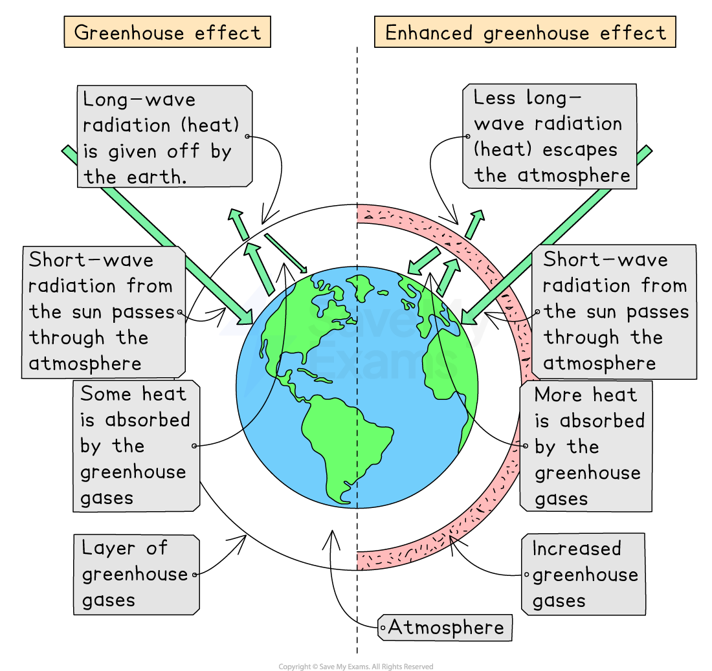

# The Enhanced Greenhouse Effect

## What is the enhanced greenhouse effect?

> **Spec point** — `spcpt_tQ4RWrBv2DWB6B8k`

## What is the enhanced greenhouse effect?

- The **enhanced greenhouse effect** occurs when there are higher levels of greenhouse gases (GHGs) than usual in the atmosphere
- The more greenhouse gases there are in the atmosphere, the more solar radiation is absorbed and **less thermal (heat) energy escaping  **into space
- This leads to **global warming **

  - The effect is **caused **by **human activities** that have **produced excessive **greenhouse gases (GHGs) into the atmosphere, trapping heat and increasing global warming
  
    - Human activity has increased CO₂ levels in the atmosphere by more than 100 parts per million (ppm) to 420 ppm in 2020
    - Which has increased global average temperatures by over 1°C since pre-industrial times

*Human activities lead to the emission of greenhouse gases that enhance the greenhouse effect, contributing to global warming*

### Is climate change the same as global warming?

- The simple answer is **no**, **but **they are **related **to each other
- **Climate change **is a** long-term change **in **average temperatures and weather patterns** that define local, regional and global climates, usually **over a 30-year period**
- **Global warming** is the **rise of Earth's average surface temperatures** because of the increasing concentrations of greenhouse gases in the atmosphere due to human activities such as burning fossil fuels
- The rise of global temperatures can and is changing global climates
- Therefore, **excess greenhouse gases** in the atmosphere **leads** to a **variety of environmental, social and economic **problems

> **Exam Hint**
> The term **'climate change'** refers to all the different ways that global warming can change the Earth's climate. These changes can affect weather patterns, sea levels, and ecosystems.
