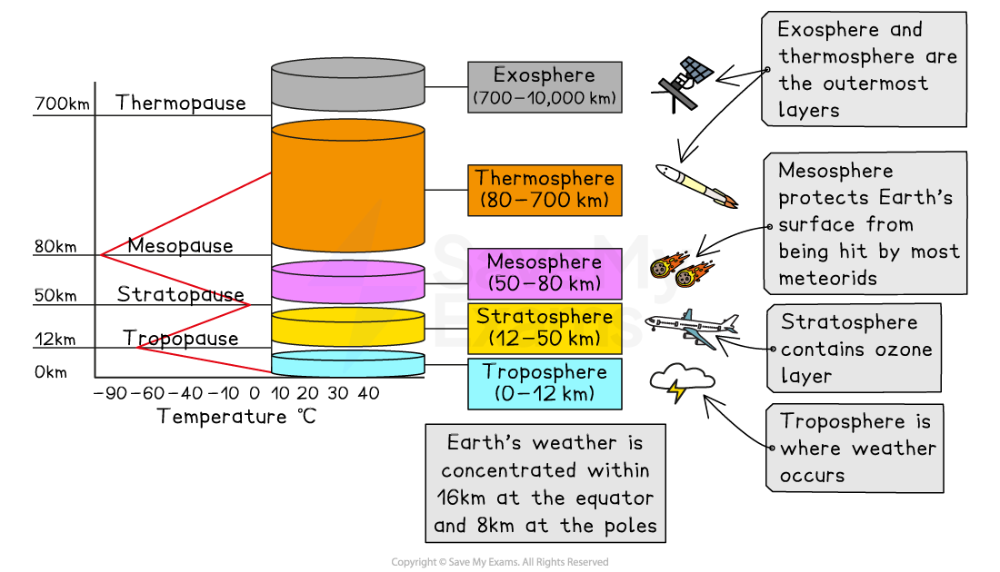

# Causes & Impacts of Ozone Depletion

## What causes ozone depletion?

> **Spec point** — `spcpt_BHBGrGqz9nWsWnR3`

## What causes ozone depletion?

- The [stratosphere](https://www.savemyexams.com/igcse/environmental-management/cie/25/revision-notes/the-atmosphere-and-human-activities/the-atmosphere/structure-and-composition-of-the-atmosphere/#:~:text=layer%20of%20atmosphere-,Atmospheric%20layers,-Troposphere) is the **second **layer of Earth's atmosphere and **extends** roughly **38 km **(24 miles) **between** the **troposphere **and the **mesosphere**
- The highest concentration of[ ozone gas](https://www.savemyexams.com/igcse/environmental-management/cie/25/revision-notes/the-atmosphere-and-human-activities/the-atmosphere/structure-and-composition-of-the-atmosphere/#:~:text=transitioning%20into%20space-,The%20ozone%20layer,-Ozone%20is%20a)** **is** **within the **first 3-20 km **of the lower stratosphere (15-30 km above the Earth's surface)
- This layer acts as a **natural 'sunscreen'** for life on Earth by absorbing the majority of the **sun's harmful ultraviolet (UV) radiation **before it reaches the planet's surface

*The stratosphere contains the ozone layer*

### Stratospheric ozone depletion

- **Ozone **can be [destroyed](https://www.savemyexams.com/igcse/environmental-management/cie/25/revision-notes/the-atmosphere-and-human-activities/the-atmosphere/structure-and-composition-of-the-atmosphere/#:~:text=Ozone%20destruction%20and%20reformation)** more quickly than **it can be [created](https://www.savemyexams.com/igcse/environmental-management/cie/25/revision-notes/the-atmosphere-and-human-activities/the-atmosphere/structure-and-composition-of-the-atmosphere/#:~:text=Ozone%20destruction%20and%20reformation)
- Some substances break down ozone even more than natural levels

  - These chemicals, known as **ozone-depleting substances (ODSs)**, lower the amount of ozone in the stratosphere
  - The main ODS gases are **hydrogen** and **nitrogen oxides** and those containing **chlorine**
  
    - One chlorine atom can destroy over 100,000 ozone molecules before it is removed from the stratosphere

### Human-produced ODSs

- **Human-produced** ODSs include

  - **Aerosols **containing chlorofluorocarbons (CFCs), such as sprays, foams, plastic manufacturing, deodorants and more
  
    - When released into the atmosphere during spraying, these substances can eventually reach the stratosphere and contribute to ozone depletion
  - **Refrigerants **in cooling systems, such as air conditioners and refrigerators, can leak and reach the stratosphere to contribute to ozone depletion
- Even though ODSs are produced and emitted at the Earth's surface, it can take from two to five years for the substances to reach and affect the stratosphere

### Natural ODSs

- Natural processes, such as **large volcanic eruptions**, have an indirect effect on ozone levels

  - Mt. Pinatubo's 1991 eruption produced large amounts of ***aerosols ***(small particles) that increased chlorine's effectiveness at destroying ozone, although the effect was short-lived
- **Polar stratospheric clouds (PSCs)** form during the long, cold **Antarctic winter**

  - These clouds consist of tiny ice crystals in the stratosphere
  - **Chlorine **compounds, mainly man-made CFCs, are **trapped** within the ice crystals, forming **chlorine reservoirs**
  - During the **Antarctic spring**, the returning **sunlight **melts the ice crystals, **releasing and reactivating **the chlorine atoms
  - This causes rapid stratospheric ozone depletion and the formation of the **'ozone hole'** over Antarctica
- **Not all** chlorine sources cause ozone layer depletion

  - Chlorine from pools, factories, sea salt, and volcanoes does not reach the stratosphere
- Because ODSs are stable and do not dissolve in rain, there are** no natural processes** that **remove **them from the lower atmosphere

> **Exam Hint**
> Do not confuse global warming with ozone depletion.
> 
> Know the differences in causes and effects.
> 
> Ozone depletion is the thinning of the ozone layer and global warming is the raising of atmospheric temperatures.
> 
> Although the ozone layer is thinner, it **does not allow** increased levels of **heat **into the atmosphere, **only ultraviolet light**.

## Impacts of ozone depletion

> **Spec point** — `spcpt_br5d9BhZ8tSYr5nC`

## Impacts of ozone depletion

- Ozone depletion refers to the gradual **thinning** of the ozone layer in the Earth's stratosphere
- Stratospheric ozone depletion leads to** increased levels of harmful ultraviolet (UV) radiation reaching the Earth's surface**
- This negatively impacts human health, including

  - **Higher UV-B radiation exposure** significantly increases the risk of **skin cancer**, particularly melanoma, the most dangerous form
  - Increased UV radiation can lead to the development of **cataracts**, clouding of the lens in the eye
  - Excessive UV exposure can **weaken the immune system**, making individuals more susceptible to infections
  - Chronic exposure to UV radiation accelerates the **ageing process** of the skin, causing the breakdown of collagen and elastin fibres, leading to wrinkles, sagging skin and the development of age spots
  - **Sunburn** occurs when the skin is exposed to excessive UV rays that trigger an inflammatory response as a defence mechanism, indicating **damage to the skin cells**
- **Ecosystems **are damaged, affecting productivity

  - UV radiation can harm **phytoplankton**, the base of the marine food chain, impacting aquatic ecosystems
  - High UV levels can damage **plant tissues**, affecting crop yields and plant productivity
  - Disruptions in ecosystems due to UV damage can affect various species and **alter food webs**
- **Clothing **and **construction materials **exposed to UV rays are damaged and degraded

  - Fabrics, plastics, paints and building materials become brittle, faded or weakened, reducing their durability and lifespan
  - This reduces the material's structure and function and also its visual appeal

> **Exam Hint**
> Don't confuse ozone depletion with the ozone hole.
> 
> **Ozone depletion** affects the **entire **Earth's stratosphere.
> 
> The **ozone hole** is an **area** of very **low **stratospheric **ozone**.
> 
> The hole is primarily over Antarctica in spring but can extend to South America and the Falkland Islands. The size and location of the ozone hole change depending on seasonal conditions.
