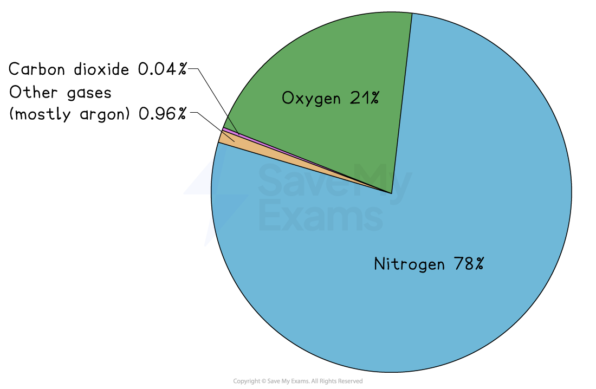
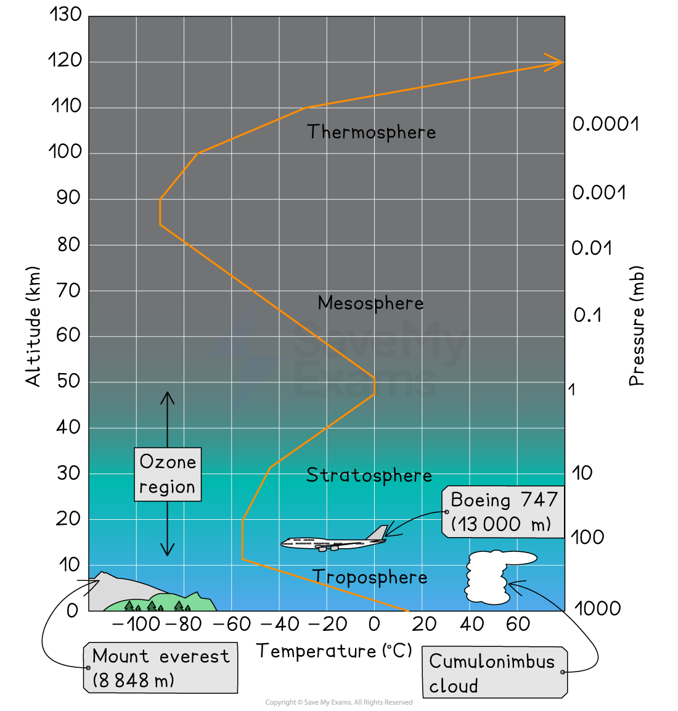

# Structure & Composition of the Atmosphere

## Composition of the atmosphere

> **Spec point** — `spcpt_YXFYhKhqR52PZhTT`

## Composition of the atmosphere

- 50% of the atmosphere is held within 5.6 km of the Earth's surface due to gravitational force and compression
- The composition of clean air in the atmosphere is:

  - **Nitrogen** (about 78%)
  - **Oxygen** (about 21%)
  
    - These two gases make up the majority of the atmosphere and play vital roles in supporting life on Earth
- The atmosphere also contains smaller amounts of other gases, including **carbon dioxide**, **argon**, **water vapour**, and trace gases

  - Carbon dioxide is present in small amounts (about 0.04%)
  - Argon is an inert gas that makes up 0.96% of the atmosphere
  - **Water vapour** content varies depending on temperature and pressure and can exceed 4% in the tropical rainforests and be below 0.2% at the poles
  
    - Water vapour is essential to Earth's weather, cloud formation, rain, and photosynthesis
    - Air that has no water vapour is classified as **dry, clean air**
  - Trace gases, like **methane, ozone, and nitrous oxide**, are even less common but have significant impacts on the weather and the chemistry of the atmosphere

*The gaseous composition of the Earth's atmosphere*

- The atmosphere also contains* aerosols* and fine particles such as dust, salt, sand and volcanic ash

| Component | Percentage % | Importance |
|---|---|---|
| Nitrogen (N₂) | 78 | Needed for plant growth |
| Oxygen (O₂) | 21 | It is essential for respiration and is produced by photosynthesis. |
| Water vapour (H₂O) | 0.2-4.0 | Essential for precipitation |
| Carbon dioxide (CO₂) | 0.04 | It is the most abundant natural greenhouse gas and maintains Earth's temperature. It is essential for photosynthesis and is produced by respiration. |
| Ozone (O₃) | 0.00006 | Absorbs ultraviolet radiation. |
| Argon  Helium (He), Krypton (Kr), Neon (Ne) | 0.96  Trace levels | These help to create an inert atmosphere to prevent oxygen and other gases from reacting to materials |
| Pollutants – sulphur dioxide (SO₂), nitrogen dioxide (NO₂), methane (CH₄) | Trace levels | It causes acid rain and the enhanced greenhouse effect. |

- The nitrogen and carbon cycle maintain the natural balance of gases in the atmosphere
- Human activities add and remove gases in the atmosphere, which upset the natural balance

## Structure of the atmosphere

> **Spec point** — `spcpt_xzX8c22Rcnwr8ySY`

## Structure of the atmosphere

- Air pressure decreases with height in the atmosphere

  - Air pressure measures how much air there is above the Earth's surface
  
    - Low pressure means less air above
    - High pressures means more air above
- The atmosphere is ***stratified*** into **four different layers** because of **temperature** changes

  - The key layers for living systems are the **troposphere** and the **stratosphere**

*Approximate atmospheric temperatures and pressures up to an altitude of about 120 km—note that the temperature changes with each layer of atmosphere*

### Atmospheric layers

#### Troposphere

- The** lowest layer**, extending up to about **10 km** from the Earth's surface
- It is where **weather phenomena**, such as cloud formation, precipitation, and the mixing of gases, mainly occur
- The troposphere contains the highest concentration of water vapour, carbon dioxide, and other trace gases that are important for the functioning of living systems and the **regulation of climate**
- The air in the troposphere is heated from the ground by longwave radiation so it is warmest near the Earth’s surface and cools with increasing altitude

  - Temperature falls about 6 °C for every 1000 meters of altitude
- Air pressure begins to drop but wind speeds increase with height
- The upper limit of Earth's weather and climate is at the **tropopause,** where temperatures remain fairly constant
- In the troposphere, chemical reactions involving pollutants, greenhouse gases and particles impact **air quality **and **climate**

#### Stratosphere

- Located **above** the troposphere, extending from about **10 to 50 km** above the Earth's surface
- Pressure continues to fall, but temperature increases with height, called a *temperature inversion* caused by the presence of ozone
- Contains the **ozone layer**, which **absorbs** and **blocks** most of the Sun's harmful **ultraviolet (UV) radiation**
- The upper boundary is called the **stratopause**, where temperatures remain constant

#### Mesosphere

- The mesosphere is the zone in which most meteors burn up as a result of colliding with gas molecules

  - Pressure continues to decrease
  - Temperatures rapidly fall to below -80 °C due to a lack of water vapour, dust or ozone to absorb incoming short-wave radiation
  - Winds reach speeds of up to 3,000 km/hr
  - The **mesopause **is the upper boundary

#### Thermosphere

- This layer is around 80-1000 km in height
- **Temperature increases with altitude (up to 1500°C)**

  - This is due to solar radiation
- The ***auroras*** occur here
- The **thermopause **marks the boundary

- The **exosphere** is the very outermost part of Earth’s atmosphere

  - The density of atmospheric gas particles is extremely low, gradually transitioning into space

## The ozone layer

> **Spec point** — `spcpt_vnsJzV9bXYgKFzzH`

## The ozone layer

- Ozone is a molecule composed of three oxygen atoms (**O₃**)
- Ozone is made naturally in the [stratosphere](https://www.savemyexams.com/igcse/environmental-management/cie/25/revision-notes/the-atmosphere-and-human-activities/the-atmosphere/structure-and-composition-of-the-atmosphere/#:~:text=quality%20and%20climate-,Stratosphere,-Located%20above%20the), because this area has high levels of solar radiation
- Ozone plays a crucial role in protecting life on Earth by absorbing a significant portion of the Sun's **harmful UV radiation**

### Dangers of UV radiation

- Exposure to high levels of UV radiation can be dangerous for life in the following ways:

  - Photosynthetic organisms, like phytoplankton, are damaged by too much UV radiation because it breaks down DNA and slows photosynthesis
  
    - This can lead to a **decrease in primary production**, particularly in aquatic ecosystems
  - High levels of UV radiation can  lead to various health issues in **humans** and **animals** by damaging cells and tissues – these issues can include:
  
    - Cataracts
    - Skin cancer
    - Sunburn
    - Premature skin ageing
    - Damage to immune systems
