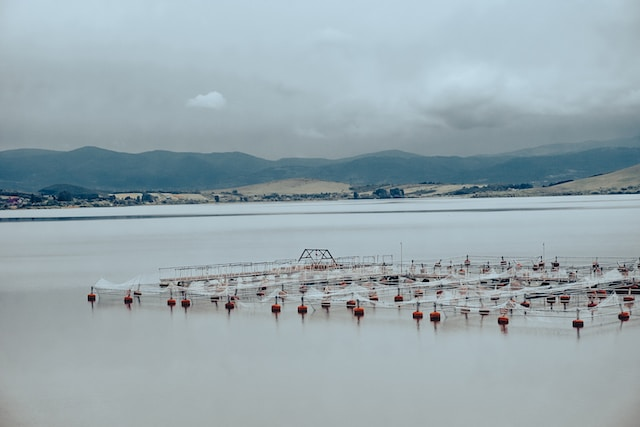
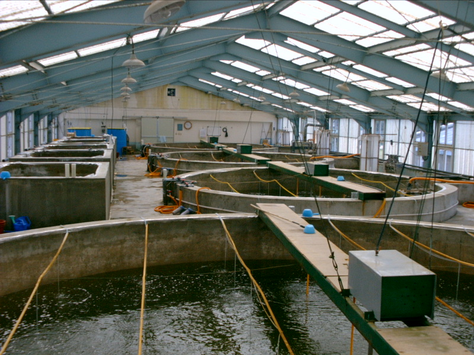
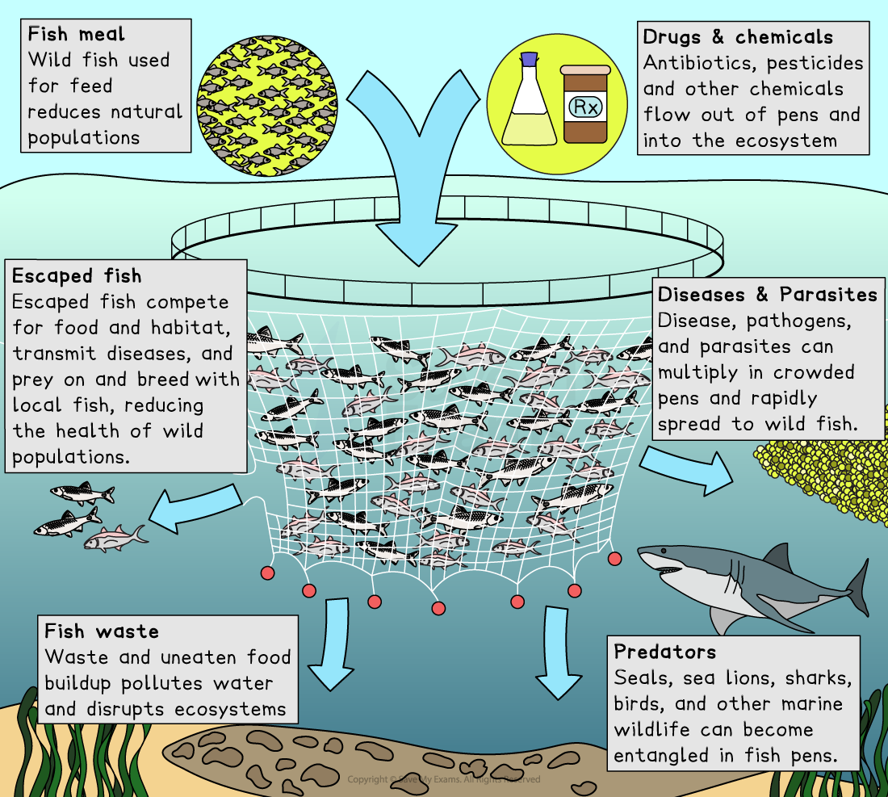

# Farming of Marine Species

## What is marine aquaculture?

> **Spec point** — `spcpt_mfmY5nxkPVcXs2qJ`

## What is marine aquaculture?

- **Marine aquaculture** is the **farming of marine species in captivity**
- Organisms are raised in **controlled conditions** rather than being caught in the wild
- Marine aquaculture is used to:

  - increase food supply
  - reduce pressure on wild fish stocks
  - support coastal economies

### Fish

- Many marine farms raise **fish** in cages or tanks in the sea
- Fish are fed and monitored to help them grow quickly and safely
- Farming fish reduces the need to catch wild populations
- This helps protect natural fish stocks from overfishing

*Fish farming is one example of aquaculture (Photo by Lucut Razvan on Unsplash)*

### Crustaceans

- **Crustaceans** such as prawns, shrimp or crabs can be farmed in ponds or coastal enclosures
- Farmers manage water quality, feeding and breeding
- Farming crustaceans provides a reliable supply for the seafood market
- This helps meet demand without relying only on wild harvesting

*A shrimp hatchery attempts to provide a sustainable source of seafood (Image from the NOAA: [1], Public domain, via Wikimedia Commons)*

### Seaweeds

- **Seaweeds** can be grown on ropes or frames placed in the sea
- They absorb nutrients from the water and grow without needing feed
- Seaweed farming is low-impact and supports food, fertiliser and cosmetic industries
- Seaweeds also remove excess nutrients from coastal waters

> **Exam Hint**
> Students often forget that marine aquaculture includes **plants **as well as **animals**. You are expected to know about fish, crustaceans and seaweed.

## Impacts of marine aquaculture

> **Spec point** — `spcpt_dGrqc24YGJFVMvFP`

## Impacts of marine aquaculture

- Marine aquaculture increases food production but also creates **environmental and ecological impacts**

  - Some impacts are beneficial, while others can affect wild ecosystems if farming is not well managed

### Reduced exploitation of natural fisheries

- Farmed fish provide an **alternative source of seafood**
- This reduces pressure on wild fish stocks
- Lower fishing pressure helps wild populations to recover
- Sustainable aquaculture can protect oceans from overfishing

### Increased food supply for humans

- Marine aquaculture produces large quantities of **fish, crustaceans and seaweed**
- This helps meet the growing global demand for protein
- Farming provides a **steady and predictable supply**

  - This helps to make seafood more affordable and widely available

### Risk of escape

- Farmed species may **escape from cages or tanks**
- Escaped fish can **compete **with wild fish for food and habitat
- Some escaped species may **interbreed **with wild populations
- This can **reduce genetic diversity **and **weaken **wild fish resilience (e.g. make them more vulnerable to diseases)
- Non-native species may become **invasive**

  - They can disrupt local ecosystems

### Risk of disease

- Fish are often kept at **high densities**
- This makes it easier for **diseases **and **parasites **to **spread**
- Diseases from farms can reach wild fish if water flows between enclosures and the open seas

  - This can harm wild populations or reduce reproduction
- Farmers may use antibiotics or chemicals to control disease

  - Overuse can lead to pollution of surrounding waters or antibiotic resistance in the farmed fish

### Local food webs

- Aquaculture can alter **predator–prey relationships** in coastal areas

  - For example, escaped fish may become new predators or new prey
- Wildlife may be attracted to fish cages, looking for food

  - This can increase human-animal conflict with predators such as birds or seals

### Nutrient enrichment from waste

- Uneaten feed and fish waste fall into the water beneath farms
- This increases levels of **nitrates and phosphates**
- This can lead to **eutrophication**, causing rapid algae growth

  - Decomposers break down the dead algae which uses up oxygen, harming wild fish and marine life
- Sediment build-up beneath cages can smother seabed habitats

  - This reduces the biodiversity of seabed communities

### Energy usage

- Aquaculture systems require **electricity** for pumps, aeration, feeding systems and transport
- Energy use** increases carbon emissions** if electricity is from fossil fuels
- Offshore farms may require **boats **and **machinery**

  - This adds to the overall environmental impact of fish farms

### Source of food for farmed species

- Many farmed species (e.g. carnivorous fish) require feed made from **wild-caught fish**

  - This can increase fishing pressure on smaller forage fish
  - Producing this feed is energy-intensive and resource-heavy
  - This can counteract some of the environmental benefits of aquaculture

- Researchers are developing plant-based or alternative feeds

  - These could lower the need for wild fish in aquaculture diets

*Environmental impacts of open-water aquaculture*

> **Exam Hint**
> When describing negative impacts, avoid vague phrases like 'it harms the environment'. Instead, give a clear mechanism, such as **'nutrient enrichment leads to eutrophication'**. Examiners look for this cause-and-effect link.
> 
> Don’t forget that aquaculture can have **positive** impacts too. Many students only list negatives, but mentioning benefits like reduced pressure on natural fisheries helps secure higher marks.
