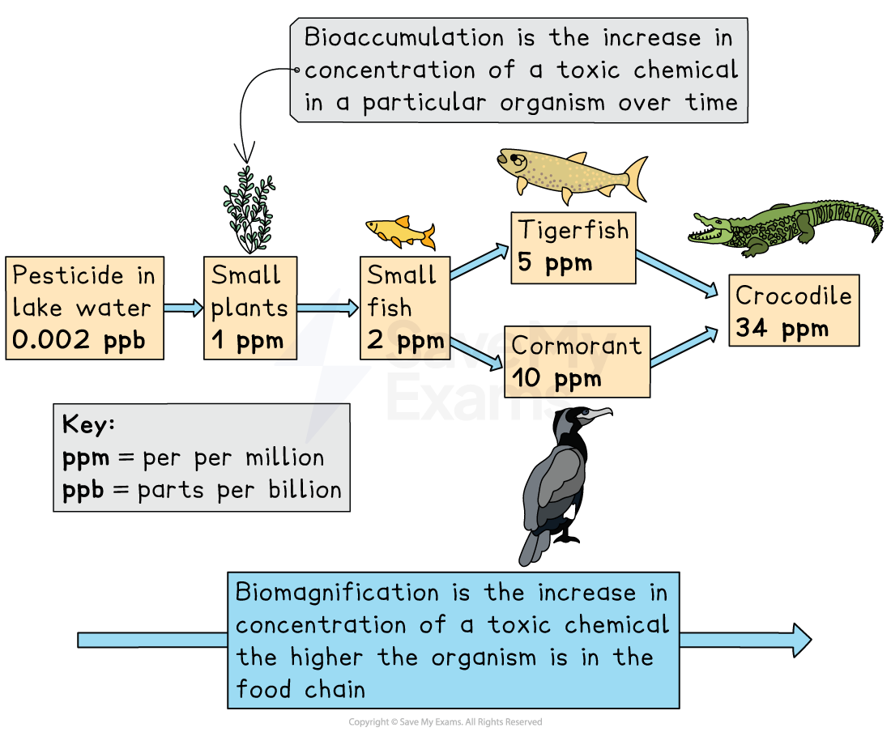

# Impacts of Plastic Pollution

## Impacts of plastic pollution

> **Spec point** — `spcpt_9Q9KxQX9ZvSSdbfN`

## Impacts of plastic pollution

- **Plastic pollution** includes the accumulation of plastic waste in oceans, seas and coastal environments
- Marine organisms can be harmed through:

  - Physical contact
  - Ingestion
  - Exposure to toxic chemicals

### Visual pollution

- Floating plastics, bottles, bags and debris create **visual pollution**
- This makes coastal areas unattractive and can make tourists less likely to visit heavily polluted areas
- Plastic waste and litter gathers on beaches

  - This reduces recreational use and may require expensive clean-up efforts

### Entanglement

- Marine animals such as turtles, seals and seabirds become **entangled** in plastic items

  - Common sources include fishing lines, nets and the plastic rings that hold four-packs and six-packs of drink
- Entanglement restricts movement

  - Eventually, animals may be unable to swim, feed or surface for air
  - Severe cases cause injury, infection or death
  - Young animals are especially vulnerable

### Risk of being mistaken for food by marine animals

- Many organisms mistake plastic for **prey**
- Floating plastics resemble jellyfish, plankton or fish eggs
- Animals ingest these plastic fragments

  - Sharp pieces can damage the digestive system
  - Plastic fills the stomach without providing energy
  - This leads to starvation, weakness or reduced growth

### Bioaccumulation and biomagnification

#### Bioaccumulation

- **Bioaccumulation**—plastic particles and the associated toxins build up in a **single organism over time**

  - This happens when animals ingest microplastics regularly
  - Chemicals absorbed onto microplastics enter organisms
  - These chemicals can affect growth, reproduction and overall health

#### Biomagnification

- **Biomagnification**—concentration of toxins from plastics increases as they move **up the food chain**

  - Predators eat many contaminated prey
  - Top predators, such as larger fish and marine mammals, accumulate the highest toxin levels
  - This leads to reproductive issues, weakened immune systems and long-term population decline

*Biomagnification and bioaccumulation in an aquatic ecosystem*
