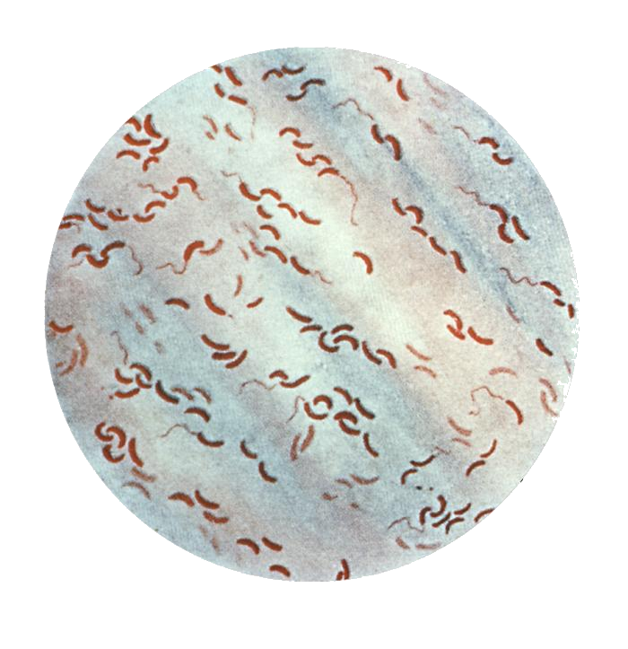
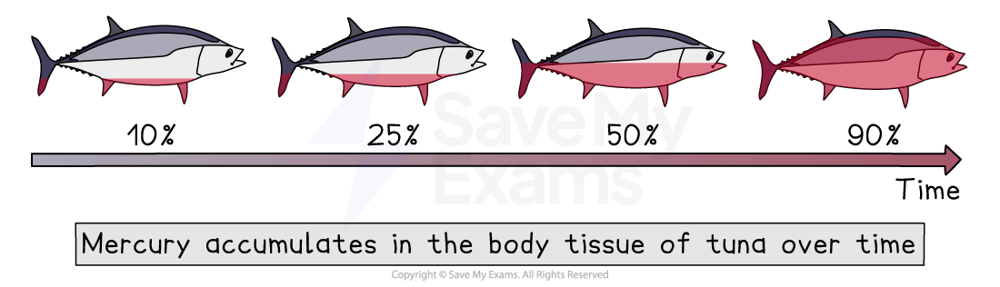
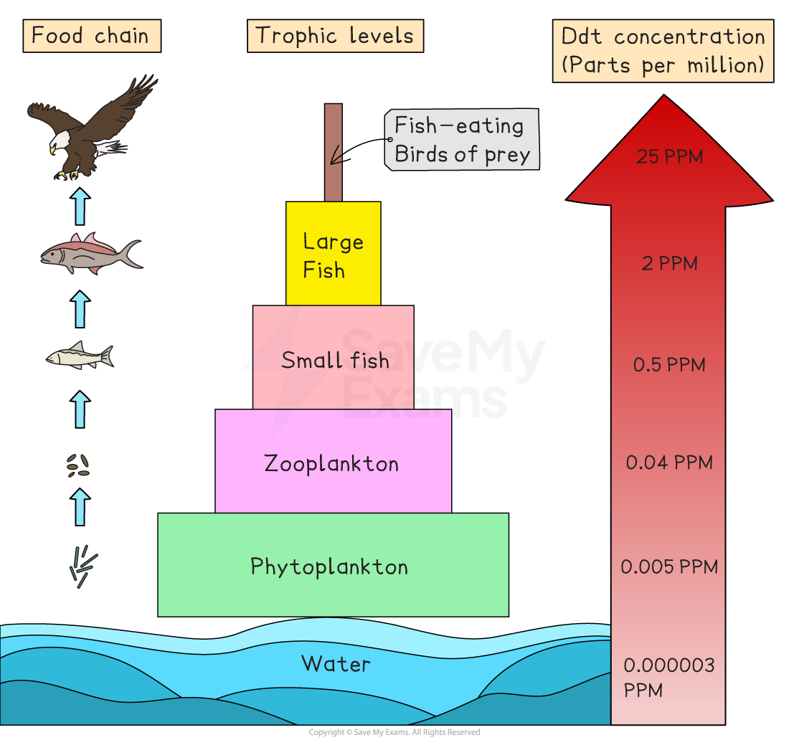
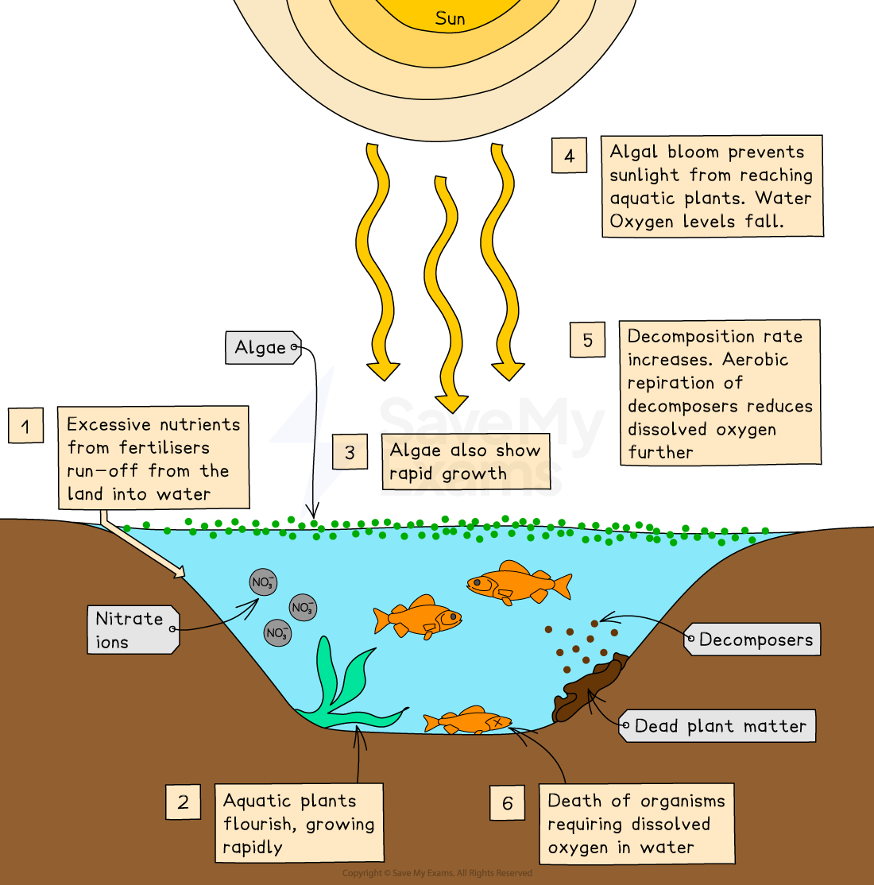

# Impacts of Water Pollution

## Water pollution & infectious diseases

> **Spec point** — `spcpt_ZytbkTSb5cWwZtRR`

## Water pollution & infectious diseases

- Water pollution harms both **people** and the **environment**

  - Pollutants can come from industry, agriculture and households
- Polluted water can lead to **infectious diseases**

### Risk of infectious bacterial diseases: cholera

- Polluted water can contain **bacteria**, including *Vibrio cholerae*, which causes cholera

  - Cholera spreads when people drink or use **untreated sewage-contaminated water**
- Causes **severe diarrhoea and dehydration**

  - Severe diarrhoea can cause the loss of **significant amounts of water and ions **from the body, causing the tissues and organs to stop working properly
  - Can lead to death if not treated quickly
- Common where sewage systems are poor or after floods that mix human waste with drinking water

*The pathogen Vibrio cholerae can cause cholera (CDC, Public domain, via Wikimedia Commons)  *

## Bioaccumulation & biomagnification of toxic substances

> **Spec point** — `spcpt_rdG5tbPP9JmmRstj`

## Bioaccumulation & biomagnification of toxic substances

### Accumulation of toxic substances from industrial processes

- Factories may release **heavy metals** (e.g. lead, mercury) or chemicals into rivers and lakes

  - These substances do not break down easily
- **Mercury** is a common example of an industrial pollutant

  - Can enter water from metal processing, mining or waste disposal
  - Causes nerve damage and serious health problems in humans and wildlife
- Toxic substances can **poison aquatic plants and animals**

  - Fish may suffer kidney damage, deformities or death
- Toxic chemicals can enter human drinking water supplies

  - This can lead to long-term health risks

### Bioaccumulation & biomagnification of toxic substances

#### Bioaccumulation

- **Bioaccumulation** is the gradual build-up of toxic substances in a **single organism over time**

  - This happens because organisms absorb toxins faster than they can remove them
  - For example:
  
    - A fish absorbs small amounts of mercury each time it feeds
    - Over months or years, mercury levels in the fish grow to dangerous amounts

*The bioaccumulation of mercury in tuna*

#### Biomagnification

- **Biomagnification** occurs when toxin concentrations increase as they pass **up the food chain**

  - Predators eat many contaminated organisms, increasing toxin levels in their bodies
- Top predators (e.g. large fish or birds of prey) have the **highest toxin levels**

  - This can cause reproductive problems, weakened shells in birds, or poisoning in mammals
- **DDT**, a pesticide, is a well-known example:

  - **DDT** was a widely used **insecticide** in the mid-20th century that was found to have harmful effects on birds of prey such as eagles and falcons
  - When DDT was sprayed on crops, it would ***leach*** into waterways and eventually enter freshwater and marine ecosystems
  - DDT would then enter food chains (via plankton) and accumulate in the bodies of fish
  - These fish would then be eaten by birds, which would accumulate **higher concentrations** of DDT
  - Because DDT is persistent and does not break down easily, it can continue to **accumulate** in the bodies of animals at **higher trophic levels** (such as birds of prey)
  - This lead to harmful effects such as thinning of eggshells and reduced reproductive success

*The process of biomagnification through the use of DDT in the environment*

> **Exam Hint**
> Students often mix up **bioaccumulation** and **biomagnification**. Remember: bioaccumulation happens in **one organism**, and biomagnification happens **up the food chain**. Please ensure you understand this distinction.

## Acid rain

> **Spec point** — `spcpt_8n6RJ29YvFgJ56zt`

## Acid rain

- Acid rain forms when gases from burning fossil fuels (e.g. sulphur dioxide, nitrogen oxides) mix with rainwater

  - Produces weak acids that fall into rivers and lakes
- Acid rain lowers the **pH** of water

  - Many fish and aquatic insects cannot survive in acidic conditions
  - Damages fish gills and kills eggs
  - This reduces populations of these organisms and can disrupt food chains
- Acid rain can also leach **toxic metals** like aluminium from the soil into rivers and lakes

  - This further harms aquatic life

*The impact of acid rain on fish*

## Leaching & nutrient enrichment

> **Spec point** — `spcpt_t7jYvcKvyh5NrBxW`

## Leaching & nutrient enrichment

### Leaching of nutrients

- Fertilisers from farms can be washed into rivers and lakes

  - Rainwater dissolves **nitrates and phosphates** and carries them away
  - These nutrients can cause **rapid plant and algae growth** in water

#### Eutrophication

- Excess nutrients lead to **algal blooms**
- Algae cover the water surface
- Algae block sunlight
- Aquatic plants below cannot photosynthesise and die
- Decomposers break down dead plants and algae
- This uses up **oxygen**, creating low-oxygen (hypoxic) water
- Fish and other animals suffocate
- This can leads to ecosystem collapse and loss of biodiversity in rivers and lakes

#### Stages of eutrophication

*The sequence of events causing eutrophication *
