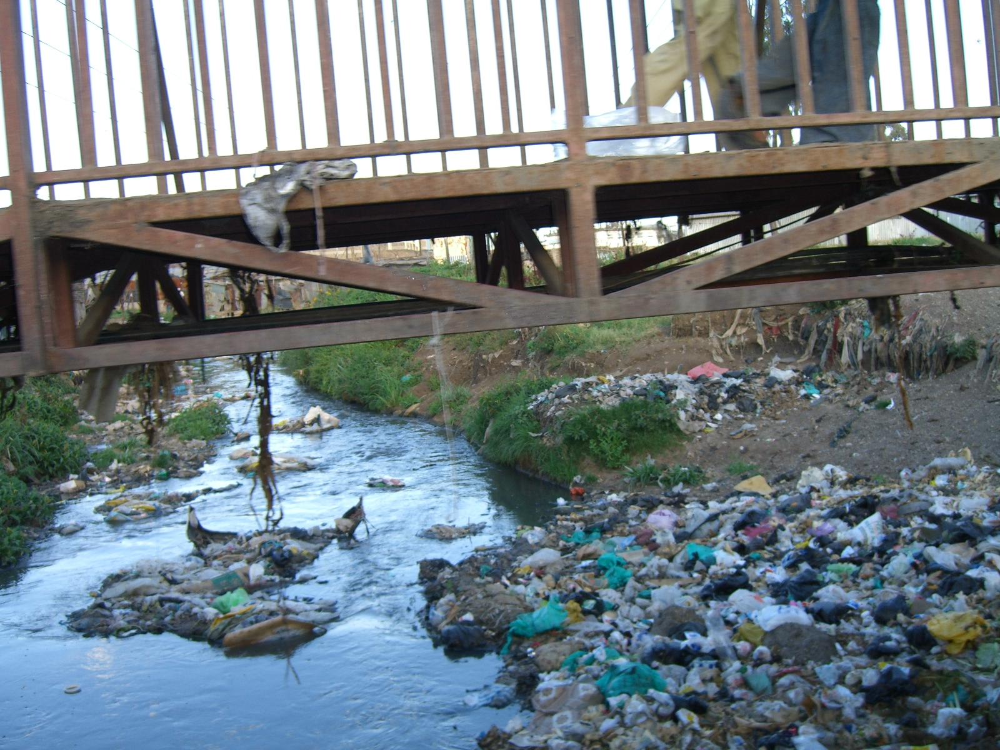

# Sources of Water Pollution

## Sources of water pollution

> **Spec point** — `spcpt_JFjvWtvNKXkFHBvw`

## Sources of water pollution

- **Water pollution** occurs when harmful substances enter rivers, lakes, groundwater or oceans
- This makes water unsafe for drinking, farming, fishing or wildlife
- Pollution can come from **homes**, **farms**, **factories** and **improper waste disposal**
- Understanding the main sources helps explain how water quality becomes degraded

### Domestic waste

- **Homes** can produce many pollutants that enter drains and rivers

#### Soaps, detergents and cleaning products

- Contain chemicals that reduce **water quality**

  - Toxic chemicals from these types of products can kill fish or contaminate drinking water

#### Cooking oils and fats

- Oils washed down sinks form greasy layers on water surfaces and can clog drainage systems

#### Household rubbish and litter

- Items like wrappers, tissues or packaging can be carried into drains

  - These can block waterways and harm aquatic wildlife

#### Medicines and personal care products

- Medicines, shampoos or cosmetics flushed down drains introduce **chemicals and hormones**

  - Some of these substances can affect fish health and reproduction

#### Paints, oils and solvents

- Improper disposal through sinks or drains introduces **toxic substances**

  - These can poison aquatic organisms and contaminate water supplies

*A polluted stream heavily littered with domestic waste*

khyk54, CC BY 2.0, via Wikimedia Commons

### Sewage

- **Sewage** contains harmful microorganisms and organic waste
- Untreated sewage entering rivers spreads **disease-causing bacteria and viruses**

  - This can lead to outbreaks of diseases such as cholera if people use the water for washing or drinking.
- Organic waste increases **biological oxygen demand (BOD)**

  - Biological oxygen demand is a measure of how much oxygen microorganisms need to break down organic waste in water
  - When lots of sewage or organic matter enter a river, bacteria use more oxygen to decompose it
  - High BOD means oxygen levels drop, leaving less oxygen for fish and other aquatic life
  - Low oxygen can cause fish to suffocate

### Plastic waste

- Plastic bags, bottles and packaging enter rivers and oceans

  - These take **hundreds of years** to break down
- Wildlife may **mistake plastic for food**

  - This can block the digestive system and cause death
- Microplastics form when plastics break into tiny pieces

  - These can be ingested by aquatic organisms and enter the food chain

### Industrial processes

- Factories may release **chemicals, heavy metals and hot water**

  - Toxic heavy metals, such as mercury or lead, can poison aquatic life
  - Warm water from industrial cooling systems causes **thermal pollution**
  - Warmer water holds less oxygen, stressing fish

- Industrial spills or leaks can contaminate large areas quickly

### Agricultural practices

- **Fertiliser run-off** contains nitrates and phosphates

  - This causes algae growth and can lead to *eutrophication*
- **Pesticides** wash off fields and contaminate water

  - This can poison aquatic insects, fish and other wildlife
- **Animal waste** from farms can wash into rivers

  - Increases bacteria levels and reduces water quality

> **Exam Hint**
> Students sometimes mix up domestic waste and sewage. Remember: **domestic waste** includes everyday household rubbish and wastewater (containing soaps, oils, detergents, etc.), while sewage specifically contains **human waste** and harmful **pathogens** from toilets and drains.
