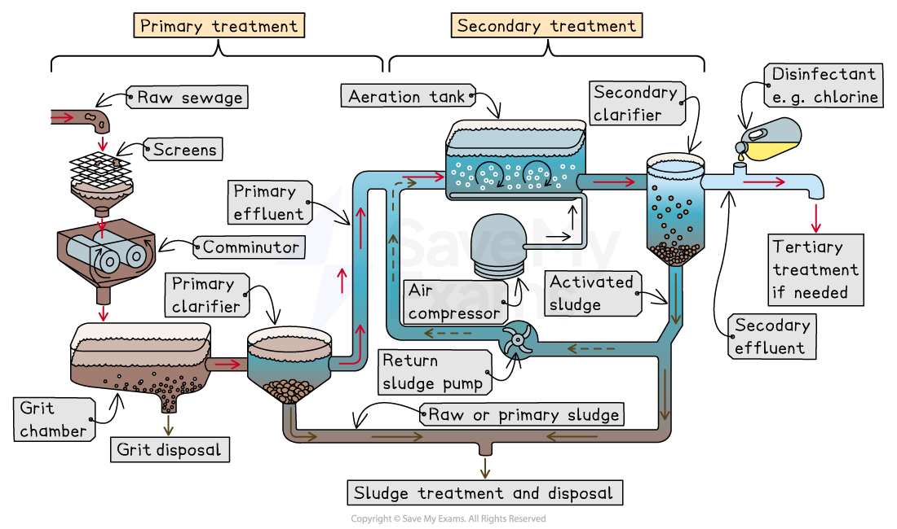

# Strategies to Improve Water Quality

## Improved sanitation

> **Spec point** — `spcpt_h9GYRhwFchrZ7Jqg`

## Improved sanitation

- Water quality improves when **pollutants are reduced** before they enter rivers, lakes or groundwater

  - Key strategies include **better sanitation**, **effective sewage treatment** and strong **pollution control laws**
  - These strategies protect both **human health** and **aquatic ecosystems**

- **Improved sanitation** includes the use of facilities that **separate human waste from human contact**

  - Reduces the spread of pathogens into water sources
- **Flush toilets** are connected to safe sewage systems

  - They move waste away from homes and reduce contamination of wells and streams
- ***Pit latrines*** with sealed pits

  - Prevent human waste leaking into surface water
  - Suitable where no sewer network exists
- **Composting toilets**

  - Use dry material to break down waste safely, producing compost
  - Reduce water use and contamination risk
- Good sanitation:

  - Prevents diseases such as **cholera**, dysentery and diarrhoea
  - Keeps drinking water supplies safer for communities

## Treatment of sewage

> **Spec point** — `spcpt_qWVq34BCP8bCx4gH`

## Treatment of sewage

- Sewage treatment is the process of **removing harmful substances from wastewater** so it can be:

  - Safely returned to the environment
  - Used for domestic purposes (e.g. for toilets, showers, drinking water)
- It prevents pollution, protects public health, and helps conserve water by recycling treated water

### The three stages of sewage treatment

#### Primary treatment

- **Purpose**: Removes large solid materials (e.g. debris) and some suspended solids
- **Process**:

  - **Screening**: Large objects like sticks, rubbish, and plastic are filtered out using screens (usually made from metal bars)
  - **Comminution**: Any remaining large solids are ground up by a device called a comminutor to prevent pipe blockages
  - **Grit removal**: Sand and gravel settle to the bottom of the grit chamber
  - **Sedimentation**: Wastewater flows into sedimentation tanks (also known as primary clarifiers), where smaller suspended solid particles settle at the bottom as **sludge**
  - **Skimming**: Floating materials like grease and oil are skimmed from the surface
- **Result**: Water is partially cleaned but still contains dissolved and smaller particles

#### Secondary treatment

- **Purpose**: Breaks down organic matter using biological processes
- **Process**:

  - **Aeration**: Oxygen is pumped into the wastewater to encourage bacteria to break down organic pollutants (e.g. human waste, food)
  - **Biological degradation**: Microorganisms (mainly bacteria) consume the organic waste, converting it into harmless by-products like carbon dioxide, water, and 'activated sludge'
  
    - Activated sludge contains aerobic bacteria that decompose organic matter
  - **Clarification**: Water is again left to settle (in a secondary clarifier) so that any remaining sludge can be removed
  
    - A portion of this sludge is reused as activated sludge in the aeration tank to continue the process of organic matter decomposition
- **Result**: Water is significantly cleaner but may still contain some nutrients (e.g. nitrates, phosphates) and pathogens

#### Tertiary treatment

- **Purpose**: Removes remaining nutrients, chemicals, and pathogens for maximum water quality
- **Process**:

  - **Chemical treatment**: Chlorine or ultraviolet light (UV) is used to disinfect the water and kill pathogens
  - **Nutrient removal**: Processes like chemical precipitation are used to remove excess nitrogen and phosphorus, which can cause eutrophication if released into water bodies
  - **Filtration**: Water may be filtered through sand, ***activated carbon***, or other materials to remove any final impurities
- **Result**: Effluent (treated water) is now clean enough to be safely discharged into rivers and lakes or reused

*Primary and secondary water treatment stages*

## Pollution control & legislation

> **Spec point** — `spcpt_9S8S7qDn6SqwB2Th`

## Pollution control & legislation

- Governments introduce rules to **reduce pollutants** entering air and water

#### Reducing acid rain pollutants

- Cutting emissions of **sulphur dioxide** and **nitrogen oxides** reduces acid rain

  - Achieved by reducing fossil fuel use in electricity generation and transport
- Using **low-sulphur fossil fuels**

  - Produces less sulphur dioxide during combustion
- *Clean Air Acts* encourage industries and power stations to adopt these practices

#### Monitoring and enforcing pollution limits

- Legislation may require companies to **measure pollution levels** from factories or wastewater discharge

  - Keeps pollution **within safe limits**
- There may be fines or legal penalties for exceeding limits

  - This encourages companies to reduce emissions or improve waste treatment
- In extreme cases, companies can be **prosecuted or forced to shut down**

#### Incentives for reducing pollution

- Governments may offer **grants or tax relief** for organisations that successfully reduce pollution

  - This encourages investment in cleaner technology
  - Supports industries transitioning to **sustainable practices**
