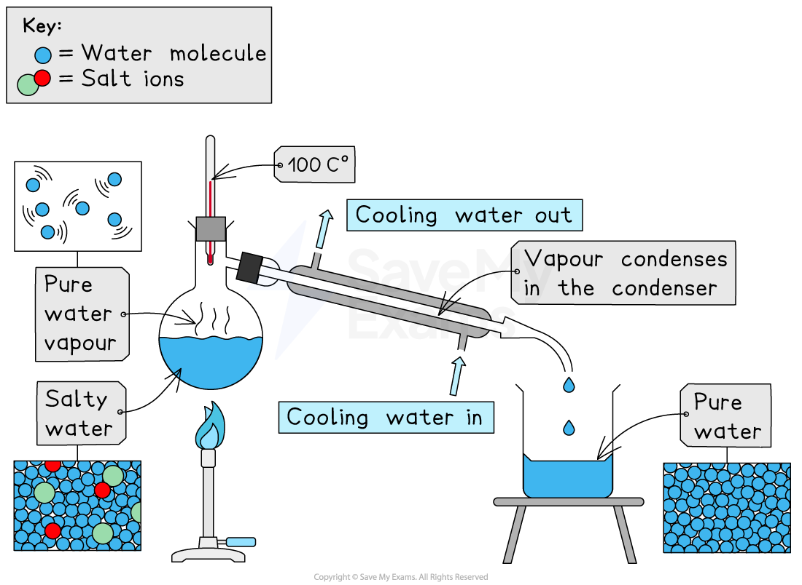
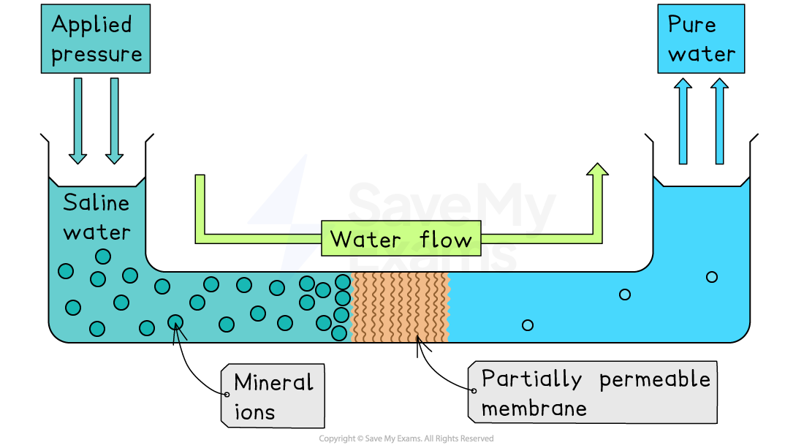
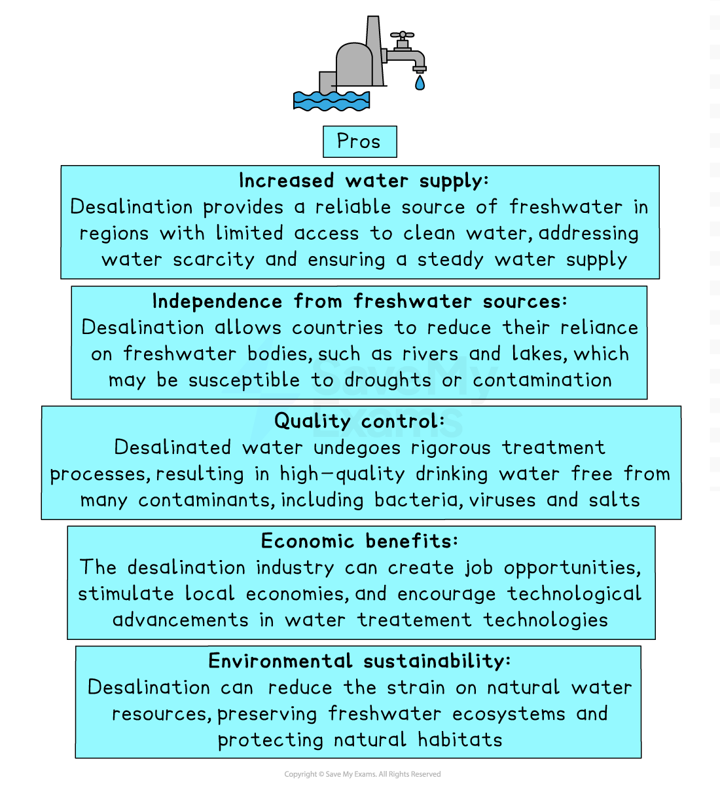
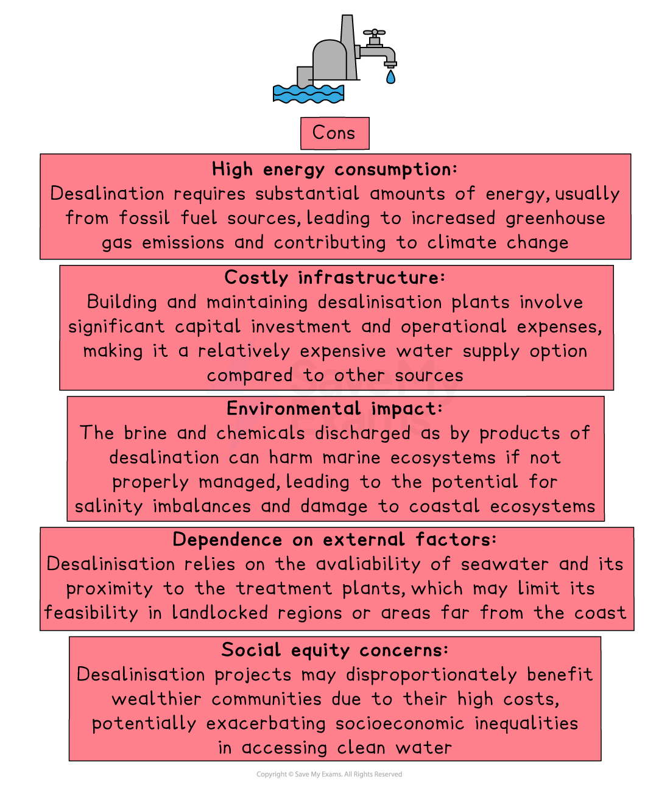

# Desalination

## Desalination: distillation

> **Spec point** — `spcpt_XzhqtHYqDyrGzgrp`

## Desalination: distillation

- **Desalination** is the process of removing **salt** from seawater to produce **potable (safe-to-drink) water**
- Two main methods are used:

  - **Distillation**
  - **Reverse osmosis**

- **Distillation** involves heating seawater until it **boils**

  - Salt and impurities **do not evaporate** and remain in the liquid
  - The water turns into **steam**, which is pure water vapour
  - Steam rises and leaves the salty water behind
  - The steam is then **cooled and condensed**
  - Turns back into **liquid fresh water**
- Produces **potable water**, safe for drinking

*Salt and water can be separated by distillation*

## Desalination: reverse osmosis

> **Spec point** — `spcpt_DZTjN9YRqzJspn9K`

## Desalination: reverse osmosis

- **Reverse osmosis** involves forcing seawater through a **partially permeable membrane** using high pressure

  - The membrane allows **small water molecules** to pass through
  - It blocks **salt ions** and most other dissolved substances
- Produces fresh water on one side of the membrane
- Leftover salty water (**brine**) must be safely disposed of

*Only water molecules can get through the partially-permeable membrane *

## Benefits & limitations of desalination

> **Spec point** — `spcpt_hxbtV5RjhRMB8GQv`

## Benefits & limitations of desalination

### Benefits of desalination

- Provides a **reliable source** of drinking water in dry or water-poor regions

  - Useful where rainfall is low or rivers and lakes are limited
- Not affected by **drought**, because the ocean is a constant supply
- Can supply **large populations**, including major cities
- Helps countries reduce dependence on **imported water** or overused rivers

*The advantages of desalination*

### Limitations of desalination

- Requires **large amounts of energy**, making it expensive to run

  - Especially for distillation, which involves heating water
- Produces **brine**, a very salty waste product

  - Must be disposed of carefully to avoid harming marine ecosystems
- Building and maintaining desalination plants is **costly**
- Not all countries can afford the infrastructure needed
- Reverse osmosis membranes need **regular cleaning or replacing**, increasing costs

*The disadvantages of desalination*
